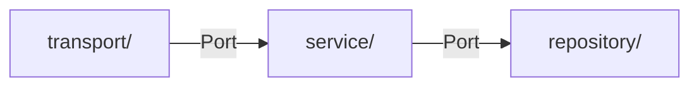

# AGENTS.md — game-backend monorepo

> Cross-tool agent instructions (Claude Code, Cursor, Codex CLI, Gemini CLI, Zed, opencode)
> Conteúdo alinhado com CLAUDE.md. Em caso de conflito, CLAUDE.md tem precedência no Claude Code.

## O que é este projeto

Monorepo de microsserviços em Go para backend de jogos multiplayer. Tese: reimplementar serviços de jogo da AWS (GameKit/GameLift) em Go sobre compute barato e comparar custo/performance (ADR-0008). O realtime de gameplay NÃO é feito em Go — roda no Unity Dedicated Server (data plane, repo separado; ADR-0010).
Cada serviço em `services/` é um binário/imagem Docker independente, mas todos compartilham o **módulo Go único** da raiz (ver ADR-0001). Dockerfile próprio e infra Terraform própria por serviço.

## Metodologia: Spec-Driven Development

**Toda implementação começa pela spec.** Não escreva código antes de ler `services/<nome>/specs/NNN-slug/spec.md` (pasta por feature, numerada por serviço).
Se a spec não existir, crie-a junto com o usuário antes de qualquer código.

## Arquitetura interna (todos os serviços)

Hexagonal Architecture — camadas com dependências unidirecionais:


Dependências sempre via interfaces declaradas em `domain/`.

- `domain/` — tipos e interfaces puras. Zero imports externos.
- `service/` — lógica de negócio. Só usa interfaces de `domain/`.
- `repository/` — acesso a dados. Implementa interfaces de `domain/`.
- `transport/` — HTTP handlers ou gRPC server. Só traduz, sem lógica.

## Regras invioláveis

1. `service/` não importa `transport/` nem `repository/` diretamente
2. Todo I/O recebe `ctx context.Context` como primeiro parâmetro
3. Erros sempre com contexto: `fmt.Errorf("camada: operação: %w", err)`
4. Goroutines sempre com context para cancelamento
5. Logging com `slog` em JSON
6. Testes: nomenclatura `TestFunc_Cenario_Resultado`, mocks com `testify/mock`

## Estrutura de arquivos

```
services/<nome>-service/
  cmd/server/main.go     ← entrypoint e wire-up
  internal/domain/       ← tipos + interfaces
  internal/service/      ← lógica de negócio
  internal/repository/   ← acesso a dados
  internal/transport/    ← HTTP/gRPC handlers
  migrations/            ← SQL migrations
  specs/                 ← specs SDD, pasta por feature (leia primeiro)
  (sem go.mod por serviço — módulo único na raiz; ver ADR-0001)
```

## Comandos de build e teste

```bash
# Todos os serviços locais
docker compose -f infra/docker/docker-compose.yml up

# Serviço específico
cd services/<nome>-service && go run ./cmd/server/

# Testes (sempre com -race)
cd services/<nome>-service && go test ./... -v -race -cover

# Lint
golangci-lint run ./...
```

## ADRs

Leia `docs/adr/ADR-GUIDE.md`. Durante a sessão, monitore decisões arquiteturais e proponha criar ADRs quando detectar escolhas entre tecnologias, padrões ou infra. Só grave o arquivo após confirmação explícita do usuário. Antes de implementar algo arquitetural, verifique `docs/adr/README.md` para consistência com decisões existentes.

## O que não fazer

- Não modifique `shared/` sem aprovação — impacta todos os serviços
- Não coloque lógica de negócio em `transport/`
- Não ignore erros (`_`)
- Não escreva código sem ler a spec primeiro
- Não faça deploy manual — use os pipelines em `.github/workflows/`
- Não crie `go.mod` por serviço — o repo é módulo único (ADR-0001)
- Não implemente gameplay realtime em Go — data plane é Unity Dedicated Server, repo separado (ADR-0010)

## Aprendizado contínuo (Go) — obrigatório ao fim de cada etapa

O usuário vem de C#/.NET e aprende Go com este projeto. Ao concluir cada feature ou fase relevante de um serviço:

1. Passe pelo `docs/GO-LEARNINGS.md` e registre conceitos/padrões de Go novos ou não-óbvios — exemplo comentado, referência ao código real (`serviço/arquivo`) e **diagrama Mermaid** quando houver fluxo/ordem/estado a visualizar.
2. Dê ao usuário um resumo didático sob a ótica de aprendizado de Go (o "porquê", não só o status), contrastando com C#/.NET quando ajudar. Nível **conceitual** (ideia e motivação de cada padrão), não walkthrough linha-a-linha.

Não invente aprendizado para preencher; se não houve nada novo, diga isso. Não pule o passo silenciosamente.

## Documentação

- Roadmap completo: `docs/ROADMAP.md`
- Guia SDD: `docs/sdd/SDD-GUIDE.md`
- Guia ADR: `docs/adr/ADR-GUIDE.md`
- Índice de ADRs: `docs/adr/README.md`
- Diagramas: sempre em **Mermaid** (não ASCII art); árvores de arquivos podem ficar em texto
