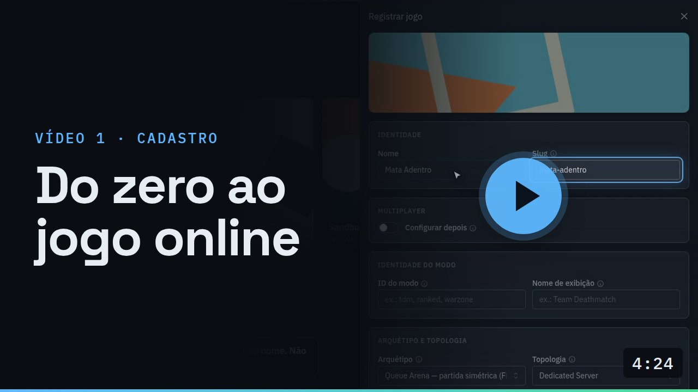
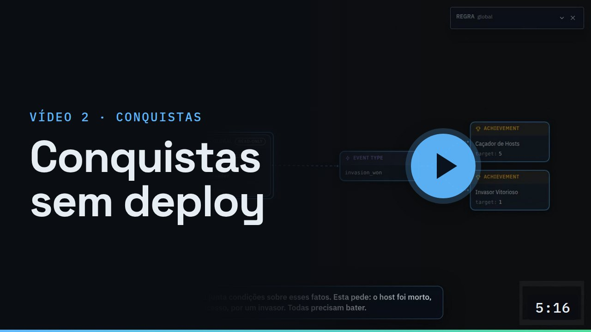
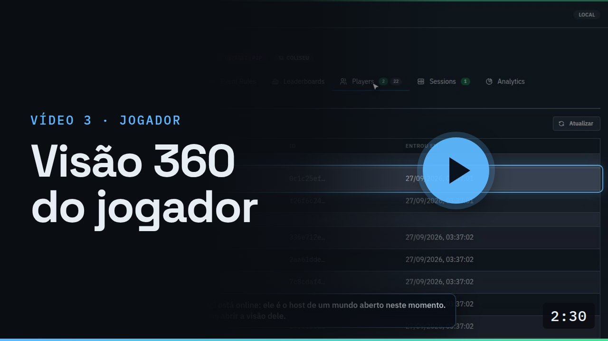

<div align="center">

# go-multiplayer-control-plane

[Português](README.md) · **English**

**A self-hosted multiplayer backend, written in Go, for games built with any engine.**<br/>
Login, matchmaking, dedicated servers on Agones or P2P over Steam, achievements without redeploys, leaderboards,
analytics and an operations console. What GameLift and PlayFab sell per player, running on your own infrastructure.

[](https://github.com/vitormartins1/go-multiplayer-control-plane/actions/workflows/ci.yml)


[](LICENSE)

[**Videos**](docs/VIDEOS.md) ·
[Getting started](#getting-started) ·
[Documentation](#documentation) ·
[Integrate a game](docs/integration/UNITY-GUIA-INTEGRACAO.md) ·
[Contributing](CONTRIBUTING.md)

</div>

https://github.com/user-attachments/assets/46f7e132-0781-479f-b8b1-ee3df2266f0f

> The videos, the console and the detailed documentation are in Brazilian Portuguese. This page is the English
> overview.

---

## What it is

A multiplayer game needs a lot more than netcode: accounts, a queue, something that starts the match server and
hands out a ticket to join it, achievements, rankings, metrics, and a screen to run all of it. The off-the-shelf
options (GameLift, PlayFab, Photon, Unity Gaming Services) charge per player and lock the game to the vendor.

This project is that backend, ready and open. It runs on anything that runs containers, **from a Raspberry Pi 5 to
EKS**, and serves several games at once: each game registers in the console, declares how it plays online, and the
backend configures itself, with no per-game code. Realtime stays in the game's engine (Unity is the reference
integration); Go handles everything around the match.

The first game in production is **Folclore Souls**, a Souls-like with host worlds, co-op and invasions.

## Features

| | |
|---|---|
| 🎮 **Any kind of game** | A game declares modes by archetype (queue arena, host world, battle royale, co-op mission), and matchmaking, sessions and achievements adapt on their own. |
| 🖥️ **Dedicated server or P2P** | One dedicated game server per match on an Agones fleet, **or** the host's game serves the world over Steam, at zero server cost. It's a single field on the mode. |
| 🎟️ **Cryptographic tickets** | Each player gets an Ed25519 connect token carrying their role, validated **offline** by the game server. |
| 🏆 **Achievements without redeploys** | Rules edited on a visual canvas, event-based or metric-based criteria, and automatic mirroring to **Steam**. |
| 📊 **Leaderboards and analytics** | Leaderboards per window (daily, weekly, monthly, all-time) and analytics per game, mode and role. |
| 💾 **Player data** | JSON player data and cloud saves, with anonymous, password, Steam or Epic login. |
| 🧭 **Operations console** | Games, live rooms, fleet, players, rules, achievements and analytics, in one place. |
| 🔭 **Observable by default** | RED metrics, OpenTelemetry tracing down to the database, and ready-made Grafana dashboards. |

## See it in action

The video at the top shows the whole product in 3 minutes. The three below are recorded from the real console
and walk through one feature at a time (Portuguese captions).

<table>
<tr>
<td width="33%" valign="top">
<a href="docs/VIDEOS.md#video-1"></a>
<br/><b>From zero to online</b><br/>
<sub>Register a game, see what the backend configured on its own, and follow the first world as it opens, gets invaded and lands in analytics. No deploy.</sub>
</td>
<td width="33%" valign="top">
<a href="docs/VIDEOS.md#video-2"></a>
<br/><b>Achievements without redeploys</b><br/>
<sub>Event-based or metric-based criteria, visual rules with comparators, global rules per archetype, and a live unlock.</sub>
</td>
<td width="33%" valign="top">
<a href="docs/VIDEOS.md#video-3"></a>
<br/><b>360° player view</b><br/>
<sub>Everything the backend knows about a player: achievements, match history, data, saves and the session they are in right now.</sub>
</td>
</tr>
</table>

## How it works

The game runs the simulation (the *data plane*), in whatever engine it uses; this repository is the *control plane*,
which handles what happens before, around and after the match. It's the same split GameLift makes.

1. The player logs in and asks to play; **matchmaking** forms the match or picks the world they join.
2. The **session** service allocates a dedicated server on Agones, or points to the host's game in P2P, and gives
   each player a signed ticket.
3. During the match, the server (or the host) reports events, results and heartbeats.
4. Each result is published once and delivered, with delivery guarantees, to **leaderboards**, **achievements**
   and **analytics**.

Services, diagrams, topologies and the reasoning behind each decision are in
[**docs/ARCHITECTURE.md**](docs/ARCHITECTURE.md) and the [architecture decision records](docs/adr/README.md).

## Getting started

**Requirements:** Docker and Go 1.26. For the demo, also `curl`, `jq` and `grpcurl`.

```bash
# 1. development keys (JWT and connect token); kept out of git
infra/docker/gen-secrets.sh

# 2. the whole stack: services, Postgres, Redis, LocalStack, Prometheus, Grafana and Tempo
docker compose -f infra/docker/docker-compose.yml up --build -d

# 3. an end-to-end match without Unity: registers the game, the host opens a world,
#    an invader joins, the server reports the win and the achievement unlocks
scripts/demo-host-world.sh
TOPOLOGY=p2p scripts/demo-host-world.sh   # the same world, hosted by the player
```

Then open the **console** at http://localhost:8089 and **Grafana** at http://localhost:3000. The other ports are
listed in [`infra/docker/README.md`](infra/docker/README.md); tests, lint and the console in development mode, in
[`CONTRIBUTING.md`](CONTRIBUTING.md).

## Project status

- **Ready:** the control plane for all four archetypes. The host world runs end to end with Folclore Souls on a
  dedicated server (k3s on a Raspberry Pi 5); P2P over Steam is done on the backend and validated by the demo,
  waiting on the Unity side. Battle royale and co-op mission are implemented but have no real game yet.
- **Game contract 1.5.0**, versioned and additive-only ([changelog](docs/contracts/CHANGELOG.md)).
- **Engines and stores** ([ADR-0033](docs/adr/0033-engine-and-store-agnostic.md)): the contract is gRPC and REST,
  and tickets are validated with a public key, so nothing depends on the engine. Unity is the reference
  integration; Godot and Unreal integrate straight through the contract, and the web (Three.js) is on the roadmap.
  On the store side, Steam is complete (login, achievements, P2P), Epic has login (EOS Connect) with achievement
  mirroring still to come; GOG, on demand.
- **Don't expose it to the internet yet:** the console has no login, and the session gRPC auth starts in
  observe-only mode (`warn`).
- **Next:** a reference AWS deployment, console login and a packaged Unity SDK ([roadmap](docs/NEXT-STEPS.md)).

## Documentation

Detailed documentation is in Portuguese.

| To… | Read |
|---|---|
| understand the product | [Product overview](docs/PRODUCT-OVERVIEW.md) · [videos](docs/VIDEOS.md) |
| understand the architecture | [Architecture](docs/ARCHITECTURE.md) · [ADRs](docs/adr/README.md) · [repository topology](docs/REPO-TOPOLOGY.md) |
| integrate a game | [Integration guide (Unity, the reference)](docs/integration/UNITY-GUIA-INTEGRACAO.md) · [per-archetype contracts](docs/game-models/README.md) · [contract changelog](docs/contracts/CHANGELOG.md) |
| operate it | [Local infra](infra/docker/README.md) · [observability](docs/OBSERVABILITY.md) · [event rules](docs/EVENT-RULES-GUIDE.md) |
| contribute | [CONTRIBUTING](CONTRIBUTING.md) · [how features are specified](docs/sdd/SDD-GUIDE.md) · [Git workflow](docs/GIT-WORKFLOW.md) |

## Contributing

Issues and PRs are welcome, in English or Portuguese. Every feature starts from a short spec with acceptance
criteria, and every architectural decision has an ADR; [`CONTRIBUTING.md`](CONTRIBUTING.md) explains the flow and
the commands. Participants follow the [code of conduct](CODE_OF_CONDUCT.md); report vulnerabilities privately, as
described in [`SECURITY.md`](SECURITY.md).

## License

[Apache License 2.0](LICENSE). You may use, modify and distribute it, including commercially, keeping the license
notice and the [`NOTICE`](NOTICE) file.
