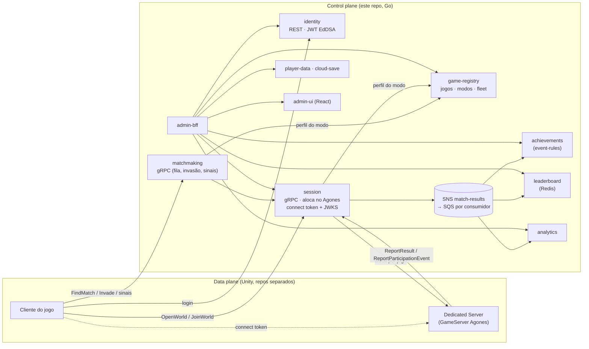

# go-multiplayer-control-plane

**Control plane de multiplayer self-hosted, em Go.** Login, cadastro de jogos e modos, matchmaking, orquestração
de servidores dedicados no **Agones**, conquistas por regras editáveis, leaderboard, analytics e um console de
operação — para jogos cujo realtime roda num **Unity Dedicated Server** (o data plane, em repos separados).

Nasceu para estudar Go reimplementando o que a AWS vende pronto (GameKit/GameLift — ADR-0008) e hoje serve um jogo
real: o **Folclore Souls**, um Souls-like em Unity que usa o arquétipo `host_world_dropin` (mundo do host, co-op
por sinais, invasões, eventos por participante).

## Arquitetura em uma figura



Detalhe e decisões: [`docs/ARCHITECTURE.md`](docs/ARCHITECTURE.md) e os [ADRs](docs/adr/README.md) (0001–0029).

## O que tem de interessante (para quem lê o código)

- **Arquitetura hexagonal idiomática** em todos os serviços (`domain` sem dependências → `service` só com
  interfaces → `repository`/`transport` nas bordas), um módulo Go único (ADR-0001).
- **Fan-out durável e idempotente**: o session publica o resultado uma vez; cada consumidor deduplica na mesma
  transação do efeito (ADR-0020). Gameplay nunca fica refém do analytics (a mutação vem antes do publish).
- **Multiplayer por arquétipo**, não por jogo: o jogo declara modos (arquétipo + parâmetros) no game-registry e
  matchmaking/sessão/conquistas se configuram sozinhos (ADR-0023/0024). Sem `if game == X`.
- **Agones de verdade**: fleet por jogo (ADR-0026), reconciliação de sessões órfãs contra o cluster (ADR-0022),
  connect token Ed25519 validado offline pelo servidor via JWKS.
- **Observável desde o primeiro serviço**: métricas RED, tracing OTel (inclusive `otelpgx`), 10 dashboards Grafana.
- **Processo documentado**: Spec-Driven Development ([guia](docs/sdd/SDD-GUIDE.md)), 29 ADRs e um diário de
  aprendizados de Go ([GO-LEARNINGS](docs/GO-LEARNINGS.md)).

## Serviços

| Serviço | Faz | Protocolo | Storage | Porta local |
|---|---|---|---|---|
| [identity](services/identity-service) | contas, login anônimo, JWT EdDSA + JWKS | REST | Postgres | 8081 |
| [game-registry](services/game-registry) | jogos, modos (perfil multiplayer), fleet, presença | REST | Postgres | 8090 |
| [matchmaking](services/matchmaking-service) | fila, invasão, quadro de sinais | gRPC (streaming) | memória | 50051 (+8086 métricas) |
| [session](services/session-service) | sessões/mundos, alocação Agones, connect token, eventos | gRPC + REST admin | memória (ativas) + Postgres (histórico) | 50052 · 8087 |
| [achievements](services/achievements-service) | catálogo + motor de regras data-driven | REST + consumer SQS | Postgres | 8082 |
| [leaderboard](services/leaderboard-service) | boards × janelas (all/daily/weekly/monthly) | REST + consumer SQS | Redis | 8085 |
| [analytics](services/analytics-service) | rollups por jogo/modo/papel | REST admin + consumer SQS | Postgres | 8091 |
| [player-data](services/player-data-service) | dados JSON por jogador | REST | Postgres | 8083 |
| [cloud-save](services/cloud-save-service) | blob de save por jogador | REST | MinIO/S3 | 8084 |
| [admin-bff](services/admin-bff) + [admin-ui](services/admin-ui) | console de operação | REST + React | — | 8088 · **8089** |

### Arquétipos

| Arquétipo | Forma | Jogo real |
|---|---|---|
| `host_world_dropin` | mundo do host; co-op/invasor entram no meio; resultado por evento | **Folclore Souls** |
| `queue_arena` | partida simétrica por fila; win/loss/draw + stats | Packet Arena (protótipo) |
| `battle_royale`, `coop_mission` | colocação ordinal / desfecho coletivo | **experimental** — contrato e código prontos, nenhum jogo real; congelados até existir um caso de verdade |

Contratos com o data plane: [`docs/game-models/`](docs/game-models/README.md).

## Rodando

Requisitos: Go 1.26 (o `go.mod` pede 1.26; com Go mais antigo use `GOTOOLCHAIN=auto`), Docker, Node 20 (só para
o admin-ui fora do compose).

```bash
# uma vez: chaves Ed25519 de dev (JWT do jogador e connect token), gitignored
infra/docker/gen-secrets.sh

# stack completa: serviços + Postgres/Redis/MinIO/LocalStack + Prometheus/Grafana/Tempo
docker compose -f infra/docker/docker-compose.yml up --build

# console:     http://localhost:8089
# Grafana:     http://localhost:3000   (pasta game-backend)
# Prometheus:  http://localhost:9090

# criar uma conta e logar (identity)
curl -s -XPOST localhost:8081/accounts  -d '{"handle":"vitor","password":"supersecret"}'
curl -s -XPOST localhost:8081/sessions  -d '{"handle":"vitor","password":"supersecret"}'

# demo do fluxo do Folclore Souls, sem Unity: jogo + modo, host abre o mundo,
# invasor invade, servidor reporta HOST_KILLED, conquista desbloqueia via fan-out
scripts/demo-host-world.sh      # precisa de curl, jq e grpcurl

# testes (unitários, com race detector)
go test ./... -race -cover
# testes de integração (testcontainers — precisa de Docker)
go test -tags=integration ./...
# lint (mesma versão do CI)
go install github.com/golangci/golangci-lint/v2/cmd/golangci-lint@v2.12.2 && golangci-lint run ./...
```

Mapa de portas e dashboards: [`infra/docker/README.md`](infra/docker/README.md). Coleções `.http` por serviço em
`services/<svc>/api/`; matchmaking e session são gRPC com reflection ligada (`grpcurl -plaintext localhost:50052 list`).

## Estado (2026-09)

- Control plane completo para os 4 arquétipos; `host_world_dropin` exercitado de ponta a ponta pelo Folclore Souls
  (k3d → Raspberry Pi 5) e `queue_arena` pelo protótipo Packet Arena.
- **Não pronto para exposição pública**: o gRPC do session ainda não autentica jogador nem game server e o console
  não tem login — ver a [revisão 2026-09](docs/review/REVISAO-2026-09.md) (riscos R1/R5, decisões D1/D6).
- Deploy em AWS e a medição de custo da tese (ADR-0008) ainda não começaram; só a mensageria tem Terraform (LocalStack).

## Documentação

| Documento | Conteúdo |
|---|---|
| [docs/review/REVISAO-2026-09.md](docs/review/REVISAO-2026-09.md) | revisão de produto e de código: estado verificado, cortes, lacunas, roadmap |
| [docs/NEXT-STEPS.md](docs/NEXT-STEPS.md) | handoff: estado atual e próximos passos |
| [docs/PRODUCT-OVERVIEW.md](docs/PRODUCT-OVERVIEW.md) | o que o sistema faz, na visão de quem opera um jogo |
| [docs/ARCHITECTURE.md](docs/ARCHITECTURE.md) | panorama técnico |
| [docs/game-models/](docs/game-models/README.md) | arquétipos, contratos com o data plane, follow-ups |
| [docs/PENDENCIAS-DO-DONO.md](docs/PENDENCIAS-DO-DONO.md) | o que depende do dono: Steam, Unity, `enforce`, decisões, validações locais |
| [docs/integration/UNITY-GUIA-INTEGRACAO.md](docs/integration/UNITY-GUIA-INTEGRACAO.md) | guia do projeto Unity: credenciais, login Steam, heartbeat, P2P (contrato 1.0.0 → 1.5.0) |
| [docs/adr/](docs/adr/README.md) · [docs/sdd/SDD-GUIDE.md](docs/sdd/SDD-GUIDE.md) · [docs/GIT-WORKFLOW.md](docs/GIT-WORKFLOW.md) | decisões · metodologia · branches e commits |
| [docs/OBSERVABILITY.md](docs/OBSERVABILITY.md) · [docs/GO-LEARNINGS.md](docs/GO-LEARNINGS.md) | observabilidade · aprendizados de Go |
