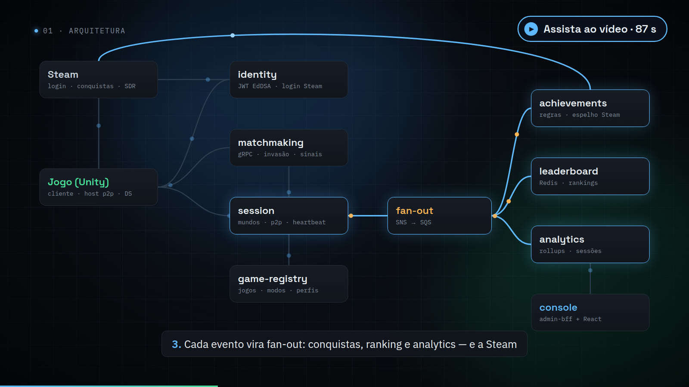
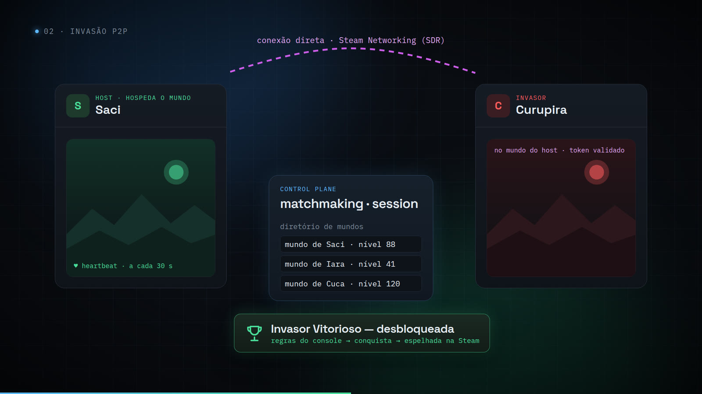
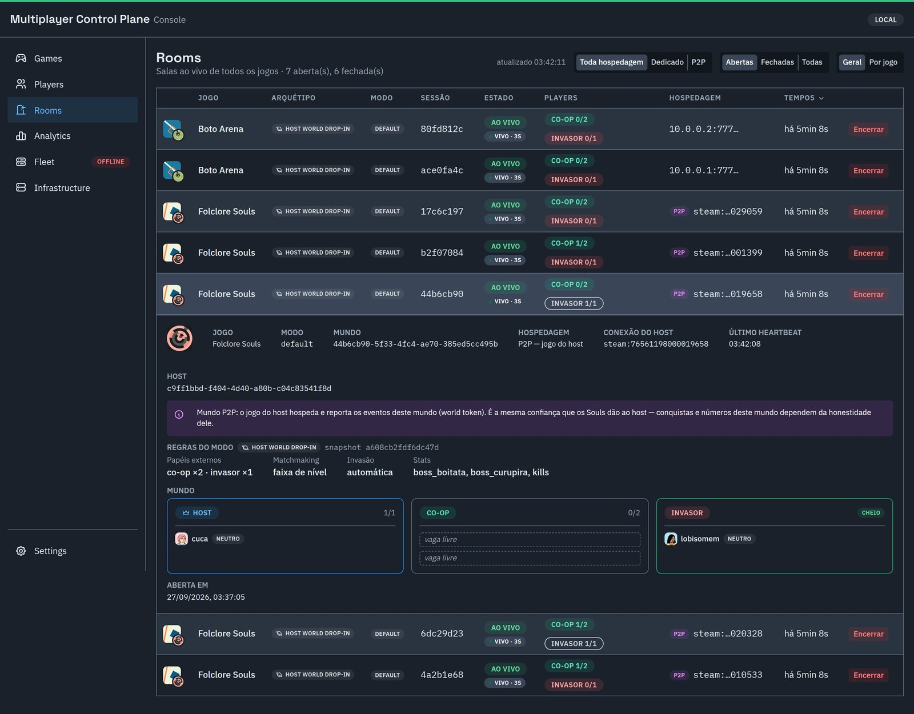
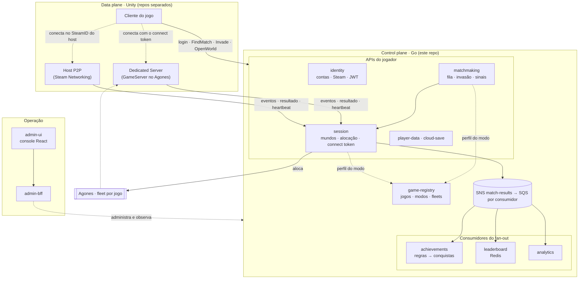
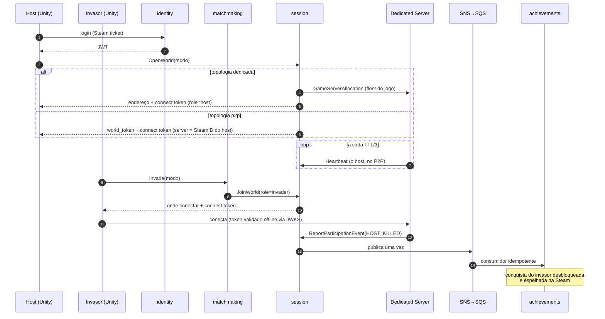

<div align="center">

# go-multiplayer-control-plane

**Backend multiplayer self-hosted, em Go, para jogos cujo realtime roda no Unity.**<br/>
Login, matchmaking, orquestração de servidores no Agones (ou P2P via Steam), conquistas por regras editáveis,
leaderboard, analytics e um console de operação: o que a AWS vende como GameKit/GameLift, sobre infra própria.

[](https://github.com/vitormartins1/go-multiplayer-control-plane/actions/workflows/ci.yml)


[**Vídeo de 90 s**](docs/media/go-multiplayer-control-plane.mp4) ·
[Arquitetura](docs/ARCHITECTURE.md) ·
[Produto](docs/PRODUCT-OVERVIEW.md) ·
[Decisões (ADRs)](docs/adr/README.md) ·
[Integração Unity](docs/integration/UNITY-GUIA-INTEGRACAO.md)

<a href="docs/media/go-multiplayer-control-plane.mp4"></a>

</div>

---

## Por que existe

Um jogo multiplayer precisa de muito mais que o netcode: contas, fila, alguém que suba o servidor da partida e
entregue um ingresso para entrar nele, conquistas, ranking, métricas, e uma tela para operar tudo isso. As opções
prontas (GameLift, PlayFab, Photon, Unity Gaming Services) cobram por jogador e prendem o jogo ao fornecedor.

Este repositório é esse backend, escrito em Go, rodando em qualquer coisa que rode containers, **de um Raspberry Pi
5 a um EKS**. Nasceu para estudar Go reimplementando o que a AWS vende pronto (ADR-0008) e hoje serve um jogo real:
o **Folclore Souls**, um Souls-like em Unity com mundo do host, co-op por sinais e invasões.

## O que ele faz

| | |
|---|---|
| 🎮 **Multiplayer por arquétipo** | O jogo declara modos (arquétipo + parâmetros) e matchmaking, sessão e conquistas se configuram sozinhos. Nenhum `if game == X`. |
| 🖥️ **Servidor dedicado ou P2P** | Aloca um Unity Dedicated Server por mundo numa fleet Agones do jogo, **ou** deixa o host hospedar via Steam (P2P), sem mudar o resto. |
| 🎟️ **Ingresso criptográfico** | Connect token Ed25519 com o papel do jogador, validado **offline** pelo servidor via JWKS. |
| 💓 **Mundo vivo** | Heartbeat do host: mundo caído fecha em ~90 s como `abandoned`; mundo ativo não expira. |
| 🏆 **Conquistas sem deploy** | Motor de regras data-driven editado num canvas visual; espelha conquistas na **Steam**. |
| 📨 **Fan-out durável** | Um resultado vira leaderboard, conquistas e analytics via SNS→SQS, com idempotência na mesma transação do efeito. |
| 📊 **Console de operação** | Salas ao vivo, hospedagem, frota Agones, regras, conquistas e analytics por jogo, numa tela só. |
| 🔭 **Observável desde o início** | Métricas RED, tracing OpenTelemetry (até o Postgres), 9 dashboards Grafana. |

<table>
<tr>
<td width="50%"><a href="docs/media/go-multiplayer-control-plane.mp4"></a></td>
<td width="50%"></td>
</tr>
<tr>
<td align="center"><sub><b>Invasão P2P</b>: o host hospeda pela Steam; o control plane é a lista telefônica, não o servidor.</sub></td>
<td align="center"><sub><b>Salas ao vivo</b>: hospedagem, papéis, o heartbeat do host e o aviso de confiança do P2P.</sub></td>
</tr>
</table>

## Arquitetura

O realtime **não** passa pelo Go. O control plane (este repo) cuida do que acontece em volta da partida; o data
plane (o jogo em Unity, repos separados) roda a simulação. É o mesmo corte que o GameLift faz (ADR-0010).



<details>
<summary><b>Um mundo do Folclore Souls, do login à conquista</b> (dedicado e P2P)</summary>



</details>

Detalhe, decisões e o porquê: [`docs/ARCHITECTURE.md`](docs/ARCHITECTURE.md) e os [ADRs](docs/adr/README.md).

## Serviços

| Serviço | Responsabilidade | Protocolo | Storage | Porta local |
|---|---|---|---|---|
| [identity](services/identity-service) | contas, login anônimo e Steam, JWT EdDSA + JWKS | REST | Postgres | 8081 |
| [game-registry](services/game-registry) | jogos, modos (perfil multiplayer), fleets, presença | REST | Postgres | 8090 |
| [matchmaking](services/matchmaking-service) | fila, invasão, quadro de sinais | gRPC (streaming) | memória | 50051 |
| [session](services/session-service) | mundos e partidas, alocação Agones, P2P, connect token, eventos | gRPC + REST admin | memória + Postgres (histórico) | 50052 · 8087 |
| [achievements](services/achievements-service) | catálogo, motor de regras, espelho Steam | REST + consumidor SQS | Postgres | 8082 |
| [leaderboard](services/leaderboard-service) | boards × janelas (all/daily/weekly/monthly) | REST + consumidor SQS | Redis | 8085 |
| [analytics](services/analytics-service) | rollups por jogo, modo e papel | REST admin + consumidor SQS | Postgres | 8091 |
| [player-data](services/player-data-service) | dados JSON por jogador | REST | Postgres | 8083 |
| [cloud-save](services/cloud-save-service) | blob de save por jogador | REST | S3 | 8084 |
| [admin-bff](services/admin-bff) · [admin-ui](services/admin-ui) | console de operação | REST · React | — | 8088 · **8089** |

**Arquétipos** ([contratos com o data plane](docs/game-models/README.md)):

| Arquétipo | Forma | Em produção |
|---|---|---|
| `host_world_dropin` | mundo do host; co-op e invasores entram no meio; resultado por evento; dedicado **ou P2P** | **Folclore Souls** |
| `queue_arena` | partida simétrica por fila; win/loss/draw + stats | Packet Arena (protótipo) |
| `battle_royale` · `coop_mission` | colocação ordinal · desfecho coletivo | *experimental*: contrato e código prontos, sem jogo real |

## Começando

**Requisitos:** Docker, Go 1.26 (com Go mais antigo, `GOTOOLCHAIN=auto` baixa o certo) e, para a demo,
`curl`, `jq` e `grpcurl`.

```bash
# 1. chaves Ed25519 de desenvolvimento (JWT e connect token); ficam fora do git
infra/docker/gen-secrets.sh

# 2. a stack inteira: serviços, Postgres, Redis, LocalStack (SNS/SQS/S3), Prometheus, Grafana, Tempo
docker compose -f infra/docker/docker-compose.yml up --build -d

# 3. o fluxo do Folclore Souls sem Unity: cadastra jogo e modo, o host abre o mundo,
#    o invasor invade, o servidor reporta HOST_KILLED e a conquista desbloqueia via fan-out
scripts/demo-host-world.sh
TOPOLOGY=p2p scripts/demo-host-world.sh   # o mesmo mundo, hospedado pelo jogador
```

| Onde | O quê |
|---|---|
| http://localhost:8089 | **console** (admin-ui) |
| http://localhost:3000 | Grafana, pasta `game-backend` |
| http://localhost:9090 | Prometheus |
| `grpcurl -plaintext localhost:50052 list` | gRPC do session (reflection ligada) |

Mapa completo de portas: [`infra/docker/README.md`](infra/docker/README.md). Coleções `.http` por serviço em
`services/<svc>/api/`.

### Desenvolvendo

```bash
go test ./... -race -cover                 # unitários, com race detector
go test -tags=integration ./...            # integração com testcontainers (precisa de Docker)
golangci-lint run ./...                    # lint (v2.12.2, a mesma do CI)
cd services/admin-ui && npm ci && npm run lint && npm test && npm run dev   # console em modo dev
```

O CI roda build, vet, testes com `-race`, integração, lint, `buf breaking` contra a `main` (o contrato `.proto`
só aceita mudanças aditivas), `govulncheck` e o lint/testes/build do console.

## Como o código é organizado

```
services/<nome>/
  cmd/server/main.go     entrypoint e wire-up
  internal/domain/       tipos puros e interfaces (ports), sem dependência externa
  internal/service/      regras de negócio; só enxerga interfaces do domain
  internal/repository/   Postgres, Redis, S3, SQS (implementa o domain)
  internal/transport/    HTTP/gRPC; só traduz
  migrations/            SQL versionado
  specs/NNN-feature/     spec.md → plan.md → tasks.md
shared/                  auth (JWT/JWKS), middleware, telemetria, config
infra/                   docker compose, Agones (k3d/k3s), Terraform (LocalStack)
docs/                    arquitetura, ADRs, contratos, guias
```

Princípios que valem para todo serviço:

- **Hexagonal idiomático** (ADR-0002) num **módulo Go único** (ADR-0001): `service/` nunca importa `transport/`
  nem `repository/`.
- **Spec-Driven Development** (ADR-0007): cada feature nasce de uma spec com critérios de aceite em EARS; são
  mais de 230 specs, uma pasta por feature. [Guia](docs/sdd/SDD-GUIDE.md).
- **Toda decisão arquitetural vira ADR**, com alternativas e trade-offs: [32 ADRs](docs/adr/README.md).
- **Contrato com o jogo versionado**: `.proto` só cresce, mudanças registradas em
  [`docs/contracts/CHANGELOG.md`](docs/contracts/CHANGELOG.md).
- **Banco por serviço** (ADR-0015), observabilidade antes de fechar a feature
  ([checklist](docs/OBSERVABILITY.md)).

## Estado

- Control plane completo para os quatro arquétipos. `host_world_dropin` roda de ponta a ponta com o Folclore
  Souls (k3d → Raspberry Pi 5); `queue_arena`, com o protótipo Packet Arena.
- **Contrato 1.5.0**: autenticação no gRPC do session (`warn` → `enforce`), login Steam, topologia P2P e
  heartbeat do mundo. O lado Unity ainda está no 1.0.0; o plano de migração está no
  [guia de integração](docs/integration/UNITY-GUIA-INTEGRACAO.md).
- **Ainda não está pronto para exposição pública**: o console não tem login (decisão D6 da
  [revisão 2026-09](docs/review/REVISAO-2026-09.md)) e o session sobe em `warn`.
- Deploy na AWS e a medição de custo da tese (ADR-0008) ainda não começaram; só a mensageria tem Terraform.

O que depende de decisão ou de trabalho fora deste repo (chaves Steam, Unity, `enforce`) está em
[`docs/PENDENCIAS-DO-DONO.md`](docs/PENDENCIAS-DO-DONO.md).

## Documentação

| Para… | Leia |
|---|---|
| entender o produto em 5 minutos | [PRODUCT-OVERVIEW](docs/PRODUCT-OVERVIEW.md) · [vídeo](docs/media/go-multiplayer-control-plane.mp4) |
| entender a arquitetura | [ARCHITECTURE](docs/ARCHITECTURE.md) · [ADRs](docs/adr/README.md) · [topologia de repos](docs/REPO-TOPOLOGY.md) |
| integrar um jogo Unity | [guia de integração](docs/integration/UNITY-GUIA-INTEGRACAO.md) · [contratos por arquétipo](docs/game-models/README.md) · [changelog do contrato](docs/contracts/CHANGELOG.md) |
| operar e observar | [OBSERVABILITY](docs/OBSERVABILITY.md) · [infra local](infra/docker/README.md) · [regras de eventos](docs/EVENT-RULES-GUIDE.md) |
| contribuir | [CONTRIBUTING](CONTRIBUTING.md) · [SDD](docs/sdd/SDD-GUIDE.md) · [Git](docs/GIT-WORKFLOW.md) |
| saber o que vem depois | [NEXT-STEPS](docs/NEXT-STEPS.md) · [revisão 2026-09](docs/review/REVISAO-2026-09.md) · [pendências do dono](docs/PENDENCIAS-DO-DONO.md) |
| aprender Go com o projeto | [GO-LEARNINGS](docs/GO-LEARNINGS.md): 40+ padrões com o código real e contraste com C# |

## Licença

Ainda não definida: o repositório é privado e a abertura como código aberto está planejada para depois. Até lá,
todos os direitos são reservados ao autor.
