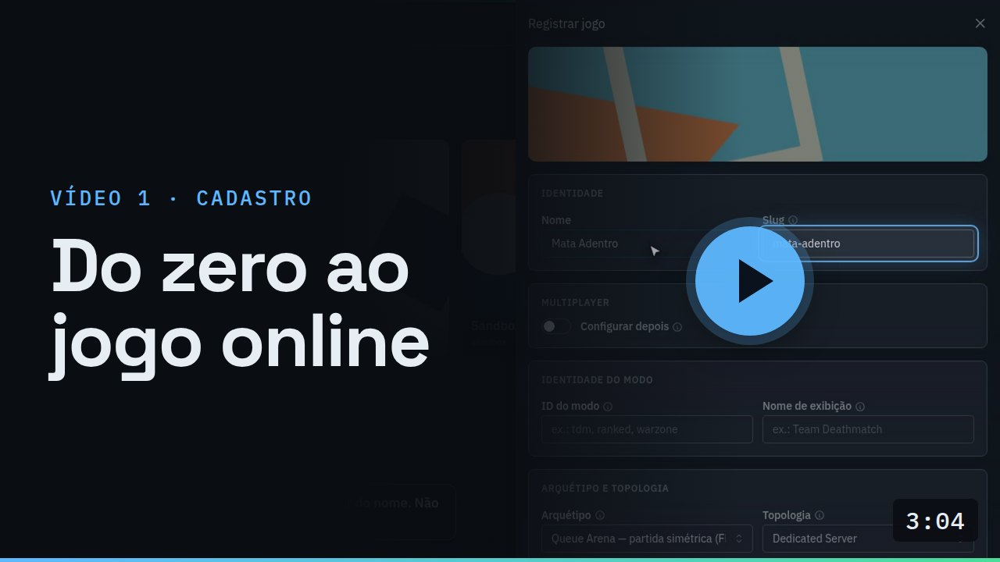
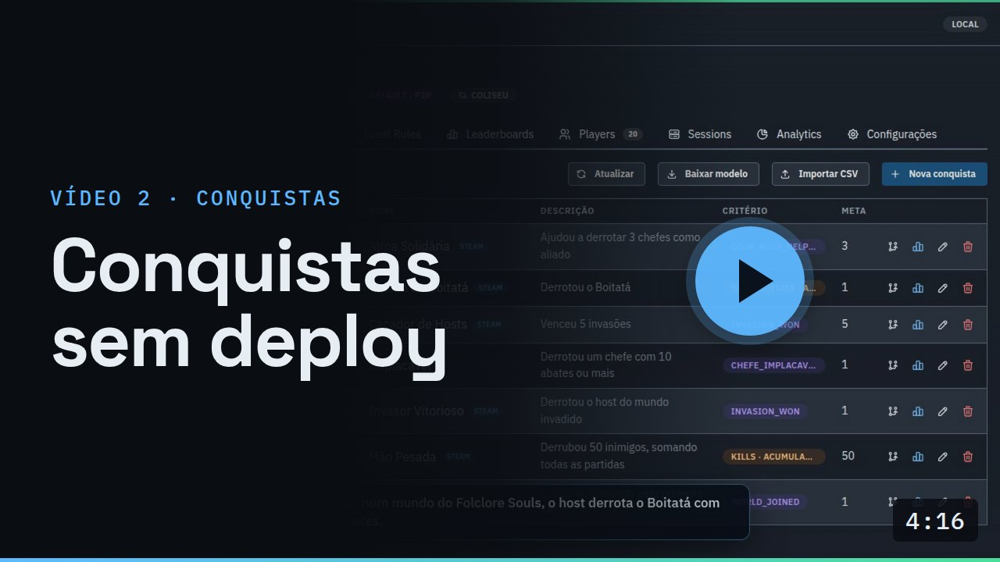
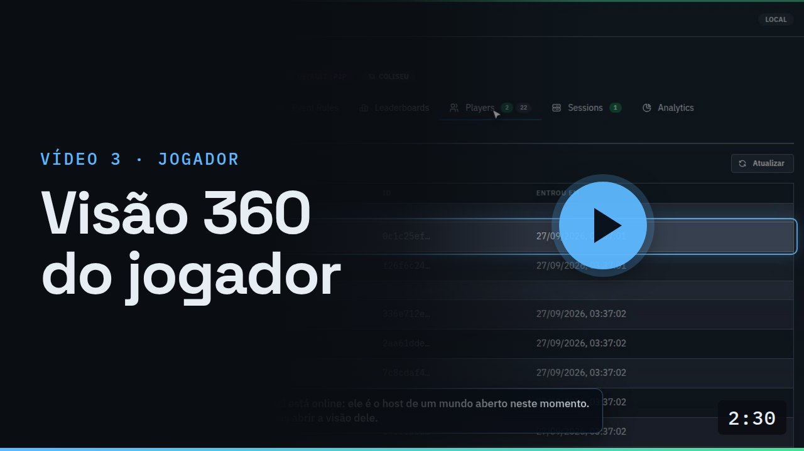

<div align="center">

# go-multiplayer-control-plane

**Português** · [English](README.en.md)

**Backend multiplayer self-hosted, em Go, para jogos de qualquer engine.**<br/>
Login, matchmaking, servidores dedicados no Agones ou P2P via Steam, conquistas sem deploy, leaderboard,
analytics e um console de operação. O que GameLift e PlayFab vendem por jogador, rodando na sua infra.

[](https://github.com/vitormartins1/go-multiplayer-control-plane/actions/workflows/ci.yml)


[](LICENSE)

[**Assista ao vídeo (3 min)**](docs/media/go-multiplayer-control-plane.mp4) ·
[Começando](#começando) ·
[Documentação](#documentação) ·
[Integrar um jogo](docs/integration/UNITY-GUIA-INTEGRACAO.md) ·
[Contribuir](CONTRIBUTING.md)

<a href="docs/media/go-multiplayer-control-plane.mp4"></a>

</div>

---

## O que é

Um jogo multiplayer precisa de muito mais que o netcode: contas, fila, alguém que suba o servidor da partida e
entregue um ingresso para entrar nele, conquistas, ranking, métricas e uma tela para operar tudo isso. As opções
prontas (GameLift, PlayFab, Photon, Unity Gaming Services) cobram por jogador e prendem o jogo ao fornecedor.

Este projeto é esse backend, pronto e aberto. Roda em qualquer coisa que rode containers, **de um Raspberry Pi 5
a um EKS**, e atende vários jogos ao mesmo tempo: cada jogo se cadastra no console, declara como joga online, e o
backend se configura sozinho, sem código novo por jogo. O realtime continua na engine do jogo (Unity é a
integração de referência); o Go cuida de tudo em volta da partida.

O primeiro jogo em produção é o **Folclore Souls**, um Souls-like com mundo do host, co-op e invasões.

## Recursos

| | |
|---|---|
| 🎮 **Qualquer tipo de jogo** | O jogo declara modos por arquétipo (arena por fila, mundo do host, battle royale, missão co-op) e matchmaking, sessão e conquistas se ajustam sozinhos. |
| 🖥️ **Servidor dedicado ou P2P** | Um servidor dedicado do jogo por partida numa fleet Agones, **ou** o jogo do host hospeda via Steam, sem custo de servidor. Troca-se num campo do modo. |
| 🎟️ **Ingresso criptográfico** | Cada jogador recebe um connect token Ed25519 com o seu papel, validado **offline** pelo servidor do jogo. |
| 🏆 **Conquistas sem deploy** | Regras editadas num canvas visual, critério por evento ou por métrica, e espelho automático na **Steam**. |
| 📊 **Rankings e analytics** | Leaderboards por janela (diária, semanal, mensal, geral) e analytics por jogo, modo e papel. |
| 💾 **Dados do jogador** | Dados em JSON e save na nuvem por jogador, com login anônimo, por senha ou pela Steam. |
| 🧭 **Console de operação** | Jogos, salas ao vivo, frota, jogadores, regras, conquistas e analytics, numa tela só. |
| 🔭 **Observável de fábrica** | Métricas RED, tracing OpenTelemetry até o banco e dashboards Grafana prontos. |

## Veja em ação

O vídeo do topo mostra o produto inteiro em 3 minutos. Os três abaixo são gravados do console real e explicam
uma feature de cada vez, passo a passo.

<table>
<tr>
<td width="33%" valign="top">
<a href="docs/VIDEOS.md#video-1"></a>
<br/><b>Do zero ao jogo online</b><br/>
<sub>Registrar um jogo, ver o que o backend configurou sozinho, e acompanhar o primeiro mundo abrir, ser invadido e terminar no analytics. Sem deploy.</sub>
</td>
<td width="33%" valign="top">
<a href="docs/VIDEOS.md#video-2"></a>
<br/><b>Conquistas sem deploy</b><br/>
<sub>Critério por evento ou por métrica, regras visuais com comparadores, regras globais por arquétipo e o desbloqueio ao vivo.</sub>
</td>
<td width="33%" valign="top">
<a href="docs/VIDEOS.md#video-3"></a>
<br/><b>Visão 360 do jogador</b><br/>
<sub>Tudo o que o backend sabe de um jogador: conquistas, histórico de partidas, dados, save e a sessão em que ele está agora.</sub>
</td>
</tr>
</table>

## Como funciona

O jogo roda a simulação (o *data plane*), na engine que for; este repositório é o *control plane*, que cuida do
que acontece antes, em volta e depois da partida. É o mesmo corte que o GameLift faz.

1. O jogador faz login e pede para jogar; o **matchmaking** forma a partida ou escolhe o mundo em que ele entra.
2. A **sessão** aloca um servidor dedicado no Agones, ou aponta para o jogo do host no P2P, e entrega a cada
   jogador um ingresso assinado.
3. Durante a partida, o servidor (ou o host) reporta eventos, resultado e sinal de vida.
4. Cada resultado é publicado uma vez e distribuído com garantia de entrega para **leaderboard**, **conquistas**
   e **analytics**.

Os serviços, os diagramas, as topologias e o porquê de cada decisão estão em
[**docs/ARCHITECTURE.md**](docs/ARCHITECTURE.md) e nos [registros de decisão (ADRs)](docs/adr/README.md).

## Começando

**Requisitos:** Docker e Go 1.26. Para a demo, também `curl`, `jq` e `grpcurl`.

```bash
# 1. chaves de desenvolvimento (JWT e connect token); ficam fora do git
infra/docker/gen-secrets.sh

# 2. a stack inteira: serviços, Postgres, Redis, LocalStack, Prometheus, Grafana e Tempo
docker compose -f infra/docker/docker-compose.yml up --build -d

# 3. uma partida de ponta a ponta, sem Unity: cadastra o jogo, o host abre um mundo,
#    um invasor entra, o servidor reporta a vitória e a conquista desbloqueia
scripts/demo-host-world.sh
TOPOLOGY=p2p scripts/demo-host-world.sh   # o mesmo mundo, hospedado pelo jogador
```

Depois abra o **console** em http://localhost:8089 e o **Grafana** em http://localhost:3000. As demais portas
estão em [`infra/docker/README.md`](infra/docker/README.md); testes, lint e o console em modo de desenvolvimento,
em [`CONTRIBUTING.md`](CONTRIBUTING.md).

## Estado do projeto

- **Pronto:** o control plane para os quatro arquétipos. O mundo do host roda de ponta a ponta com o Folclore
  Souls em servidor dedicado (k3s num Raspberry Pi 5); o P2P pela Steam está pronto no backend e validado pela
  demo, aguardando o lado Unity. Battle royale e missão co-op estão implementados, mas ainda sem um jogo real.
- **Contrato com o jogo 1.5.0**, versionado e só com mudanças aditivas
  ([changelog](docs/contracts/CHANGELOG.md)).
- **Engines e lojas** ([ADR-0033](docs/adr/0033-engine-and-store-agnostic.md)): o contrato é gRPC e REST, e o
  ingresso é validado por chave pública, então nada depende de engine. Unity é a integração de referência; Godot e
  Unreal integram direto pelo contrato, e a web (Three.js) está no roadmap. Na loja, a Steam está completa (login,
  conquistas, P2P); o login da Epic é o próximo; GOG, sob demanda.
- **Ainda não exponha na internet:** o console não tem login e a autenticação do gRPC da sessão sobe em modo
  de observação (`warn`).
- **Próximos passos:** deploy de referência na AWS, login no console e um SDK Unity empacotado
  ([roadmap](docs/NEXT-STEPS.md)).

## Documentação

| Para… | Leia |
|---|---|
| entender o produto | [Visão de produto](docs/PRODUCT-OVERVIEW.md) · [vídeos](docs/VIDEOS.md) |
| entender a arquitetura | [Arquitetura](docs/ARCHITECTURE.md) · [ADRs](docs/adr/README.md) · [topologia de repositórios](docs/REPO-TOPOLOGY.md) |
| integrar um jogo | [Guia de integração (Unity, a referência)](docs/integration/UNITY-GUIA-INTEGRACAO.md) · [contratos por arquétipo](docs/game-models/README.md) · [changelog do contrato](docs/contracts/CHANGELOG.md) |
| operar | [Infra local](infra/docker/README.md) · [observabilidade](docs/OBSERVABILITY.md) · [regras de eventos](docs/EVENT-RULES-GUIDE.md) |
| contribuir | [CONTRIBUTING](CONTRIBUTING.md) · [como as features são especificadas](docs/sdd/SDD-GUIDE.md) · [fluxo de Git](docs/GIT-WORKFLOW.md) |

## Contribuindo

Issues e PRs são bem-vindos. Cada feature nasce de uma spec curta com critérios de aceite e cada decisão de
arquitetura tem um ADR; o [`CONTRIBUTING.md`](CONTRIBUTING.md) explica o fluxo e os comandos. Quem participa segue
o [código de conduta](CODE_OF_CONDUCT.md); vulnerabilidades são reportadas em privado, como descreve o
[`SECURITY.md`](SECURITY.md).

## Licença

[Apache License 2.0](LICENSE). Pode usar, modificar e distribuir, inclusive comercialmente, mantendo o aviso de
licença e o [`NOTICE`](NOTICE).
