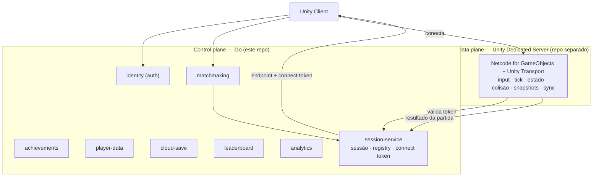
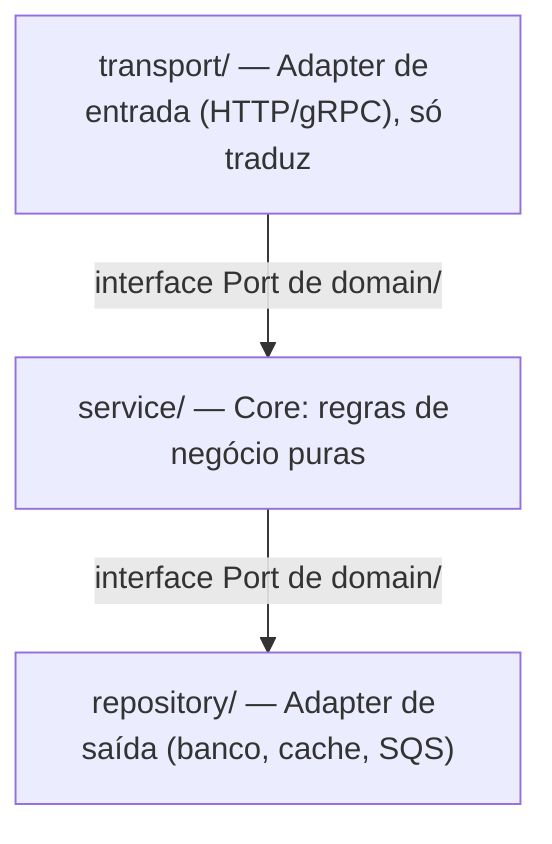
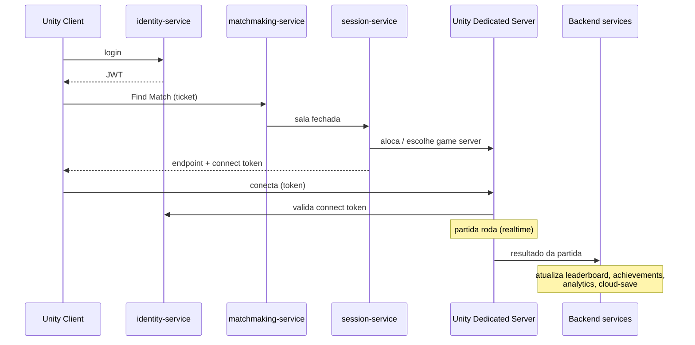

# Arquitetura — game-backend

> Visão consolidada da arquitetura do repositório. Aqui está o **panorama e o porquê de alto nível**; cada decisão pontual tem seu **ADR** em `docs/adr/`. O roadmap de execução está em `ROADMAP.md`.

---

## 1. Tese do projeto

Reimplementar em Go, sobre infraestrutura própria e barata, os serviços de backend que a AWS (e a Unity) vendem prontos para jogos — e comparar **custo, performance e eficiência** entre a nossa versão e a oferta gerenciada. Dois objetivos: **aprender Go de forma séria** e **construir infra reutilizável** para jogos próprios. (ADR-0008)

A observabilidade não é enfeite — é o **instrumento de medição** dessa comparação. (ADR-0006)

---

## 2. Topologia: control plane (Go) vs data plane (Unity)

A decisão estrutural mais importante: o realtime de gameplay **não é Go**. Go cuida do *control plane*; o Unity Dedicated Server cuida do *data plane*. É como o GameLift de fato funciona — ele orquestra, não simula. (ADR-0010, ADR-0011)



Serviços pagos (Unity Relay/Lobby/Matchmaker/Multiplay, AWS GameLift/GameKit gerenciados) são **substituídos por serviços Go** + game server com IP/porta. Escala de game server: EC2/VPS → ECS-on-EC2 → **Agones/EKS** (open-source). (ADR-0011)

---

## 3. Mapa de serviços (control plane)

Cada serviço é a reimplementação de um equivalente AWS e forma um **par de comparação**. Trilha em ordem de complexidade crescente. (ADR-0008, ADR-0009)

| # | Serviço | Equivalente AWS | Papel |
|---|---|---|---|
| 1 | identity-service | GameKit Identity & Auth | auth/JWT próprio; **fundação** dos demais |
| 2 | achievements-service | GameKit Achievements | desbloqueio por evento, progresso |
| 3 | player-data-service | GameKit User Gameplay Data | inventário, stats, cross-play |
| 4 | cloud-save-service | GameKit Game State Saving | save versionado na nuvem |
| 5 | leaderboard-service | ref. arch DynamoDB/Redis | ranking em tempo real |
| 6 | analytics-service | Game Analytics Pipeline | telemetria, worker pool (prio. menor) |
| 7 | matchmaking-service | GameLift FlexMatch | fila/tickets, gRPC streaming |
| 8 | session-service | GameLift (orquestração) | ciclo de sessão, registry, connect token, resultado |

Os quatro do GameKit (1–4) são **serviços separados, com a identity como fundação de auth** — espelhando o deploy per-feature do GameKit. O compute de cada um é decidido no `plan.md` (ADR-0005), não pré-fixado. (ADR-0009)

Fora de escopo por ora: economy (≈ GameSparks). Lobby entra como serviço próprio se/quando um jogo precisar.

---

## 4. Arquitetura interna e organização do código

- **Monorepo de módulo único** (um `go.mod` na raiz). Cada serviço é binário/imagem Docker independentes; `shared/` é pacote interno. Migração para multi-módulo + `go.work` só com necessidade concreta. (ADR-0001)
- **Hexagonal idiomático** em todos os serviços: `domain / service / repository / transport`. Interfaces declaradas no consumidor; régua anti-interface-pollution. (ADR-0002)
- **gRPC com streaming** para matchmaking/session; **REST** para os serviços de CRUD. (ADR-0003)
- **SDD**: `spec.md → plan.md → tasks.md → código`, spec é fonte de verdade. (ADR-0007)



Estrutura de pastas de cada serviço:

```
services/<nome>-service/
  cmd/server/main.go     entrypoint + wire-up
  internal/domain/       tipos puros + interfaces (Ports) — zero deps externas
  internal/service/      regras de negócio (só interfaces de domain)
  internal/repository/   acesso a dados (implementa interfaces de domain)
  internal/transport/    HTTP/gRPC handlers (só traduz)
  migrations/ · specs/
```

---

## 5. Infraestrutura e compute

- **Terraform** como IaC; **LocalStack** no local, **AWS** em prod; state independente por serviço. (ADR-0004)
- **Compute por serviço, decidido na hora de construir** — menu Lambda/Fargate/ECS-EC2/EC2/EKS. CRUD stateless → Lambda; worker always-on → ECS/EC2; streaming/stateful → ECS/EKS; game server realtime → EC2/ECS-EC2/Agones (nunca Fargate). A escolha de banco (gerenciado vs auto-provisionado) segue a mesma lógica diferida. (ADR-0005)

---

## 6. Fluxo de uma partida



---

## 7. Observabilidade como instrumento da tese

`slog` JSON (logs) + Prometheus (métricas) + Grafana (dashboards) + OpenTelemetry (traces). A mesma stack roda local e em prod, e alimenta a comparação Go-vs-AWS: custo $/mês, latência p50/p95/p99, throughput, uso de recurso. (ADR-0006)

---

## 8. Índice de decisões

Todas as decisões e seus trade-offs estão em `docs/adr/README.md`. Antes de implementar algo arquitetural, confira se há ADR aplicável; se conflitar com um ADR aceito, avise antes de prosseguir.

---

## Convenção de diagramas

Todo diagrama neste repositório é feito em **Mermaid** (GitHub renderiza nativo). ASCII art não é usado para diagramas. Listagens de árvore de arquivos/pastas permanecem em bloco de código texto, pois Mermaid não as representa bem.
