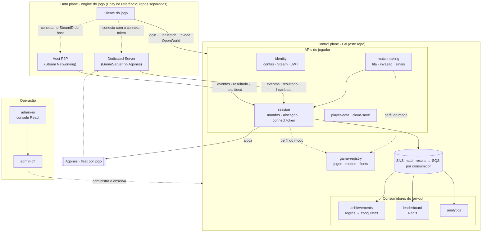
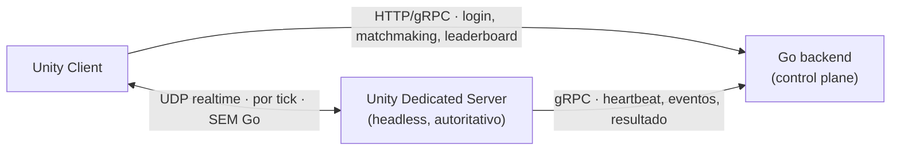
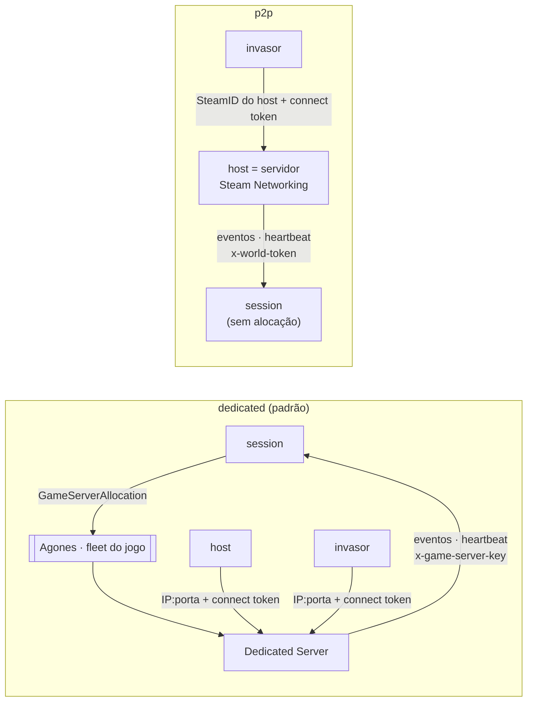
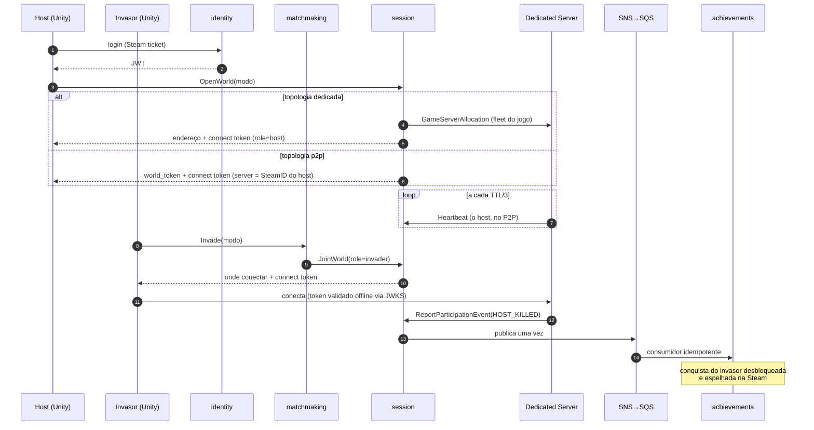
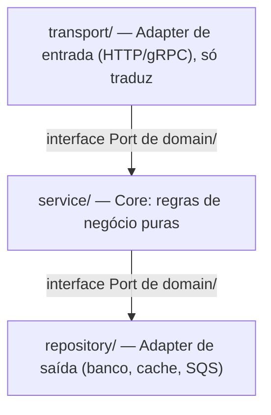
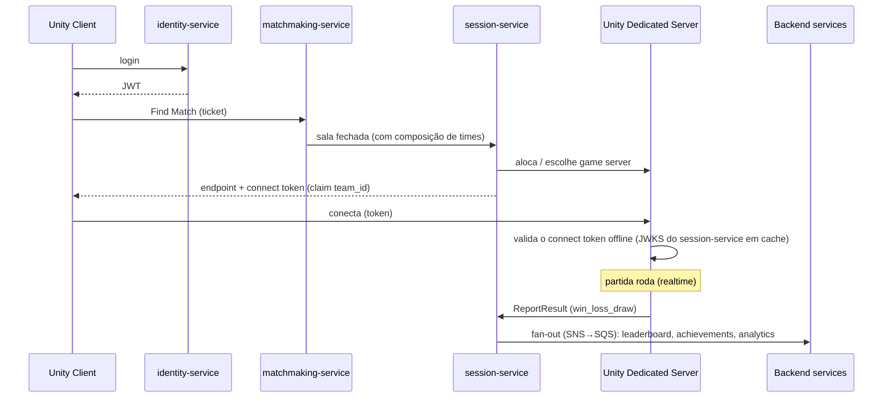
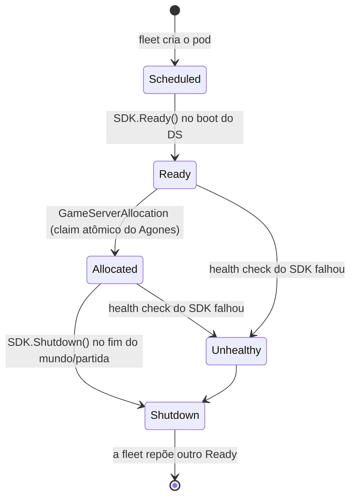
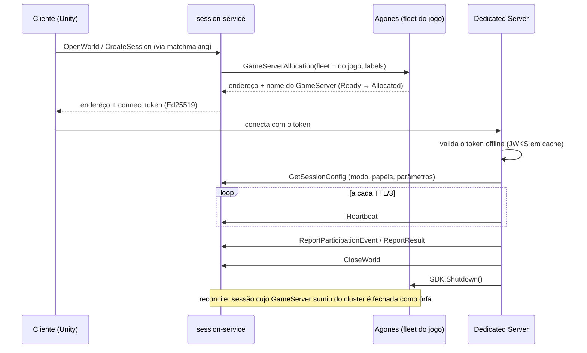

# Arquitetura — go-multiplayer-control-plane

> Visão consolidada da arquitetura do repositório. Aqui está o **panorama e o porquê de alto nível**; cada decisão pontual tem seu **ADR** em `docs/adr/`. O roadmap de execução está em `ROADMAP.md`. Para o que o sistema **faz** (capacidades/fluxos, visão de produto em vez de arquitetura), ver [`PRODUCT-OVERVIEW.md`](PRODUCT-OVERVIEW.md).

---

## 1. Objetivo

Oferecer, como software aberto e self-hosted, os serviços de backend que a AWS (GameKit, GameLift) e a Unity vendem
prontos para jogos multiplayer, rodando em infraestrutura própria e barata, e **medir custo, performance e
eficiência** contra a oferta gerenciada. Cada serviço deste repositório tem um equivalente gerenciado e forma um par
de comparação (seção 3). (ADR-0008)

A observabilidade é o **instrumento de medição** dessa comparação, não um acessório. (ADR-0006)

---

## 2. Topologia: control plane (Go) vs data plane (a engine do jogo)

A decisão estrutural mais importante: o realtime de gameplay **não é Go**. Go cuida do *control plane*; o Unity Dedicated Server cuida do *data plane*. É como o GameLift de fato funciona — ele orquestra, não simula. (ADR-0010, ADR-0011)

> **Qualquer engine** ([ADR-0033](adr/0033-engine-and-store-agnostic.md)). O data plane nasceu como Unity Dedicated
> Server, e o Unity segue como integração de referência, mas o contrato não depende dele: gRPC e REST versionados,
> connect token validado offline pelo JWKS e `host_connection` opaco no P2P. Godot e Unreal integram direto pelo
> contrato; a web (Three.js) pede uma ponte gRPC-web/Connect e transporte WebSocket/WebRTC, e está no backlog. Onde
> este documento diz "Unity", leia "o jogo, na engine que for".



Serviços pagos (Unity Relay/Lobby/Matchmaker/Multiplay, AWS GameLift/GameKit gerenciados) são **substituídos por serviços Go** + game server com IP/porta. Escala de game server: EC2/VPS → ECS-on-EC2 → **Agones/EKS** (open-source). (ADR-0011)

### Onde o Go entra (e onde NÃO entra) no gameplay

Durante a partida em tempo real, **o Go não participa**. A simulação autoritativa (input, tick, física, colisão, estado do mundo) roda inteira no Unity Dedicated Server, falando direto com os clients por UDP. O Go atua **em volta** da partida (control plane) e em chamadas **fora do caminho de tick** (heartbeat, eventos, resultado; o connect token é validado localmente pelo server) — nunca no loop por frame, onde um salto extra só adicionaria latência.



> Nuance: o host realtime ser Unity vale para jogos com física/ação (o server precisa rodar a MESMA simulação do client). Para jogos turn-based/baixa frequência (cartas, tabuleiro), um serviço Go poderia hospedar a lógica da partida diretamente, sem Unity Dedicated Server — matchmaking e session continuam iguais; só muda o "host da partida".

### Repos: 1 control plane + N data planes (por arquétipo)

Client e Dedicated Server de um jogo são **o mesmo projeto Unity** (dois build targets: client gráfico, server headless) — compartilham o código de jogo. Como o backend virou agnóstico de arquétipo (ADR-0023), a topologia é **um control plane, N data planes**: cada arquétipo tem um data plane Unity de referência, em repo próprio, para validar aquele tipo de jogo isoladamente. Contrato via `.proto` + docs de contrato por arquétipo. Nomenclatura decidida (`go-multiplayer-control-plane` + `unity-<archetype>-data-plane`, rename concluído) e mapa de repos em **`docs/REPO-TOPOLOGY.md`**. (ADR-0010, ADR-0011)

### Topologias de hospedagem: dedicado × P2P (ADR-0032)

No `host_world_dropin`, o **modo** escolhe quem hospeda o mundo. O resto do control plane (matchmaking, papéis,
connect token, eventos, fan-out, console) é o mesmo nas duas.



| | `dedicated` | `p2p` |
|---|---|---|
| Quem roda a simulação | Unity Dedicated Server no Agones | o jogo do host |
| Custo de servidor | um GameServer por mundo aberto | zero |
| Onde o invasor conecta | `IP:porta` devolvidos pelo session | `host_connection` (SteamID) via Steam Datagram Relay |
| Quem reporta eventos | o DS, com `x-game-server-key` | o host, com o `world_token` do mundo (só o hash fica no session) |
| Confiança nos eventos | autoritativa | o host pode mentir; o session limita o estrago (só participantes, um mundo por host) |

O **heartbeat** (spec `session/032`) vale para as duas: quem hospeda chama `Heartbeat` a cada `TTL/3`; sem sinal
por `WORLD_HEARTBEAT_TTL` (90 s), o mundo fecha como `abandoned`. Mundos que nunca mandaram heartbeat (clientes
antigos) continuam no TTL por idade.

### Um mundo do login à conquista (dedicado e P2P)

O caminho completo de um mundo do `host_world_dropin`, com o Folclore Souls como exemplo: o host abre o mundo, um
invasor entra pelo matchmaking, o servidor (ou o host, no P2P) reporta a morte do host e o fan-out desbloqueia a
conquista do invasor.



### Quem pode chamar o quê (ADR-0030, ADR-0031)

O gRPC do session identifica **quatro tipos de chamador** e cada RPC aceita só os seus. O modo `warn` registra o
que seria recusado; `enforce` recusa.

| Chamador | Credencial | RPCs |
|---|---|---|
| jogador | `Bearer` JWT do identity | `OpenWorld`, `LeaveWorld`, `CloseWorld`, `Heartbeat` |
| game server | `x-game-server-key` | `ReportResult`, `ReportParticipationEvent`, `GetSessionConfig`, `LeaveWorld`, `CloseWorld`, `Heartbeat` |
| host p2p | `x-world-token`, válido **só para o próprio mundo** | os do game server, menos `ReportResult` |
| serviço interno | `x-internal-key` | `CreateSession`, `ListInvadableWorlds`, `JoinWorld` (o matchmaking) |

Um `world_token` de mundo já fechado só serve para reenviar um `ReportParticipationEvent` (o reenvio do
`HOST_KILLED`, spec `session/029`).

O JWT do jogador vem do identity, que aceita **login Steam** (ticket de sessão verificado na Steam Web API) além de
conta própria e anônimo; a conta Steam é uma identidade externa ligada à conta do control plane (ADR-0031).
Tokens exigem `iss`, `aud` e `exp`; a chave pública vem do JWKS, com refetch por `kid` desconhecido.

---

## 3. Mapa de serviços (control plane) — **canônico**

Cada serviço é a reimplementação de um equivalente AWS e forma um **par de comparação**. Trilha em ordem de complexidade crescente. Este é o **mapa canônico** (README e ROADMAP apontam para cá; não repetir a tabela em outros docs). (ADR-0008, ADR-0009)

| # | Serviço | Equivalente AWS | Papel | Estado |
|---|---|---|---|---|
| 1 | identity-service | GameKit Identity & Auth | auth/JWT próprio; **fundação** dos demais | ✅ |
| — | game-registry | (sem equivalente 1:1) | jogos multi-tenant, modos/perfil de multiplayer, fleet por jogo, presença (ADR-0017/0019/0023/0024/0026) | ✅ |
| 2 | achievements-service | GameKit Achievements | desbloqueio por evento/stat, progresso; consumer SQS | ✅ |
| 3 | player-data-service | GameKit User Gameplay Data | inventário, stats, cross-play | ✅ |
| 4 | cloud-save-service | GameKit Game State Saving | save versionado na nuvem | ✅ |
| 5 | leaderboard-service | ref. arch DynamoDB/Redis | ranking em tempo real; consumer SQS | ✅ |
| 6 | analytics-service | Game Analytics Pipeline | telemetria via worker pool; consumer SQS | ✅ |
| 7 | matchmaking-service | GameLift FlexMatch | fila/tickets + injeção por arquétipo, gRPC streaming | ✅ |
| 8 | session-service | GameLift (orquestração) | ciclo de sessão, registry, connect token, resultado | ✅ |
| — | admin-bff + admin-ui | painel de operação (ADR-0016) | agrega os serviços + Prometheus; React | ✅ |

Protocolo, armazenamento e porta local de cada um (o mapa completo, com bancos e ferramentas, está em
[`infra/docker/README.md`](../infra/docker/README.md)):

| Serviço | Protocolo | Storage | Porta local |
|---|---|---|---|
| identity | REST | Postgres | 8081 |
| game-registry | REST | Postgres | 8090 |
| matchmaking | gRPC (streaming) | memória | 50051 |
| session | gRPC + REST admin | memória + Postgres (histórico) | 50052 · 8087 |
| achievements | REST + consumidor SQS | Postgres | 8082 |
| leaderboard | REST + consumidor SQS | Redis | 8085 |
| analytics | REST admin + consumidor SQS | Postgres | 8091 |
| player-data | REST | Postgres | 8083 |
| cloud-save | REST | S3 | 8084 |
| admin-bff · admin-ui | REST · React | sem banco | 8088 · 8089 |

Os quatro do GameKit (1–4) são **serviços separados, com a identity como fundação de auth** — espelhando o deploy per-feature do GameKit. O compute de cada um é decidido no `plan.md` (ADR-0005), não pré-fixado. (ADR-0009) O fan-out durável do resultado (ADR-0020) liga session → achievements/leaderboard/analytics por **SNS→SQS** idempotente.

Fora de escopo por ora: economy (≈ GameSparks). Lobby entra como serviço próprio se/quando um jogo precisar.

---

## 3a. Multiplayer por arquétipo (ADR-0023) — o control plane é agnóstico de tipo de jogo

A decisão de generalização mais importante depois da topologia: **o control plane não assume um tipo de jogo**. Cada jogo declara no game-registry um **perfil de multiplayer** = um **arquétipo** (a *forma* da sessão/matchmaking/resultado) + parâmetros; matchmaking, session e fan-out **leem o perfil e se pré-configuram**. Um jogo novo de um arquétipo já suportado **não** exige código novo.

A generalização é dirigida por **engenharia reversa de jogos reais** (não por especulação): `docs/game-models/` disseca jogos, extrai o que o backend precisa modelar, e cada gap maduro vira ADR + specs. **Gênero ≠ arquétipo** (ficha 05): vários gêneros (shooter, MOBA, esporte, fighting) colapsam no mesmo arquétipo com parâmetros diferentes; câmera/arte/economia são conteúdo do data plane.

| Arquétipo | Forma | Resultado | Estado |
|---|---|---|---|
| `queue_arena` | partida simétrica formada por fila (FFA / NvN) | win/loss/draw por jogador/time + stats | ✅ completo |
| `host_world_dropin` | mundo persistente de um host; phantoms co-op/invasor entram/saem por papel | por **evento/participante** (não placar terminal) | ✅ completo (H0–H3) |
| `battle_royale` | lobby grande, eliminação progressiva | colocação ordinal (1º..Nº) | ✅ completo (BR0–BR4) |
| `coop_mission` | co-op puro vs. ambiente | coletivo (sucesso/falha por sessão) | ✅ completo (C0–C4) |

Como o perfil orienta cada serviço, o estado por fatia e os roadmaps por arquétipo vivem em **`docs/game-models/README.md`** (fonte única do estado de implementação). Contratos control↔data plane por arquétipo: `docs/game-models/<archetype>-dataplane-contract.md`.

---

## 4. Arquitetura interna e organização do código

- **Monorepo de módulo único** (um `go.mod` na raiz). Cada serviço é binário/imagem Docker independentes; `shared/` é pacote interno. Migração para multi-módulo + `go.work` só com necessidade concreta. (ADR-0001)
- **Hexagonal idiomático** em todos os serviços: `domain / service / repository / transport`. Interfaces declaradas no consumidor; régua anti-interface-pollution. (ADR-0002)
- **gRPC com streaming** para matchmaking/session; **REST** para os serviços de CRUD. (ADR-0003)
- **SDD**: `spec.md → plan.md → tasks.md → código`, spec é fonte de verdade. (ADR-0007)



Estrutura de pastas de cada serviço:

```
services/<nome>-service/
  cmd/server/main.go     entrypoint + wire-up
  internal/domain/       tipos puros + interfaces (Ports) — zero deps externas
  internal/service/      regras de negócio (só interfaces de domain)
  internal/repository/   acesso a dados (implementa interfaces de domain)
  internal/transport/    HTTP/gRPC handlers (só traduz)
  migrations/ · specs/
```

---

## 5. Infraestrutura e compute

- **Terraform** como IaC; **LocalStack** no local, **AWS** em prod. Hoje só existe `infra/terraform/environments/local/messaging` (SNS/SQS); Terraform por serviço e o ambiente de prod ainda não foram escritos. (ADR-0004)
- **Compute por serviço, decidido na hora de construir** — menu Lambda/Fargate/ECS-EC2/EC2/EKS. CRUD stateless → Lambda; worker always-on → ECS/EC2; streaming/stateful → ECS/EKS; game server realtime → EC2/ECS-EC2/Agones (nunca Fargate). A escolha de banco (gerenciado vs auto-provisionado) segue a mesma lógica diferida. (ADR-0005)

---

## 6. Fluxo de uma partida (arquétipo `queue_arena`)

Este é o fluxo do `queue_arena` (partida formada por fila). Cada arquétipo tem o seu — o `host_world_dropin`, por exemplo, não forma partida: o host **abre um mundo** e phantoms são **injetados por papel** ao longo da vida da sessão, reportando **eventos** em vez de um resultado terminal (ver `docs/game-models/host_world_dropin-dataplane-contract.md` e a sequência completa, dedicada e P2P, em [Um mundo do login à conquista](#um-mundo-do-login-à-conquista-dedicado-e-p2p)).



---

## 7. Alocação de game server (session-service)

Quando o matchmaking fecha uma partida, o `session-service` precisa achar um Dedicated Server livre e saudável para hospedá-la — a reimplementação do *game session placement* do GameLift. Quatro responsabilidades: **registry** (quais servers existem e seu estado), **health** (heartbeat detecta server morto), **allocation** (reivindicar um livre sem corrida) e **reclaim** (devolver ao pool no fim).

Essas quatro responsabilidades ficaram com o **Agones** (ADR-0012): o session-service é um cliente fino da
Allocation API, pede um `GameServer` `Ready` na **fleet do jogo** (ADR-0026) e reconcilia sessões órfãs contra o
cluster (ADR-0022). Em dev sem cluster, um allocator `static` devolve um endereço fixo.

Ciclo de vida de um GameServer (estados do Agones):



Fluxo de alocação e fim de sessão:



> O **claim atômico** Ready→Allocated é o ponto de concorrência crítico (duas partidas não podem pegar o mesmo server). Em processo único: `sync.Mutex`. Distribuído (várias instâncias do session-service): update condicional no store (DynamoDB `... IF state=Ready` / Postgres `UPDATE ... WHERE state='Ready' RETURNING`). Detalhado em `docs/GO-LEARNINGS.md` §01.

**Decisão (ADR-0012): Agones desde o início.** Em vez de construir um pool em Go, o `session-service` é **cliente fino da Allocation API do Agones**. O Agones é um projeto open-source que estende o Kubernetes para gerenciar game servers: CRD `GameServer` com o ciclo de vida acima, `Fleet` com buffer de servers `Ready`, API de *Allocation* e autoscaler. É **engine-agnóstico** — empacota-se o Unity Dedicated Server (Linux headless **ARM64**, suportado no Unity 6) num container e integra-se o **Agones SDK (C#)** para reportar Ready/Allocated/Health/Shutdown.

Onde roda (ADR-0012):

| Ambiente | Kubernetes | Custo |
|---|---|---|
| Dev / homelab | **k3s** no Raspberry Pi 5 16GB (ARM64) | grátis (hardware próprio) |
| Cloud (sob demanda) | **EKS** efêmero (sobe/destrói via Terraform) só p/ testes de nuvem | ~$73/mês só ligado → manter efêmero |

> O claim atômico Ready→Allocated passa a ser responsabilidade do Agones, não do session-service. O exemplo em Go (`GO-LEARNINGS.md` §01) permanece como **estudo de concorrência**; a concorrência de produção vive no matchmaking (pool de tickets).

### Connect token

Ao alocar a sessão, o session-service também cunha um **connect token** — o ingresso criptográfico que o jogador apresenta ao Unity Dedicated Server. Ele prova *"este jogador foi autorizado a entrar nesta partida, neste server, dentro de uma janela curta"*, impedindo que alguém conecte direto no IP:porta sem passar pelo matchmaking.

Claims (JWT):

```json
{
  "sub": "player-abc123",     // quem
  "match_id": "match-xyz789", // qual partida
  "server": "10.0.0.5:7777",  // vale só para este server
  "iat": 1719500000,
  "exp": 1719500060,          // ~60s
  "jti": "nonce-uuid"         // anti-reuso
}
```

Assinatura **assimétrica (Ed25519)**: o backend assina com a **chave privada** (nunca sai dele); o game server verifica com a **chave pública**, **localmente, sem round-trip ao backend** a cada conexão. No Netcode for GameObjects, o token viaja no payload de *connection approval*, validado no callback de aprovação do server. Implementação em `GO-LEARNINGS.md` §02.

> **Claims por arquétipo (ADR-0023):** além dos claims base, o token carrega um claim que o data plane lê no *connection approval* para o gameplay — `team_id` no `queue_arena` (lado do jogador na partida NvN) ou `role` no `host_world_dropin` (`host`/`coop`/`invader`). Detalhe em cada `docs/game-models/<archetype>-dataplane-contract.md`.

Não confundir com o **JWT de identidade** (emitido pela identity-service, prova "sou o jogador X" para o backend, vida longa): o connect token é de **uma entrada só**, curtíssimo, e prova autorização para uma partida específica ao *game server*.

---

## 8. Observabilidade como instrumento da tese

`slog` JSON (logs) + Prometheus (métricas) + Grafana (dashboards) + OpenTelemetry (traces). A mesma stack roda local e em prod, e alimenta a comparação Go-vs-AWS: custo $/mês, latência p50/p95/p99, throughput, uso de recurso. (ADR-0006)

---

## 9. Índice de decisões

Todas as decisões e seus trade-offs estão em `docs/adr/README.md`. Antes de implementar algo arquitetural, confira se há ADR aplicável; se conflitar com um ADR aceito, avise antes de prosseguir.

---

## Convenção de diagramas

Todo diagrama neste repositório é feito em **Mermaid** (GitHub renderiza nativo). ASCII art não é usado para diagramas. Listagens de árvore de arquivos/pastas permanecem em bloco de código texto, pois Mermaid não as representa bem.
