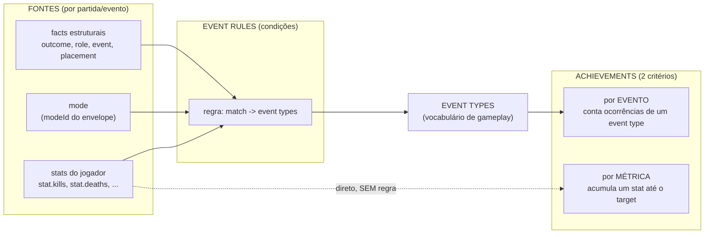
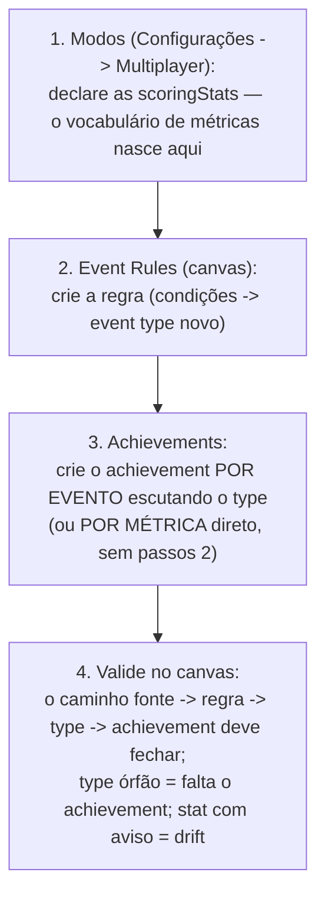

# Guia de modelagem — Event Rules e Achievements

> Como modelar conquistas e regras de evento no console: os conceitos, a
> semântica exata do motor e as receitas dos casos comuns. Complementa os
> ADRs 0027/0028 (o *porquê* das decisões); aqui é o *como usar*.

## O modelo em uma figura

Duas vias alimentam conquistas, e elas **não se misturam no achievement**:

| | Achievement por EVENTO | Achievement por MÉTRICA |
|---|---|---|
| Progride quando | um **event type** chega (+1 por ocorrência) | o **valor da stat** cresce (acumulada) ou atinge N numa partida (`per_match`) |
| Quem decide o disparo | as **event rules** (condições sobre as fontes) | ninguém — a stat reportada aplica direto |
| Onde mora a lógica condicional | **na regra** (única casa de condições do sistema) | não há (só o threshold `target`) |
| Exemplo | "Vença 3 invasões" (`invasion_won`, target 3) | "Acumule 500 kills" (`statKey: kills`, target 500) |

**Não existe achievement "misto"** — quando você quiser "evento + métrica"
(ex.: *vencer sem morrer*), a mistura acontece **na regra**: condição composta
→ event type novo → achievement por evento. Isso é intencional: o motor de
condições vive num lugar só.

## A semântica exata do motor (o que você precisa saber)

1. **Facts são POR PARTIDA/EVENTO, nunca acumulados.** `stat.headshots` é o
   valor daquele envelope (aquela partida). Acumular entre partidas é papel
   exclusivo do achievement por métrica. Portanto:
   - "5 headshots **numa** partida" → regra `stat.headshots ≥ 5` → event type
     → achievement por evento (target 1 = na primeira vez; target 3 = em 3
     partidas diferentes).
   - "5 headshots **no total**" → achievement por métrica (`statKey:
     headshots`, acumulada, target 5). **Sem regra nenhuma.**
2. **`=` em número é IGUAL EXATO.** `stat.headshots = 5` casa só a partida
   com exatamente 5 (a de 6 não!). Quase sempre você quer `≥`.
3. **Todas as condições da regra precisam bater (E lógico).** O "OU" é
   implícito entre regras: quer `A ou B`? Crie duas regras emitindo o mesmo
   event type.
4. **Fact ausente nunca casa.** Envelope sem a stat, sem `modeId`, etc. —
   a condição simplesmente não bate (nunca casa "com vazio").
5. **União SEM duplicar.** Todas as regras que casam somam seus event types,
   e cada type conta **uma vez por avaliação** — duas regras emitindo o mesmo
   type no mesmo evento NÃO geram progresso dobrado. (Por isso uma regra
   condicional emitindo um type que uma regra incondicional já emite é
   *inócua*, não perigosa — o console avisa, mas não bloqueia.)
6. **Global soma, jogo soma; ninguém substitui.** Regras globais (semeadas
   por arquétipo) valem pra todo jogo daquele arquétipo; regras do jogo
   ADICIONAM. Hoje não há supressão de global (roadmap V2b).
7. **Avaliação é por jogador** (nos kinds com dado individual): no coop o
   desfecho é coletivo, mas condições com `stat.*` casam jogador a jogador —
   dá pra premiar só o MVP da missão.
8. **Operadores**: `=` (string/número exato) · `≠` · `< ≤ > ≥` (numéricos) ·
   `in` (lista). Condição malformada nunca casa (e loga warning no serviço).

### As fontes disponíveis (por arquétipo)

| Arquétipo | Facts estruturais | `mode` | `stat.*` |
|---|---|---|---|
| queue_arena | `outcome` (win/loss/draw) | ✓ | ✓ (scoringStats do modo) |
| battle_royale | `placement` (número) | ✓ | ✓ (+ `stat.survived_ms`) |
| coop_mission | `outcome` (MISSION_SUCCESS/FAILURE) | ✓ | ✓ |
| host_world_dropin | `role`, `event`, `outcome` | ✓ | ✗ (envelope sem stats) |

## Receitas

**Renomear/vocabulário próprio do jogo** — quer que a vitória do SEU jogo
conte como `raid_defeated` além de `invasion_won`? Regra do jogo com o mesmo
match da global, emitindo o type novo. (União: os dois valem.)

**Regra por modo** — "vitória no ranked": `outcome = win` + `mode = ranked` →
`ranked_won` → achievement por evento.

**Flawless victory** — `outcome = win` + `stat.deaths ≤ 0` →
`flawless_victory` → achievement por evento (target N = N partidas perfeitas).

**Feito de partida (threshold por partida)** — "pentakill":
`stat.kills ≥ 5` → `pentakill` → achievement por evento. *(Compare com
"500 kills totais": métrica pura, sem regra.)*

**MVP coletivo** — coop: `outcome = MISSION_SUCCESS` + `stat.kills ≥ 10` →
`mission_mvp` — só os jogadores que satisfazem ganham o type.

**Top N do battle royale** — já vem como regra global editável
(`placement ≤ 10` → `battle_royale_top_n`); ajuste o limiar por jogo criando
a regra do jogo com outro valor e um type próprio.

## Fluxo de cadastro (a ordem que funciona)

Armadilhas que o console detecta pra você:
- **Drift de stat**: achievement por métrica usando `statKey` que nenhum modo
  declara → aviso vermelho no canvas (pode nunca progredir).
- **Event type órfão**: regra emite type que nenhum achievement escuta →
  visível no grafo (0 listeners).
- **Emissão redundante**: regra emitindo type já coberto por uma regra
  incondicional → hint informativo (inócuo pelo motor, ver §5 acima).

## Onde cada coisa mora

- **Regras**: aba Event Rules do jogo (canvas/tabela). Globais são read-only.
- **Achievements**: aba Achievements (CRUD/CSV/progresso).
- **Métricas declaradas**: no modo (Configurações → Multiplayer) — e visíveis
  no canvas e na vista Pipeline (Analytics → Pipeline).
- **O caminho completo dos dados**: Analytics → Pipeline (envelope → 3
  consumers; regras só existem no ramo do achievements).
