# Aprendizados de Go — game-backend

> Caderno vivo das coisas boas de Go que fui aprendendo ao construir este projeto.
> Cada entrada: o conceito, **por que importa**, um exemplo comentado e **onde uso no projeto**.
> Atualizado de forma incremental conforme uso algo novo.

## Como usar

- Uma entrada por conceito/padrão. Adicione ao final, numerando.
- Prefira exemplo curto e comentado a teoria longa.
- Ligue ao serviço/lugar real onde o padrão aparece.
- **Use Mermaid sempre que um diagrama explicar melhor que texto** — fluxo de execução, ordem de middlewares, sequência de shutdown, máquina de estados, relações entre tipos. O objetivo é didático: ver o conceito, não só ler. (GitHub e o preview local renderizam Mermaid nativo; nunca use ASCII art para diagrama.) O código comentado mostra o *como*; o Mermaid mostra o *fluxo/forma*.

### Template de entrada

```markdown
## NN — Título do conceito

**O que é / por que importa:** ...
**Onde no projeto:** <serviço/arquivo>

​```mermaid
%% opcional, mas recomendado quando há fluxo/ordem/estado a visualizar
flowchart LR
    A --> B
​```

​```go
// exemplo comentado
​```

**Pegadinha / nuance:** ...
```

---

## 01 — Concorrência: alocação atômica com `sync.Mutex`

**O que é / por que importa:** quando várias goroutines disputam o mesmo recurso, "ler o estado e agir sobre ele" precisa ser **uma operação indivisível**. Em Go, o jeito mais direto é proteger a seção crítica com `sync.Mutex`. É o tipo de problema em que Go é confortável e expressivo.

**Onde no projeto:** `session-service/internal/allocator/static.go` — `Static.Allocate` reivindica UM server livre do pool sem que duas sessões peguem o mesmo. O teste `static_test.go` (`TestAllocate_Concorrente_SemDuplicar`, rodado com `-race`) dispara N `Allocate` em paralelo e garante que nenhum server sai duas vezes. O exemplo abaixo é uma variante didática (com `Region`/estados); o código real usa uma `slice` de slots `{server, allocated}`.

```go
package registry

import (
	"errors"
	"sync"
)

type State int

const (
	StateReady State = iota
	StateAllocated
	StateDown
)

type GameServer struct {
	ID     string
	Addr   string // ip:porta
	Region string
	State  State
}

var ErrNoServerAvailable = errors.New("session: nenhum game server disponível")

// Registry guarda os game servers e permite alocação concorrente segura.
type Registry struct {
	mu      sync.Mutex
	servers map[string]*GameServer
}

// Allocate reivindica UM server Ready da região, de forma atômica.
//
// Sem o lock, duas goroutines (duas partidas fechando ao mesmo tempo)
// poderiam ler o mesmo server "Ready" e ambas marcá-lo Allocated —
// resultado: dois matches no mesmo server. O mutex garante que o
// "ler estado + reivindicar" aconteça como uma operação indivisível.
func (r *Registry) Allocate(region string) (*GameServer, error) {
	r.mu.Lock()
	defer r.mu.Unlock()

	for _, gs := range r.servers {
		if gs.State == StateReady && gs.Region == region {
			gs.State = StateAllocated // claim dentro da seção crítica
			return gs, nil
		}
	}
	return nil, ErrNoServerAvailable
}
```

**Pegadinha / nuance:** o `sync.Mutex` resolve a corrida **dentro de um processo**. Se rodarem várias instâncias do `session-service` (escala horizontal), cada uma tem seu próprio lock em memória — o mutex não basta. Aí o claim atômico precisa migrar para o **store compartilhado**:

- DynamoDB: `UpdateItem` condicional — `SET state = :allocated` com `ConditionExpression: state = :ready`. Se a condição falhar, outra instância já pegou.
- Postgres: `UPDATE servers SET state='allocated' WHERE id=$1 AND state='ready' RETURNING *` — se não voltar linha, já estava ocupado.

Ou seja: o conceito (ler-e-reivindicar atômico) é o mesmo; só muda **onde** a atomicidade é garantida — no mutex local ou no banco distribuído.

---

## 02 — Assinatura assimétrica com `crypto/ed25519` (connect token)

**O que é / por que importa:** assinar dados de forma que **só o backend** (chave privada) consiga produzir uma assinatura válida, mas **qualquer um com a chave pública** consiga verificar — sem segredo compartilhado. Ed25519 é rápido, tem chaves pequenas e está na biblioteca padrão do Go.

**Onde no projeto:** `session-service/internal/token/connect_issuer.go` — `ConnectIssuer.Issue` cunha o connect token (JWT EdDSA, claims `sub`/`match_id`/`server`/`exp`) com a chave privada; o `main.go` expõe a pública em `GET /.well-known/jwks.json`. O Unity Dedicated Server verifica offline, sem chamar o backend. O exemplo abaixo mostra o conceito com `ed25519.Sign`/`Verify` cru; o código real usa JWT EdDSA (ver a pegadinha). A chave do session é **própria** — distinta da do `identity-service`, que tem seu próprio par.

```go
package token

import (
	"crypto/ed25519"
	"encoding/json"
	"errors"
	"time"
)

var (
	ErrBadSignature = errors.New("token: assinatura inválida")
	ErrExpired      = errors.New("token: expirado")
)

type ConnectToken struct {
	PlayerID string    `json:"sub"`
	MatchID  string    `json:"match_id"`
	Server   string    `json:"server"`
	Expiry   time.Time `json:"exp"`
}

// Sign serializa os claims e assina com a chave privada (fica só no backend).
func Sign(priv ed25519.PrivateKey, t ConnectToken) (payload, sig []byte, err error) {
	payload, err = json.Marshal(t)
	if err != nil {
		return nil, nil, err
	}
	sig = ed25519.Sign(priv, payload)
	return payload, sig, nil
}

// Verify roda no game server: confere a assinatura com a chave PÚBLICA
// e a expiração. A assinatura prova autenticidade; cabe ao chamador ainda
// checar match_id/server contra a partida que ele hospeda (autorização).
func Verify(pub ed25519.PublicKey, payload, sig []byte) (*ConnectToken, error) {
	if !ed25519.Verify(pub, payload, sig) {
		return nil, ErrBadSignature
	}
	var t ConnectToken
	if err := json.Unmarshal(payload, &t); err != nil {
		return nil, err
	}
	if time.Now().After(t.Expiry) {
		return nil, ErrExpired
	}
	return &t, nil
}
```

**Pegadinha / nuance:** a chave **privada nunca sai do backend**; o game server só recebe a **pública** (via config ou um endpoint JWKS da identity-service). Em produção, em vez de `payload`+`sig` separados, costuma-se empacotar como **JWT com `EdDSA`** (uma string `header.payload.signature`) — mesma criptografia, formato padrão que o lado C#/Unity também lê. É exatamente o que o `identity-service` já faz: cunha JWT EdDSA e publica a chave pública em `GET /.well-known/jwks.json`.

---

## 03 — `http.Handler` e middleware como decoradores

**O que é / por que importa:** Go não tem um "pipeline de middleware" mágico como o ASP.NET. Um middleware é só uma função que recebe um `http.Handler` e devolve **outro** `http.Handler` que faz algo antes/depois de chamar o original. Você **compõe** aninhando chamadas — e a ordem de aninhamento é a ordem de execução. Explícito, sem registro mágico, fácil de seguir lendo o código.

**Onde no projeto:** `shared/middleware/metrics.go` (`Metrics.Wrap`), `shared/middleware/tracing.go` (`RouteSpanName`), encadeados em `services/identity-service/cmd/server/main.go`.

O request desce pela pilha de decoradores até o `mux` e volta — cada camada age na ida, na volta, ou nas duas:

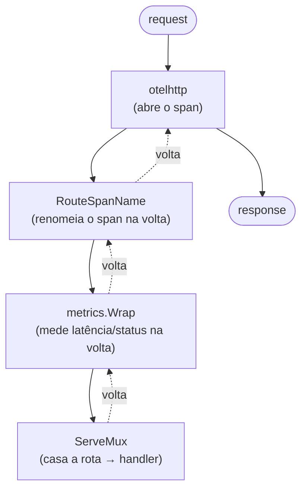

```go
// um middleware = função (http.Handler) http.Handler
func (m *Metrics) Wrap(next http.Handler) http.Handler {
	return http.HandlerFunc(func(w http.ResponseWriter, r *http.Request) {
		start := time.Now()
		rec := &statusRecorder{ResponseWriter: w, status: http.StatusOK}
		next.ServeHTTP(rec, r) // chama o handler de dentro
		// ...mede latência/status DEPOIS que ele retorna
	})
}

// composição no main: o mais externo executa primeiro
traced := otelhttp.NewHandler( //   1º: abre o span do request
	middleware.RouteSpanName( //     2º: renomeia o span pós-rota
		metrics.Wrap(mux), //        3º: mede; o mux casa a rota
	),
	"http.server",
)
```

**Pegadinha / nuance:** para capturar o **status code** (o handler escreve no `http.ResponseWriter`, mas a interface não deixa ler de volta), embrulha-se o writer num tipo que faz **embedding** da interface e sobrescreve só `WriteHeader`:

```go
type statusRecorder struct {
	http.ResponseWriter // embedding: ganha todos os métodos de graça
	status int
}
func (s *statusRecorder) WriteHeader(code int) {
	s.status = code // intercepta o valor
	s.ResponseWriter.WriteHeader(code)
}
```

Embedding é o "tem um, age como" de Go: o `statusRecorder` **é um** `http.ResponseWriter`, mas intercepta um método. É a alternativa de Go à herança.

---

## 04 — Roteamento do `net/http` (Go 1.22): método no pattern + `r.Pattern`

**O que é / por que importa:** desde o Go 1.22 o `ServeMux` da stdlib roteia por **método + caminho** (`"POST /accounts"`) — sem framework (gorilla/chi). Após o match, o pattern casado fica em `r.Pattern`, e o `net/http` o grava **no próprio request** (não num clone), então um middleware que envolve o mux consegue lê-lo **depois** que o handler retorna.

**Onde no projeto:** rotas em `services/identity-service/internal/transport/http_handler.go` (`Register`); o `r.Pattern` é consumido em `shared/middleware/metrics.go` (label de rota) e `shared/middleware/tracing.go` (nome do span).

O `r.Pattern` só existe **depois** do match — por isso renomear o span acontece na volta:

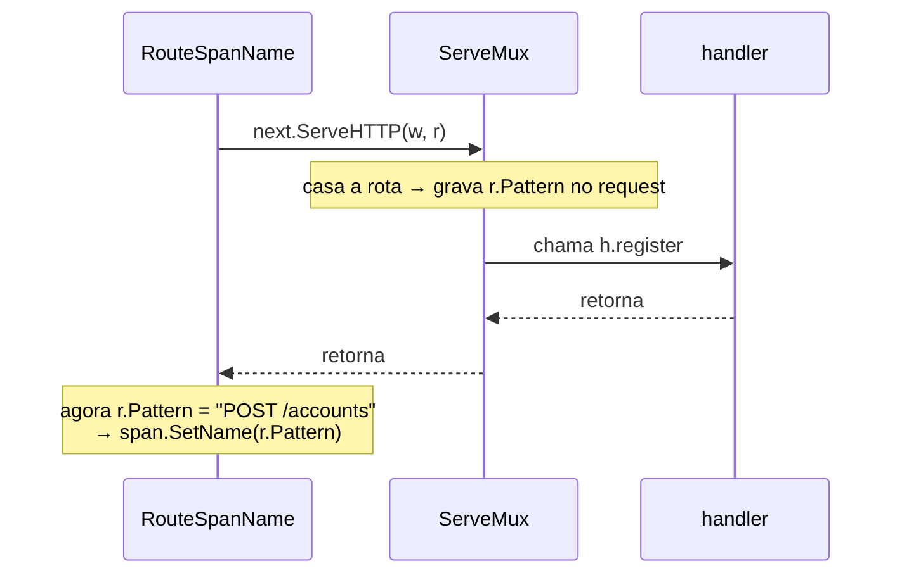

```go
mux.HandleFunc("POST /accounts", h.register) // método embutido no pattern
mux.HandleFunc("POST /sessions", h.login)
mux.HandleFunc("GET /.well-known/jwks.json", h.jwks)

// num middleware, DEPOIS de chamar o mux:
next.ServeHTTP(w, r)
route := r.Pattern // "POST /accounts" — preenchido pelo match
```

**Pegadinha / nuance:** usar `r.Pattern` (o template) e **não** `r.URL.Path` (o caminho real) como label de métrica e nome de span é o que mantém a **cardinalidade baixa** — `GET /players/{id}` vira uma série só, não uma por ID. Antes do match, `r.Pattern` está vazio: por isso o `RouteSpanName` renomeia o span só na volta do `next.ServeHTTP`.

---

## 05 — Graceful shutdown idiomático

**O que é / por que importa:** desligar o servidor "sem cortar requests no meio" em Go é a combinação de três peças da stdlib: `signal.NotifyContext` (context que cancela no SIGINT/SIGTERM), um canal para o erro de boot do servidor, e `srv.Shutdown(ctx)` (para de aceitar conexões novas e espera as em andamento até um timeout). Sem host genérico, sem framework — peças pequenas combinadas.

**Onde no projeto:** `services/identity-service/cmd/server/main.go` (`run`).


```go
errCh := make(chan error, 1)
go func() {
	if err := srv.ListenAndServe(); err != nil && !errors.Is(err, http.ErrServerClosed) {
		errCh <- err // erro real (porta ocupada etc.)
	}
}()

ctx, stop := signal.NotifyContext(context.Background(), syscall.SIGINT, syscall.SIGTERM)
defer stop()
select {
case err := <-errCh: // servidor caiu sozinho
	return fmt.Errorf("http server: %w", err)
case <-ctx.Done(): // Ctrl+C / SIGTERM do Docker
}

shutdownCtx, cancel := context.WithTimeout(context.Background(), 10*time.Second)
defer cancel()
return srv.Shutdown(shutdownCtx) // drena os requests em andamento
```

**Pegadinha / nuance:** `ListenAndServe` **sempre** retorna erro não-nil; no shutdown limpo esse erro é `http.ErrServerClosed` — por isso o `errors.Is` o filtra para não virar falha. O canal tem buffer 1 para a goroutine não vazar se ninguém ler.

---

## 06 — Cleanup como closure retornada (e o no-op quando desligado)

**O que é / por que importa:** em vez de devolver um objeto com `Close()`, um padrão muito comum em Go é o setup **retornar a própria função de limpeza** (uma closure). Quem chama só faz `defer shutdown(ctx)`. E quando o recurso está desabilitado, retorna-se uma closure **no-op** em vez de `nil` — assim o chamador nunca precisa checar nil antes de chamar.

**Onde no projeto:** `shared/telemetry/telemetry.go` (`SetupTracing`), usado em `cmd/server/main.go`.

```go
func SetupTracing(ctx context.Context, cfg Config) (func(context.Context) error, error) {
	if cfg.OTLPEndpoint == "" {
		return func(context.Context) error { return nil }, nil // no-op: tracing desligado
	}
	// ...monta o TracerProvider...
	return tp.Shutdown, nil // devolve o próprio Shutdown como handle de limpeza
}

// no main, simétrico ao shutdown do HTTP server:
shutdownTracing, err := telemetry.SetupTracing(ctx, cfg)
defer func() {
	ctx, cancel := context.WithTimeout(context.Background(), 5*time.Second)
	defer cancel()
	_ = shutdownTracing(ctx) // sempre chamável, mesmo desligado
}()
```

**Pegadinha / nuance:** repare em duas formas de configurar lado a lado no projeto: `telemetry.SetupTracing` usa uma **struct `Config`** (campos explícitos), enquanto `otelhttp.NewHandler(..., otelhttp.WithFilter(...))` usa **functional options** (`With...` variádicos). Vindo de C#, a struct lembra um objeto de opções; as functional options são o jeito idiomático de Go para "muitos parâmetros opcionais com default" sem vários construtores. Poucas opções → struct é mais simples; API de biblioteca extensível → functional options.

---

## 07 — Interface opcional via type assertion (feature detection)

**O que é / por que importa:** em Go um valor pode implementar **mais** do que a interface declarada na assinatura. Para usar uma capacidade extra **só quando ela existe**, faz-se um *type assertion* para essa interface opcional: se passar, usa; se não, fallback. É o jeito idiomático de "detectar capacidade em runtime" — parecido com `is IFoo` em C#, mas para **opt-in de comportamento**, sem obrigar todo mundo a implementá-la.

**Onde no projeto:** `shared/middleware/metrics.go` (`observeDuration`). O `prometheus.Observer` do histograma **pode** também ser um `prometheus.ExemplarObserver`; só nesse caso anexamos o `trace_id` como exemplar (é o que liga latência → trace no Grafana).

```go
func observeDuration(ctx context.Context, obs prometheus.Observer, secs float64) {
	if sc := trace.SpanContextFromContext(ctx); sc.IsSampled() {
		// obs é sempre Observer; PODE também ser ExemplarObserver
		if eo, ok := obs.(prometheus.ExemplarObserver); ok {
			eo.ObserveWithExemplar(secs, prometheus.Labels{"trace_id": sc.TraceID().String()})
			return
		}
	}
	obs.Observe(secs) // fallback: sem trace amostrado ou sem suporte a exemplar
}
```

**Pegadinha / nuance:** o `, ok` é o que torna o assertion seguro — sem ele (`obs.(prometheus.ExemplarObserver)`), um valor que **não** implementa a interface causa **panic**. A mesma técnica aparece na stdlib (ex.: checar se um `io.Writer` também é `io.ReaderFrom` para copiar mais rápido). É composição em vez de herança: capacidades se **somam**, e você pergunta por elas quando precisa.

---

## 08 — Valores request-scoped no `context.Context` (chave de tipo privado)

**O que é / por que importa:** dados que "viajam com a requisição" mas não são parâmetros explícitos — ex. o jogador que o middleware de auth resolveu a partir do JWT — vão no `context.Context` via `context.WithValue`. O idioma de Go: a **chave** é de um tipo **não exportado** do seu pacote, não uma string. Assim nenhum outro pacote consegue colidir com a sua chave nem ler seu valor por acidente. Em C# isso seria o `HttpContext.Items` ou um serviço *scoped* do DI; em Go é o próprio context, com isolamento garantido pelo tipo da chave.

**Onde no projeto:** `services/achievements-service/internal/transport/http_handler.go` — o middleware valida o token, injeta o `playerID`; os handlers o leem.

```go
type ctxKey int           // tipo privado do pacote
const playerIDKey ctxKey = iota

// no middleware, após validar o token:
ctx := context.WithValue(r.Context(), playerIDKey, playerID)
next.ServeHTTP(w, r.WithContext(ctx))

// no handler:
func playerID(ctx context.Context) string {
	id, _ := ctx.Value(playerIDKey).(string) // type assertion; "" se ausente
	return id
}
```

**Pegadinha / nuance:** usar `ctxKey` (e não `string`) é o que dá o isolamento — um `context.WithValue(ctx, "playerID", ...)` de outro pacote **não** colide com a sua chave, porque os tipos diferem. Regra prática: o context carrega só o que é **request-scoped** (quem é o usuário, trace, deadline). Dependências fixas do serviço (repo, logger, config) vão por **injeção no construtor**, nunca pelo context. Se o dado sobrevive à requisição, não é lugar de context.

---

## 09 — pgx: NULL como ponteiro, `RETURNING` como sinal e cast de tipo

**O que é / por que importa:** três detalhes do `pgx` (driver Postgres em Go) que apareceram juntos ao implementar o desbloqueio com contador idempotente — e que o EF/Dapper do mundo C# escondem. (1) Coluna **NULL-able** lê-se em **ponteiro** (`*time.Time`): `NULL` vira `nil`. (2) Um `UPSERT ... WHERE ... RETURNING` que **não afeta** linha devolve `pgx.ErrNoRows` — dá pra usar isso como **sinal** de "nada mudou". (3) Quando um parâmetro entra numa expressão (`CASE`), o Postgres às vezes não infere o tipo e assume `text` — precisa de **cast explícito** `$N::tipo`.

**Onde no projeto:** `services/achievements-service/internal/repository/postgres_achievement.go` (`RecordProgress`).

```go
var unlockedAt *time.Time // (1) nullable -> ponteiro; nil quando NULL
err := r.pool.QueryRow(ctx, q, playerID, id, target, at).Scan(&unlockedAt)
if errors.Is(err, pgx.ErrNoRows) { // (2) WHERE barrou -> linha não tocada
    return false, nil
}
return unlockedAt != nil, nil // 3 estados: 0 linhas / nil / preenchido agora
```

```sql
-- (3) sem o ::timestamptz, o Postgres infere $4 como text dentro do CASE e quebra
VALUES ($1, $2, 1, CASE WHEN 1 >= $3 THEN $4::timestamptz ELSE NULL END)
```

**Pegadinha / nuance:** o erro do cast (`column ... is of type timestamptz but expression is of type text`) **não** aparece no compilador Go — só ao rodar contra o Postgres. É mais um argumento para os testes de integração com testcontainers: o SQL só é validado de verdade contra um banco real, não pelo `go build`.

---

## 10 — Interfaces implícitas: um tipo satisfaz uma Port sem declarar

**O que é / por que importa:** em Go um tipo implementa uma interface **só por ter os métodos** — não existe `implements` nem `: IFoo`. Foi isso que permitiu o `shared/auth.Verifier` satisfazer a Port `TokenVerifier` do achievements **e** do player-data (e de qualquer serviço futuro) sem conhecer nenhum desses pacotes. Vindo de C#/Java é o **inverso**: lá o tipo declara a interface que implementa (acopla-se ao contrato). Em Go, **quem define a interface é o consumidor**, e o provedor nem sabe que ela existe.

**Onde no projeto:** `shared/auth.Verifier` (não importa nenhum domain) satisfaz `domain.TokenVerifier` tanto em `achievements-service` quanto em `player-data-service`.

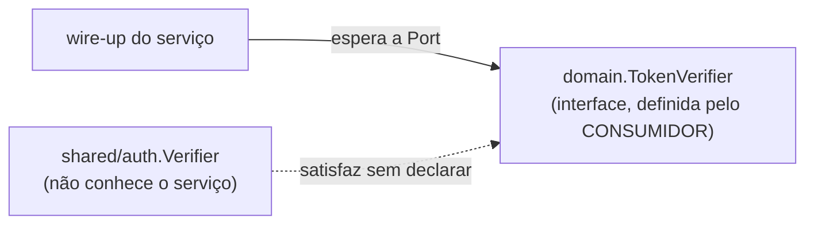

```go
// shared/auth — NÃO conhece nenhum serviço:
func (v *Verifier) Verify(ctx context.Context, token string) (string, error) { ... }

// cada serviço declara a Port que precisa, do jeito que precisa:
type TokenVerifier interface {
	Verify(ctx context.Context, token string) (playerID string, err error)
}

// no wire-up o Verifier é aceito onde a Port é esperada — sem cast, sem "implements":
handler := transport.NewHandler(svc, auth.NewVerifier(url, ttl))
```

**Pegadinha / nuance:** isso é a base do **hexagonal idiomático em Go** (ADR-0002) — a interface mora no `domain` (o lado de dentro, que a define do tamanho exato que precisa) e os adapters a satisfazem de fora **sem importá-la**. Por isso as Ports são pequenas e específicas por serviço, e `interface` de uma linha é comum e saudável (ao contrário do C#, onde interfaces tendem a ser grandes e centralizadas). O `var _ domain.X = (*T)(nil)` nos adapters é só uma **asserção de compilação** que falha cedo se o tipo deixar de satisfazer a Port.

---

## 11 — Limitar o corpo do request com `http.MaxBytesReader`

**O que é / por que importa:** aceitar um upload (ex. um save de jogo) sem limite é um vetor de OOM/DoS — um cliente manda 2 GB e derruba o serviço. A stdlib resolve com `http.MaxBytesReader`, que envolve o `r.Body` e corta a leitura ao passar do limite, devolvendo um `*http.MaxBytesError`. Em C# seria o `MaxRequestBodySize` do Kestrel; em Go é uma linha no handler.

**Onde no projeto:** `services/cloud-save-service/internal/transport/http_handler.go` (`save`).

```go
r.Body = http.MaxBytesReader(w, r.Body, maxSaveBytes) // ex. 5 MiB
blob, err := io.ReadAll(r.Body)
if err != nil {
	var mbe *http.MaxBytesError
	if errors.As(err, &mbe) { // estourou o limite
		writeError(w, http.StatusRequestEntityTooLarge, "too_large") // 413
		return
	}
	writeError(w, http.StatusBadRequest, "bad_request")
	return
}
```

**Pegadinha / nuance:** o `MaxBytesReader` recebe o `w` (ResponseWriter) de propósito — ao estourar, sinaliza a conexão para não seguir lendo um corpo gigante. E o erro de limite é um **tipo concreto** (`*http.MaxBytesError`), pego com `errors.As` (mesmo padrão do #09): é o que permite distinguir "grande demais" (413) de um erro de leitura genérico (400).

---

## 12 — O "zero value problem": ponteiro para distinguir ausente de zero no JSON

**O que é / por que importa:** em Go toda struct nasce com zero values (`0`, `""`, `false`) — não há `null` para tipos básicos. No decode de JSON isso cria ambiguidade: `{"score": 0}` e `{}` produzem o **mesmo** `score == 0`. Para distinguir "enviou zero" de "não enviou", usa-se um **ponteiro** (`*int64`): `nil` = ausente, aponta = valor (mesmo que zero). Vindo de C#, é o papel do `int?` + `[Required]` juntos.

**Onde no projeto:** `services/leaderboard-service/internal/transport/http_handler.go` (`submit`) — um `POST /scores` sem `score` deve dar 400, não virar um score 0 válido.

```go
var req struct {
	Score *int64 `json:"score"` // ponteiro: nil quando o campo não veio no JSON
}
if err := json.NewDecoder(r.Body).Decode(&req); err != nil || req.Score == nil {
	writeError(w, http.StatusBadRequest, "invalid_score") // ausente -> 400
	return
}
score := *req.Score // aqui, 0 seria um score válido e explícito
```

**Pegadinha / nuance:** é o mesmo idioma do ponteiro-como-opcional do #09 (`*time.Time` para `NULL` do SQL) — a forma idiomática de Go expressar "ausência" em valores que têm zero value. Use só onde a distinção importa (campo opcional, checar presença); para campos sempre obrigatórios, o valor direto é mais simples.

---

## 13 — Channels + `select`: coordenando goroutines

**O que é / por que importa:** o jeito idiomático de goroutines conversarem é por **channels**, não só por memória compartilhada com lock. No matchmaking, o handler do stream (uma goroutine por cliente) **espera** o resultado num channel, enquanto o worker de formação (outra goroutine) **envia** o match nesse channel. O `select` deixa uma goroutine aguardar **vários eventos ao mesmo tempo** — o match *ou* o cancelamento do cliente. É o "share memory by communicating" de Go, e é a peça que faltava (o #01 era a outra ponta: lock para estado compartilhado).

**Onde no projeto:** `services/matchmaking-service/internal/service/matchmaker.go` (worker envia em `ticket.ch`) e `internal/transport/grpc_server.go` (`FindMatch` espera com `select`).

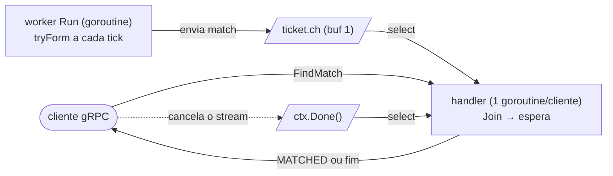

```go
// handler: o match OU o cancelamento, o que vier primeiro
select {
case match := <-ch:
	return stream.Send(&pb.TicketUpdate{Status: pb.Status_STATUS_MATCHED /* ... */})
case <-stream.Context().Done():
	return stream.Context().Err() // cliente saiu
}

// worker: entrega e fecha
t.ch <- match // buffer 1: não bloqueia mesmo se o cliente já saiu
close(t.ch)
```

**Pegadinha / nuance:** o channel com **buffer 1** é deliberado — se o cliente cancelou entre a formação e o envio, `t.ch <- match` não pode **bloquear** o worker (que segura o mutex da fila). O buffer absorve o envio e a mensagem é descartada. E `select` com `<-ctx.Done()` é o padrão universal de "faça X, mas desista se o context cancelar": toda espera deve ter esse braço, senão a goroutine vaza.

---

## 14 — Um serviço como cliente gRPC de outro (e o `internal/` que blinda fronteiras)

**O que é / por que importa:** até aqui cada serviço *expunha* gRPC; agora o matchmaking **consome** o gRPC do session — vira cliente de outro serviço. O padrão no consumidor: abrir uma conexão com `grpc.NewClient`, instanciar o client gerado e chamá-lo como se fosse uma função local. O detalhe idiomático é **traduzir o erro de transporte de volta para um erro de domínio**: o gRPC devolve um `status` com `codes.X`, e o adapter mapeia isso para um erro sentinela do domínio, para o resto do serviço nunca depender de tipos gRPC. É o equivalente Go de, em C#/.NET, um cliente `Grpc.Net.Client` cujo `RpcException.StatusCode` você converte numa exceção/erro do seu domínio.

**Onde no projeto:** `services/matchmaking-service/internal/sessionclient/grpc_client.go` (adapter que implementa a Port `domain.SessionProvisioner`) e o wire-up em `cmd/server/main.go` (dial + `otelgrpc` no client para o trace cross-service). A Port fica em `internal/domain/matchmaking.go`.

```go
// adapter: chama o gRPC do session e traduz o resultado/erro para o domínio
func (c *Client) Provision(ctx context.Context, matchID string, players []string) (domain.Provisioned, error) {
	resp, err := c.session.CreateSession(ctx, &sessionv1.CreateSessionRequest{
		MatchId: matchID, Players: players,
	})
	if err != nil {
		if status.Code(err) == codes.ResourceExhausted { // erro de transporte...
			return domain.Provisioned{}, domain.ErrNoServer // ...vira erro de domínio
		}
		return domain.Provisioned{}, fmt.Errorf("sessionclient: provision: %w", err)
	}
	// ... mapeia resp.Grants -> Provisioned.Tokens (por playerID)
}
```

```go
// main: a conexão é uma dependência com lifecycle (fechar no shutdown).
// otelgrpc no client propaga o trace: o span do FindMatch continua no CreateSession.
sessionConn, _ := grpc.NewClient(os.Getenv("SESSION_GRPC_ADDR"),
	grpc.WithTransportCredentials(insecure.NewCredentials()),
	grpc.WithStatsHandler(otelgrpc.NewClientHandler()),
)
defer sessionConn.Close()
provisioner := sessionclient.New(sessionv1.NewSessionClient(sessionConn))
```

**Pegadinha / nuance:** o pacote `internal/` do Go é uma **fronteira imposta pelo compilador**, não convenção. Código só pode importar `.../X/internal/...` se estiver dentro da subárvore de `X`. Por isso o teste do matchmaking **não pôde** subir o session real reusando `session-service/internal/...` — a solução foi um *fake* que implementa o **contrato gerado** (`sessionv1.SessionServer`), que é público (fica em `gen/`, não em `internal/`). Lição: o que é contrato entre serviços vai para um pacote público (o `gen/` do proto); o que é detalhe interno fica em `internal/` e o compilador garante que ninguém de fora encoste. `grpc.NewClient` (substituto do antigo `grpc.Dial`) é **lazy** — não conecta na hora; a conexão sobe na primeira RPC, então um session fora do ar não derruba o boot do matchmaking, vira erro na chamada (que viramos `STATUS_FAILED`).

---

## 15 — Fan-out concorrente com `errgroup` (agregar várias fontes)

**O que é / por que importa:** quando você precisa de **N chamadas independentes** e quer o resultado de todas (ou o primeiro erro), o idioma é `golang.org/x/sync/errgroup`: dispara cada uma numa goroutine, espera todas com `Wait()`, e o **primeiro erro cancela o `ctx`** das demais (via `errgroup.WithContext`). É o "share by communicating" aplicado a I/O paralelo — e o análogo direto do `Task.WhenAll` do C#/.NET, mas com **cancelamento por context** embutido. Difere dos aprendizados anteriores de concorrência: o #01 era `sync.Mutex` (estado compartilhado) e o #13 era `channels`+`select` (coordenar produtor/consumidor); aqui o objetivo é **paralelizar e juntar**.

**Onde no projeto:** `services/admin-bff/internal/service/admin_service.go` — `LiveMetrics` consulta 4 métricas do Prometheus em paralelo. O admin-bff é um agregador (BFF): juntar várias fontes rápido é exatamente o seu trabalho.

```go
func (s *Service) LiveMetrics(ctx context.Context) (domain.LiveMetrics, error) {
	var lm domain.LiveMetrics
	g, ctx := errgroup.WithContext(ctx) // 1º erro cancela o ctx das outras
	// Cada goroutine escreve um CAMPO DISTINTO de lm — locais de memória
	// independentes, então não há corrida (não precisa de mutex aqui).
	g.Go(func() (err error) { lm.QueueSize, err = s.scalar(ctx, "matchmaking_queue_size"); return })
	g.Go(func() (err error) { lm.ActiveSessions, err = s.scalar(ctx, "session_active_sessions"); return })
	g.Go(func() (err error) { lm.MatchesTotal, err = s.scalar(ctx, "matchmaking_matches_total"); return })
	g.Go(func() (err error) { lm.MatchesFailed, err = s.scalar(ctx, "matchmaking_matches_failed_total"); return })
	if err := g.Wait(); err != nil { // espera todas; devolve o 1º erro
		return domain.LiveMetrics{}, err
	}
	return lm, nil
}
```

**Pegadinha / nuance:** escrever em **campos distintos** do mesmo struct de goroutines diferentes é seguro (são endereços de memória separados — `-race` não acusa). O que **seria** corrida é duas goroutines escreverem o **mesmo** campo, ou darem `append` no mesmo slice — aí precisaria de mutex ou de cada uma escrever no seu índice. Outro ponto: o `errgroup.WithContext` devolve um **novo** `ctx` que você precisa repassar às chamadas (`s.scalar(ctx, ...)`), senão o cancelamento no primeiro erro não chega às outras. E a degradação é decisão de quem chama: aqui um erro de qualquer query derruba o `LiveMetrics` inteiro (vira 503), enquanto a `Topology` trata "fonte fora" como estado normal (degrada) em vez de erro — o mesmo `errgroup` serviria, mas a política de erro é do caso de uso.

---

## 16 — `http.RoundTripper` para auth de saída + middleware com `crypto/subtle`

**O que é / por que importa:** dois lados da auth serviço-a-serviço (ADR-0018), ambos idiomáticos em Go. (1) No **callee**, um middleware (`func(http.Handler) http.Handler`) valida um segredo no header — comparado com **`crypto/subtle.ConstantTimeCompare`** para não vazar timing. (2) No **caller**, em vez de setar o header em cada request, embrulha-se o `http.RoundTripper` do client: toda chamada de saída ganha o header automaticamente. É o ponto de extensão do `net/http` para cross-cutting de saída (auth, tracing, retries) — o `otelhttp.NewTransport` é exatamente isso, e a gente compõe os dois.

**Onde no projeto:** `shared/auth/internal_key.go` — `RequireInternalKey` (middleware, só nos prefixos `/admin`/`/games`) e `InternalKeyTransport` (RoundTripper). O `admin-bff` compõe: `auth.InternalKeyTransport(key, otelhttp.NewTransport(...))` — um único client injeta a chave em todas as fontes.

```go
// caller: um RoundTripper que injeta o header em toda request de saída
type internalKeyTransport struct {
	key  string
	base http.RoundTripper // encadeia (ex.: otelhttp por baixo)
}

func (t internalKeyTransport) RoundTrip(r *http.Request) (*http.Response, error) {
	r2 := r.Clone(r.Context()) // NUNCA mutar o request original
	r2.Header.Set("X-Internal-Key", t.key)
	return t.base.RoundTrip(r2)
}

// callee: comparação em tempo constante (não "==" para segredos)
if subtle.ConstantTimeCompare([]byte(got), []byte(expected)) != 1 { /* 401 */ }
```

**Pegadinha / nuance:** o contrato do `RoundTripper` diz que ele **não deve modificar o request original** — daí o `r.Clone(ctx)` antes de setar o header (mutar direto pode corromper retries/concorrência). E o middleware aplica o check **por prefixo de path** (`/admin`), deixando `/healthz` e `/metrics` livres — senão o Prometheus não conseguiria raspar. "Fail closed": chave não configurada → nega as rotas protegidas (em vez de liberar por engano).

## 17 — Um `querier` que é pool **ou** transação (idempotência com pgx)

**O que é / por que importa:** para o fan-out durável (ADR-0020) o consumidor precisa aplicar o resultado da partida **e** marcá-la como processada de forma **atômica** — senão um crash no meio deixa a partida "processada" sem efeito (ou o SQS reentrega e dobra o progresso). A solução é uma transação. O problema idiomático: eu já tinha as queries (`FindByEventType`, `RecordProgress`) rodando sobre o `*pgxpool.Pool`, e não queria duplicá-las só para rodar sobre uma `pgx.Tx`. A saída é uma **interface pequena que `*pgxpool.Pool` e `pgx.Tx` satisfazem os dois** (interfaces implícitas, entrada 10) — as funções passam a receber esse `querier` e não sabem se estão dentro ou fora de uma transação.

**Onde no projeto:** `achievements-service/internal/repository/postgres_achievement.go` (`querier`, `findByEventType`, `recordProgress`, `ApplyMatchResult`).

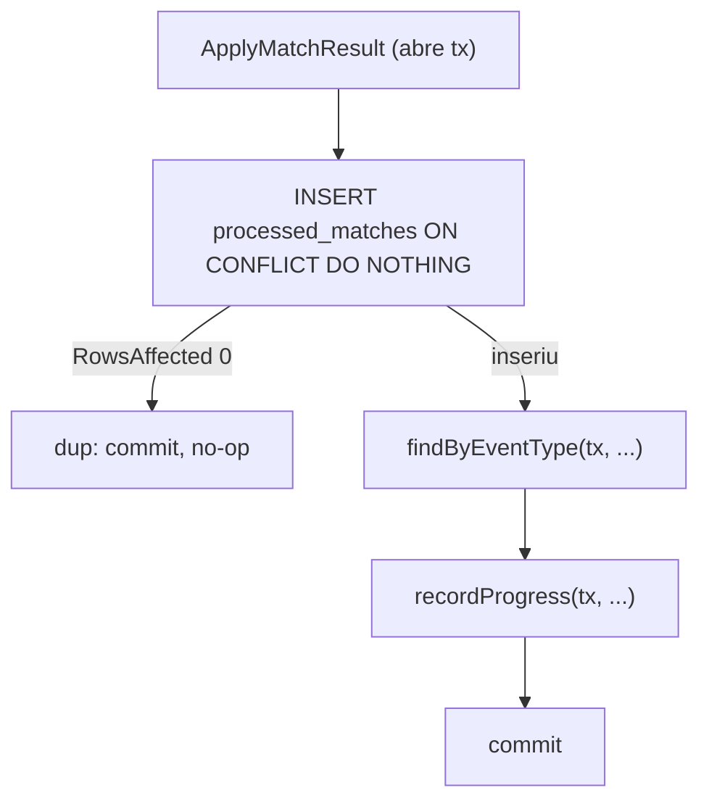

```go
// A mesma query serve pool E tx: ambos têm Query/QueryRow/Exec.
type querier interface {
	Query(ctx context.Context, sql string, args ...any) (pgx.Rows, error)
	QueryRow(ctx context.Context, sql string, args ...any) pgx.Row
	Exec(ctx context.Context, sql string, args ...any) (pgconn.CommandTag, error)
}

// Fora de transação: passa o pool.
func (r *PostgresAchievementRepository) RecordProgress(ctx context.Context, /* ... */) (bool, error) {
	return recordProgress(ctx, r.pool, /* ... */) // r.pool satisfaz querier
}

// Dentro de transação: passa a tx (mesma função, sem duplicar SQL).
func (r *PostgresAchievementRepository) ApplyMatchResult(ctx context.Context /* ... */) (bool, error) {
	tx, err := r.pool.Begin(ctx)
	if err != nil { return false, err }
	defer func() { _ = tx.Rollback(ctx) }() // no-op depois do Commit

	tag, _ := tx.Exec(ctx, `INSERT INTO processed_matches (match_id, game_id)
	                        VALUES ($1,$2) ON CONFLICT DO NOTHING`, matchID, gameID)
	if tag.RowsAffected() == 0 {
		return true, tx.Commit(ctx) // já processada: idempotente
	}
	// ... findByEventType(ctx, tx, ...) + recordProgress(ctx, tx, ...) ...
	return false, tx.Commit(ctx)
}
```

**Pegadinha / nuance:** dois detalhes valem ouro. (1) `defer tx.Rollback(ctx)` **sempre** — depois de um `Commit` bem-sucedido o Rollback vira no-op (retorna `ErrTxClosed`, que ignoramos), então você nunca esquece de desfazer nos caminhos de erro/panic. É o equivalente pgx do `using`/`TransactionScope` do C#, mas explícito. (2) A idempotência sai de graça do banco: `INSERT ... ON CONFLICT DO NOTHING` + `tag.RowsAffected() == 0` é o teste de "já vi essa partida?" **na mesma transação** que aplica o efeito — sem `SELECT` antes (que teria corrida entre o check e o insert). Contraste com C#/.NET: em vez de um `SemaphoreSlim` ou lock distribuído, você deixa o Postgres arbitrar via constraint.

## 18 — Worker pool: fan-out/fan-in com channels, resultado por trabalho e shutdown ordenado

**O que é / por que importa:** o analytics-service (ADR-0021) processa o fan-out das partidas com um **worker pool** — o *core* de concorrência do serviço (não um loop simples como os consumers da 006). É o padrão de Go que faltava: um channel de `jobs`, N goroutines consumindo, e um channel de retorno **por trabalho** para o produtor saber o resultado. A sacada é o `done chan error` embutido no job: o consumidor SQS submete e **espera** o resultado para deletar a mensagem só no sucesso (at-least-once → DLQ em falha) — sem isso, um pool assíncrono não conseguiria confirmar a entrega.

**Onde no projeto:** `analytics-service/internal/service/pool.go` (o pool) + `internal/consumer/consumer.go` (fan-out do batch → fan-in dos `done`).

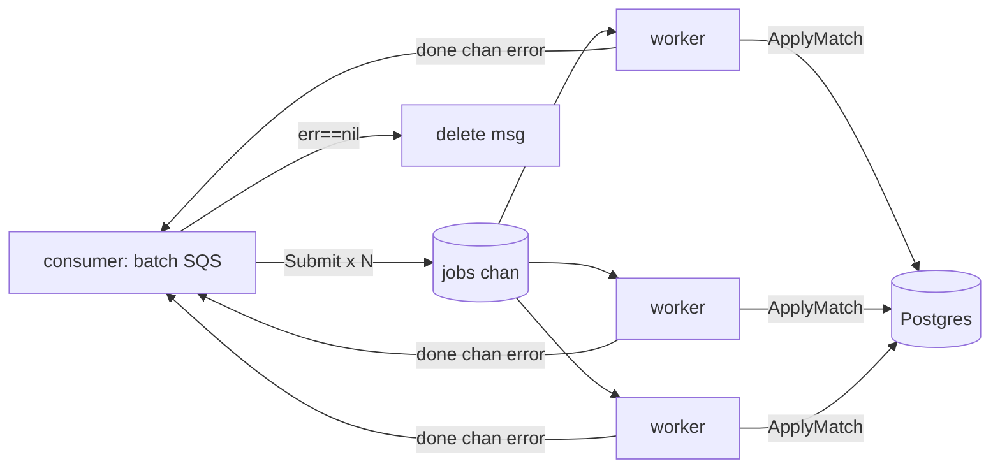

```go
type job struct {
	match domain.MatchResult
	done  chan error // resultado deste trabalho específico
}

func (p *Pool) Submit(ctx context.Context, m domain.MatchResult) <-chan error {
	done := make(chan error, 1) // buffer 1: o worker nunca bloqueia ao responder
	select {
	case <-ctx.Done(): // shutdown: não enfileira, devolve o erro do ctx
		done <- ctx.Err()
	case p.jobs <- job{match: m, done: done}: // contrapressão: bloqueia se cheio
	}
	return done
}

func (p *Pool) worker(ctx context.Context) {
	defer p.wg.Done()
	for {
		select {
		case <-ctx.Done():
			return
		case j, ok := <-p.jobs:
			if !ok { // channel fechado (Stop): drena o que sobrou e sai
				return
			}
			j.done <- p.applyAndObserve(ctx, j.match)
		}
	}
}

// Stop: fecha o channel e espera os workers drenarem. Ordem importa —
// parar o consumidor ANTES, senão haveria Submit num pool fechado (panic).
func (p *Pool) Stop() { close(p.jobs); p.wg.Wait() }
```

**Pegadinha / nuance:** três detalhes que só o Go ensina direito aqui. (1) **`done` com buffer 1** — o worker faz `j.done <- err` e segue sem bloquear, mesmo que o consumidor ainda não esteja lendo aquele `done` específico (ele lê todos em sequência depois). (2) **`close(jobs)` é o sinal de "acabou"**: o `for range`/`<-jobs` com o segundo retorno `ok` deixa os workers **drenarem** o que já estava enfileirado antes de sair — nenhum trabalho aceito se perde. (3) **Ordem de shutdown**: parar o consumidor → `pool.Stop()`; inverter isso daria `send on closed channel`. Contraste com C#/.NET: é o mesmo território de `Channel<T>` + `BackgroundService`, mas em Go o `select` sobre `ctx.Done()` e o channel é a espinha do cancelamento cooperativo — sem `CancellationToken` separado, o `context` já é o canal de parada. Reaproveita as entradas [[13]] (channels + select) e [[05]] (graceful shutdown).

---

## 19 — Dependência opcional como interface `nil` (e a armadilha do *typed-nil*)

**O que é / por que importa:** nem toda Port precisa existir sempre. O session-service (spec 008, ADR-0022) reconcilia sessões órfãs contra o Agones **quando** há uma fonte de verdade de liveness — no modo `static` (dev) não há. Em vez de criar um *null object* ou uma flag, a Port `ServerRegistry` é **opcional**: o `Service` guarda `registry domain.ServerRegistry` e o método simplesmente **retorna cedo se `registry == nil`**. `nil` É o "desligado". Diferente do #07 (que detecta uma capacidade *extra* de um valor presente via type assertion), aqui a **dependência inteira** pode estar ausente.

**Onde no projeto:** `session-service/internal/service/session_service.go` (`reconcile` começa com `if s.registry == nil { return 0 }`) e `cmd/server/main.go` (`buildAllocator` devolve `registry` = adapter Agones no modo agones, **interface nil** no static).

```go
// no service: nil = sem fonte de verdade de liveness → não reconcilia.
func (s *Service) reconcile(ctx context.Context, grace time.Duration, log *slog.Logger) int {
	if s.registry == nil {
		return 0
	}
	// ...
}

// no main: a variável é declarada como o TIPO DA INTERFACE e só é atribuída
// no modo agones. No static ela permanece uma interface genuinamente nil.
var registry domain.ServerRegistry // nil
switch mode { /* ... */
case "agones":
	ag := allocator.NewAgones(client, ns, fleet)
	alloc, registry = ag, ag // mesmo adapter serve alocação E liveness
}
```

**Pegadinha / nuance:** o *typed-nil* é o buraco clássico de Go. Se eu tivesse escrito `var ag *allocator.Agones` (ponteiro nil concreto) e passado esse `ag` para `WithServerRegistry(ag)`, a interface resultante **não seria nil** — ela carrega o par `(tipo=*Agones, valor=nil)`, e `s.registry == nil` daria **false**, entrando no `reconcile` e chamando método num ponteiro nil → panic. A defesa é declarar a variável já como **o tipo da interface** (`var registry domain.ServerRegistry`) e só atribuir um valor concreto quando ele existe de verdade — assim o "vazio" é uma interface nil de verdade. Contraste com C#: lá `null` é só `null`, não existe esse par tipo+valor; a checagem `_registry is null` nunca te surpreende. Em Go, "interface nil" ≠ "interface com ponteiro nil dentro". Relaciona com [[07]] (capacidade opcional de um valor presente) e [[10]] (interfaces implícitas).

## 20 — Tagged union por ponteiro (discriminated union) para params polimórficos

**O que é / por que importa:** às vezes um campo precisa ter **uma de várias formas**, escolhida por um discriminador. Em C# você faria herança/`abstract` ou um `oneof`/união; Go não tem união nativa. O padrão idiomático é um **struct com um ponteiro por variante** e um campo discriminador string — exatamente um ponteiro é não-nil, indicado pelo discriminador. Type-safe, serializa em JSON/JSONB natural e é fácil de estender (nova variante = novo ponteiro), sem `any` nem type-switch mágico no domínio.

**Onde no projeto:** `game-registry/internal/domain/game.go` — `MultiplayerProfile` guarda o perfil de multiplayer de um jogo (ADR-0023). O `Archetype` discrimina; no MVP só existe `QueueArena`, mas `battle_royale`/`coop_mission` (fichas de `docs/game-models/`) entram como novos ponteiros. A validação da invariante (o ponteiro do arquétipo declarado é o único não-nil) vive no `service` (`profile_service.go`); a persistência isola o formato num struct-espelho com tags JSON no `repository` (`postgres_profile.go`), mantendo o domínio limpo.

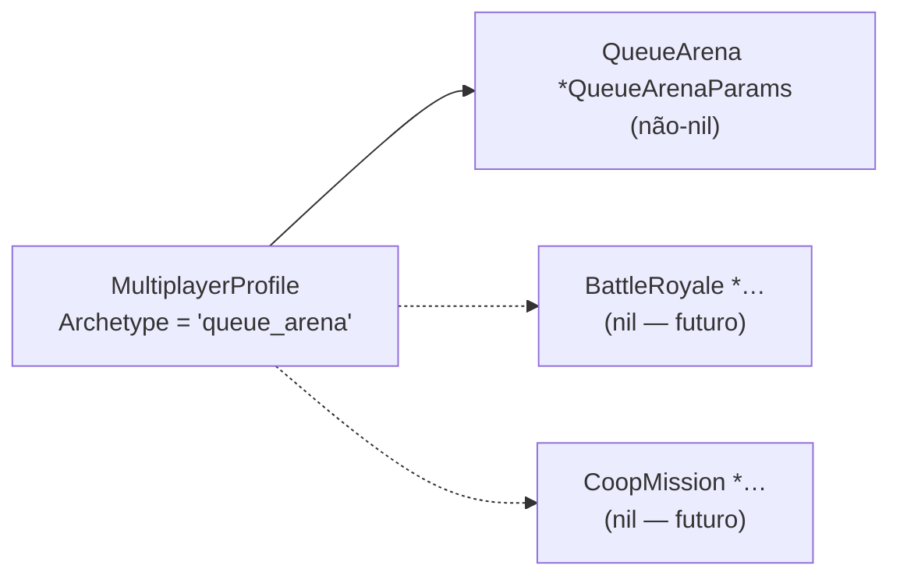

```go
type MultiplayerProfile struct {
	Archetype  string // discriminador: "queue_arena" | (futuro) "battle_royale" | ...
	Topology   string
	QueueArena *QueueArenaParams // não-nil sse Archetype == "queue_arena"
	// BattleRoyale *BattleRoyaleParams // nova variante entra aqui
}

// invariante conferida no service (não no tipo):
func check(p MultiplayerProfile) error {
	if p.Archetype == ArchetypeQueueArena && p.QueueArena == nil {
		return ErrInvalidProfileParams // discriminador diz queue_arena, mas faltam os params
	}
	return nil
}
```

**Pegadinha / nuance:** o compilador **não** garante a invariante — nada impede `Archetype="queue_arena"` com `QueueArena==nil`, ou dois ponteiros não-nil ao mesmo tempo. Isso é responsabilidade de validação em runtime (aqui, no `service`). É o trade-off vs. uma união de verdade: mais simples e explícito, mas a coerência discriminador↔ponteiro é sua para manter. Diferente do [[12]] (ponteiro para distinguir *ausente* de *zero* num escalar), aqui o ponteiro seleciona **qual sub-struct** está ativa. Relaciona com [[09]] (NULL como ponteiro no pgx).

## 21 — Decorator de uma Port de domínio (cache transparente)

**O que é / por que importa:** para adicionar um *cross-cutting concern* (cache, retry, logging) a uma dependência **sem** tocar quem a usa nem quem a implementa, escreve-se um tipo que **implementa a mesma interface que recebe** e delega ao "inner", interceptando no meio. É o Decorator do GoF, e em Go sai de graça por causa das interfaces implícitas ([[10]]): o consumidor recebe a Port e não sabe se é o adapter real ou um wrapper. Mesma técnica de [[03]] (middleware de `http.Handler`) e [[16]] (`http.RoundTripper`), mas aqui aplicada a uma **Port de domínio própria**, não a uma abstração de infra HTTP.

**Onde no projeto:** `matchmaking-service/internal/profilecache` — `CachingProvider` decora `domain.ProfileProvider` (que dita o tamanho do match por jogo, ADR-0023): memoriza `gameID → tamanho` com TTL, servindo do cache no hit e só chamando o adapter HTTP (`registryclient`) no miss. O matchmaker recebe um `ProfileProvider` e é **alheio** ao cache; o wire-up aninha no `main`: `profilecache.New(registryclient.New(url, httpClient), ttl)`.

```go
type CachingProvider struct {
	inner domain.ProfileProvider // a MESMA Port que este tipo implementa
	ttl   time.Duration
	mu    sync.Mutex
	cache map[string]entry
}

func (c *CachingProvider) MatchSize(ctx context.Context, gameID string) (int, error) {
	c.mu.Lock()
	if e, ok := c.cache[gameID]; ok && time.Now().Before(e.expiry) {
		c.mu.Unlock()
		return e.size, nil // hit: nem toca no inner
	}
	c.mu.Unlock()
	size, err := c.inner.MatchSize(ctx, gameID) // miss: delega
	if err != nil {
		return 0, err // erro não é cacheado
	}
	c.mu.Lock(); c.cache[gameID] = entry{size, time.Now().Add(c.ttl)}; c.mu.Unlock()
	return size, nil
}
```

**Pegadinha / nuance:** decisões de política vivem no decorator, não na interface — aqui, **não cachear erros** (senão um "registry fora" fixaria o jogo como "sem perfil" por todo o TTL) e **não segurar o lock durante a chamada ao inner** (I/O sob mutex serializaria tudo; o custo é dois misses concorrentes poderem ambos buscar — inofensivo). Em C#/.NET seria um decorator via DI registrando `IProfileProvider` → `CachingProfileProvider` que recebe o inner; a diferença é que em Go não há registro/atributo: basta o tipo ter o método, e o aninhamento é manual e explícito no `main`.

## 22 — `oneof` do protobuf ↔ tagged union do domínio (a ponte no transport)

**O que é / por que importa:** quando um campo tem **uma de várias formas**, o protobuf oferece o `oneof` (discriminated union no wire) e o domínio Go usa a tagged union por ponteiro ([[20]]). Os dois se **espelham**, e o adapter de transport é a ponte: traduz o campo setado do `oneof` para o ponteiro correspondente do domínio (e vice-versa). Assim o wire e o domínio evoluem juntos — cada novo arquétipo é **um campo no `oneof`** e **um ponteiro no struct**.

**Onde no projeto:** `session-service` — `ReportResultRequest { string match_id; oneof outcome { WinLossDrawResult win_loss_draw = 2; } }` (ADR-0023, resultado polimórfico). O `transport/grpc_server.go` mapeia com `toMatchOutcome`; novos kinds (placement/collective/role_event) entram como novos ramos do `oneof` e do `switch`.

```protobuf
message ReportResultRequest {
  string match_id = 1;
  oneof outcome { WinLossDrawResult win_loss_draw = 2; } // + placement/collective/... depois
}
```
```go
// transport: oneof (wire) -> tagged union (domínio)
func toMatchOutcome(req *pb.ReportResultRequest) domain.MatchOutcome {
	if wld := req.GetWinLossDraw(); wld != nil { // getter do oneof: nil se não setado
		// ... monta players ...
		return domain.MatchOutcome{Kind: domain.OutcomeWinLossDraw, WinLossDraw: &domain.WinLossDrawResult{Players: players}}
	}
	return domain.MatchOutcome{} // nenhum ramo setado -> Kind "" -> rejeitado na validação
}
```

**Pegadinha / nuance:** o protoc gera para cada ramo um **tipo wrapper** (`ReportResultRequest_WinLossDraw`) e o getter `GetWinLossDraw()` devolve `nil` quando o ramo não está setado — então "nenhum outcome enviado" vira `Kind: ""`, que a validação do service rejeita (`ErrUnsupportedOutcome` → `InvalidArgument`). Diferente de C#, onde o `oneof` do protobuf vira um `enum XCase` + propriedade; em Go o discriminador é implícito no ponteiro não-nil. Nunca confie no cliente ter setado o ramo: trate o "vazio" explicitamente.

---

## 23 — `json.RawMessage`: passthrough sem re-decodificar (o BFF que não interpreta)

**O que é / por que importa:** `json.RawMessage` é `[]byte` com métodos `MarshalJSON`/`UnmarshalJSON` que **não fazem nada** — o encoding/json trata o valor como JSON já serializado e o copia verbatim. É a ferramenta certa quando uma camada precisa **carregar** um JSON sem conhecer sua forma: o admin-bff repassa o perfil de multiplayer (ADR-0023) do painel para o game-registry e de volta sem se acoplar aos campos — quando o modelo crescer (novos arquétipos), o BFF não muda. É o "objeto opaco" que em C#/.NET você resolveria com `JsonElement`/`JObject`, mas aqui é literalmente o slice de bytes cru.

**Onde no projeto:** `admin-bff` (spec 012) — `domain.GameRegistry.GetMultiplayerProfile/SetMultiplayerProfile` usam `json.RawMessage`; o adapter faz `io.ReadAll` do corpo e o handler escreve com `writeRawJSON` (sem `json.Encode`, que re-serializaria à toa). A validação fica só no game-registry (a verdade); o BFF é passthrough.

```go
// Port: o tipo carregado é JSON cru — o BFF não conhece a forma.
GetMultiplayerProfile(ctx context.Context, gameID string) (json.RawMessage, error)

// Adapter: lê o corpo verbatim (upstream.Do já classificou 2xx/4xx).
raw, err := io.ReadAll(resp.Body)
return raw, err

// Transport: repassa os bytes sem re-decodificar (Encode reprocessaria).
func writeRawJSON(w http.ResponseWriter, status int, raw json.RawMessage) {
	w.Header().Set("Content-Type", "application/json")
	w.WriteHeader(status)
	_, _ = w.Write(raw) // já é JSON válido: só copia
}
```

**Pegadinha / nuance:** `json.RawMessage` **não valida** que os bytes são JSON — só os carrega. Se você aceitar um `RawMessage` de fora e reencaminhar, um corpo lixo passa batido (aqui tudo bem: o game-registry rejeita o que for inválido). E no PUT eu leio `r.Body` com `io.ReadAll` em vez do `decode`/`DisallowUnknownFields` usado nos outros handlers — de propósito: campos desconhecidos são responsabilidade do dono da validação (o backend de domínio), não do passthrough. Contraste com [[22]] (`oneof`/tagged union): lá o transport **conhece e traduz** a forma; aqui ele deliberadamente **não conhece** — dois extremos do mesmo eixo "quanto a borda sabe do payload".

---

## 24 — SQL montado por modo + a inferência de tipo do parâmetro no pgx

**O que é / por que importa:** às vezes duas variantes de uma operação diferem só numa **expressão** dentro de um SQL grande (o resto — INSERT/ON CONFLICT/RETURNING — é idêntico). Em vez de duplicar a query, monta-se a fração que varia numa `string` e concatena-se. Fiz isso no critério por stat das conquistas (ADR-0023 A1): `cumulative` soma (`progress + delta`) e `per_match` guarda o melhor (`GREATEST(progress, delta)`) — mesma instrução, expressão trocada por `mode`. É o "SQL como dado" com parcimônia: só o operador muda, os placeholders `$n` continuam os mesmos (nunca interpolar valor — sempre parâmetro).

**Onde no projeto:** `achievements-service/internal/repository/postgres_achievement.go` — `recordStatProgress`. A idempotência é de graça: o incremento cumulativo roda dentro da MESMA tx que marca `processed_matches`, e essa tx só executa uma vez por `matchID` — então somar não corre risco de dupla contagem (diferente de um `ZINCRBY` solto, que a fatia A2 do leaderboard vai ter que deduplicar à mão).

```go
progressExpr := "LEAST(player_achievements.progress + $6::bigint, $4)::int" // cumulative
if mode == domain.StatModePerMatch {
    progressExpr = "LEAST(GREATEST(player_achievements.progress::bigint, $6::bigint), $4)::int"
}
q := `... ON CONFLICT (...) DO UPDATE SET progress = ` + progressExpr + ` WHERE ...`
```

**Pegadinha / nuance:** o `$6` (delta, um `int64`) sem cast explícito fez o Postgres inferir o tipo como **`text`** — porque o mesmo placeholder aparece em vários contextos e o planner não conseguiu unificar. Resultado: `GREATEST(integer, text) cannot be matched` / `column is of type integer but expression is of type bigint`. A cura é **castar o parâmetro na própria SQL** (`$6::bigint`) e o resultado final para a coluna (`::int`, já capado em `$4`). Diferente de C#/EF, onde o tipo do parâmetro vem do CLR e o provider resolve; no pgx o parâmetro chega ao servidor com tipo a inferir, e em query montada essa inferência falha calada até o operador reclamar. Regra: quando um placeholder numérico entra em `GREATEST`/`LEAST`/aritmética misturada, casta explícito.

---

## 25 — Script Lua no Redis: idempotência atômica que a operação não dá de graça

**O que é / por que importa:** o Redis executa cada script Lua (`EVAL`/`redis.NewScript`) de forma **atômica** — nenhum outro comando entrelaça no meio. Isso o torna a ferramenta certa quando você precisa de "checa-e-age" indivisível que um único comando não oferece. No leaderboard cumulativo (ADR-0023 A2) o problema é: `ZINCRBY` **não** é idempotente (somar de novo dobra), e o SQS entrega at-least-once. A solução é um script que faz `SADD` do `matchID` num SET de processados e, **só se for novo**, aplica os `ZINCRBY` — tudo num passo. Reprocessar a mesma partida vira no-op.

**Onde no projeto:** `leaderboard-service/internal/storage/redis_store.go` — `applyCumulativeScript` + `ApplyCumulative`. O consumer (`cmd/consumer`) monta as parcelas (`wins` +1, `<stat>_total` += valor) e chama uma vez por partida.

```go
var applyCumulativeScript = redis.NewScript(`
if redis.call('SADD', KEYS[1], ARGV[1]) == 0 then
  return 1                    -- matchID já processado: no-op (dup)
end
for i = 2, #ARGV, 3 do
  redis.call('ZINCRBY', ARGV[i], ARGV[i+2], ARGV[i+1])  -- board, delta, member
end
return 0
`)
// Run(ctx, client, KEYS, ARGV...): KEYS[1]=SET processed; ARGV=[matchID, (boardKey,member,delta)...]
res, err := applyCumulativeScript.Run(ctx, s.client, []string{s.processedKey(gameID)}, argv...).Int()
```

**Pegadinha / nuance:** é o **mesmo problema de idempotência, três respostas conforme o storage** — vale internalizar o eixo: (1) `ZADD GT` do highscore é idempotente **por natureza** (só sobe se maior → reaplicar não muda nada, fatia 003); (2) o achievements ([[24]]) resolve com uma **transação Postgres** que marca `processed_matches` e incrementa juntos; (3) aqui, sem transação multi-key trivial no Redis, o **script Lua** é o análogo — a atomicidade vem do engine, não de locks meus. Detalhe cross-storage: passei as keys de board no **ARGV** (não como `KEYS`), o que quebra em Redis Cluster (keys de um script devem casar o mesmo slot, via hash-tag); num nó único (o setup local) é seguro. E `redis.NewScript` usa `EVALSHA` com fallback para `EVAL` sozinho — não preciso gerenciar o cache do script à mão, diferente de chamar `EVAL` cru.

---

## 26 — Tagged union por ponteiro: como Go representa tipos-soma (sum types)

**O que é / por que importa:** Go não tem `sealed class` (C#) nem union discriminada nativa. O padrão idiomático para representar "um de N tipos possíveis" é a **tagged union por ponteiro** — uma struct com um campo discriminador (`string`/`int`) e um ponteiro por variante; exatamente **um** ponteiro é não-nil. Ao adicionar o arquétipo `host_world_dropin` ao perfil de multiplayer, usamos exatamente esse padrão: a invariante é documentada no comentário e aplicada no service (que valida) e no repository (que persiste). É incomum em C#, onde você usaria `sealed class` ou `OneOf<T1,T2>` de biblioteca.

**Onde no projeto:** `game-registry/internal/domain/game.go` (`MultiplayerProfile`) + `service/profile_service.go` (validação do discriminador).

```go
// Tagged union por ponteiro: exatamente um ponteiro não-nil por Archetype.
type MultiplayerProfile struct {
    Archetype       string // discriminador: "queue_arena" | "host_world_dropin"
    Topology        string
    QueueArena      *QueueArenaParams      // não-nil ↔ Archetype == "queue_arena"
    HostWorldDropIn *HostWorldDropInParams // não-nil ↔ Archetype == "host_world_dropin"
}

// No service: switch no discriminador mantém o código por caso isolado.
switch p.Archetype {
case domain.ArchetypeQueueArena:
    if p.QueueArena == nil { return nil, domain.ErrInvalidProfileParams }
    if err := validateQueueArena(*p.QueueArena); err != nil { return nil, err }
case domain.ArchetypeHostWorldDropIn:
    if p.HostWorldDropIn == nil { return nil, domain.ErrInvalidProfileParams }
    if err := validateHostWorldDropIn(*p.HostWorldDropIn); err != nil { return nil, err }
}
```

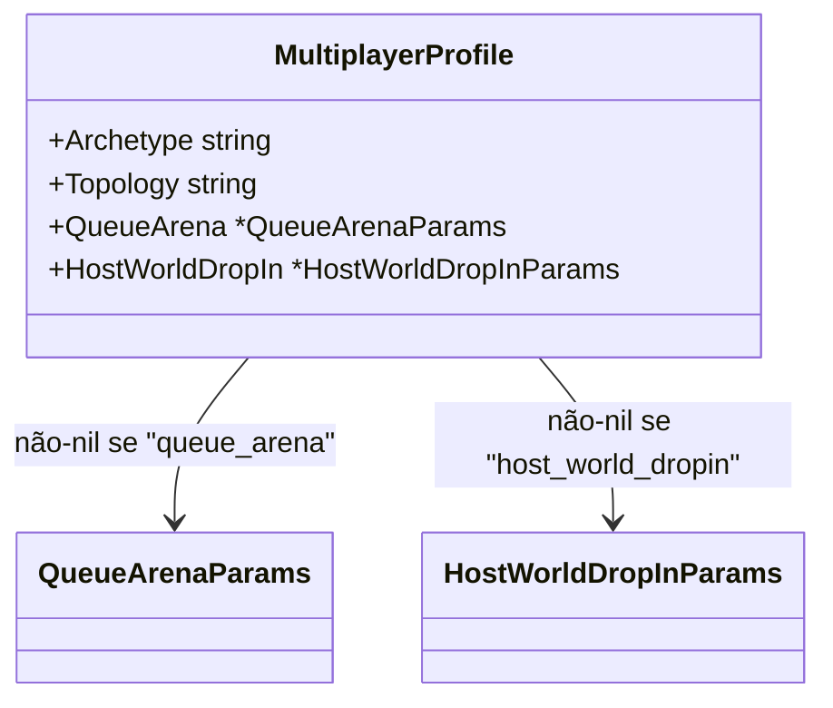

**Corolário — `json.RawMessage` como decode diferido:** o mesmo padrão aparece no `http_handler.go`. O envelope JSON `{ archetype, topology, params }` chega com `Params json.RawMessage` — apenas os bytes crus. Só depois de ler o discriminador `archetype` é que o handler sabe *qual* struct desserializar. Isso é "decode-then-dispatch" e é o análogo Go do pattern matching de C# (`switch (x) { case MyType y: ... }`).

```go
// profileDTO: envelope com Params como bytes crus (decode adiado).
type profileDTO struct {
    Archetype string          `json:"archetype"`
    Topology  string          `json:"topology"`
    Params    json.RawMessage `json:"params"` // diferido
}

func profileToDomain(d profileDTO) domain.MultiplayerProfile {
    switch d.Archetype {
    case domain.ArchetypeQueueArena:
        var qa queueArenaParamsDTO
        _ = json.Unmarshal(d.Params, &qa) // decodifica o tipo certo
        // ...
    case domain.ArchetypeHostWorldDropIn:
        var hw hostWorldDropInParamsDTO
        _ = json.Unmarshal(d.Params, &hw) // outro tipo, mesmo campo Params
    }
}
```

**Diferença de [[23]]:** [[23]] usa `json.RawMessage` no BFF para *não decodificar* (passthrough puro). Aqui usamos no transport do próprio serviço para *decodificar tardiamente* com base no discriminador — "passthrough adiado para o switch".

**Pegadinha / nuance:** como não há verificação de tipos em runtime do compilador (ao contrário do pattern matching exaustivo de C# 8+), você precisa garantir a invariante "exatamente um ponteiro não-nil" **nos dois lados** da fronteira: ao receber (service valida) e ao persistir/serializar (transport/repo verifica no `switch` + `default: return error`). Se esquecer o `default`, um arquétipo novo silenciosamente não persiste nada.

---

## 27 — Reservar sob o lock, trabalho lento fora, reverter sob o lock na falha

**O que é / por que importa:** numa seção crítica você quer segurar o `sync.Mutex` pelo **menor tempo possível** — mas às vezes a operação "cara" (I/O, cripto) precisa acontecer *depois* de decidir que a ação é válida, e você não quer segurar o mutex durante ela. O padrão: **reserva o estado sob o lock** (torna a ação visível/atômica), **solta o lock**, faz o trabalho lento, e **se falhar, reverte a reserva sob o lock de novo**. É um mini-otimista: assume sucesso, desfaz no erro.

**Onde no projeto:** `session-service/internal/service/session_service.go` → `JoinWorld` (spec 011, host_world_dropin). Ocupar um slot de papel (coop/invasor) é atômico sob o lock; cunhar o connect token Ed25519 (cripto) roda fora do lock; se a emissão falhar, o slot volta.

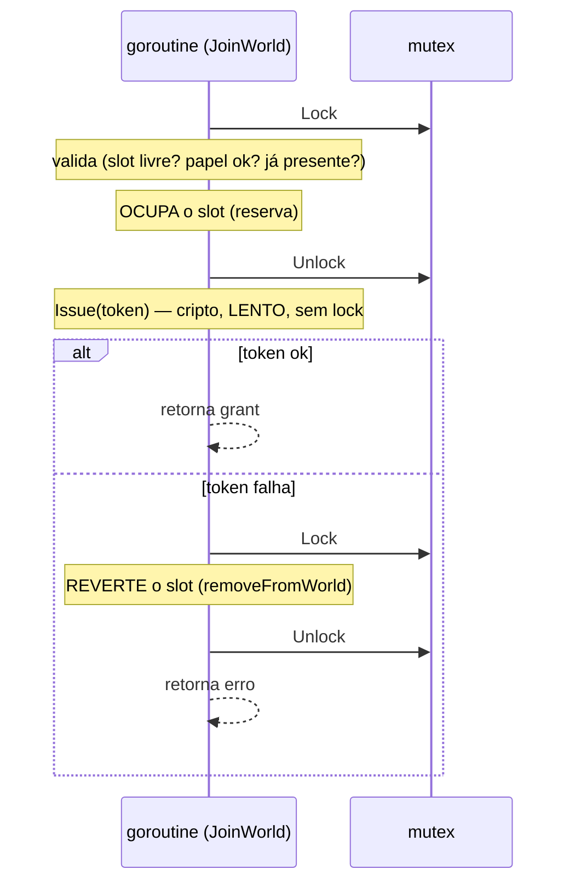

```go
func (s *Service) JoinWorld(ctx context.Context, sessionID, playerID, role string) (domain.ConnectGrant, error) {
    s.mu.Lock()
    // ... validações e ...
    slot.Occupants = append(slot.Occupants, playerID) // reserva sob o lock
    sess.Players = append(sess.Players, playerID)
    serverAddr := sess.ServerAddress
    s.mu.Unlock()

    tok, err := s.issuer.Issue(playerID, sessionID, serverAddr, domain.ConnectClaims{Role: role}) // lento, fora do lock
    if err != nil {
        s.mu.Lock()
        removeFromWorld(sess, playerID) // reverte a reserva
        s.mu.Unlock()
        return domain.ConnectGrant{}, err
    }
    return domain.ConnectGrant{PlayerID: playerID, Token: tok}, nil
}
```

**Contraste com C#:** em C# você poderia deixar tudo dentro de `lock (…) { … }` e chamar o trabalho lento lá dentro — funciona, mas serializa todo mundo atrás da operação cara. Aqui a escolha é explícita: o lock protege só a transição de estado; o custo (cripto) fica concorrente. O preço é ter que escrever o **rollback** à mão (não há `try/finally` desfazendo automaticamente o append).

**Pegadinha / nuance:** o `sess` é um ponteiro capturado antes de soltar o lock. Entre o unlock e o revert, outra goroutine pode ter fechado o mundo (`CloseWorld` remove a sessão do mapa) — o `removeFromWorld` então mexe num agregado já destacado do mapa, o que é **inofensivo** (ninguém mais o vê). O que *não* é resolvido por este padrão é a janela em que o token é emitido para um mundo que fechou concorrentemente; para o MVP (um cliente de teste) é aceitável, e o connect simplesmente falharia no game server. Se virar problema, a alternativa é emitir o token **dentro** do lock (a assinatura Ed25519 custa ~dezenas de µs) — trade-off consciente, documentado no `plan.md` da spec 011.

---

## 28 — Um adapter, várias Ports: interface implícita (structural typing)

**O que é / por que importa:** em Go, um tipo satisfaz uma interface **só por ter os métodos** — não se declara `implements`. Consequência prática: um mesmo struct concreto pode satisfazer **várias Ports** sem cerimônia, e cada consumidor recebe **só a interface estreita que usa** (Interface Segregation de graça). Na H1a o `sessionclient.Client` já falava `SessionProvisioner` (queue-form); ganhou dois métodos novos (`ListInvadableWorlds`, `Inject`) e passou a satisfazer também `WorldDirectory` e `WorldInjector` — o `Invader` recebe as duas Ports, sem saber que por trás é o mesmo objeto e a mesma conexão gRPC.

**Onde no projeto:** `matchmaking-service/internal/sessionclient/grpc_client.go` (um struct, três Ports) e `internal/service/invader.go` (o serviço depende só das interfaces estreitas). Mesmo padrão no `registryclient.Client` (satisfaz `ProfileProvider` **e** `InvasionPolicyProvider`).

```go
// O adapter declara à vista quais Ports satisfaz — asserção em tempo de compilação.
var (
    _ domain.SessionProvisioner = (*Client)(nil)
    _ domain.WorldDirectory     = (*Client)(nil)
    _ domain.WorldInjector      = (*Client)(nil)
)

// O wire-up passa o MESMO objeto onde cada Port é esperada:
sessionClient := sessionclient.New(sessionv1.NewSessionClient(sessionConn))
mm  := service.New(formInterval, provider, sessionClient)      // usa SessionProvisioner
inv := service.NewInvader(registry, sessionClient, sessionClient) // usa Directory + Injector
```

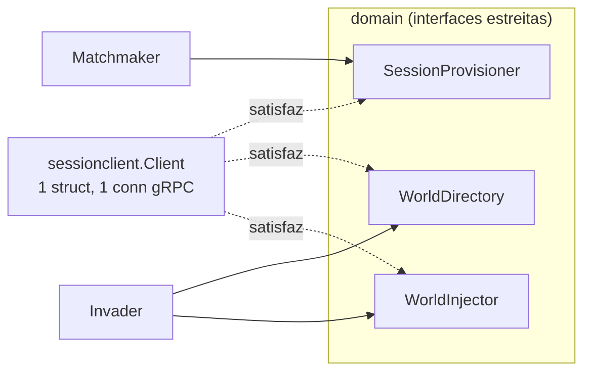

**Contraste com C#:** em C# a classe precisa *declarar* `class SessionClient : ISessionProvisioner, IWorldDirectory, IWorldInjector` — o acoplamento nome↔tipo é explícito e a interface normalmente vive perto de quem a implementa. Em Go a interface é **definida do lado de quem consome** (o `domain` do matchmaking declara `WorldDirectory` do jeito que *ele* precisa) e qualquer tipo com a forma certa serve. Isso inverte a dependência sem o consumidor jamais importar o adapter.

**Pegadinha / nuance:** a asserção `var _ Interface = (*T)(nil)` não é decoração — é o que transforma "esqueci de atualizar um método" num **erro de compilação no arquivo do adapter**, e não num erro obscuro lá no wire-up. Segundo achado da mesma fatia, pela mesma razão de "método a mais, sem herança": o `Invade` é **unary** e o interceptor de auth existente era **stream-only** (`grpc.StreamServerInterceptor`); foi preciso um `UnaryAuthInterceptor` irmão (`grpc.UnaryServerInterceptor`) — o gRPC-Go trata os dois mundos por assinaturas distintas, registradas separadamente (`StreamInterceptor` vs `ChainUnaryInterceptor`). Reusei a mesma `bearerFromMetadata`/`playerIDKey`; só a moldura muda.

---

## 29 — `close` vs `send`: um canal como sinal de duas vias (`v, ok := <-ch`)

**O que é / por que importa:** um canal Go carrega **dois** sinais, não um. Um `send` entrega um **valor**; um `close` entrega o fato de que **não virá mais valor**. Quem recebe distingue com `v, ok := <-ch`: `ok==true` → veio valor; `ok==false` → canal fechado. No co-op (spec 007) isso modela **um desfecho com duas saídas** sem um segundo canal nem um campo de status: o aliado abre o stream e **bloqueia** num canal; um **outro** ator o acorda — o host que invoca **envia** um `Summoned` (→ `SUMMONED`), ou o sweeper de TTL **fecha** sem valor (→ `EXPIRED`).

**Onde no projeto:** `matchmaking-service/internal/service/summoner.go` (`Summon` envia; `SweepExpired`/`CancelSign` fecham) e o handler `PostSummonSign` em `internal/transport/grpc_server.go` (o `select` que traduz para o stream gRPC).

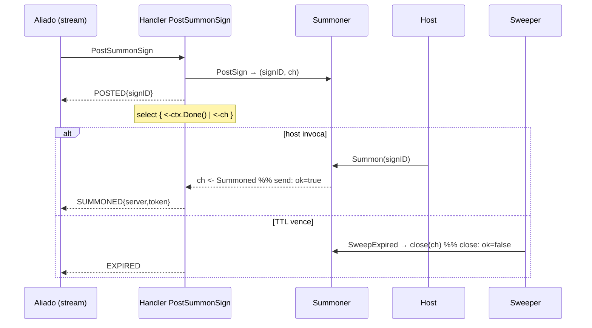

```go
select {
case <-stream.Context().Done(): // o aliado desistiu
    s.sum.CancelSign(signID)
    return stream.Context().Err()
case summoned, ok := <-ch:
    if !ok { // canal fechado sem valor = TTL/cancelado
        return stream.Send(&pb.SummonUpdate{Status: pb.SummonStatus_SUMMON_STATUS_EXPIRED})
    }
    return stream.Send(&pb.SummonUpdate{Status: pb.SummonStatus_SUMMON_STATUS_SUMMONED, /* server+token */})
}
```

**Contraste com C#:** o equivalente seria um `TaskCompletionSource<Summoned?>` com `TrySetResult(value)` vs `TrySetResult(null)` (ou `TrySetCanceled`) — dá para fazer, mas o "canal como fila + fechamento" do Go junta **entrega** e **fim de vida** numa primitiva só, e o `select` compõe isso com o cancelamento do stream (`ctx.Done()`) de forma uniforme.

**Pegadinha / nuance:** `send` num canal **fechado** dá **panic** — então "enviar" (`Summon`) e "fechar" (`SweepExpired`/`CancelSign`) precisam ser **mutuamente exclusivos**. É o que o estado `claimed` garante: ao iniciar uma invocação, o sinal vira `claimed` **sob o lock** e some da varredura/cancelamento; só o `Summon` que ganhou a transição envia. O canal tem **buffer 1** para o `send` nunca bloquear o `Summon` (o handler pode ainda não estar no `receive`). E o "consumido não é o mesmo que inexistente": um `Summon` de um sinal já consumido deve dizer `ErrSignConsumed`, não `ErrSignNotFound` — por isso o store guarda um **tombstone** (`consumed map[signID]time.Time`, limpo pelo sweeper) além do mapa de ativos; deletar e pronto perderia a distinção que a idempotência precisa.

## 30 — Module path é a identidade do código: renomear o repo é renomear todos os imports

**O que é / por que importa:** em Go, o **module path** (`module github.com/vitormartins1/go-multiplayer-control-plane` no `go.mod`) não é só o "nome do projeto" — é o **prefixo literal de todo import interno**. Diferente de C#, onde renomear o repositório/assembly não muda os `using` (namespace e assembly são identidades separadas do local do código), em Go **o nome do módulo É o caminho de import**: renomear o repo implica reescrever o `go.mod` **e cada linha de import** que aponte para dentro dele (aqui: 128 arquivos). Não existe "alias de módulo" para esconder isso — a identidade é única e explícita.

**Onde no projeto:** rename `go-game-backend` → `go-multiplayer-control-plane` (2026-07-07, `docs/REPO-TOPOLOGY.md`).

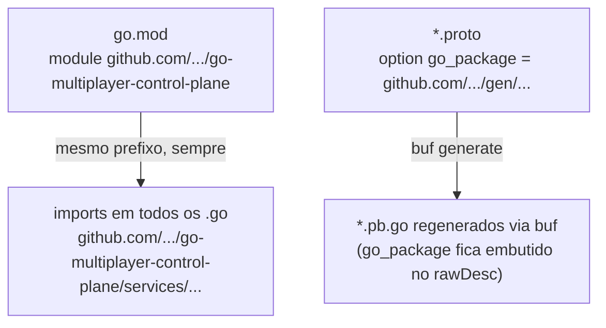

```go
// go.mod — a única declaração; todo o resto é consequência textual dela
module github.com/vitormartins1/go-multiplayer-control-plane

// qualquer arquivo do monorepo: o import interno repete o module path por extenso
import (
    "github.com/vitormartins1/go-multiplayer-control-plane/services/session-service/internal/domain"
)
```

**Pegadinha / nuance:** os arquivos **gerados** de protobuf têm **duas** camadas com o module path: (1) as linhas de `import` normais — seguras de reescrever com `sed` — e (2) o `option go_package` do `.proto`, que fica **serializado dentro do `rawDesc`** do `.pb.go` (o FileDescriptor binário, com strings prefixadas por tamanho). Um `sed` no `.pb.go` que altere a string dentro do `rawDesc` **corrompe o descriptor** (o tamanho gravado deixa de bater). O caminho certo: editar o `go_package` no `.proto` e **regenerar com `buf generate`**. Em C#, o análogo seria mexer à mão em código gerado por source generator — a regra é a mesma: muda-se a fonte, regenera-se o artefato.

## 31 — `*string` como argumento opcional: nil = "não informado" ≠ zero value

**O que é / por que importa:** Go não tem parâmetros opcionais nem `default` de argumento (C# tem `string name = null` e sobrecargas). Quando uma função precisa distinguir **"o chamador não passou o valor"** de **"o chamador passou o valor vazio"**, o idioma é receber um **ponteiro**: `nil` = não informado (preserve/derive), não-nil = use este valor (mesmo que seja `""`). É a mesma distinção que o `omitempty`/`*T` faz em JSON, aplicada à assinatura interna.

**Onde no projeto:** `game-registry/internal/service/profile_service.go` — `setMode(ctx, gameID, modeID string, displayName *string, p)`. O `SetMode` público passa `&displayName` (o console sempre informa, até para limpar); o alias legado `SetMultiplayerProfile` passa `nil` (o corpo das specs 006–008 não tem `displayName` → **preserva** o do modo existente em vez de apagá-lo).

```go
// SetMode (API nova): displayName explícito — "" significa "limpe".
func (s *service) SetMode(ctx context.Context, gameID, modeID, displayName string, p domain.MultiplayerProfile) (*domain.MultiplayerMode, error) {
    return s.setMode(ctx, gameID, modeID, &displayName, p)
}

// Alias legado: nil = "não sei nada sobre displayName, preserve o que existe".
func (s *service) SetMultiplayerProfile(ctx context.Context, gameID string, p domain.MultiplayerProfile) (*domain.MultiplayerProfile, error) {
    m, err := s.setMode(ctx, gameID, domain.DefaultModeID, nil, p)
    // ...
}
```

**Pegadinha / nuance:** não confundir com o typed-nil da entrada #19 (interface embrulhando ponteiro nil). Aqui o ponteiro é usado **de propósito** como tri-estado (`nil` / `""` / valor). Alternativas quando o tri-estado cresce: um struct de "patch" com campos `*T` (estilo JSON merge patch) ou functional options — para **um** campo, o ponteiro simples é o mais direto. Em C# o equivalente moderno seria `string?` + um `bool` separado ou `Optional<T>` — o ponteiro do Go junta os dois.
