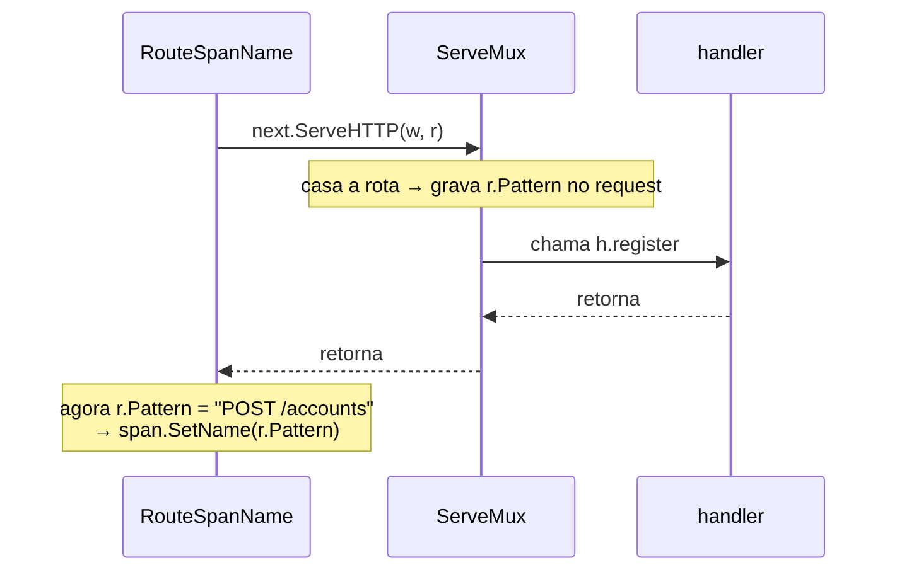
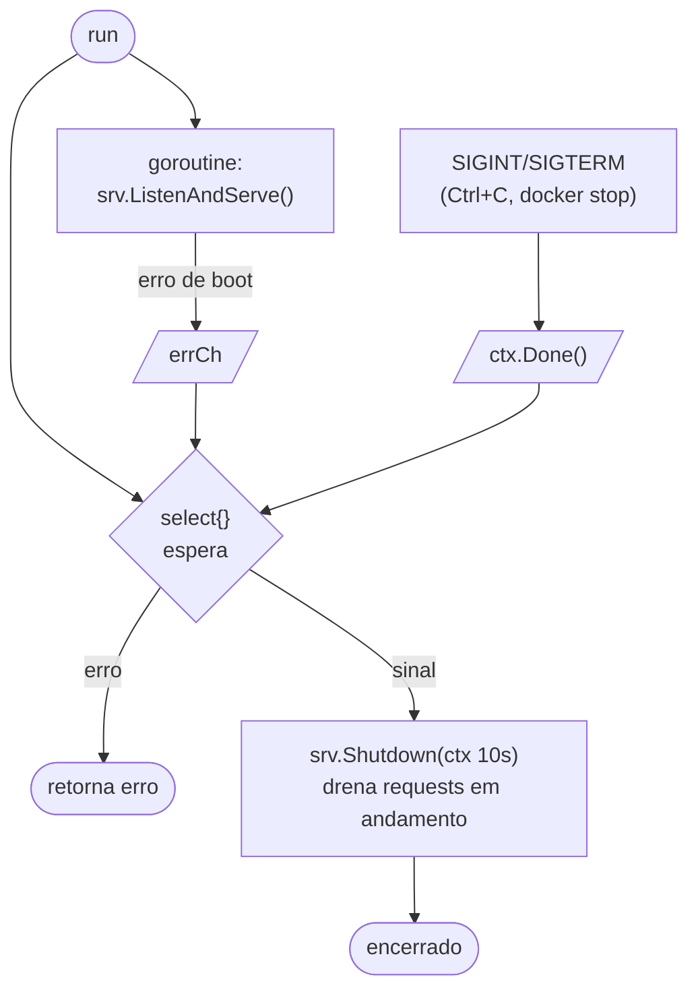

# Aprendizados de Go — game-backend

> Caderno vivo das coisas boas de Go que fui aprendendo ao construir este projeto.
> Cada entrada: o conceito, **por que importa**, um exemplo comentado e **onde uso no projeto**.
> Atualizado de forma incremental conforme uso algo novo.

## Como usar

- Uma entrada por conceito/padrão. Adicione ao final, numerando.
- Prefira exemplo curto e comentado a teoria longa.
- Ligue ao serviço/lugar real onde o padrão aparece.
- **Use Mermaid sempre que um diagrama explicar melhor que texto** — fluxo de execução, ordem de middlewares, sequência de shutdown, máquina de estados, relações entre tipos. O objetivo é didático: ver o conceito, não só ler. (GitHub e o preview local renderizam Mermaid nativo; nunca use ASCII art para diagrama.) O código comentado mostra o *como*; o Mermaid mostra o *fluxo/forma*.

### Template de entrada

```markdown
## NN — Título do conceito

**O que é / por que importa:** ...
**Onde no projeto:** <serviço/arquivo>

​```mermaid
%% opcional, mas recomendado quando há fluxo/ordem/estado a visualizar
flowchart LR
    A --> B
​```

​```go
// exemplo comentado
​```

**Pegadinha / nuance:** ...
```

---

## 01 — Concorrência: alocação atômica com `sync.Mutex`

**O que é / por que importa:** quando várias goroutines disputam o mesmo recurso, "ler o estado e agir sobre ele" precisa ser **uma operação indivisível**. Em Go, o jeito mais direto é proteger a seção crítica com `sync.Mutex`. É o tipo de problema em que Go é confortável e expressivo.

**Onde no projeto:** `session-service` — alocação de game server (escolher UM server `Ready` e reivindicá-lo sem que duas partidas peguem o mesmo). Ver `docs/ARCHITECTURE.md` §7.

```go
package registry

import (
	"errors"
	"sync"
)

type State int

const (
	StateReady State = iota
	StateAllocated
	StateDown
)

type GameServer struct {
	ID     string
	Addr   string // ip:porta
	Region string
	State  State
}

var ErrNoServerAvailable = errors.New("session: nenhum game server disponível")

// Registry guarda os game servers e permite alocação concorrente segura.
type Registry struct {
	mu      sync.Mutex
	servers map[string]*GameServer
}

// Allocate reivindica UM server Ready da região, de forma atômica.
//
// Sem o lock, duas goroutines (duas partidas fechando ao mesmo tempo)
// poderiam ler o mesmo server "Ready" e ambas marcá-lo Allocated —
// resultado: dois matches no mesmo server. O mutex garante que o
// "ler estado + reivindicar" aconteça como uma operação indivisível.
func (r *Registry) Allocate(region string) (*GameServer, error) {
	r.mu.Lock()
	defer r.mu.Unlock()

	for _, gs := range r.servers {
		if gs.State == StateReady && gs.Region == region {
			gs.State = StateAllocated // claim dentro da seção crítica
			return gs, nil
		}
	}
	return nil, ErrNoServerAvailable
}
```

**Pegadinha / nuance:** o `sync.Mutex` resolve a corrida **dentro de um processo**. Se rodarem várias instâncias do `session-service` (escala horizontal), cada uma tem seu próprio lock em memória — o mutex não basta. Aí o claim atômico precisa migrar para o **store compartilhado**:

- DynamoDB: `UpdateItem` condicional — `SET state = :allocated` com `ConditionExpression: state = :ready`. Se a condição falhar, outra instância já pegou.
- Postgres: `UPDATE servers SET state='allocated' WHERE id=$1 AND state='ready' RETURNING *` — se não voltar linha, já estava ocupado.

Ou seja: o conceito (ler-e-reivindicar atômico) é o mesmo; só muda **onde** a atomicidade é garantida — no mutex local ou no banco distribuído.

---

## 02 — Assinatura assimétrica com `crypto/ed25519` (connect token)

**O que é / por que importa:** assinar dados de forma que **só o backend** (chave privada) consiga produzir uma assinatura válida, mas **qualquer um com a chave pública** consiga verificar — sem segredo compartilhado. Ed25519 é rápido, tem chaves pequenas e está na biblioteca padrão do Go.

**Onde no projeto:** `session-service` cunha o connect token assinado; o Unity Dedicated Server verifica com a chave pública (offline, sem chamar o backend). Ver `docs/ARCHITECTURE.md` §7 "Connect token".

```go
package token

import (
	"crypto/ed25519"
	"encoding/json"
	"errors"
	"time"
)

var (
	ErrBadSignature = errors.New("token: assinatura inválida")
	ErrExpired      = errors.New("token: expirado")
)

type ConnectToken struct {
	PlayerID string    `json:"sub"`
	MatchID  string    `json:"match_id"`
	Server   string    `json:"server"`
	Expiry   time.Time `json:"exp"`
}

// Sign serializa os claims e assina com a chave privada (fica só no backend).
func Sign(priv ed25519.PrivateKey, t ConnectToken) (payload, sig []byte, err error) {
	payload, err = json.Marshal(t)
	if err != nil {
		return nil, nil, err
	}
	sig = ed25519.Sign(priv, payload)
	return payload, sig, nil
}

// Verify roda no game server: confere a assinatura com a chave PÚBLICA
// e a expiração. A assinatura prova autenticidade; cabe ao chamador ainda
// checar match_id/server contra a partida que ele hospeda (autorização).
func Verify(pub ed25519.PublicKey, payload, sig []byte) (*ConnectToken, error) {
	if !ed25519.Verify(pub, payload, sig) {
		return nil, ErrBadSignature
	}
	var t ConnectToken
	if err := json.Unmarshal(payload, &t); err != nil {
		return nil, err
	}
	if time.Now().After(t.Expiry) {
		return nil, ErrExpired
	}
	return &t, nil
}
```

**Pegadinha / nuance:** a chave **privada nunca sai do backend**; o game server só recebe a **pública** (via config ou um endpoint JWKS da identity-service). Em produção, em vez de `payload`+`sig` separados, costuma-se empacotar como **JWT com `EdDSA`** (uma string `header.payload.signature`) — mesma criptografia, formato padrão que o lado C#/Unity também lê. É exatamente o que o `identity-service` já faz: cunha JWT EdDSA e publica a chave pública em `GET /.well-known/jwks.json`.

---

## 03 — `http.Handler` e middleware como decoradores

**O que é / por que importa:** Go não tem um "pipeline de middleware" mágico como o ASP.NET. Um middleware é só uma função que recebe um `http.Handler` e devolve **outro** `http.Handler` que faz algo antes/depois de chamar o original. Você **compõe** aninhando chamadas — e a ordem de aninhamento é a ordem de execução. Explícito, sem registro mágico, fácil de seguir lendo o código.

**Onde no projeto:** `shared/middleware/metrics.go` (`Metrics.Wrap`), `shared/middleware/tracing.go` (`RouteSpanName`), encadeados em `services/identity-service/cmd/server/main.go`.

O request desce pela pilha de decoradores até o `mux` e volta — cada camada age na ida, na volta, ou nas duas:


```go
// um middleware = função (http.Handler) http.Handler
func (m *Metrics) Wrap(next http.Handler) http.Handler {
	return http.HandlerFunc(func(w http.ResponseWriter, r *http.Request) {
		start := time.Now()
		rec := &statusRecorder{ResponseWriter: w, status: http.StatusOK}
		next.ServeHTTP(rec, r) // chama o handler de dentro
		// ...mede latência/status DEPOIS que ele retorna
	})
}

// composição no main: o mais externo executa primeiro
traced := otelhttp.NewHandler( //   1º: abre o span do request
	middleware.RouteSpanName( //     2º: renomeia o span pós-rota
		metrics.Wrap(mux), //        3º: mede; o mux casa a rota
	),
	"http.server",
)
```

**Pegadinha / nuance:** para capturar o **status code** (o handler escreve no `http.ResponseWriter`, mas a interface não deixa ler de volta), embrulha-se o writer num tipo que faz **embedding** da interface e sobrescreve só `WriteHeader`:

```go
type statusRecorder struct {
	http.ResponseWriter // embedding: ganha todos os métodos de graça
	status int
}
func (s *statusRecorder) WriteHeader(code int) {
	s.status = code // intercepta o valor
	s.ResponseWriter.WriteHeader(code)
}
```

Embedding é o "tem um, age como" de Go: o `statusRecorder` **é um** `http.ResponseWriter`, mas intercepta um método. É a alternativa de Go à herança.

---

## 04 — Roteamento do `net/http` (Go 1.22): método no pattern + `r.Pattern`

**O que é / por que importa:** desde o Go 1.22 o `ServeMux` da stdlib roteia por **método + caminho** (`"POST /accounts"`) — sem framework (gorilla/chi). Após o match, o pattern casado fica em `r.Pattern`, e o `net/http` o grava **no próprio request** (não num clone), então um middleware que envolve o mux consegue lê-lo **depois** que o handler retorna.

**Onde no projeto:** rotas em `services/identity-service/internal/transport/http_handler.go` (`Register`); o `r.Pattern` é consumido em `shared/middleware/metrics.go` (label de rota) e `shared/middleware/tracing.go` (nome do span).

O `r.Pattern` só existe **depois** do match — por isso renomear o span acontece na volta:



```go
mux.HandleFunc("POST /accounts", h.register) // método embutido no pattern
mux.HandleFunc("POST /sessions", h.login)
mux.HandleFunc("GET /.well-known/jwks.json", h.jwks)

// num middleware, DEPOIS de chamar o mux:
next.ServeHTTP(w, r)
route := r.Pattern // "POST /accounts" — preenchido pelo match
```

**Pegadinha / nuance:** usar `r.Pattern` (o template) e **não** `r.URL.Path` (o caminho real) como label de métrica e nome de span é o que mantém a **cardinalidade baixa** — `GET /players/{id}` vira uma série só, não uma por ID. Antes do match, `r.Pattern` está vazio: por isso o `RouteSpanName` renomeia o span só na volta do `next.ServeHTTP`.

---

## 05 — Graceful shutdown idiomático

**O que é / por que importa:** desligar o servidor "sem cortar requests no meio" em Go é a combinação de três peças da stdlib: `signal.NotifyContext` (context que cancela no SIGINT/SIGTERM), um canal para o erro de boot do servidor, e `srv.Shutdown(ctx)` (para de aceitar conexões novas e espera as em andamento até um timeout). Sem host genérico, sem framework — peças pequenas combinadas.

**Onde no projeto:** `services/identity-service/cmd/server/main.go` (`run`).



```go
errCh := make(chan error, 1)
go func() {
	if err := srv.ListenAndServe(); err != nil && !errors.Is(err, http.ErrServerClosed) {
		errCh <- err // erro real (porta ocupada etc.)
	}
}()

ctx, stop := signal.NotifyContext(context.Background(), syscall.SIGINT, syscall.SIGTERM)
defer stop()
select {
case err := <-errCh: // servidor caiu sozinho
	return fmt.Errorf("http server: %w", err)
case <-ctx.Done(): // Ctrl+C / SIGTERM do Docker
}

shutdownCtx, cancel := context.WithTimeout(context.Background(), 10*time.Second)
defer cancel()
return srv.Shutdown(shutdownCtx) // drena os requests em andamento
```

**Pegadinha / nuance:** `ListenAndServe` **sempre** retorna erro não-nil; no shutdown limpo esse erro é `http.ErrServerClosed` — por isso o `errors.Is` o filtra para não virar falha. O canal tem buffer 1 para a goroutine não vazar se ninguém ler.

---

## 06 — Cleanup como closure retornada (e o no-op quando desligado)

**O que é / por que importa:** em vez de devolver um objeto com `Close()`, um padrão muito comum em Go é o setup **retornar a própria função de limpeza** (uma closure). Quem chama só faz `defer shutdown(ctx)`. E quando o recurso está desabilitado, retorna-se uma closure **no-op** em vez de `nil` — assim o chamador nunca precisa checar nil antes de chamar.

**Onde no projeto:** `shared/telemetry/telemetry.go` (`SetupTracing`), usado em `cmd/server/main.go`.

```go
func SetupTracing(ctx context.Context, cfg Config) (func(context.Context) error, error) {
	if cfg.OTLPEndpoint == "" {
		return func(context.Context) error { return nil }, nil // no-op: tracing desligado
	}
	// ...monta o TracerProvider...
	return tp.Shutdown, nil // devolve o próprio Shutdown como handle de limpeza
}

// no main, simétrico ao shutdown do HTTP server:
shutdownTracing, err := telemetry.SetupTracing(ctx, cfg)
defer func() {
	ctx, cancel := context.WithTimeout(context.Background(), 5*time.Second)
	defer cancel()
	_ = shutdownTracing(ctx) // sempre chamável, mesmo desligado
}()
```

**Pegadinha / nuance:** repare em duas formas de configurar lado a lado no projeto: `telemetry.SetupTracing` usa uma **struct `Config`** (campos explícitos), enquanto `otelhttp.NewHandler(..., otelhttp.WithFilter(...))` usa **functional options** (`With...` variádicos). Vindo de C#, a struct lembra um objeto de opções; as functional options são o jeito idiomático de Go para "muitos parâmetros opcionais com default" sem vários construtores. Poucas opções → struct é mais simples; API de biblioteca extensível → functional options.

---

## 07 — Interface opcional via type assertion (feature detection)

**O que é / por que importa:** em Go um valor pode implementar **mais** do que a interface declarada na assinatura. Para usar uma capacidade extra **só quando ela existe**, faz-se um *type assertion* para essa interface opcional: se passar, usa; se não, fallback. É o jeito idiomático de "detectar capacidade em runtime" — parecido com `is IFoo` em C#, mas para **opt-in de comportamento**, sem obrigar todo mundo a implementá-la.

**Onde no projeto:** `shared/middleware/metrics.go` (`observeDuration`). O `prometheus.Observer` do histograma **pode** também ser um `prometheus.ExemplarObserver`; só nesse caso anexamos o `trace_id` como exemplar (é o que liga latência → trace no Grafana).

```go
func observeDuration(ctx context.Context, obs prometheus.Observer, secs float64) {
	if sc := trace.SpanContextFromContext(ctx); sc.IsSampled() {
		// obs é sempre Observer; PODE também ser ExemplarObserver
		if eo, ok := obs.(prometheus.ExemplarObserver); ok {
			eo.ObserveWithExemplar(secs, prometheus.Labels{"trace_id": sc.TraceID().String()})
			return
		}
	}
	obs.Observe(secs) // fallback: sem trace amostrado ou sem suporte a exemplar
}
```

**Pegadinha / nuance:** o `, ok` é o que torna o assertion seguro — sem ele (`obs.(prometheus.ExemplarObserver)`), um valor que **não** implementa a interface causa **panic**. A mesma técnica aparece na stdlib (ex.: checar se um `io.Writer` também é `io.ReaderFrom` para copiar mais rápido). É composição em vez de herança: capacidades se **somam**, e você pergunta por elas quando precisa.

---

## 08 — Valores request-scoped no `context.Context` (chave de tipo privado)

**O que é / por que importa:** dados que "viajam com a requisição" mas não são parâmetros explícitos — ex. o jogador que o middleware de auth resolveu a partir do JWT — vão no `context.Context` via `context.WithValue`. O idioma de Go: a **chave** é de um tipo **não exportado** do seu pacote, não uma string. Assim nenhum outro pacote consegue colidir com a sua chave nem ler seu valor por acidente. Em C# isso seria o `HttpContext.Items` ou um serviço *scoped* do DI; em Go é o próprio context, com isolamento garantido pelo tipo da chave.

**Onde no projeto:** `services/achievements-service/internal/transport/http_handler.go` — o middleware valida o token, injeta o `playerID`; os handlers o leem.

```go
type ctxKey int           // tipo privado do pacote
const playerIDKey ctxKey = iota

// no middleware, após validar o token:
ctx := context.WithValue(r.Context(), playerIDKey, playerID)
next.ServeHTTP(w, r.WithContext(ctx))

// no handler:
func playerID(ctx context.Context) string {
	id, _ := ctx.Value(playerIDKey).(string) // type assertion; "" se ausente
	return id
}
```

**Pegadinha / nuance:** usar `ctxKey` (e não `string`) é o que dá o isolamento — um `context.WithValue(ctx, "playerID", ...)` de outro pacote **não** colide com a sua chave, porque os tipos diferem. Regra prática: o context carrega só o que é **request-scoped** (quem é o usuário, trace, deadline). Dependências fixas do serviço (repo, logger, config) vão por **injeção no construtor**, nunca pelo context. Se o dado sobrevive à requisição, não é lugar de context.
