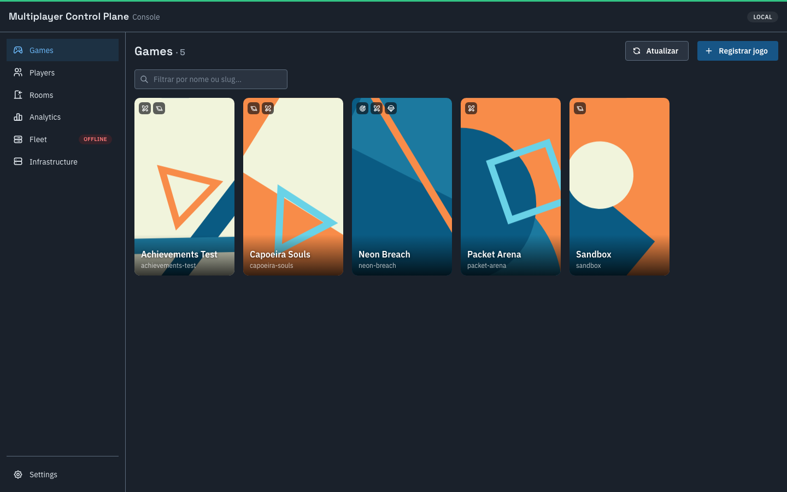
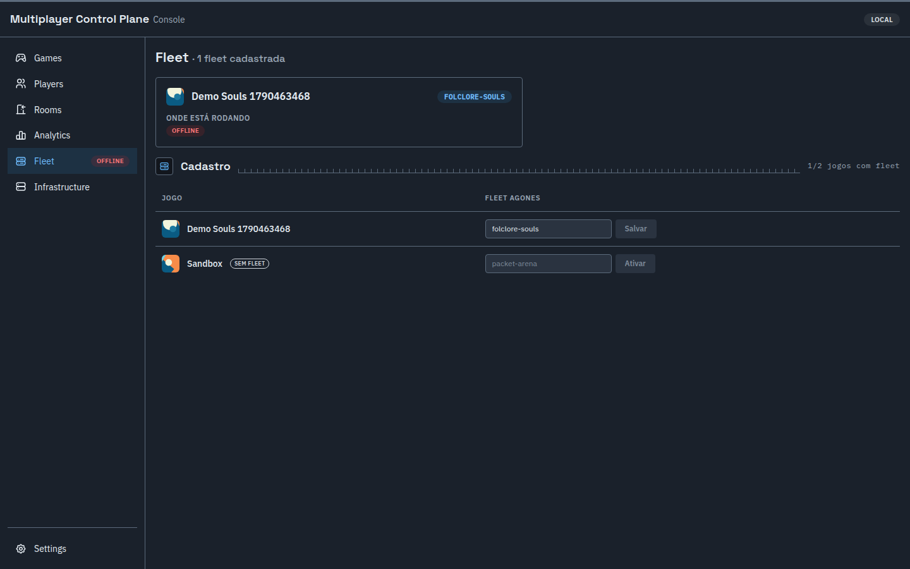
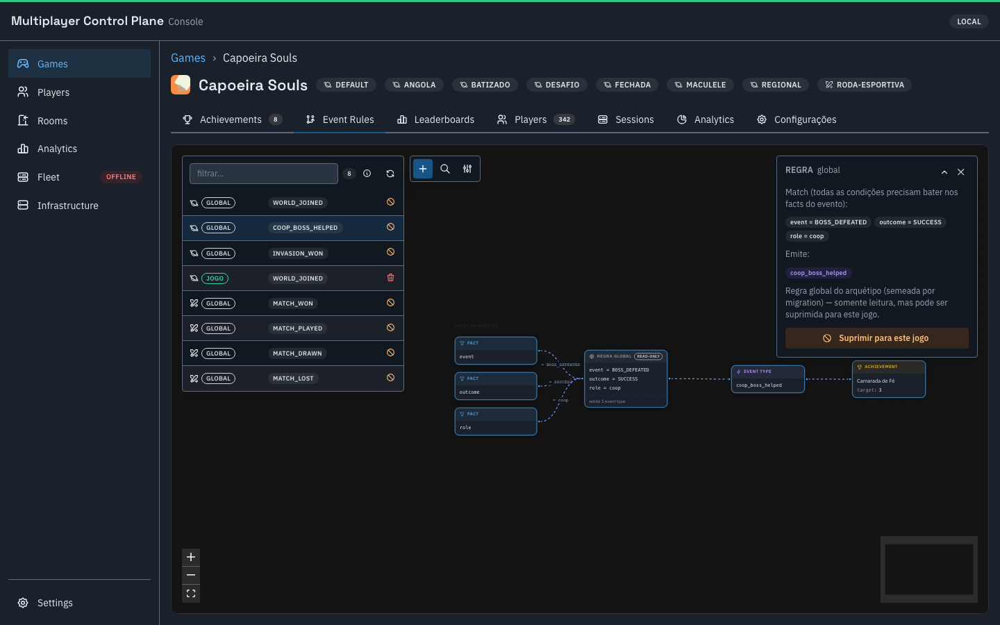
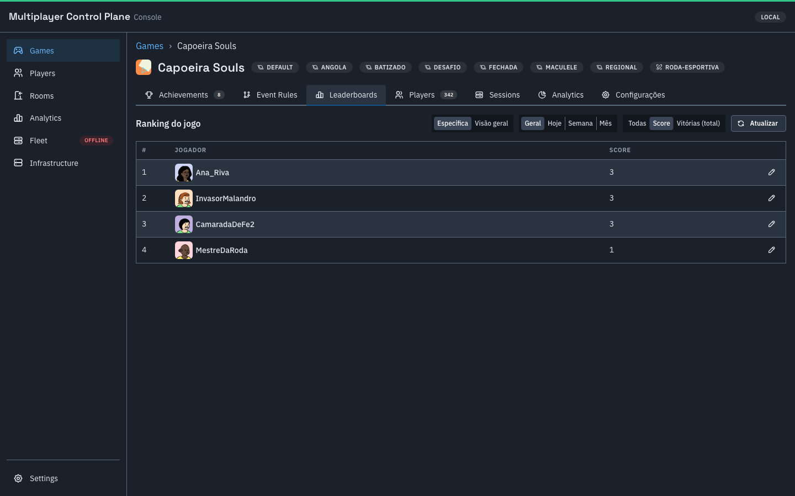
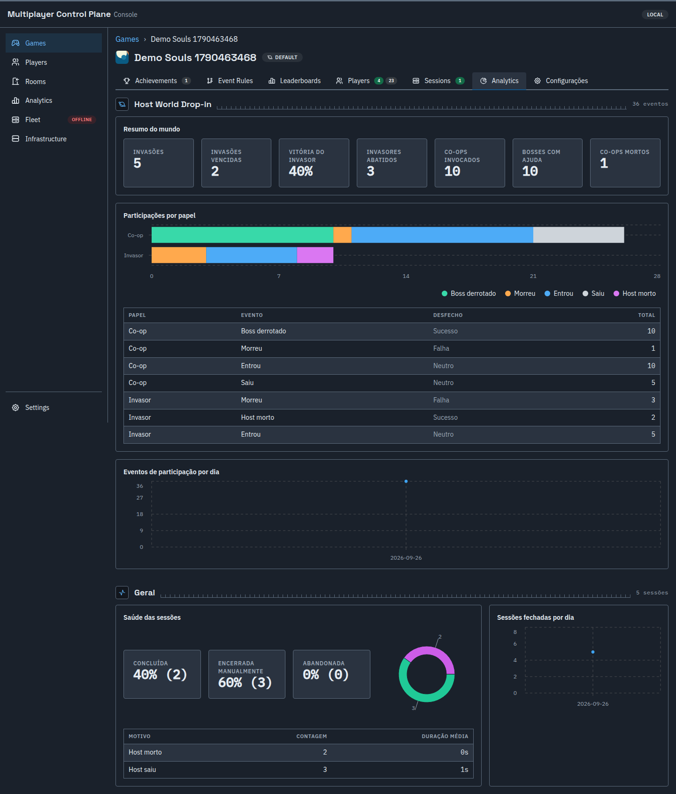
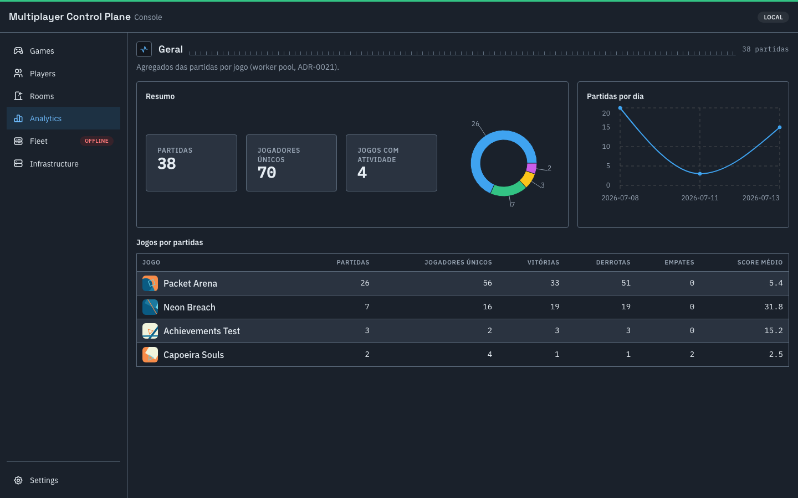
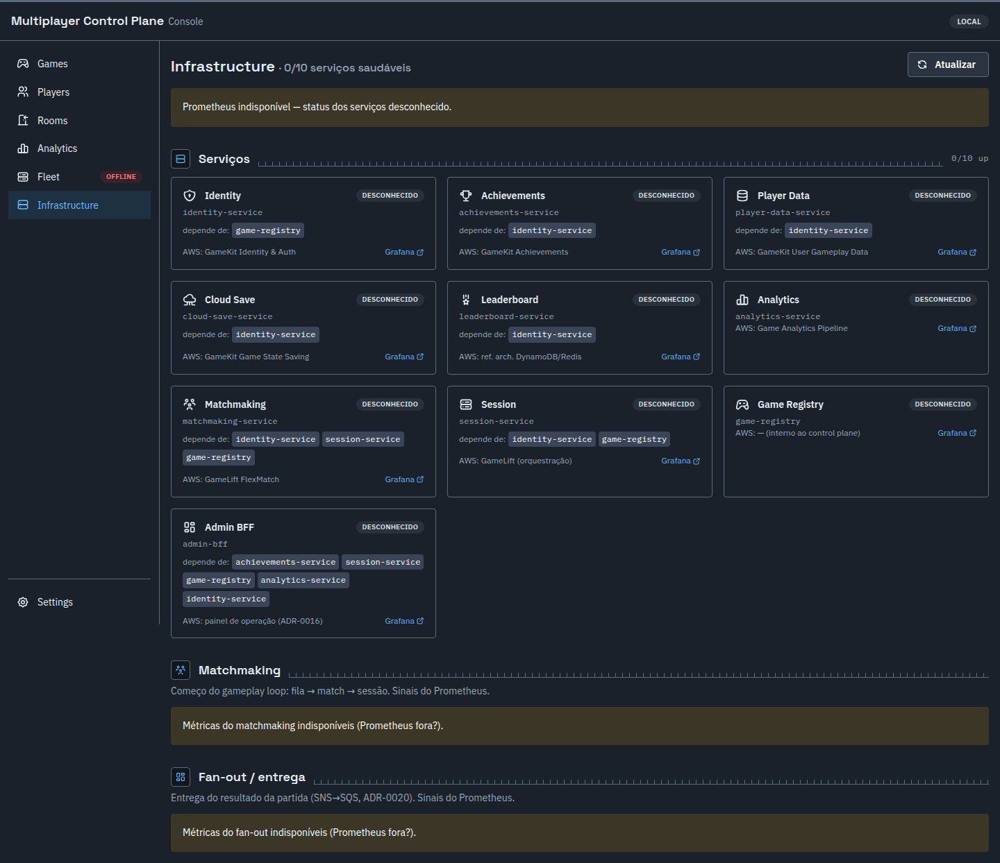

# Product Overview — o que este sistema FAZ

> Este doc descreve o **produto**: capacidades e fluxos, na perspectiva de quem opera jogos multiplayer live — não como ele é construído (isso é o [`ARCHITECTURE.md`](ARCHITECTURE.md), o panorama técnico canônico) nem o histórico incremental de como cada parte chegou lá (isso são as `specs/NNN-slug/` de cada serviço). A tese de origem (ADR-0008) é reimplementar em Go, sobre infra própria, os serviços que a AWS vende prontos — mas o sistema já foi além de "clone 1:1": ver a seção final sobre o que é genuinamente diferenciado.

## O que é

Um **backend de jogos multiplayer self-hosted + console de operação**, agnóstico do tipo de jogo: um estúdio cadastra o jogo, declara a **forma** do multiplayer (arquétipo + parâmetros) e o resto do sistema — matchmaking, sessão/orquestração de servidor, conquistas, leaderboard, analytics — se comporta certo automaticamente, sem código novo por jogo. O painel de operação (`admin-ui`) é o "console AWS" desse backend: uma tela só pra tudo que um operador de live-ops precisa (salas ao vivo, saúde da frota, regras de conquista, métricas por jogo).

## Capacidades

### 1. Multiplayer por arquétipo — sem redeploy por jogo

Um jogo se cadastra e declara um ou mais **modos nomeados** (ex.: "Ranked", "Casual", "Roda Aberta") — cada modo escolhe um **arquétipo** (a forma da sessão) e seus parâmetros:

| Arquétipo | Forma | Exemplo real |
|---|---|---|
| `queue_arena` | partida simétrica FFA/NvN, fila + resultado terminal (win/loss/draw) | Packet Arena |
| `host_world_dropin` | mundo persistente de um host; co-op/invasores entram e saem no meio (join-in-progress); resultado por evento, não placar final | Folclore Souls |
| `battle_royale` | colocação ordinal (1º..Nº) + tempo de sobrevivência | (contrato pronto, sem jogo real ainda) |
| `coop_mission` | desfecho coletivo da missão (sucesso/fracasso para o time todo) | (contrato pronto, sem jogo real ainda) |

Trocar de modo, ajustar tamanho de time, ligar/desligar invasão, exigir senha — tudo isso é **configuração no game-registry**, lida em runtime pelo matchmaking/sessão/achievements. Nenhum serviço tem `if game == X` hardcoded.

### 2. Dois modelos de matchmaking

- **Fila simétrica** (`FindMatch`, streaming): jogador entra numa fila, o sistema forma o match por tamanho/composição de time e devolve o servidor + token quando fecha.
- **Descoberta de mundo + injeção** (`host_world_dropin`): não há fila — o sistema lista mundos já abertos elegíveis (por faixa de progresso, senha) e **injeta** o jogador no meio de uma sessão em andamento, com o papel certo (invasor hostil, aliado sem friendly-fire). Inclui um quadro de sinais (o aliado "posta" um sinal e é invocado pelo host, como nos jogos de referência).

### 3. Sessão/mundo orquestrado com game server real (Agones)

Cada sessão/mundo aloca um **Dedicated Server real** via Agones (não um mock) — por jogo, numa **Fleet própria** (não uma Fleet fixa compartilhada). O servidor recebe um **connect token assinado (Ed25519)**, validado offline via JWKS, com o papel do jogador (host/coop/invader/time) — o jogo não confia em nada que o cliente diga sem essa validação. Sessões órfãs (server morreu, ninguém reportou) são reconciliadas contra o cluster automaticamente.

### 4. Motor de conquistas visual e data-driven

Em vez de 4 funções Go hardcoded traduzindo cada arquétipo pra um vocabulário fixo de eventos, existe um **motor de regras genérico**: fatos da partida (resultado, papel, evento, métricas) → regras editáveis (`campo = valor` ou comparadores `lt/lte/gt/gte/ne/in`) → tipos de evento → conquistas. Um jogo pode ter regras **globais** (compartilhadas por todo arquétipo) e regras **próprias**, e pode **suprimir** uma regra global só para si sem afetar os demais. Tudo isso é editado num **canvas visual** no admin-ui (grafo de 4 camadas) — sem redeploy, sem PR.

Ver [`EVENT-RULES-GUIDE.md`](EVENT-RULES-GUIDE.md) para o guia completo de modelagem.

### 5. Leaderboards multi-board × multi-janela

Cada jogo pode ter N rankings (`board`, um por métrica) × 4 janelas temporais (`alltime`/`daily`/`weekly`/`monthly`), highscore ou cumulativo, alimentados tanto por chamada direta do jogo quanto pelo fan-out do resultado de partida — com idempotência garantida mesmo com entrega duplicada.

### 6. Dados de jogador e save na nuvem

Dados arbitrários por jogador (JSON, sem schema fixo) e um slot de save opaco (blob) por jogador — multi-tenant, escopado por jogo.

### 7. Analytics por jogo e cross-game

Agregados pré-computados (não é um event store) por jogo: total de partidas, jogadores únicos, série diária, e — por arquétipo — quebra de participação por papel/evento (mundos persistentes), histograma de colocação (battle royale) ou taxa de sucesso de missão (coop). Visão cross-game no overview do console.

### 8. Console de operação único

Um estúdio real não quer abrir o console da AWS, um cliente de banco e o Grafana separadamente. O `admin-ui` é **games-first**: entra pela lista de jogos, cada jogo abre com sub-abas (conquistas + editor visual de regras, leaderboards, jogadores, sessões, analytics, configurações), mais visões cross-game (Rooms — salas ao vivo de todos os jogos, agrupável/ordenável —, Players, Analytics, Fleet, Infrastructure).

### 9. Observabilidade desde o primeiro serviço

Todo serviço nasce instrumentado — métricas RED (Prometheus), tracing distribuído (Tempo/OpenTelemetry) cobrindo também as chamadas que o Dedicated Server Unity faz ao control plane (o trace *dentro* do servidor Unity ainda é futuro — ver `OBSERVABILITY.md`), dashboards Grafana por domínio (serviço, Postgres, Redis, Agones/Fleet). Não é um adendo: é o instrumento que valida a própria tese do projeto (custo/performance vs. AWS gerenciado).

## Fluxos ponta a ponta

### A. Onboarding de um jogo novo (estúdio)

1. Cadastra o jogo (`POST /games` — nome, capa gerada, descrição).
2. Declara um ou mais modos de multiplayer (arquétipo + parâmetros) — ex.: "Ranked" = `queue_arena`, times 2, placar até 5.
3. (Se for orquestrar via Agones de verdade) registra a Fleet do jogo.
4. Modela as conquistas: catálogo + regras (globais do arquétipo já vêm prontas; specíficas do jogo são criadas no canvas).
5. Jogo está pronto — nenhum serviço precisou de deploy novo.

### B. Jornada do jogador

Login (anônimo ou conta, com presença marcada no jogo) → entra na fila **ou** abre/entra num mundo → o sistema aloca servidor + emite token → joga no Dedicated Server real → o server reporta o desfecho (resultado terminal ou eventos por participante) → fan-out atualiza conquistas, leaderboard e analytics de forma assíncrona e idempotente.

### C. Jornada do operador (live-ops)

Abre o console → vê as salas ao vivo (todas ou agrupadas por jogo, ordenáveis por estado/arquétipo/players) → força o encerramento de uma sala travada, se precisar → edita uma regra de conquista no canvas visual sem esperar deploy → acompanha a saúde da Fleet do jogo (réplicas, ready/allocated) → confere o analytics do jogo (participação, colocação, missão) no dashboard dedicado.

## O que é genuinamente diferenciado (não é só "clone da AWS")

- **Um único backend agnóstico, não N serviços de propósito único.** GameLift/GameKit são ofertas separadas por preocupação; aqui um `game_id` + perfil de multiplayer configura matchmaking, sessão, conquistas, leaderboard e analytics de uma vez, para qualquer arquétipo suportado.
- **Motor de conquistas editável visualmente, sem redeploy.** Nenhum dos serviços GameKit/GameLift equivalentes tem isso — é a peça mais "produto" do sistema.
- **Console único, games-first.** Não é dashboard de infra genérico — é pensado pra operação de jogos (salas, jogadores, conquistas, ranking) na mesma tela.
- **Orquestração real, não simulada.** Fleet Agones por jogo, validada ponta a ponta com Dedicated Server Unity real (ARM64, k3d local → homelab Pi 5), não um mock que só existe em dev.

## Fora de escopo (deliberado, não esquecido)

Ver [`FEATURE-MAP.md`](FEATURE-MAP.md) para o backlog vivo. Alguns itens ficam de fora **por falta de evidência real**, não por dificuldade: topologia P2P, PvPvE ("modo cinza"), covenants/mensagens assíncronas, anti-cheat de score, multi-região, seasons nomeadas — todos aguardando um caso de uso real antes de virar ADR (o próprio processo do projeto recomenda isso, ver `docs/sdd/SDD-GUIDE.md`).
