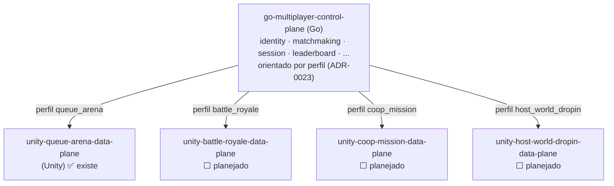

# Topologia de repositórios — control plane + data planes por arquétipo

> **Status:** **nomes decididos (2026-07-07); rename do control plane executado (2026-07-07).** O module path Go, os protos (`go_package` + stubs regenerados via `buf`) e as referências em docs já usam `go-multiplayer-control-plane`; falta só o `mv` da pasta local (fazer entre sessões: `cd .. && mv go-game-backend go-multiplayer-control-plane`). O repo segue **local** (sem remote) por decisão do dono — quando for publicar, criar já com o nome novo. Data planes novos nascem com o nome do padrão; o `go-game-dataplane` (queue_arena) renomeia quando for tocado.
>
> **Motivação:** o ADR-0023 generalizou o multiplayer por **arquétipo** (`queue_arena`, `battle_royale`, `coop_mission`, `host_world_dropin`). A tese de validação (`docs/game-models/`) é ter **um data plane de referência por arquétipo** — cada um é um projeto Unity próprio, com um repo próprio, para testar e validar aquele tipo de jogo de forma isolada. Com N data planes chegando, o nome genérico atual (`go-game-dataplane`) deixa de escalar.

## Princípios

1. **Um control plane, N data planes** (ADR-0010). O control plane (Go) é único e agnóstico de arquétipo — orienta-se pelo perfil (ADR-0023). Cada arquétipo tem seu **data plane** (Unity) de referência, em repo separado.
2. **O data plane é do arquétipo, não do jogo.** O repo representa a *forma* de multiplayer (`queue_arena`), não um jogo/tema específico (câmera, arte, economia são conteúdo — ficha 05: gênero ≠ arquétipo). Por isso o nome do repo usa o **vocabulário do arquétipo do ADR-0023**, não um nome de produto.
3. **Forma certa acima de compatibilidade do data plane.** Ao evoluir o backend, priorizamos o design correto do control plane mesmo que isso quebre um data plane já implementado. O data plane migra depois; as mudanças cross-repo ficam documentadas (ex.: `docs/game-models/queue_arena-dataplane-contract.md`). Confirmado pelo dono do projeto em 2026-07-06.
4. **Data plane de referência ≠ jogo real.** Com modos por jogo (ADR-0024), um jogo real pode cruzar arquétipos (Elden Ring = `host_world_dropin` + `queue_arena` no Coliseu; CoD = `queue_arena` + `battle_royale`). Os repos `unity-<archetype>-data-plane` continuam sendo **veículos de validação/exemplo por arquétipo**; um **jogo de verdade** é uma categoria própria de repo, que implementa os modos que quiser consumindo a integração comum.
5. **SDK Unity compartilhado — planejado para o futuro (decisão 2026-07-07).** O código de integração (auth → FindMatch → connect token → report + leitura do session manifest) tende a se repetir em cada data plane. A extração para um pacote UPM (ex.: `unity-controlplane-sdk`) é **válida e desejada, mas adiada**: só quando os arquétipos estiverem validados nos data planes de referência e um jogo final entrar em cena (repo local, nada publicado por ora). Até lá, cada data plane copia o handshake do anterior — a duplicação é o custo aceito.

## Padrão de nomenclatura (decidido)

```
go-multiplayer-control-plane        # o backend Go (único)
unity-<archetype>-data-plane        # um por arquétipo (Unity)
```

- **Control plane:** `go-multiplayer-control-plane` — prefixo `go-` (a linguagem), "multiplayer" (o domínio da tese), "control-plane" (o papel, ADR-0010).
- **Data planes:** prefixo `unity-` (o engine), `<archetype>` = o enum do arquétipo (ADR-0023) em **kebab-case** (`queue-arena`, `battle-royale`, `coop-mission`, `host-world-dropin`), sufixo `-data-plane`. A simetria `control-plane` ↔ `data-plane` é o eixo organizador.

## Mapa de repositórios

| Arquétipo (ADR-0023) | Repo data plane (nome decidido) | Repo atual | Status |
|---|---|---|---|
| `queue_arena` | `unity-queue-arena-data-plane` | `go-game-dataplane` | ✅ existe (referência; jogo "Packet Arena") — **renomear** |
| `battle_royale` | `unity-battle-royale-data-plane` | — | ⬜ planejado (criar quando atacar o arquétipo) |
| `coop_mission` | `unity-coop-mission-data-plane` | — | ⬜ planejado |
| `host_world_dropin` | `unity-host-world-dropin-data-plane` | — | ⬜ planejado |
| — (control plane) | `go-multiplayer-control-plane` | `go-game-backend` | ✅ **renomeado** (module path + docs, 2026-07-07); falta o `mv` da pasta |

> `go-game-unity` (repo vazio, órfão): resquício do plano antigo (memória "dataplane-repo"). Data plane real virou `go-game-dataplane`. **Arquivar/remover** no rename.



## Ao executar o rename (checklist futuro — não fazer agora)

Renomear toca o module path Go e várias referências. Quando decidido:

1. **Repos GitHub:** renomear (GitHub redireciona o antigo por um tempo) e `git remote set-url`.
2. ~~**Module path Go**~~ ✅ **feito (2026-07-07):** `go.mod` + 128 arquivos de imports + `go_package` dos 2 protos + stubs regenerados via `buf` (não usar `sed` no `.pb.go` — corrompe o `rawDesc`). 721 testes verdes com `-race`.
3. **Referências em docs do backend** (ajustar os links relativos `../go-game-dataplane` e menções): `docs/ARCHITECTURE.md`, `docs/NEXT-STEPS.md`, `docs/ROADMAP.md`, `docs/UNITY-INTEGRATION.md`, `docs/game-models/*`, ADRs 0010/0011/0012/0020/0021/0022/0023 e `docs/adr/README.md`.
4. **Referências no data plane** (`go-game-dataplane`): README, CLAUDE.md, ROADMAP, specs, links `../go-game-backend`.
5. **Memórias** do assistente que citam nomes de repo (`dataplane-repo`, etc.).
6. **CI/CD e paths** que embutam o nome do repo/módulo.

> Sugestão de sequência: renomear os repos → module path → varredura de referências → validar build/CI. Feito de uma vez para não conviver com nomes mistos.

## Próximos passos

- [x] ~~Fechar os nomes~~ — decididos em 2026-07-07 (control plane `go-multiplayer-control-plane`; data planes `unity-<archetype>-data-plane`).
- [x] ~~Executar o rename do control plane~~ — module path + protos + docs feitos em 2026-07-07; falta só o `mv` da pasta (nota no topo).
- [ ] Criar os repos data plane planejados conforme cada arquétipo for atacado (já com o nome do padrão); renomear o `go-game-dataplane` quando for tocado.
- [ ] **Futuro:** extrair o SDK Unity compartilhado (`unity-controlplane-sdk`, princípio 5) quando o primeiro jogo final entrar em cena.
- [ ] (Opcional) Registrar como **ADR** se quiser tornar a convenção formal — hoje é decisão deste doc.
