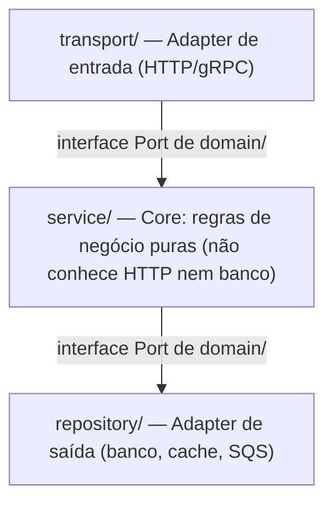

# Game Backend em Go — Roadmap & Arquitetura

> Monorepo de microsserviços para backend de jogos multiplayer
> Autor: Vitor (C130N) | Stack: Go · gRPC · Terraform · AWS · LocalStack · Prometheus · Grafana

---

## Visão Geral

Este projeto tem uma tese central:

> **Reimplementar em Go, sobre infraestrutura própria e barata, os serviços de backend que a AWS vende prontos (e caros) para jogos — e depois comparar custo, performance e eficiência entre a nossa versão e a da AWS.**

A AWS oferece um catálogo "AWS for Games" com serviços gerenciados (GameLift, GameKit, Game Analytics Pipeline). Eles resolvem problemas reais de jogos — matchmaking, conquistas, identidade, leaderboards, telemetria — mas têm custo elevado e acoplam o jogo ao ecossistema AWS. A proposta aqui é construir esses mesmos recursos como microsserviços Go independentes, rodando em compute genérico barato (ECS, Lambda, EC2, EKS), e usar a observabilidade do projeto para medir o trade-off real.

Isso atende a três objetivos simultâneos:

1. **Aprender Go** de forma estruturada e progressiva, contextualizado com C#/.NET — cada serviço exercita um músculo diferente da linguagem.
2. **Construir infraestrutura reutilizável** para jogos próprios futuros — não é throwaway, é base de verdade.
3. **Produzir uma comparação técnica** (Go self-hosted vs. AWS gerenciado) como entregável de pós-projeto: custo $/mês, latência p50/p95/p99, throughput e uso de recurso.

A metodologia de desenvolvimento é **Spec-Driven Development (SDD)**: specs escritas antes do código, usadas como fonte de verdade para o agente de IA e para os testes. Ver `docs/sdd/SDD-GUIDE.md`.

As decisões arquiteturais ficam registradas em **ADRs** (`docs/adr/`). A visão de arquitetura consolidada fica em `docs/ARCHITECTURE.md`.

### Princípio: compute genérico, não serviços-de-jogo da AWS

Deliberadamente **não** usamos os serviços purpose-built da AWS para jogos (GameLift, GameKit gerenciado etc.). Reconstruímos a funcionalidade deles em Go sobre compute commodity. Isso é a tese — e está registrado no **ADR-0008**.

---

## Os serviços como reimplementações de serviços AWS

Cada microsserviço é a reimplementação de um serviço/recurso AWS, e forma um **par de comparação** para o estudo de custo/performance. Trilha principal em ordem de complexidade crescente (construída um serviço por vez):

| # | Serviço Go | Equivalente AWS | Compute | Desafio central |
|---|---|---|---|---|
| 1 | **identity-service** | GameKit Identity & Auth | Lambda | auth/JWT **próprio** (reimplementa o papel do Cognito), fundação de auth |
| 2 | **achievements-service** | GameKit Achievements | Lambda | desbloqueio por evento, progresso parcial |
| 3 | **player-data-service** | GameKit User Gameplay Data | Lambda | inventário/stats, persistência cross-play |
| 4 | **cloud-save-service** | GameKit Game State Saving | Lambda | blob versionado, sync, resolução de conflito |
| 5 | **leaderboard-service** | ref. arch DynamoDB/Redis | Fargate | ranking em tempo real, sorted sets |
| 6 | **analytics-service** | Game Analytics Pipeline | ECS Fargate | worker pool, goroutines (prioridade menor, posição flexível) |
| 7 | **matchmaking-service** | GameLift FlexMatch | ECS / EKS | pool de tickets, rules engine, gRPC streaming |
| 8 | **session-service** | GameLift (orquestração de frota/sessão) | Fargate | ciclo de sessão, registry de game servers, connect token, resultado |

> **Descartado por ora:** economy-service (≈ GameSparks: moeda virtual/transações) — escopo grande, sem valor imediato.

### Decomposição: fiel ao GameKit (ADR a registrar)

Os quatro equivalentes do GameKit (identity, achievements, player-data, cloud-save) são **serviços separados em Lambda**, espelhando como a AWS provisiona o GameKit: **cada feature é um stack próprio** (API Gateway + Lambda + DynamoDB), com a **identity como fundação de auth** — os demais validam o JWT emitido por ela.

Por que separar e não consolidar: (1) realismo de microsserviços enterprise (auth entre serviços, deploy/escala independentes); (2) comparação 1:1 fiel com o GameKit; (3) em Lambda, **separar não custa idle** (escala a zero), então o único contra-argumento real some. Fronteiras não são cravadas de uma vez — cada feature nova nasce como serviço próprio por default (Lambda), e só se junta a outra se houver motivo concreto de carga.

> **Nota histórica:** o **Amazon GameSparks** foi **descontinuado em set/2022**, derrubando jogos em produção. O **AWS GameKit** segue vivo e open-source (deploy por feature via CloudFormation: Cognito + Lambda + DynamoDB). O **GameLift FlexMatch** segue vivo.

### Control plane (Go) vs data plane (Unity) — ADR a registrar

A parte realtime do jogo (input, tick da partida, estado do mundo, física, snapshots, sincronização) **não é feita em Go**. Ela roda num **Unity Dedicated Server** (Netcode for GameObjects + Unity Transport), em **repo separado**. Go cuida do **control plane**; Unity cuida do **data plane**.

| Plano | Responsável | Conteúdo |
|---|---|---|
| **Control plane** | Go (este repo) | auth, matchmaking, sessão, registry de servidores, persistência, leaderboard, achievements, analytics, resultado de partida |
| **Data plane** | Unity Dedicated Server (repo separado) | input, tick, estado do mundo, movimento, colisão, combate, snapshots, sync realtime |

Por que assim: reescrever netcode (prediction/reconciliation/interpolation, UDP, perda de pacote) em Go é R&D enorme e não é o que se faz em backend Go enterprise. E é **como o GameLift realmente funciona** — ele orquestra frota + matchmaking e roda o *seu* binário de servidor; não simula gameplay. Logo `matchmaking + session ≈ orquestração do GameLift`, e o Unity Dedicated Server = o build que você subiria nele.

Serviços pagos da Unity (Relay, Lobby, Matchmaker, Multiplay) são **substituídos por serviços Go** + game server com IP/porta. Escala de game server: EC2/VPS/Docker → ECS-on-EC2 → **Agones/EKS** (equivalente open-source do GameLift, sem serviço pago). Coerente com o ADR-0008.

### Filosofia de desenvolvimento

Os serviços são desenvolvidos **um por um, conforme a necessidade** — às vezes com um jogo em paralelo testando a funcionalidade pronta antes de partir pro próximo. **A decisão de infra de cada serviço é tomada na hora de construí-lo**, não antecipadamente. Este roadmap levanta as opções e o raciocínio; a escolha concreta de compute por serviço sai no `plan.md` da feature correspondente (ver ADR-0005).

---

## Estrutura do Monorepo

Monorepo de **módulo único** (um `go.mod` na raiz): cada serviço vira um binário independente e uma imagem Docker própria; o `shared` é um pacote interno. Simples e idiomático para começar, sem over-engineering. Migração para **multi-módulo + `go.work`** (a forma oficial/moderna) fica reservada para quando houver necessidade concreta — ex: versões de dependência divergentes entre serviços. Decisão registrada no **ADR-0001**.

```
game-backend/                              ← raiz do monorepo (módulo único)
│
├── go.mod                                 ← módulo único: github.com/c130n/game-backend
├── go.sum
│
├── services/
│   ├── identity-service/                  ← ≈ GameKit Identity & Auth
│   │   ├── cmd/server/main.go             ← entrypoint, wire-up de dependências
│   │   ├── internal/
│   │   │   ├── domain/                    ← tipos puros + interfaces (Ports). Zero deps externas
│   │   │   ├── service/                   ← regras de negócio (só usa interfaces do domain)
│   │   │   ├── repository/                ← acesso a dados (implementa interfaces do domain)
│   │   │   └── transport/                 ← handlers HTTP/gRPC (só traduz, sem lógica)
│   │   ├── migrations/                    ← SQL migrations versionadas
│   │   ├── specs/                         ← SDD: pasta por feature (NNN-slug/)
│   │   └── Dockerfile
│   │
│   ├── achievements-service/              ← ≈ GameKit Achievements
│   ├── player-data-service/               ← ≈ GameKit User Gameplay Data
│   ├── cloud-save-service/                ← ≈ GameKit Game State Saving
│   ├── leaderboard-service/               ← ≈ ref. arch DynamoDB/Redis
│   │
│   ├── analytics-service/                 ← ≈ Game Analytics Pipeline
│   │   └── internal/worker/               ← goroutine workers assíncronos (exclusivo deste serviço)
│   │
│   ├── matchmaking-service/               ← ≈ GameLift FlexMatch
│   │   ├── internal/queue/                ← fila com goroutines + channels
│   │   ├── internal/transport/            ← gRPC server (não HTTP)
│   │   └── proto/                         ← .proto definitions (local ao serviço)
│   │
│   └── session-service/                   ← ≈ GameLift orquestração de frota/sessão (control plane)
│       └── internal/                      ← sessão, registry de game servers, connect token, resultado
│                                            (realtime sim = Unity Dedicated Server, repo separado, não-Go)
│
├── shared/                                ← pacotes compartilhados (utilitários finos, sem go.mod próprio)
│   ├── logger/                            ← slog wrapper padronizado
│   ├── middleware/                        ← auth, metrics, tracing
│   ├── config/                            ← leitura de env vars
│   └── telemetry/                         ← OpenTelemetry setup
│
├── infra/
│   ├── terraform/
│   │   ├── modules/                       ← módulos reutilizáveis por tipo de compute
│   │   │   ├── ecs-service/               ← ECS Fargate genérico, parametrizável
│   │   │   ├── lambda-service/            ← Lambda + API Gateway
│   │   │   ├── eks-cluster/               ← (quando houver aplicação real — ADR-0005)
│   │   │   ├── dynamodb/
│   │   │   ├── sqs/
│   │   │   ├── api-gateway/
│   │   │   └── monitoring/                ← CloudWatch + Budgets
│   │   ├── environments/
│   │   │   ├── local/                     ← aponta para LocalStack
│   │   │   └── prod/                      ← AWS real, state no S3
│   │   │       ├── shared/                ← VPC, ECR, IAM (provisionado uma vez)
│   │   │       └── <cada-serviço>/        ← infra isolada, state independente por serviço
│   │   └── shared-vars.tf
│   └── docker/
│       ├── docker-compose.yml             ← ambiente local completo
│       └── prometheus.yml
│
├── docs/
│   ├── ROADMAP.md                         ← este arquivo
│   ├── ARCHITECTURE.md                    ← visão geral consolidada da arquitetura
│   ├── adr/                               ← Architecture Decision Records (4 dígitos)
│   │   ├── 0000-template.md
│   │   ├── 0001-monorepo-structure.md
│   │   ├── ...
│   │   ├── ADR-GUIDE.md
│   │   └── README.md                      ← índice de ADRs
│   └── sdd/
│       └── SDD-GUIDE.md
│
├── .github/
│   └── workflows/                         ← CI por serviço + CD seletivo
│
├── CLAUDE.md                              ← contexto do agente (raiz do monorepo)
├── AGENTS.md                              ← cross-tool (Cursor, Codex, etc.)
└── README.md
```

---

## Arquitetura Interna de Cada Serviço — Hexagonal idiomático em Go

Todos os serviços seguem **Hexagonal Architecture** (Ports & Adapters), aplicada com o idioma de Go — **não** com o peso do Clean Architecture do .NET. Decisão registrada no **ADR-0002**.



**Regra principal:** o `service/` nunca importa `transport/` nem `repository/` diretamente. Só trabalha com interfaces declaradas em `domain/`.

### Régua anti-interface-pollution (boa prática de Go)

Vindo de .NET, o instinto é criar interface pra tudo. Go empurra no sentido oposto, e a interface é declarada **no consumidor**, não no produtor. Regra do projeto:

> Uma interface só existe quando **(a)** é mockada em teste, **(b)** tem 2+ implementações reais, ou **(c)** cruza uma fronteira de I/O. Caso contrário, é struct concreta.

Na prática: `PlayerRepository` ganha interface (é mockada no teste do service ✅). Uma interface `transport → service` só nasce se realmente formos isolar o service no teste do handler.

### Como o hexagonal se dobra a cada formato de serviço

| Serviço | Forma | Como o hexagonal acomoda |
|---|---|---|
| identity | REST + auth | adapters triviais, core fininho |
| achievements | regras de desbloqueio | core gordo — onde o hexagonal mais brilha |
| leaderboard | ranking real-time | repository = Redis/DynamoDB; core ordena |
| analytics | pipeline assíncrono | consumidor SQS = driving adapter; worker pool no service; sink = driven adapter |
| matchmaking | fila stateful + gRPC | gRPC stream = driving adapter; fila é o core de concorrência |

### Exemplo em código

```go
// domain/player.go — tipos puros, zero dependências externas
package domain

type Player struct {
    ID        string
    Name      string
    Rating    int
    CreatedAt time.Time
}

// Port de saída — interface declarada onde é consumida (no service)
type PlayerRepository interface {
    FindByID(ctx context.Context, id string) (*Player, error)
    Save(ctx context.Context, p *Player) error
}
```

```go
// service/player_service.go — regras de negócio
func (s *playerService) CreatePlayer(ctx context.Context, name string) (*domain.Player, error) {
    if name == "" {
        return nil, domain.ErrInvalidName  // erro de domínio, não HTTP
    }
    p := &domain.Player{ID: uuid.New().String(), Name: name, Rating: 1000}
    return p, s.repo.Save(ctx, p)
}
```

```go
// transport/http_handler.go — só traduz HTTP ↔ domínio
func (h *Handler) CreatePlayer(w http.ResponseWriter, r *http.Request) {
    var req CreatePlayerRequest
    json.NewDecoder(r.Body).Decode(&req)

    player, err := h.service.CreatePlayer(r.Context(), req.Name)
    if err != nil {
        writeError(w, err)  // mapeia erro de domínio → HTTP status
        return
    }
    writeJSON(w, http.StatusCreated, player)
}
```

---

## Boas Práticas Go Adotadas

### Tratamento de erros — sempre wrappado com contexto
```go
result, err := service.DoSomething()
if err != nil {
    return fmt.Errorf("player service: do something: %w", err)
}
```

### Interfaces pequenas, compostas quando necessário
```go
type PlayerFinder interface {
    FindByID(ctx context.Context, id string) (*Player, error)
}
type PlayerWriter interface {
    Save(ctx context.Context, p *Player) error
}
```

### Context em toda chamada I/O
```go
func (r *repository) FindByID(ctx context.Context, id string) (*domain.Player, error) {
    // ctx carrega: deadline, cancelamento, tracing
}
```

### Logging estruturado (slog, JSON)
```go
logger.Info("player created",
    slog.String("player_id", player.ID),
    slog.Duration("latency", time.Since(start)),
)
```

### Goroutines — sempre com context + WaitGroup
```go
func (w *Worker) Start(ctx context.Context) {
    var wg sync.WaitGroup
    for i := 0; i < w.concurrency; i++ {
        wg.Add(1)
        go func() {
            defer wg.Done()
            w.loop(ctx)  // para quando ctx for cancelado
        }()
    }
    wg.Wait()
}
```

### Testes
- Unit tests com `testing` nativo + `testify/assert`; mocks com `testify/mock`
- Integração com `testcontainers-go` (sobe banco real em Docker)
- Sempre rodar com `-race`
- Nomenclatura: `TestNomeDaFuncao_Cenario_ResultadoEsperado`
- Cobertura mínima: 80% em `service/` e `domain/`

---

## Spec-Driven Development (SDD)

A **spec é a fonte de verdade**, não o código. Fluxo em cascata, um artefato por fase:

```
spec.md  →  plan.md  →  tasks.md  →  código  →  testes
(O QUE)     (COMO)      (trabalho)
```

Cada feature é uma **pasta numerada por serviço** dentro de `specs/`:

```
services/identity-service/specs/
├── 001-account-auth/
│   ├── spec.md      ← comportamento em EARS (O QUE)
│   ├── plan.md      ← decisões técnicas, arquivos, compute (COMO)
│   └── tasks.md     ← tarefas atômicas, marcadas [x] conforme implementa
└── 002-session-jwt/
    └── ...
```

Guia completo e formato EARS: `docs/sdd/SDD-GUIDE.md`.

---

## Infraestrutura — Terraform + LocalStack

Decisão registrada no **ADR-0004**. Cada serviço tem **estado Terraform independente**.

- **Local:** LocalStack (DynamoDB, SQS, Lambda, ECR) — provider AWS apontando para `http://localhost:4566`.
- **Prod:** AWS real, state no S3. `shared/` (VPC, ECR, IAM) provisionado uma vez; cada serviço aplicado de forma isolada.

### Framework de compute por serviço (ADR-0005)

Não há padronização forçada. A escolha de compute é feita **por serviço, na hora de construí-lo**, a partir deste cardápio e dos critérios abaixo:

| Compute | Sweet spot | Evitar quando |
|---|---|---|
| **Lambda** | request/response stateless, bursty, escala a zero | conexões longas, streaming, estado em memória, processamento contínuo |
| **ECS Fargate** | serviço long-running/stateful, sem gerenciar instância | — (default seguro) |
| **ECS-on-EC2** | controle de instância, custo em escala | quando não precisa gerenciar o metal |
| **EC2 puro** | controle total, instance types específicos | undifferentiated heavy lifting sem necessidade |
| **EKS / Kubernetes** | quando houver aplicação real de cluster | usar "por usar" — só com justificativa concreta |

> Critério rápido: worker always-on → ECS/EC2; disparado por evento/SQS em rajada → Lambda; streaming/stateful → ECS/EKS; CRUD stateless → Lambda.

### Escalabilidade independente por serviço (referência inicial, ajustável)

| Serviço | Min tasks | Max tasks | Métrica de escala |
|---|---|---|---|
| identity-service | 0 (Lambda) | — | concorrência Lambda |
| achievements-service | 0 (Lambda) | — | concorrência Lambda |
| player-data-service | 0 (Lambda) | — | concorrência Lambda |
| cloud-save-service | 0 (Lambda) | — | concorrência Lambda |
| leaderboard-service | 1 | 5 | CPU % / latência |
| analytics-service | 1 | 10 | SQS queue depth |
| matchmaking-service | 1 | 8 | conexões ativas |
| session-service | 1 | 5 | sessões/partidas ativas |

---

## Observabilidade — instrumento da tese de comparação

A stack de observabilidade não é enfeite: é **o instrumento que mede o trade-off** Go self-hosted vs. AWS gerenciado. Decisão Prometheus+Grafana no **ADR-0006**.

### Três pilares
1. **Logs** — `slog` JSON → CloudWatch / Grafana Loki
2. **Métricas** — Prometheus client Go → Grafana
3. **Traces** — OpenTelemetry → Grafana Tempo (ou AWS X-Ray)

### Métricas que alimentam a comparação

| Dashboard | Métricas |
|---|---|
| API Overview | RPS, latência p50/p95/p99, error rate por serviço |
| Matchmaking | tamanho da fila, tempo médio de espera, partidas formadas/min |
| Leaderboard | latência de ranking, throughput de updates |
| Analytics | eventos recebidos/s, processados/s, lag da fila |
| Go Runtime | goroutines, heap, GC pause |
| FinOps / Comparação | custo $/serviço vs. estimativa do equivalente AWS gerenciado |

---

## Práticas transversais — desde o serviço 1

**Observabilidade nasce com cada serviço.** O primeiro serviço já sobe instrumentado (slog JSON + métricas Prometheus + traces OpenTelemetry) e com o stack local (Prometheus + Grafana no docker-compose). Cada serviço novo adiciona a própria instrumentação de forma **incremental** — observabilidade não é uma fase no fim, é requisito de nascença. Dashboards Grafana específicos de Go (goroutines, GC, heap, latência p50/p95/p99) serão pesquisados/adaptados ao montar o serviço 1. (ADR-0006)

**Estratégia de testes em camadas:**
- **Unit** (`testify`) — desde o serviço 1; cobre os Casos de Teste Obrigatórios da spec.
- **Integração** (`testcontainers-go`) — banco/dependências reais em container; entra cedo, por serviço.
- **E2E de sessão real** (meta futura) — subir um binário/jogo que abre uma sessão real em container e capturar as validações, eliminando teste manual.
- **Infra como código testada** (Terratest / TaC) — validar os módulos Terraform à medida que a fase de infra avança.

## CI/CD — GitHub Actions

- **CI por serviço** (paralelo): roda em `push` filtrado por `services/<nome>/**` — `go test ./... -race -cover` + `go build`.
- **CD seletivo**: só deploya o serviço que mudou (via `dorny/paths-filter`), respeitando o compute escolhido para cada um.

---

## FinOps — Controle de Custo

Budget AWS via Terraform, alerta em 80% de **$40/mês**. Mover serviços stateless para Lambda tende a **abaixar** o custo vs. tudo-em-Fargate (free tier + escala a zero). Estimativa de partida (fase de estudo): **~$20–37/mês**, variando conforme o mix de compute.

A coluna de custo de cada serviço alimenta diretamente a **comparação com o equivalente AWS gerenciado** — que costuma ser ordens de magnitude mais caro para volumes baixos.

---

## Roadmap de Estudo — Fases

> Durações são estimativas, ajustáveis. Os serviços são construídos **um por um, conforme a necessidade** — a ordem abaixo é de complexidade crescente, não um compromisso rígido de cronograma.

### Fase 0 — Fundação de docs e arquitetura
- [ ] ADRs iniciais (0001–0008) + índice `docs/adr/README.md`
- [ ] `docs/ARCHITECTURE.md` com a visão consolidada
- [ ] Scaffold do monorepo: `go.work`, `shared/`, estrutura base

### Fase 1 — Fundamentos Go
- [ ] Tour of Go + Go by Example; structs, interfaces, ponteiros, errors
- [ ] Unit tests com `testing` + `testify`
- [ ] Primeira spec: `identity-service/specs/001-account-auth/spec.md`

### Fase 2 — identity-service (≈ GameKit Identity) + Hexagonal
- [ ] Estrutura hexagonal: domain / service / repository / transport
- [ ] API REST com `net/http`; auth/JWT; PostgreSQL com `pgx`
- [ ] Docker Compose local; CI no GitHub Actions

### Fase 3 — Terraform + LocalStack + primeiro compute
- [ ] Terraform básico: providers, resources, modules, state
- [ ] LocalStack: DynamoDB + SQS; módulo reutilizável (`lambda-service` ou `ecs-service`)
- [ ] Deploy do identity-service na AWS

### Fase 4 — achievements-service (≈ GameKit Achievements)
- [ ] Domínio rico: desbloqueio por evento, progresso parcial
- [ ] Segundo serviço Lambda; **auth entre serviços** (valida JWT da identity)

### Fase 5 — player-data-service (≈ GameKit User Gameplay Data)
- [ ] CRUD de inventário/stats, persistência cross-play; modelagem de dados
- [ ] Decisão de DB no `plan.md`: gerenciado (DynamoDB) vs. auto-provisionado

### Fase 6 — cloud-save-service (≈ GameKit Game State Saving)
- [ ] Blob versionado, sincronização, resolução de conflito; storage (S3)

### Fase 7 — leaderboard-service (≈ ref. arch DynamoDB/Redis)
- [ ] Ranking em tempo real; sorted sets (Redis/ElastiCache) ou DynamoDB GSI
- [ ] Primeiro serviço always-on (Fargate); dashboard de latência no Grafana

### Fase 8 — matchmaking-service (≈ GameLift FlexMatch)
- [ ] Protobuf + gRPC server com streaming bidirecional
- [ ] Pool de tickets, rules engine, agrupamento por latência, relaxamento progressivo
- [ ] Fila stateful com goroutines + channels; testes de integração gRPC
- [ ] Avaliar EKS (cluster, conexões longas)

### Fase 9 — analytics-service (≈ Game Analytics Pipeline) — prioridade menor
- [ ] Worker pool com goroutines + channels; `context` com cancelamento/deadline
- [ ] Ingestão via SQS (AWS SDK Go v2); métricas Prometheus
- [ ] Posição flexível: pode ser antecipada se houver necessidade de telemetria

### Fase 10 — session-service + realtime (control/data plane) — capstone final
- [ ] `session-service` (Go, Fargate): ciclo de sessão, registry de game servers, connect token, ingestão de resultado
- [ ] **Data plane = Unity Dedicated Server** (Netcode for GameObjects + Transport), repo separado — não-Go
- [ ] Fluxo: matchmaking forma partida → session aloca game server → token → Unity conecta → resultado volta pro backend Go
- [ ] Escala de game server: EC2/VPS/Docker → ECS-on-EC2 → avaliar Agones/EKS (open-source, sem serviço pago)

### Fase 11 — Comparação Go vs. AWS (entregável de tese)
- [ ] Coletar custo/latência/throughput de cada serviço
- [ ] Comparar com a estimativa do equivalente AWS gerenciado
- [ ] Documentar conclusões

---

## Referências

| Recurso | URL |
|---|---|
| Tour of Go | tour.golang.org |
| Go by Example | gobyexample.com |
| Effective Go | go.dev/doc/effective_go |
| Go Workspaces (go.work) | go.dev/doc/tutorial/workspaces |
| AWS SDK Go v2 | pkg.go.dev/github.com/aws/aws-sdk-go-v2 |
| gRPC Go | grpc.io/docs/languages/go |
| AWS GameLift FlexMatch | docs.aws.amazon.com/gameliftservers/latest/flexmatchguide |
| AWS GameKit | docs.aws.amazon.com/gamekit |
| AWS Game Analytics Pipeline | aws.amazon.com/blogs/gametech |
| LocalStack | docs.localstack.cloud |
| Terraform AWS Provider | registry.terraform.io/providers/hashicorp/aws |
| Prometheus Go Client | prometheus.io/docs/guides/go-application |
| OpenTelemetry Go | opentelemetry.io/docs/languages/go |
| SDD (GitHub Spec Kit) | github.com/github/spec-kit |
