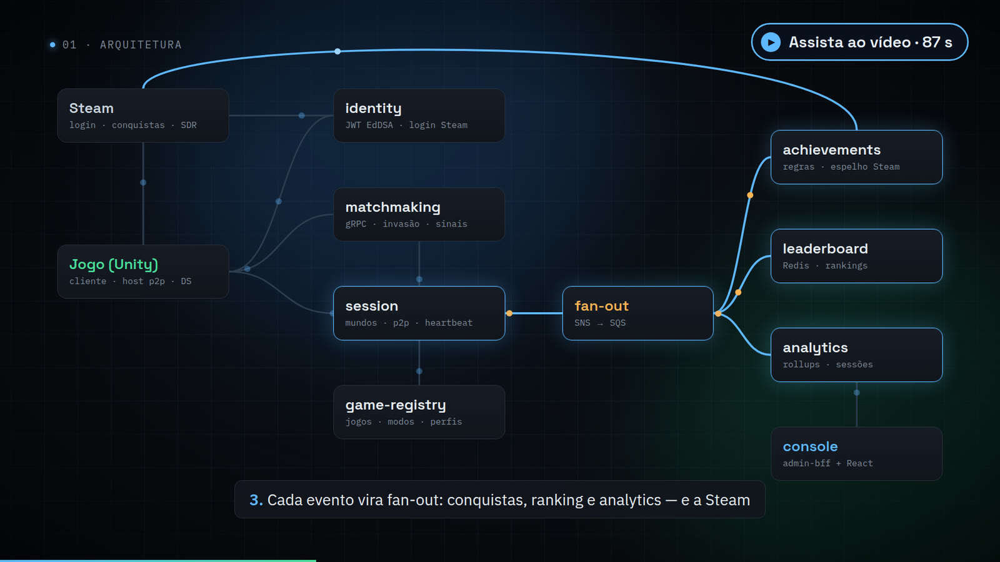
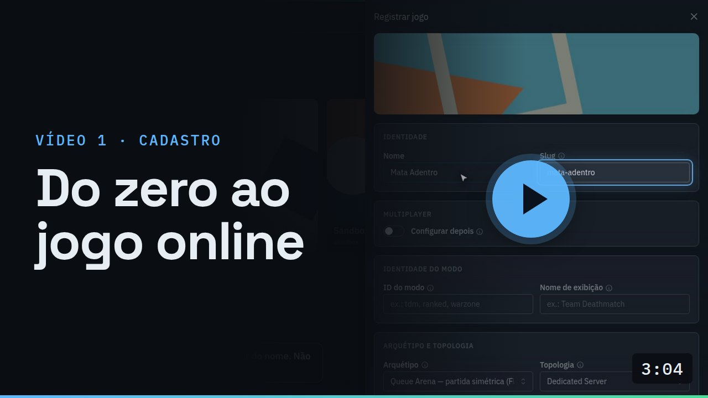
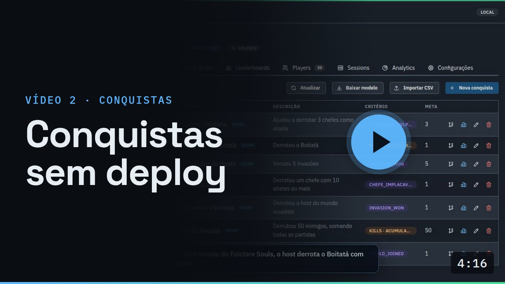

# Vídeos

O produto em quatro vídeos gravados do console real, com legendas em português. O primeiro dá a visão geral; os
outros três explicam uma feature de cada vez, passo a passo. Os arquivos originais e o jeito de regravar estão em
[`media/`](media/README.md).

*Four videos recorded from the real console, with Portuguese captions: an overview and three feature walkthroughs.*

## O produto em 3 minutos

O problema, como o backend funciona, qualquer tipo de jogo, servidor dedicado ou P2P, o motor de conquistas e um
tour pelo console.

## Vídeo 1 · Do zero ao jogo online

Registrar um jogo e entender cada parte do formulário (modo, arquétipo, topologia, papéis, matchmaking, métricas),
ver o que o backend configurou sozinho (pipeline de dados e as regras do arquétipo) e acompanhar o primeiro mundo
abrir, ser invadido e terminar no analytics e no histórico. Sem deploy.

## Vídeo 2 · Conquistas sem deploy

Conquistas por evento e por métrica (acumulada ou por partida), o grafo de uma regra lido coluna por coluna, regras
globais do arquétipo e a supressão por jogo, uma regra nova com comparador, a conquista criada a partir do evento
novo e o desbloqueio ao vivo.

## Vídeo 3 · Visão 360 do jogador

Tudo o que o backend sabe de um jogador, numa tela só: quem está online, conquistas com progresso, histórico de
partidas com o desfecho de cada uma, dados, save na nuvem e a sessão em que ele está agora.

https://github.com/user-attachments/assets/0221bbd0-9f14-47a7-98f2-04637f66695a
