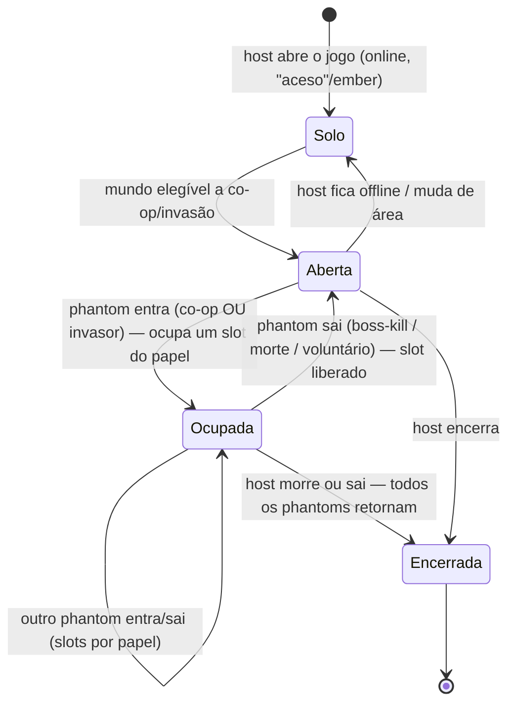

# Ficha: Soulslike — invasão & co-op no mundo do host

**Ficha nº:** 01 · **Data:** 2026-07-06 · **Status:** analisado

> Multiplayer "drop-in" no mundo de um host, via sinais/itens — co-op aliado, invasão PvP e mensagens.

## 1. Visão geral

- **O que é:** jogos **single-player por padrão** com uma camada online **opcional** onde jogadores entram no *mundo* de um **host** — como **aliado** (co-op, sem friendly fire) ou como **invasor** (PvP adversário). Não há "sala de multiplayer": a entrada acontece por **itens/sinais** (soapstones, dedos, sinos). O jogo loga online automaticamente ao abrir (parecido com nosso identity), com opção de ficar **offline** — e offline **desabilita os itens de multiplayer**.
- **Jogos de referência (reais):** Dark Souls 1/2/3, Bloodborne, Elden Ring (FromSoftware). Todos compartilham o mesmo esqueleto multiplayer, com variações de item e limites.
- **Por que nos interessa:** **quebra o arquétipo atual em quase todos os eixos** — não há partida simétrica formada por fila, não há placar, a "sessão" é o mundo persistente de um host, jogadores **entram e saem no meio** com **papéis diferentes**, e o "resultado" é **por participante e por papel** (o co-op ganha por ajudar; o invasor ganha por matar o host), não um `Won` global.

## 2. Classificação (eixos)

| Eixo | Valor |
|---|---|
| Estrutura social | **Assimétrica host-cêntrica** — host + aliados (co-op) + adversários (invasores) no mesmo mundo. Não é "times" simétricos nem FFA. |
| Condição de término | **Por participante**, não global: boss da área morto, host morto, invasor morto, saída voluntária/expulsão. O mundo do host **continua** após um phantom sair. |
| Modelo de resultado | **Outcome por papel** (objetivo cumprido conforme o papel), não vitória binária de partida. Sem placar. |
| Granularidade do resultado | **Por participante e por evento** (boss-kill do co-op, host-kill do invasor). |
| Persistência competitiva | Casual (sem MMR). Existem **covenants** (facções) com contagem/ranking próprios — fora do escopo desta ficha. |
| Tamanho & composição | **Capacidade por papel, dinâmica.** Default ~host + 2 co-op + 1 invasor; itens (ex.: Dried Finger no DS3) sobem para host + 3 co-op + 2 invasores. |
| Sincronicidade | Tempo real, server autoritativo (no original é host-hospedado P2P; no nosso backend → server dedicado do mundo do host). ✅ dentro do escopo. |
| Ciclo de vida do jogador | **Join-in-progress e leave** o tempo todo; host fixo, phantoms transitórios. Sem reconnect do phantom (some ao sair). |
| Efeito do abandono | Phantom sai → **libera o slot**, mundo do host segue. Host sai/morre → **encerra a participação de todos** os phantoms (voltam aos seus mundos). |

## 3. Ciclo de vida da sessão

A "sessão" **não nasce de um match** — ela é **o mundo do host** ficando aberto ao online. Phantoms entram/saem por cima.



- **Como começa:** o host não "procura partida" — ele fica **disponível** (aceso/com ember). Aliados **anunciam sinais**; invasores **buscam** um mundo elegível.
- **Enquanto roda:** o mundo é **persistente e autoritativo do host**; phantoms são **join-in-progress**, cada um ocupando um **slot de papel**.
- **Como termina (por participante):** co-op → boss da área morto (recompensa + retorna) ou host morre (retorna); invasor → mata o host (recompensa) ou é morto (retorna); qualquer um → saída voluntária.
- **Quem reporta:** o **server do mundo do host** reporta **eventos por participante** (entrou, boss-kill, host-kill, saiu), não um placar final único.

## 4. Matchmaking

Não é "junte N e forme partida". São **dois fluxos de descoberta assimétricos**, ambos filtrados.

- **Co-op (anúncio → escolha do host):** o aliado deixa um **sinal** num **pool/área**; o host **vê os sinais compatíveis** e escolhe quem invocar. É um **quadro de sinais**, não uma fila que resolve sozinha.
- **Invasão (busca → injeção):** o invasor usa um item e o sistema o **coloca num mundo elegível** (o host não escolhe). Assimétrico.
- **Critérios de compatibilidade (o "range"):**
  - **Soul level:** co-op ≈ `X ± (10 + 10%)`; invasão é **assimétrica** (invasor só entra em faixa acima: ~`X−0.1X` a `X+(20+0.1X)`).
  - **Weapon upgrade tier:** limita quem pode se encontrar (além do nível).
  - **Senha:** **ignora as faixas de nível/arma** — se as senhas batem, casam (é o "jogar com amigos").
  - **Pool/área e região:** o sinal vive num pool ligado a uma área do mapa.
- **O que viaja no "ticket":** papel pretendido (co-op/invasor), soul level, weapon tier, senha (opcional), pool/área, região, `game_id`.

## 5. Resultado da partida

Aqui o modelo atual quebra de vez. **Não há vitória de partida** — há **outcome por participante, condicionado ao papel**.

- **Co-op:** objetivo = ajudar o host a matar o boss da área. Sucesso → **recompensa** (no DS3: Embers + ~25% dos souls do boss) e **retorna** ao próprio mundo. Host morre antes → sem recompensa de boss, retorna.
- **Invasor:** objetivo = matar o host. Sucesso → **recompensa** (itens/souls/pontos de covenant). Morto → retorna sem prêmio.
- **Host:** "vence" ao superar a área (com ou sem ajuda); não há prêmio de PvP.
- **Estrutura conceitual do que o server reportaria** (por participante, ao longo da vida da sessão — não um payload único no fim):
  ```
  ParticipationEvent{
    sessionId, gameId,
    playerId, role: HOST|COOP|INVADER,
    event: JOINED | BOSS_DEFEATED | HOST_KILLED | DIED | LEFT,
    outcome: SUCCESS|FAIL|NEUTRAL   // interpretado conforme o papel
  }
  ```
- **Efeito pós-partida:** recompensas por evento (embers/souls/itens), progressão de covenant. Sem MMR.
- **Casos de borda:** host desconecta (todos retornam) · invasor foge/desconecta · múltiplos phantoms simultâneos (co-op + invasor no mesmo mundo, PvPvE) · "modo cinza" (Mound-maker: pode atacar todos) — reforça que **papel não é binário aliado/inimigo**.

## 6. Impacto no backend (o elo com o control plane)

Confronto com o [baseline](./README.md#estado-atual-do-backend-baseline). Veredito: **❌ exige generalização** — este jogo não cabe no modelo atual em nenhum dos três serviços.

- **Cabe no modelo atual?** ❌. O atual é "fila forma partida simétrica de N iguais → 1 ReportResult com `Won`/`Score`". Souls é "mundo persistente de host + join-in-progress de papéis + eventos por participante".

- **matchmaking:** hoje é **queue-form FIFO por `matchSize`**. Souls precisa de um **segundo modo**: **quadro de sinais / injeção em sessão existente** com filtros de faixa (soul level, weapon tier), senha, pool/área e **papel**. Não forma partida nova — **descobre um host elegível e injeta um participante**. Grande gap novo (ver Log).

- **session:** hoje sessão = criada por match, N players entram juntos, 1 ReportResult encerra. Souls exige:
  - **Sessão dona-por-host, persistente**, criada quando o host fica online (sem match prévio).
  - **Slots por papel** com **capacidade dinâmica** (host+2co-op+1inv → host+3co-op+2inv), não `matchSize` fixo.
  - **Join/leave no meio** com **papel** por participante.
  - **Eventos de participação** ao longo da vida (não um `ReportResult` terminal único).

- **resultado & fan-out:** `PlayerResult{Won bool; Score}` não expressa "co-op ajudou no boss → ember" nem "invasor matou host". Precisa de **outcome por papel/evento** — reforça o **gap central** do baseline.

- **game-registry (a tua ideia — concordo):** o jogo deveria **declarar seu perfil de multiplayer** no cadastro. Souls seria um arquétipo tipo `host_world_dropin` (papéis co-op/invasor, matchmaking por sinal+faixa, resultado por evento); o "arena" atual seria outro (`queue_arena`). Os demais serviços **leem esse perfil** e se pré-configuram. Isso vira o "pré-setup" que liga control plane e data plane. Ver §"Discussão" abaixo.

- **Gaps para o Log de generalizações:** (a) modo de matchmaking "sinal/injeção" além de "queue-form"; (b) sessão host-cêntrica persistente com slots por papel; (c) papel do participante na sessão; (d) resultado por evento/papel; (e) perfil de multiplayer declarado no game-registry.

## 7. Demo mínima (validação)

O corte mais simples que prova que o backend suporta o formato — **não** o combate Souls.

- **Escopo:** um host abre um "mundo" (sessão persistente). Um segundo jogador pede **co-op** e é **injetado** no mundo do host (respeitando faixa de nível + senha e um slot de co-op). O server do host emite `JOINED` e, ao "matar o boss" (botão), emite `BOSS_DEFEATED` para o co-op, que recebe recompensa e **retorna** (slot liberado). Um terceiro entra como **invasor** e emite `HOST_KILLED`/`DIED`.
- **O que valida no backend:** (1) sessão sem match prévio; (2) matchmaking por descoberta+injeção com faixa/senha/papel; (3) slots por papel com capacidade; (4) fan-out de **outcome por papel/evento**.

---

## Topologia de rede (benchmark real) — P2P listen-server, **não** dedicated server

Pesquisa/engenharia reversa (ver Sources — destaque para a série do Tim Leonard sobre o netcode do DS3). Resposta direta à dúvida "é no host local ou num server?":

- **O gameplay roda P2P, com o host como *listen server* (autoridade local).** Em **nenhum** desses títulos (Demon's/DS1-3/Bloodborne/Elden Ring) há dedicated server de gameplay. O mundo é a máquina do host — **"mundo" e "partida" são a mesma coisa**; não há distinção entre "quem hospedou o mundo" e "onde a partida roda".
- **Os servidores da FromSoftware/Bandai são um *control plane*, não game servers.** Fazem: **matchmaking** por `MatchingParameter` (nível, arma, região, covenant, NAT type), **armazenam os sinais** (`player_id`, `sign_id`, avatar serializado, faixa, `is_red_sign`), **coordenam invasão/co-op** e mandam **push** ao alvo. Terminado o matchmaking, **o server sai do caminho** — o resto é P2P direto via Steam networking.
- **No momento da invasão NÃO é criado um server, nem há "load para server".** O jogador "online, solo" só se **marca invadível** (heartbeat `RequestUpdatePlayerStatus`); o invasor busca alvos elegíveis, o server casa por faixa e notifica; então abre-se uma **conexão P2P direta** invasor↔host. O mundo do host **continua o mesmo**, ele segue sendo a autoridade; ao fim, a conexão fecha e ele volta a "solo-online". Sem migração de host, sem carregar o mundo em lugar nenhum.

### Consequência para o **nosso** backend (topologia divergente — de propósito)

Nós **não** vamos reproduzir P2P: nossa topologia é **dedicated server via Agones/Unity (ADR-0010/0011)**. Reproduzimos a **experiência** (drop-in, co-op/invasão, matchmaking por sinal+faixa, resultado por papel), não o transporte. Três implicações:

1. **O control plane deles ≈ o nosso.** Matchmaking com faixas, armazenamento de sinais, coordenação de entrada e push são **exatamente o escopo do nosso control plane** — isso **valida** matchmaking/session como os lugares certos. O "server backend" da From é um control plane, não um game server.
2. **"Host" vira papel lógico, não máquina.** Onde eles têm "host = autoridade local", nós temos **um dedicated server alocado que encarna o mundo**; o host é o **papel do dono do mundo** (1º jogador), e phantoms são injetados nesse server. Ganhamos **autoridade neutra** — mata os problemas de cheating/RCE que assolam os Souls (alinha com a tese anti-P2P do ADR-0008).
3. **Decisão nova e econômica — quando alocar o server?** No original o mundo existe sempre (de graça, é o PC do jogador). Para nós, **alocar um dedicated server para cada jogador solo-online seria caríssimo**. Foi essa a tua intuição do "load do mundo num server": no original não existe, mas **para nós é a opção mais barata** — alocar o dedicated server **sob demanda**, quando o mundo "abre" para multiplayer (co-op pedido ou invasão casada), e **liberar** quando esvazia. É a diferença entre "sessão criada por um match" (modelo atual) e "sessão criada quando o host abre o mundo" (§3) — e **quando** materializar isso num server Agones é uma decisão de design em aberto (ver Log de generalizações).

### Decisão (fechamento): topologia é **por jogo**, e o control plane é **agnóstico de transporte**

Separando duas coisas que costumam se misturar:

- **O "feeling" do Souls (drop-in: você joga e do nada te invadem; pra evitar, fica offline) NÃO vem do P2P.** Vem do **design de matchmaking/sessão** (sem lobby, mundo "aberto ao online", matchmaking por sinal/faixa). Isso é **reproduzível em dedicated server** igual. Ou seja: trocar P2P por dedicated **não** quebra o feeling por si só.
- **MAS a intuição de que "dedicated encaixa mal no Souls" tem fundamento técnico real** — só não é sobre feeling, é sobre **custo + naturalidade do drop-in**: o arquétipo "mundo-solo-persistente-sempre-aberto" casa mal com dedicated server. No P2P o mundo já roda (é o PC do jogador, "de graça", invasão é instantânea). Com dedicated você **não** pode manter um server por jogador solo-online (proibitivo) → tem de **alocar sob demanda com um "handoff"** (materializar o mundo num server no instante da invasão), o que introduz latência e complexidade de migração de estado. Então, **para este arquétipo específico**, P2P tem afinidade estrutural — a decisão do Vitor é bem fundamentada.

**Decisão:** o **perfil de multiplayer** (game-registry) declara a **topologia** por jogo — `dedicated` (Agones/Unity, já modelado) **ou** `p2p` (host como listen server + relay/NAT). O **control plane é majoritariamente agnóstico**: matchmaking (sinais/faixas/senha), presença, resultado/fan-out **não mudam**. Só muda a camada de **provisionamento/connect da sessão** — uma Port `SessionProvisioner` com dois adapters:

| | `dedicated` (Agones) | `p2p` (host listen-server) |
|---|---|---|
| Quem hospeda o mundo | server alocado | 1º jogador (host lógico) |
| Connect info | endereço do server + token | endereço do host / relay + token |
| Autoridade / anti-cheat | **neutra** (nossa vantagem sobre os Souls) | host (trapaceável, como nos Souls) |
| Custo pro operador | paga compute | ~grátis (host paga) + relay/TURN |
| Drop-in instantâneo | precisa alocar/handoff | natural (mundo já roda) |
| Infra extra | Agones (já existe) | NAT traversal / relay (TURN), novo transport Unity |

**Sequência de implementação (recomendada):**
1. **Dedicated primeiro** — já está modelado (Agones/Unity, ADR-0010/0011), reproduz o feeling, e é onde está nossa **tese de valor** (autoridade neutra mata o cheating/RCE que assola os Souls — ADR-0008). Valida o arquétipo drop-in end-to-end.
2. **P2P como slot desde já no modelo** (o perfil aceita `topology: p2p`), **implementado depois** — exige data plane próprio (**provável repo Unity separado**, transport P2P + relay/NAT). **Não desvia o design do control plane**; adia só o transport.

> **Isso desvia muito do plano?** Control plane: **não** — fica mais genérico (bom). Data plane P2P: **sim, é investimento** (transport + relay + provável repo Unity à parte) — por isso vira **slot no modelo agora, implementação depois**.

## Discussão: perfil de multiplayer no game-registry (resposta à sua sugestão)

**Concordo, e é a peça que amarra a genericidade.** Proposta de direção (a maturar → ADR):

- O game-registry passa a guardar, por jogo, um **perfil de multiplayer**: um **arquétipo** (enum) + parâmetros. Ex.:
  - `queue_arena` (o atual): `matchSize`, times?, skill?, resultado = placar/vitória.
  - `host_world_dropin` (Souls): papéis (`coop`,`invader`), capacidade por papel, regras de faixa (soul level ± / weapon tier), senha on/off, pools, resultado = eventos por papel.
- **matchmaking e session leem o perfil** e se comportam de acordo — em vez de assumir um arquétipo hardcoded. O data plane, ao integrar, "herda o caminho" pré-configurado.
- **Recomendação de dosagem:** começar com **2 arquétipos** (arena + host-drop-in) e um punhado de parâmetros — não um DSL genérico. Expandir por evidência (próximas fichas). Evita over-engineering.

## Adjacência fora de escopo: social assíncrono (Death Stranding)

O sistema de **mensagens no chão com votação** (Souls) e o de **construções/itens compartilhados** (Death Stranding) são **social assíncrono persistente** — não há sessão ao vivo, o conteúdo fica no mundo e é curado por votos. Cai no **escopo assíncrono já excluído** (README) e provavelmente é um domínio à parte (mais perto de UGC/analytics que de session/matchmaking). **Registrado como referência; não atacar agora.**

**Sources:**
- [Furlcalling Finger Remedy — Elden Ring Wiki (Fextralife)](https://eldenring.wiki.fextralife.com/Furlcalling+Finger+Remedy)
- [Online — Dark Souls Wiki (Fextralife)](https://darksouls.wiki.fextralife.com/Online)
- [Online — Dark Souls 3 Wiki (Fextralife)](https://darksouls3.wiki.fextralife.com/Online)
- [Summon Range Calculator — Dark Souls Wiki (Fextralife)](https://darksouls.wiki.fextralife.com/Summon+Range+Calculator)
- [Phantoms — Dark Souls 3 (Wikidot)](http://darksouls3.wikidot.com/phantoms)
