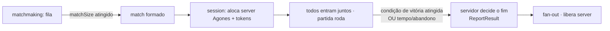

# Ficha: Arena de sessão fechada (o veículo atual, generalizado)

**Ficha nº:** 02 · **Data:** 2026-07-06 · **Status:** analisado

> É o **jogo atual do data plane** (coleta de orbes) elevado a **arquétipo genérico**: uma partida de sessão
> fechada, formada por matchmaking, que termina com um **resultado**. O arquétipo `queue_arena` do baseline.

## 1. Visão geral

- **O que é:** o jogo que já existe no data plane (`go-game-dataplane`, spec `006-match-result`): arena server-authoritative, players coletam **orbes** (+1 ponto), **primeiro a X (=5) vence**, o servidor decide o fim e reporta `PlayerResult[]{player_id, score, won}`. Não é um jogo "de verdade" — é o **veículo** que validou o loop control plane ↔ data plane. A tarefa aqui é **generalizá-lo** (condição de vitória, empate, times, status de fim configuráveis) em vez de deixar `first-to-5` hardcoded.
- **Jogos de referência (reais) que este molde serve:** arena shooters/deathmatch (Quake), `.io` de placar (Agar.io), esporte por time e tempo (Rocket League), objetivo/território (Splatoon, CTF), corrida, king-of-the-hill, duelo 1v1. Tudo que caiba em **"N jogadores entram juntos numa sessão fechada e sai um resultado"**.
- **Por que nos interessa:** é o arquétipo que o backend **quase** serve hoje — é de onde o modelo atual saiu. Analisá-lo mostra **exatamente o que falta generalizar** para deixar de ser "um jogo" e virar "uma família de jogos".

## 2. Classificação (eixos)

| Eixo | Valor (configurável no perfil) |
|---|---|
| Estrutura social | **FFA** (o atual) **ou times NvN** — parâmetro |
| Condição de término | placar-alvo (first-to-X) · tempo esgotado (maior score) · objetivo cumprido · eliminação — **parâmetro** |
| Modelo de resultado | vitória/derrota **com empate possível** (hoje `won` nunca dá empate) |
| Granularidade do resultado | por jogador **ou por time** — parâmetro |
| Persistência competitiva | casual (MVP) → ranked/MMR opcional |
| Tamanho & composição | 1v1 · FFA de N · NvN — parâmetro (`matchSize`, `teams`) |
| Sincronicidade | tempo real, dedicated server. ✅ (é a topologia nativa; sem P2P) |
| Ciclo de vida do jogador | fixo até o fim; desconexão = fica com o score que tinha e `won=false` (comportamento atual) |
| Efeito do abandono | derrota do faltante (atual); anular partida = opção |

## 3. Ciclo de vida da sessão

**É o modelo atual** — o único que o backend já implementa ponta a ponta.



- **Como começa:** matchmaking forma o match (FIFO hoje; skill/times = evolução) → `CreateSession` aloca server.
- **Enquanto roda:** todos os jogadores presentes desde o início; server é autoritativo.
- **Como termina:** **condição de vitória declarada** (hoje hardcoded first-to-5) → o server congela e reporta.
- **Quem reporta:** o Dedicated Server, com **um `ReportResult` terminal único** (diferente do Souls, que emite eventos ao longo do tempo).

## 4. Matchmaking

- **Como forma:** fila por `game_id`, `matchSize` tickets → match (atual).
- **A generalizar:** **composição por times** (montar lados NvN, não só N no mesmo balde) e, opcionalmente, **skill/MMR**. Já eram gaps do baseline; esta ficha confirma que o veículo os exige para servir jogos por time.
- **Ticket:** `game_id` (atual) + (evolução) time/party, faixa de skill.

## 5. Resultado da partida

O ponto da generalização. Hoje: `PlayerResult{Score int64; Won bool}` + eventos `match_played`/`match_won`. Para servir a família, o resultado precisa declarar:

- **Condição de vitória** (do perfil do jogo, não hardcoded): `first_to_score` · `highest_score_at_time` · `objective` · `elimination`.
- **Outcome por jogador OU por time**, com **empate** possível: `WIN | LOSS | DRAW` (hoje só `won bool` → sem empate).
- **Desempate** declarado quando há tempo esgotado (ex.: score → depois algum critério).
- **Esboço conceitual:**
  ```
  MatchResult{
    sessionId, gameId,
    winCondition: FIRST_TO_SCORE | HIGHEST_AT_TIME | OBJECTIVE | ELIMINATION,
    teams?: [{ teamId, outcome: WIN|LOSS|DRAW, score }],
    players: [{ playerId, teamId?, score, outcome: WIN|LOSS|DRAW }]
  }
  ```
- **Casos de borda:** empate no first-to-X simultâneo · abandono (derrota vs. anula) · todos saem (partida anulada, sem resultado — já existe via TTL/Shutdown).

## 6. Impacto no backend (o elo com o control plane)

Veredito: **⚠️ cabe com esforço** — é o arquétipo nativo, mas está **hardcoded** onde deveria ser **declarado**.

- **Cabe no modelo atual?** ⚠️. O fluxo (fila→match→server→ReportResult terminal) já é exatamente este. Falta **tirar as regras do código e pô-las no perfil do jogo** + enriquecer o resultado.
- **game-registry:** arquétipo `queue_arena` com params: `matchSize`, `teams` (nº e tamanho), `winCondition` + alvo (X pontos / duração), `allowDraw`, `tiebreak`.
- **matchmaking:** **composição por times** (gap do baseline) e skill opcional.
- **session:** pouca mudança estrutural (o modelo já é este); passa a **carregar o perfil** para saber interpretar o resultado.
- **resultado & fan-out:** `PlayerResult` evolui para **outcome `WIN|LOSS|DRAW` + times** (o **gap central**). Fan-out ganha eventos além de `match_won` (ex.: `match_drawn`, `match_lost`, eventos por time).
- **Gaps para o Log:** condição de vitória **declarada no perfil** (não hardcoded); empate; resultado por time. (Reforçam gaps já abertos.)

## 7. Demo mínima (validação)

- **Escopo:** o mesmo jogo de orbes, mas com o `winCondition` e `teams` **vindos do perfil do game-registry** — rodar a **mesma build** como (a) FFA first-to-5 e (b) 2v2 por tempo com empate possível, só trocando o cadastro do jogo.
- **O que valida:** que o backend **parametriza** o arquétipo em vez de embutir — a prova de que "um jogo" virou "uma família".
