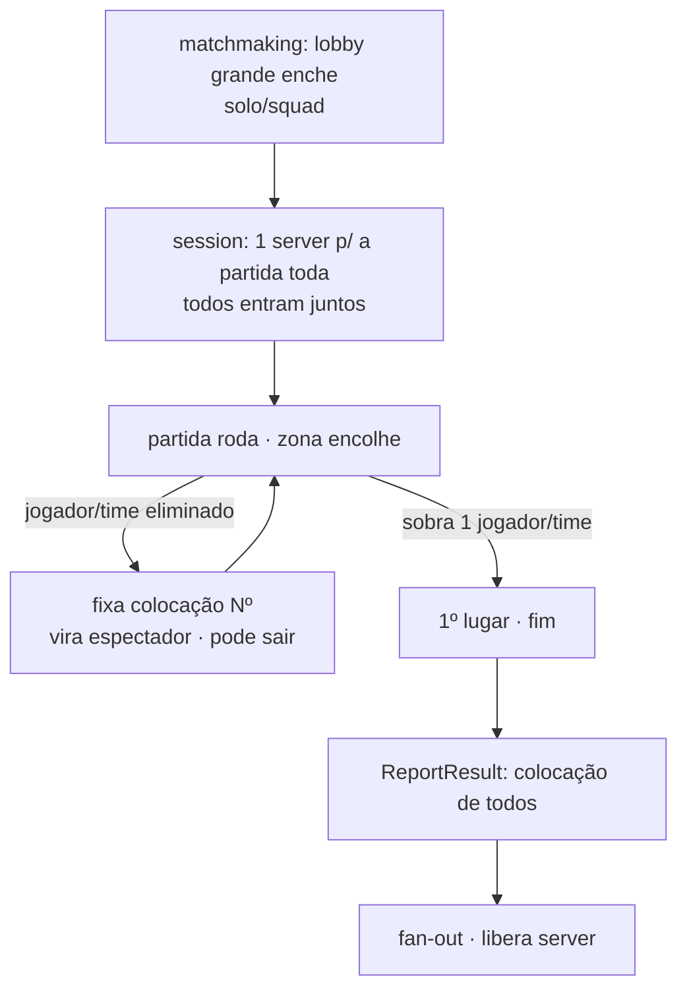

# Ficha: Battle Royale (colocação + eliminação progressiva)

**Ficha nº:** 03 · **Data:** 2026-07-06 · **Status:** analisado

> Muitos jogadores numa sessão, eliminação progressiva, **vence o último de pé**. Traz dois eixos novos ao
> backend: **resultado por colocação ordinal** (1º..Nº) e **respawn configurável**.

## 1. Visão geral

- **O que é:** dezenas a centenas de jogadores começam numa arena que **encolhe**; jogadores são eliminados ao longo do tempo; **vence o último jogador/time de pé**. Resultado não é vitória binária — é **colocação** (posição de saída) + tempo de sobrevivência.
- **Jogos de referência (reais):** PUBG, Fortnite, Warzone, Apex Legends; variantes fora do gênero-armas: Fall Guys (party/mini-games), Tetris 99 (puzzle). Mostra que o **molde** independe do tema.
- **Por que nos interessa:** estressa eixos que Souls e Arena não tocaram — **colocação ordinal** como resultado, **eliminação progressiva** (jogador "acaba" antes da partida, vira espectador) e **respawn** com regras variadas. Também exercita **escala de sessão** (muitos jogadores num server).

## 2. Classificação (eixos)

| Eixo | Valor (configurável no perfil) |
|---|---|
| Estrutura social | FFA (solo) · **squads** (duo/trio/quad) — parâmetro |
| Condição de término | **último de pé** (jogador ou time) |
| Modelo de resultado | **colocação ordinal (1º..Nº)** + sobrevivência (+ kills opcional) — não `Won bool` |
| Granularidade do resultado | por jogador **e** por time (squad compartilha colocação) |
| Persistência competitiva | casual → SBMM opcional (mais difícil que 5v5 — balancear N grande) |
| Tamanho & composição | **lobby grande** (parâmetro: ~30–150) · tamanho de squad |
| Sincronicidade | tempo real, **dedicated server** (norma do gênero). ✅ nossa topologia |
| Ciclo de vida do jogador | **eliminação progressiva** → espectador; squad permite revive/respawn |
| Efeito do abandono | desconexão = eliminação (registra colocação atual) |

## 3. Ciclo de vida da sessão

Difere da Arena: a sessão **não termina quando um jogador "acaba"** — ele sai (vira espectador) e a partida **segue** até sobrar um. Cada eliminação **fixa uma colocação** (Nº → 1º, de trás pra frente).



- **Como começa:** matchmaking enche um **lobby grande**; todos entram no **mesmo server**.
- **Enquanto roda:** o **data plane** cuida da zona que encolhe, spawns, loot (nada disso é control plane). O server registra **eliminações e colocações**.
- **Como termina:** sobra 1 → o server reporta as **colocações de todos** (resultado terminal único, como a Arena — mas ordinal).
- **Quem reporta:** o Dedicated Server; a colocação de cada um é fixada na eliminação e enviada no fim.

## 4. Matchmaking

- **Como forma:** enche um lobby de **N grande** (parâmetro) antes de abrir a partida — variação do "queue-form" da Arena, mas com alvo alto e **composição de squads** (agrupa parties, completa com solos).
- **Critérios:** região (latência importa com N grande), SBMM opcional.
- **Ticket:** `game_id` + modo (solo/duo/squad) + party + região.

## 5. Resultado da partida

Os **dois eixos novos** ao backend:

- **Colocação ordinal:** o resultado de cada jogador/time é sua **posição** (1º..Nº), não WIN/LOSS. Recompensa costuma escalar por colocação **e** por sobrevivência/kills.
- **Respawn configurável** (o eixo que o Vitor pediu — oferecer variantes sem engessar):
  | Modo de respawn | Como funciona | Efeito no "está eliminado?" |
  |---|---|---|
  | `one_life` | sem volta (BR clássico) | eliminação = final |
  | `teammate_revive` | aliado reergue quem foi "derrubado" (knocked) num tempo | derrubado ≠ eliminado |
  | `arena_1v1` (Gulag) | quem morre disputa 1v1; vencedor volta | eliminação **provisória** até perder o 1v1 |
  | `reboot_timer` | volta se o time pegar um item/estação em T minutos | eliminação provisória com janela |
  A nuance para o backend: **eliminação provisória vs. final** decide **quando** a colocação é fixada.
- **Esboço conceitual:**
  ```
  BattleRoyaleResult{
    sessionId, gameId, mode: SOLO|DUO|SQUAD,
    entries: [{ playerId, teamId?, placement:int, survivedMs, kills?, eliminatedFinal:bool }]
  }
  ```
- **Casos de borda:** desconexão = eliminação (colocação atual) · squad inteiro eliminado = colocação do time · empate de colocação raro (co-eliminação).

## 6. Impacto no backend (o elo com o control plane)

Veredito: **❌ exige generalização** — colocação ordinal e eliminação progressiva não existem no modelo atual.

- **game-registry:** arquétipo `battle_royale` com params: `lobbySize`, `teamSize` (solo/duo/squad), `respawnMode` (`one_life|teammate_revive|arena_1v1|reboot_timer`), `scoring` (peso de colocação × kills). **A "gama sem engessar" que o Vitor quer = esses parâmetros.**
- **matchmaking:** **lobby grande** (alvo N configurável) + composição de squads + região. Extensão do "times" da Arena, em escala.
- **session:** **eliminação progressiva** — participante sai (espectador) enquanto a sessão **continua**; capacidade grande (1 server/partida). Novo vs. Arena (onde ninguém "sai" antes do fim).
- **resultado & fan-out:** **colocação ordinal** — novo modelo de outcome (nem `Won bool` nem `WIN/LOSS/DRAW`, é ordinal). Fan-out mapeia para leaderboard (por colocação/kills) e conquistas ("Top 10", "1º lugar"). Reforça o **gap central**.
- **Fronteira importante:** **zona que encolhe, mapa, loot, spawns = data plane (gameplay).** O control plane **não** modela nada disso — só lobby, sessão, eliminação/colocação e resultado. Deixar isso explícito evita inchar o backend.
- **Gaps para o Log:** resultado por **colocação ordinal**; **eliminação progressiva** na sessão; **modo de respawn** como parâmetro de perfil; lobby grande / escala de sessão.

## 7. Demo mínima (validação)

- **Escopo:** lobby pequeno (ex.: 6 jogadores) num server; "eliminação" por um botão/queda simples (sem zona real); ao morrer, fixa colocação e vira espectador; sobra 1 → `ReportResult` com as colocações. Rodar em `one_life` e depois em `arena_1v1` (Gulag) só trocando o perfil.
- **O que valida:** (1) sessão com eliminação progressiva; (2) resultado por **colocação**; (3) `respawnMode` do perfil muda quando a colocação é fixada. **Sem** implementar a zona/gameplay real.
