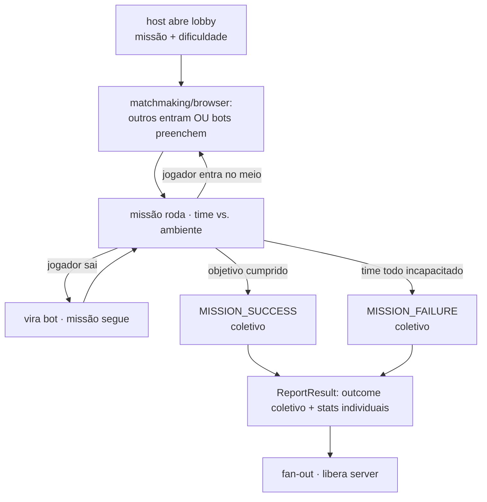

# Ficha: Co-op PvE de missão (resultado coletivo)

**Ficha nº:** 04 · **Data:** 2026-07-06 · **Status:** analisado

> Um time pequeno enfrenta o **ambiente/IA** e **ganha ou perde junto** — não há vencedor individual.
> Traz o eixo que faltava: **resultado coletivo** (sucesso/falha da sessão inteira).

## 1. Visão geral

- **O que é:** 4 jogadores cooperam contra o ambiente (hordas, cavernas, objetivos) para **completar uma missão**. O resultado é **do time todo**: ou **todos concluem** (sucesso) ou dá **wipe/falha** (todos incapacitados / objetivo perdido). Ninguém "vence" o outro. Drop-in/drop-out é a norma; **bots** preenchem vagas.
- **Jogos de referência (reais):** Left 4 Dead 1/2, Deep Rock Galactic; parentes: Vermintide, Payday, Helldivers.
- **Por que nos interessa:** é o **oposto** dos anteriores no eixo de resultado — Souls é por papel/evento, Arena é WIN/LOSS/DRAW, BR é colocação; aqui é **um único outcome coletivo** (`MISSION_SUCCESS | MISSION_FAILURE`). Também reforça o **matchmaking por lobby** (entrar numa missão em andamento) e reencontra a **topologia P2P** (DRG/L4D são host-hospedados).

## 2. Classificação (eixos)

| Eixo | Valor |
|---|---|
| Estrutura social | **Co-op puro** — 1 time contra o ambiente/IA (sem PvP no modo base) |
| Condição de término | **objetivo cumprido** (missão completa) **ou** wipe (time todo incapacitado) |
| Modelo de resultado | **coletivo:** `MISSION_SUCCESS`/`MISSION_FAILURE` para todos (sem vencedor individual) |
| Granularidade do resultado | **por sessão/time**; performance individual (kills, minério) pode modular recompensa, não o desfecho |
| Persistência competitiva | casual; sem MMR — filtra por **dificuldade escolhida** (Hazard Level / difficulty) |
| Tamanho & composição | time pequeno fixo (~4); **bots preenchem** vagas humanas |
| Sincronicidade | tempo real. Original é **host-hospedado (P2P)**; nós faríamos dedicated (ver §6) |
| Ciclo de vida do jogador | **join-in-progress / drop-out**; incapacitado→revive; slot vago→bot |
| Efeito do abandono | **bot assume**, a missão continua (não anula, não derrota) |

## 3. Ciclo de vida da sessão

Como o Souls, a sessão é **host-cêntrica e admite entrada no meio** — mas **cooperativa** e com **parâmetros de missão** (missão + dificuldade) escolhidos pelo host.



- **Como começa:** o host escolhe **missão + dificuldade** e abre; não há "fila que forma lados" — outros **encontram e entram** (ou bots).
- **Enquanto roda:** ambiente/IA é o adversário (o "AI Director" do L4D é data plane). Humanos entram/saem; bots cobrem.
- **Como termina:** objetivo cumprido (sucesso) **ou** wipe (falha) — **um desfecho para todos**.
- **Quem reporta:** o server, com **um outcome coletivo** + stats individuais para modular recompensa.

## 4. Matchmaking

- **Como forma:** **lobby / server-browser** — o host anuncia a missão+dificuldade; jogadores filtram e **entram numa sessão existente** (público) ou por convite (privado). Não é "queue-form" simétrico; é **descoberta + entrada**, como o co-op do Souls, mas sem papel adversário.
- **Critérios:** missão, **dificuldade** (Hazard/difficulty), região; sem MMR.
- **Ticket / filtro:** `game_id` + missão + dificuldade + público/privado (senha).

## 5. Resultado da partida

O eixo novo: **outcome de sessão, não de jogador**.

- **Desfecho coletivo:** `MISSION_SUCCESS` ou `MISSION_FAILURE` — **igual para todos** os participantes (inclusive quem entrou no meio, se estava no fim).
- **Stats individuais** (opcionais) **modulam recompensa**, não o desfecho: kills, revives, minério coletado, dano. Todos ganham a recompensa base do sucesso; performance ajusta extras/XP.
- **Esboço conceitual:**
  ```
  CoopMissionResult{
    sessionId, gameId, mission, difficulty,
    outcome: MISSION_SUCCESS | MISSION_FAILURE,   // coletivo
    participants: [{ playerId, joinedMidMission:bool, stats:{ kills, revives, ... } }]
  }
  ```
- **Efeito pós-partida:** progressão coletiva (missão concluída) + individual (XP/loot por stats). Sem ranking competitivo.
- **Casos de borda:** todos saem antes do fim (bots terminam? ou anula?) · sucesso com jogadores que entraram no fim · falha parcial (objetivo secundário).

## 6. Impacto no backend (o elo com o control plane)

Veredito: **❌ exige generalização** — o resultado coletivo não existe no modelo atual.

- **Cabe no modelo atual?** ❌. `PlayerResult{Won bool}` é **por jogador**; aqui o desfecho é **da sessão**. E o matchmaking atual (queue-form) não modela "entrar numa missão em andamento".
- **game-registry:** arquétipo `coop_mission` com params: `teamSize` (~4), `botfill` (on/off), `missions[]` + `difficulties[]` (o que o host pode escolher), `resultKind = collective`.
- **matchmaking:** modo **lobby/browser** (descoberta + entrada em sessão existente, filtrado por missão+dificuldade) — **mesmo gap** do sinal/injeção do Souls, na variante cooperativa. E **join-in-progress**.
- **session:** host-cêntrica com **parâmetros de missão** (missão+dificuldade carregados na sessão); **join/leave no meio**; **bot-fill** (o control plane modela slots de humano — bots são gameplay). Aparentada da sessão do Souls, sem papéis adversários.
- **resultado & fan-out:** **outcome coletivo** (`MISSION_SUCCESS/FAILURE` para todos) + stats individuais que modulam recompensa. Novo formato — nem por jogador, nem colocação: **por sessão**. Reforça e **amplia** o gap central.
- **Topologia (reencontro):** L4D/DRG são **P2P host-hospedado** (DRG nem tem host migration). Cai na mesma decisão da ficha 01: `dedicated` (nosso default, autoridade neutra) vs `p2p`. Este arquétipo, como o Souls, é candidato natural a **suportar as duas topologias** — reforça a decisão de topologia-por-jogo.
- **Fronteira:** IA/Director, hordas, incapacitação/revive, geração procedural = **data plane**. O control plane só modela lobby, sessão (com missão+dificuldade), participação e **outcome coletivo**.
- **Gaps para o Log:** **resultado coletivo** (por sessão); matchmaking por lobby/browser filtrado + join-in-progress (partilha com Souls); parâmetros de missão/dificuldade na sessão; bot-fill (slots de humano).

## 7. Demo mínima (validação)

- **Escopo:** host abre uma "missão" (sessão com `mission`+`difficulty` do perfil). Um 2º jogador **entra no meio**. Um botão "completar objetivo" → `MISSION_SUCCESS` para os dois; ou "wipe" → `MISSION_FAILURE`. Todos recebem o **mesmo desfecho**; stats individuais (um contador) viajam junto.
- **O que valida:** (1) resultado **coletivo** no fan-out; (2) join-in-progress numa sessão host-cêntrica; (3) missão+dificuldade como parâmetros da sessão vindos do perfil.
