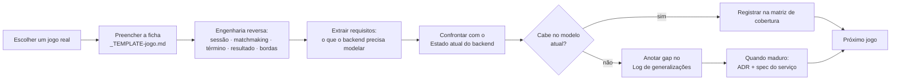

# Modelos de Jogo Multiplayer — taxonomia & engenharia reversa

**Status:** documento vivo · **Início:** 2026-07-06 · **Dono:** control plane (backend Go)

## Por que este documento existe

O backend (matchmaking, session, game-registry, fan-out) precisa dar suporte a **vários tipos de jogo multiplayer** — cooperativo, competitivo, por times, battle royale, turnos, etc. Hoje ele assume **um único arquétipo** (N jogadores independentes, cada um com placar, alguém vence por booleano — ver "Estado atual do backend"). O jogo-exemplo do data plane (Unity) acabou moldando os contratos, e queremos genericidade **com qualidade**, não por acidente.

A abordagem é **engenharia reversa de jogos reais**: para cada jogo que nos interessa, dissecamos como funcionam sessão, matchmaking, condição de término e resultado — e daí extraímos o que o backend precisa **modelar, mudar ou generalizar**. Este documento é o input de design; ADRs e specs são o output.

> **O que este documento NÃO é:** não é o design de *um* jogo (não há level design, arte, economia). É uma **taxonomia** + fichas de análise que existem para dirigir a modelagem do backend genérico.

> **Escopo (decidido 2026-07-06):** apenas jogos **tempo real com game server dedicado** (modelo Agones/Unity atual — sessão = 1 server vivo ↔ N players). Jogos **assíncronos** (jogadas ao longo de dias, sem server alocado) ficam **fora de escopo** por ora — exigiriam repensar sessão como estado durável sem server. O eixo "Sincronicidade" varia só entre *tempo real* e *turnos síncronos* (todos conectados).

## Como trabalhamos (o loop, entre sessões)

**Regras do loop:**
1. Um jogo por ficha, numerada: `01-<slug>.md`, `02-<slug>.md`, … (ordem de análise, não de prioridade).
2. Nunca inventamos mecânica: cada ficha cita **jogos reais** como referência e raciocina sobre o que é observável.
3. A ficha termina sempre com **"Impacto no backend"** — é o elo com o control plane.
4. Gaps recorrentes viram entrada no **Log de generalizações** (abaixo). Quando um gap amadurece, propomos **ADR** (decisão) + **spec** (implementação) — nunca gravamos ADR sem aprovação.
5. Cada jogo vira, eventualmente, uma **demo mínima** no data plane para validar o conceito (não o jogo completo).

## Eixos de classificação (o vocabulário comum)

Toda ficha classifica o jogo por estes eixos. São a "linguagem" que torna jogos diferentes comparáveis e revela o que o backend precisa parametrizar.

| Eixo | Valores possíveis (não exaustivo) | Por que importa pro backend |
|---|---|---|
| **Estrutura social** | solo-vs-mundo · co-op (todos juntos) · FFA competitivo · times (NvN) · múltiplos times/squads | Define se o resultado é por jogador, por time ou coletivo; se o matchmaking monta lados |
| **Condição de término** | eliminação · placar-alvo · tempo esgotado · objetivo cumprido · último de pé · sem fim (sandbox) | Quem/o quê fecha a sessão e dispara o `ReportResult` |
| **Modelo de resultado** | vitória binária · empate possível · colocação ordinal (1º..Nº) · placar contínuo · coletivo (co-op ganha/perde) · sem win-state | **O gap central** — hoje só existe `Won bool` + `Score` |
| **Granularidade do resultado** | por jogador · por time · por partida | Como o fan-out atribui XP/conquistas/ranking |
| **Persistência competitiva** | casual · ranked/MMR · temporadas | Se matchmaking usa skill e se há efeito pós-partida no ranking |
| **Tamanho & composição** | 1v1 · NvN simétrico · FFA de N · assimétrico (ex.: 4v1) | Parâmetros de formação de match |
| **Sincronicidade** | tempo real · por turnos síncrono · assíncrono (jogadas ao longo de dias) | Modelo de sessão: server dedicado vivo vs. estado durável sem server |
| **Ciclo de vida do jogador** | fixo até o fim · reconnect · entra/sai no meio (join-in-progress) · espectador | Robustez da sessão a desconexão/abandono |
| **Efeito do abandono** | derrota do faltante · substituição por bot · anula a partida · sem efeito | Como o resultado lida com quem saiu |

## Baseline histórico do backend (ponto de partida, pré-ADR-0023)

> **Nota:** esta seção descreve o **arquétipo implícito único** de onde partimos — antes do perfil por arquétipo (ADR-0023). Já foi generalizado: hoje há `queue_arena` e `host_world_dropin` completos (ver "Estado da implementação" abaixo). Mantido como registro do gap original.

O que os serviços modelavam no baseline — o ponto de partida a ser generalizado. (Refs: `session-service/specs/001,002`, `matchmaking-service/specs/001,003`, `game-registry/specs/001`.)

- **game-registry:** jogo = `id / slug / name` + capa + presença. **Não** descreve a *forma* do multiplayer (tipo, modo, times, término, regras de resultado).
- **matchmaking:** fila **FIFO** por `matchSize` fixo, escopada por `game_id`. Sem times, sem skill/MMR, sem modo/fila, sem party, sem região. `FindMatchRequest{ game_id }`.
- **session:** 1 game server ↔ N players. Ciclo: `CreateSession → (partida) → ReportResult → libera server`. Reconciliação de órfãs (spec 008). **Sem** conceito de times.
- **resultado (o gap):** `PlayerResult{ PlayerID; Score int64; Won bool }`. Fan-out → eventos `match_played` (todos) e `match_won` (`won=true`). **Sem** empate, abandono, colocação, resultado por time, ou partida sem vencedor.

### Arquétipo implícito de hoje

> "Uma partida competitiva de N jogadores **independentes**, todos rivais, cada um com um **placar**, terminando com **um ou mais vencedores** marcados por booleano."

Cobre bem: FFA competitivo simples. **Não** cobre: co-op, times, empate, colocação, ranked, assíncrono, abandono estruturado, jogo sem win-state.

## Matriz de cobertura (preenchida conforme analisamos jogos)

Cada jogo analisado entra aqui com um veredito rápido. `✅ cabe` · `⚠️ cabe com esforço` · `❌ exige generalização`.

> **Princípio (ficha 05): gênero ≠ arquétipo.** Arquétipo é a **forma** da sessão/matchmaking/resultado (o que o backend modela); gênero/tema (shooter, esporte, MOBA, luta…) e **câmera** (FPS/TPS) são **conteúdo do data plane**. Vários gêneros colapsam no mesmo arquétipo (ex.: shooter competitivo, MOBA 5v5, esporte, fighting 1v1 → todos `queue_arena` com `mode`/`scoring`/`teamSize` diferentes). Nem todo "tipo de jogo" novo vira arquétipo novo.

| # | Jogo | Estrutura | Resultado | Veredito | Ficha |
|---|---|---|---|---|---|
| 01 | Soulslike (DS1-3, Bloodborne, Elden Ring) | Assimétrica host-cêntrica (host + co-op + invasor) | Outcome por papel/evento | ❌ exige generalização | [01](./01-soulslike-invasion-coop.md) |
| 02 | Arena de sessão fechada (veículo atual — orbes) | FFA ou NvN, sessão simétrica | Vitória/derrota **+ empate**, por jogador/time | ⚠️ cabe com esforço (hoje hardcoded) | [02](./02-arena-placar.md) |
| 03 | Battle Royale (PUBG, Fortnite, Warzone…) | FFA/squads, eliminação progressiva | **Colocação ordinal** (1º..Nº) + respawn configurável | ❌ exige generalização | [03](./03-battle-royale.md) |
| 04 | Co-op PvE de missão (L4D, Deep Rock) | Co-op puro (time vs. ambiente) | **Coletivo** (`MISSION_SUCCESS/FAILURE` p/ todos) | ❌ exige generalização | [04](./04-coop-pve-mission.md) |
| 05 | Shooters FPS/TPS (CoD, CS, TLOU, MGS) | Times NvN (varia) | Por time + **stats por jogador** | ✅ **estende** `queue_arena` (não é arquétipo) | [05](./05-shooters-fps-tps.md) |

## Log de generalizações (gaps → decisões)

Fila de mudanças candidatas no backend, alimentada pelas fichas. Só viram ADR/spec após maturar e com aprovação.

| Gap | Origem (jogo/ficha) | Serviço(s) | Ideia de direção | Estado |
|---|---|---|---|---|
| Modelo de resultado além de `Won bool`/`Score` | baseline, fichas 01-04 | session, achievements, leaderboard | resultado como **outcome** rico: WIN/LOSS/DRAW (02), **colocação ordinal** (03), **coletivo por sessão** (04), **por evento/papel** (01) — por jogador, time **ou sessão** | ✅ **completo** — os 4 modelos do ADR-0023 na main com sinks: `win_loss_draw` (session `009`), `participation_event` (H2), `placement` (BR2+BR3), `collective` (C2 `session/016` + C3 sinks + C4 console) |
| Jogo descreve sua **forma** de multiplayer (**perfil/arquétipo**) | baseline, ficha 01 | game-registry | jogo declara um **arquétipo de multiplayer** (`queue_arena`, `host_world_dropin`, …) + parâmetros; demais serviços leem e se pré-configuram | ✅ **ADR-0023** (Accepted) |
| Matchmaking com **times** e composição | baseline, fichas 02/03 | matchmaking | formar lados (NvN), squads e **lobby grande** (BR), não só N tickets FIFO | 🟡 **NvN na main** (specs `matchmaking/005`+`session/010`, atribuição posicional); squads/lobby grande (BR) e skill/MMR seguem abertos |
| Condição de vitória **declarada no perfil** (não hardcoded) | ficha 02 | game-registry, session | `first_to_score` / `highest_at_time` / `objective` / `elimination` no cadastro; hoje é `first-to-5` no código | 🟡 **declarada** no perfil (`queue_arena`, spec 006); o **consumo pelo data plane** vem via **session manifest** (ADR-0024, fatia M1) |
| **Modo de partida** (preset) + **estrutura de rounds** no `queue_arena` | ficha 05 | game-registry, session | `mode` (TDM/FFA/Domination/S&D/CTF) = preset de {social, vitória, granularidade}; `matchStructure = single \| best_of_rounds(N)` | ✅ **absorvido pelo ADR-0024** — modos = **perfis nomeados** (TDM e S&D viram dois perfis `queue_arena` com params diferentes); `matchStructure`/rounds já são params declarados (spec 006) |
| **Stats estruturadas** no resultado (não só `score int64`) | ficha 05 | session, leaderboard, achievements | resultado carrega mapa de métricas por jogador (kills, assists, objetivos, stealth) → leaderboards ricos (K/D, MVP) | ✅ **feito** — `stats` no outcome (session `009`), boards por métrica (leaderboard `003`/`004`), conquistas por stat (achievements `008`) |
| **Colocação ordinal** como resultado (1º..Nº) | ficha 03 | session, leaderboard, achievements | outcome ordinal (BR) além de WIN/LOSS/DRAW | ✅ **feito** — kind `placement` (BR2, session `015`) + sinks (BR3) |
| **Eliminação progressiva** na sessão | ficha 03 | session | participante vira espectador/sai enquanto a sessão segue; colocação fixada na saída | ✅ **resolvido por design** — resultado `placement` é **terminal**; a eliminação é gameplay do data plane (contrato BR) |
| **Modo de respawn** como parâmetro de perfil | ficha 03 | game-registry, session | `one_life`/`teammate_revive`/`arena_1v1`/`reboot_timer`; muda quando a colocação é final | ✅ **declarado** (BR0, game-registry `007`); comportamento é do data plane (contrato BR) |
| **Resultado coletivo** (por sessão, não por jogador) | ficha 04 | session, achievements, leaderboard | `MISSION_SUCCESS/FAILURE` igual p/ todos; stats individuais só modulam recompensa | ✅ **completo** — C2 (`session/016`) + C3 (sinks) + C4 (console) na main |
| **Parâmetros de missão/dificuldade** na sessão + **bot-fill** | ficha 04 | game-registry, matchmaking, session | host escolhe missão+dificuldade (matchmaking filtra, sessão carrega); slots de humano com bot-fill | 🟡 **declarados no perfil** (C0); carregá-los na sessão/data plane vem via **session manifest** (ADR-0024, M1); bot-fill segue comportamento do data plane |
| **Vários modos por jogo** (perfis nomeados) + snapshot por sessão + manifest | review pós-ADR-0023; fichas 01/03/05 (Elden Ring/CoD) | game-registry, matchmaking, session, sinks, console | jogo 1—N perfis nomeados (`modeId`); `mode_id` opcional no ticket/token; sessão congela snapshot e valida `kind`×arquétipo; manifest p/ o data plane; `modeId` aditivo no envelope | ✅ **ADR-0024** (Accepted, 2026-07-07); fatias M0–M2 em [`multiplayer-modes-roadmap.md`](./multiplayer-modes-roadmap.md) — M0 em spec |
| **Matchmaking por lobby/browser + join-in-progress** | fichas 01/04 | matchmaking, session | descobrir e **entrar numa sessão existente** (filtrada), não só formar partida nova | 🟡 **join-in-progress + injeção feitos** (host_world_dropin H1a/H1b); lobby/browser do queue-form segue aberto |
| Modo de matchmaking **sinal/injeção** (não só queue-form) | ficha 01 | matchmaking | descobrir host elegível por faixa/senha/pool/papel e **injetar** um participante numa sessão existente | ✅ **host_world_dropin** (H1a invasão `matchmaking/006` + H1b co-op por sinais `matchmaking/007`); senha/pool = follow-up |
| Sessão **host-cêntrica persistente** com **slots por papel** | ficha 01 | session | sessão nasce sem match (host abre mundo); join/leave no meio; capacidade dinâmica por papel (host/co-op/invasor) | ✅ **host_world_dropin H0** (`session/011`) |
| **Papel** do participante na sessão | ficha 01 | session | participante tem papel (host/aliado/adversário/neutro), não só "player" | ✅ **host_world_dropin H0** (claim `role` no connect token) |
| **Quando alocar o dedicated server** (Agones) | ficha 01 | session | original é P2P (mundo = grátis, sempre existe); nós usamos dedicated server → alocar **sob demanda** quando o mundo abre p/ multiplayer e liberar ao esvaziar (economia) | 🟡 aloca no `OpenWorld` (H0); **sob demanda = follow-up** (`host_world_dropin-follow-ups.md` #10) |
| **Topologia por jogo** (`dedicated` vs `p2p`) + control plane **agnóstico de transporte** | ficha 01 | game-registry, session | perfil declara a topologia; `SessionProvisioner` Port com 2 adapters (Agones / P2P listen-server+relay). Dedicated 1º; P2P = slot no modelo, implementação depois (provável repo Unity à parte) | ✅ campo do **ADR-0023**; implementação P2P = ADR futuro |

## Estado da implementação (fatias do ADR-0023)

> **`host_world_dropin`:** as evoluções adiadas (senha, pools, Redis, `eventId`, `outcome` no analytics, alocação sob demanda, …) estão consolidadas em [`host_world_dropin-follow-ups.md`](./host_world_dropin-follow-ups.md) — o backlog para retomar após validar no data plane.

O arquétipo **`queue_arena`** está sendo implementado ponta a ponta (declarar → formar → produzir resultado → colher). Feito e planejado:

| Fatia | Serviço (spec) | O que faz | Status |
|---|---|---|---|
| Perfil no cadastro | game-registry (`006`) | jogo declara arquétipo (`queue_arena`) + params; coluna JSONB | ✅ **main** |
| Tamanho do match | matchmaking (`004`) | deriva o tamanho do perfil (ffa/teams), remove `matchSize` global | ✅ **main** |
| Resultado polimórfico | session (`009`) | `MatchOutcome` (win_loss_draw + stats + times); envelope de fan-out v2 retrocompatível | ✅ **main** |
| Colher: conquistas | achievements (`007`) | lê `outcome` → `match_won`/`match_lost`/`match_drawn` (destrava empate/derrota) | ✅ **main** |
| Colher: leaderboard por métrica | leaderboard (`003`) | N rankings por jogo (board): `score` + um por stat (kills…), highscore; `?board` default `score` | ✅ **main** |
| **Composição de times** | matchmaking (`005`) + session (`010`) | matchmaking atribui lados NvN; session é dono canônico do `teamId` (registra + carimba no resultado); connect token carrega `team_id` p/ o data plane | ✅ **main** |
| **Colher: analytics** | analytics (`003`) | agrega por `outcome` (win/**loss**/**draw**) por jogo; empate deixa de ser contado como derrota; JSON aditivo (`losses`/`draws`) | ✅ **main** — _stats por partida seguem como follow-up_ |
| **Perfil no console (B1)** | admin-bff (`012`) + admin-ui (`015`) | cadastrar/editar o perfil de multiplayer pelo painel (aba Configurações, form condicional); BFF é passthrough cru | ✅ **main** |
| **Surfacing no console (B2)** | admin-bff + admin-ui (`016`/`017`) | derrotas/empates na Analytics (B2a) + seletor de board no leaderboard, derivado do perfil (B2b) | ✅ **main** |
| **Conquistas por `stats` (A1)** | achievements (`008`) + admin-bff/admin-ui (`018`) | critério por métrica: `cumulative` (soma entre partidas) / `per_match` (melhor de uma); consumer lê `stats`; editor no console. `teamId` fica como follow-up | ✅ **main** |
| **Leaderboard cumulativo (A2)** | leaderboard (`004`) + admin-ui (`019`) | boards `wins` + `<stat>_total` via `ZINCRBY`, idempotentes por matchID (script Lua atômico); seletor no console | ✅ **main** |
| **Conquistas por `teamId`** | achievements | conquistas por time / "vencer como time X" (o outcome já carrega `teamId`) | ⬜ planejado |
| **Leaderboard acumulativo / por outcome** | leaderboard | ranking de vitórias (ZINCRBY), total de kills; hoje é só highscore por partida | ⬜ planejado |
| Usar `winCondition`/`mode`/`rounds` do perfil | session/data plane | o gameplay lê a condição de vitória declarada (hoje `first-to-5` fica no data plane) | ⬜ planejado |
| **Arquétipo `host_world_dropin` — declaração** | game-registry + admin-ui | `HostWorldDropInParams` (roles, slots, matchmaking criteria, invasion); form no painel com Fieldsets + tooltips; select de arquétipo agora real; refactor completo de `MultiplayerSettings` | ✅ **main** (commit `6fbb3cf`) |
| **`host_world_dropin` — sessão host-cêntrica (H0)** | session (`011`) | mundo persistente sem match: `OpenWorld`/`JoinWorld`/`LeaveWorld`/`CloseWorld`; slots por papel (coop/invasor) do perfil; connect token com claim `role`; rechaveação por `sessionID` sem regredir queue_arena; GO-LEARNINGS #27 | ✅ **main** |
| **`host_world_dropin` — diretório de invadíveis (H1a, lado session)** | session (`012`) | `OpenWorld` guarda os atributos do host (`WorldAttributes{SoulLevel, WeaponTier}`); novo `ListInvadableWorlds(gameID)` (mundos abertos com slot de invasor livre, fonte de dados pura); `JoinWorld` devolve `server_address` (furo de contrato herdado da H0); aditivo, queue_arena/H0 sem regressão | ✅ **main** |
| **`host_world_dropin` — injeção/invasão (H1a, lado matchmaking)** | matchmaking (`006`) | RPC unary `Invade`: lê política (`InvasionPolicy`), lista via `session/012`, filtra por faixa assimétrica (`Eligible`, função pura), injeta via `JoinWorld` com `role=invader`, retry no próximo se `ErrRoleFull`; `UnaryAuthInterceptor` novo; métrica `invasions_total{result}`; queue-form intacto | ✅ **main** |
| **`host_world_dropin` — co-op por sinais (H1b)** | matchmaking (`007`) | quadro de sinais de dois passos: `PostSummonSign` (stream — aliado anuncia e aguarda), `ListSigns` (host vê compatíveis por faixa **simétrica** `CoopEligible`), `SummonSign` (injeta `coop` via `JoinWorld`, consumo idempotente); store efêmero em memória + TTL sweeper; métricas `summons_total{result}`/`summon_signs_active`; senha/pools follow-up | ✅ **main** |
| **`host_world_dropin` — eventos de participação (H2, lado session)** | session (`013`) | `ReportParticipationEvent` (JOINED/BOSS_DEFEATED/HOST_KILLED/DIED/LEFT × SUCCESS/FAIL/NEUTRAL); DIED/LEFT liberam slot, HOST_KILLED encerra (`CloseHostKilled`); publica no `match-results` com envelope `kind=participation_event` (decisão #3, publica-antes-de-mutar); métrica `participation_events_total{event}`; aditivo, queue_arena/H0/H1a sem regressão | ✅ **main** |
| **`host_world_dropin` — conquistas por papel (H2, sink)** | achievements (`009`) | consumer despacha por `kind` (retrocompat); `participation_event` → event types por papel (`invasion_won`/`coop_boss_helped`/`world_joined`, `ParticipationEventTypes` pura), idempotência `(sessionID, playerID, event)` em `processed_participations`; `win_loss_draw` intacto | ✅ **main** |
| **`host_world_dropin` — analytics por participação (H2, sink)** | analytics (`004`) | consumer despacha por `kind`; `participation_event` → agrega `(game, role, event)` (`game_participation_rollup`), idempotência `(sessionID, playerID, event)`; `GameAnalytics.roleParticipations` aditivo no JSON; `win_loss_draw` intacto | ✅ **main** |
| **`host_world_dropin` — contrato do data plane** | doc | [`host_world_dropin-dataplane-contract.md`](./host_world_dropin-dataplane-contract.md): fonte de verdade control↔data plane (RPCs, claim `role`, `ReportParticipationEvent`, envelope, mudanças p/ o repo Unity) | ✅ **main** |
| **`host_world_dropin` — H3 (surfacing no console)** | session (`014`) + admin-bff (`014`) + admin-ui (`020`) | board admin expõe `origin`/`host`/`roleSlots`; BFF repassa + endpoint per-game analytics; Rooms mostra slots por papel (co-op X/2, invasor Y/1) e host; GameAnalytics mostra participações por papel. Quadro de sinais adiado (follow-up) | ✅ **main** |
| **Arquétipo `battle_royale` — declaração (BR0)** | game-registry (`007`) | `BattleRoyaleParams` (`LobbySize`, `TeamSize`, `RespawnMode`, `ScoringStats`); ponteiro `BattleRoyale` no `MultiplayerProfile`; validação (`lobbySize ≥ 2×teamSize`, vocabulário de respawn); persistência JSONB sem migration. Aditivo puro, `queue_arena`/`host_world_dropin` sem regressão | ✅ **main** |
| **`battle_royale` — lobby grande + squads (BR1)** | matchmaking (`008`) | `Format` deriva `battle_royale` (solo→`ffa`, squad→nova estrutura `squads`); `composeTeams` particiona o lobby em squads ragged (`squad-K`, último menor); reusa fila/`tryForm`/`Provision`. **session intacto** (formação já agnóstica de arquétipo — a diferença é o resultado, BR2) | ✅ **main** |
| **`battle_royale` — resultado por colocação (BR2)** | session (`015`) | novo kind de outcome `placement` (`MatchOutcome.Placement *PlacementResult`, `PlacementEntry{PlayerID, TeamID, Placement, SurvivedMs, Stats}`); `validateOutcome`/`stampTeams`/`toMatchOutcome`/publishers despacham por `kind`; envelope `kind=placement` no mesmo tópico `match-results`. Validação estrutural (colocação ≥ 1, `survivedMs` ≥ 0, empates/não-contiguidade aceitos). `win_loss_draw`/`participation_event` sem regressão | ✅ **main** |
| **`battle_royale` — colher: sinks (BR3)** | achievements (`010`), leaderboard (`005`), analytics (`005`) | 3 sinks reagem ao envelope `kind=placement` (dispatch por kind, zero infra nova). achievements: event types `battle_royale_played`/`_win`/`_top_n` + `survived_ms` como stat; leaderboard: boards `wins`/`top_n_finishes`/`survived_ms`/`kills_total`; analytics: rollup `game_placement_rollup` (histograma 1º/top-10/resto + sobrevivência média). Limiar Top-N=10 (constante do sink). `win_loss_draw`/`participation_event` sem regressão | ✅ **main** |
| **`battle_royale` — console + contrato (BR4)** | admin-bff (`015`) + admin-ui (`021`) + doc | **contrato** [`battle_royale-dataplane-contract.md`](./battle_royale-dataplane-contract.md); admin-bff propaga `placement`; admin-ui traz o arquétipo ao console — form de perfil BR (lobbySize/teamSize/respawnMode/scoringStats), bloco de distribuição de colocação no Analytics e rótulo lobby/modo no Rooms. Fecha também o gap da BR0-UI. `queue_arena`/`host_world_dropin` sem regressão | ✅ **main** |
| **Arquétipo `coop_mission` — declaração (C0)** | game-registry (`008`) + admin-ui | `CoopMissionParams` (`TeamSize`, `Missions`, `Difficulties`, `BotfillEnabled`, `ScoringStats`); ponteiro `CoopMission` no `MultiplayerProfile`; `ArchetypeCoopMission`; validação (`teamSize ≥ 2`, catálogos = identificadores estáveis sem duplicata); JSONB sem migration; form `coop_mission` no console + union em `api.ts`. Aditivo puro, outros 3 arquétipos sem regressão | ✅ **main** |
| **`coop_mission` — formação do time (C1)** | matchmaking (`009`) | co-op = **um único time** (`StructureTeams` com `TeamCount=1`); `case archetypeCoopMission` no `registryclient.Format` (valida `teamSize ≥ 2`). `composeTeams`/domínio/**session intactos** (formação agnóstica de arquétipo). `queue_arena`/`battle_royale` sem regressão | ✅ **main** |
| **`coop_mission` — resultado coletivo (C2, núcleo)** | session (`016`) | novo kind `collective` (`MatchOutcome.Collective *CollectiveResult`, `CollectiveResult{Outcome, Players}` — **outcome no nível da SESSÃO**, não por jogador; `CollectivePlayer{PlayerID, TeamID, Stats}`); proto regenerado com `buf`; `validateOutcome`/`stampTeams`/`toMatchOutcome`/publishers despacham por `kind`; envelope `kind=collective` no tópico `match-results`. Validação estrutural (`outcome ∈ {MISSION_SUCCESS, MISSION_FAILURE}`, `players` não-vazio). `win_loss_draw`/`placement`/`participation_event` sem regressão | ✅ **main** |
| **`coop_mission` — colher: sinks (C3)** | achievements (`011`), leaderboard (`006`), analytics (`006`) | 3 sinks reagem ao envelope `kind=collective` (dispatch por kind). achievements: `coop_mission_played`/`_success`/`_failed` (desfecho da sessão p/ todos); leaderboard: `missions_completed` cumulativo + `<stat>_total`; analytics: `game_mission_rollup` (successes/failures + successRate), migration `005` (+ fix dos mounts 002–005 no compose). `win_loss_draw`/`placement`/`participation_event` sem regressão | ✅ **main** |
| **`coop_mission` — console + contrato (C4)** | admin-bff (`016`) + admin-ui (`022`) + doc | **contrato** [`coop_mission-dataplane-contract.md`](./coop_mission-dataplane-contract.md); admin-bff propaga `mission`; admin-ui traz o bloco "Desfecho das missões" (cumpridas/falhas/taxa) na Analytics e o badge `co-op N/teamSize` no Rooms. `queue_arena`/`battle_royale`/`host_world_dropin` sem regressão | ✅ **main** |

> Convenção de status: ✅ **main** = mergeado · 🔵 **branch** = implementado e verde, aguardando merge · ⬜ planejado = fatia identificada, não iniciada · 🟡 = parcial (ver Log acima).

## Backlog de jogos a analisar

Preenchido pelo Vitor. Começamos por 1–2 jogos que ele tem em mente e expandimos.

- [x] **Soulslike** (DS1-3, Bloodborne, Elden Ring) — invasão & co-op no mundo do host → [ficha 01](./01-soulslike-invasion-coop.md)
- [x] **Arena de sessão fechada** — o veículo atual (orbes) generalizado → [ficha 02](./02-arena-placar.md)
- [x] **Battle Royale** (PUBG, Fortnite, Warzone…) — colocação + respawn configurável → [ficha 03](./03-battle-royale.md)
- [x] **Co-op PvE de missão** (L4D, Deep Rock) — resultado coletivo → [ficha 04](./04-coop-pve-mission.md)
- [x] **Shooters FPS/TPS** (CoD, CS, TLOU, MGS) — estende `queue_arena` (gênero ≠ arquétipo) → [ficha 05](./05-shooters-fps-tps.md)
- [ ] _(candidato com eixo ainda não coberto: **empate + turnos síncronos** — tabuleiro/carta)_

## Artefatos

- [`_TEMPLATE-jogo.md`](./_TEMPLATE-jogo.md) — ficha de engenharia reversa (copie por jogo)
- `NN-<slug>.md` — uma ficha por jogo analisado
- [`queue_arena-dataplane-contract.md`](./queue_arena-dataplane-contract.md) — contrato control↔data plane do arquétipo `queue_arena` (perfil → formação → token c/ `team_id` → resultado `win_loss_draw`); fonte de verdade das mudanças cross-repo no `go-game-dataplane`
- [`host_world_dropin-dataplane-contract.md`](./host_world_dropin-dataplane-contract.md) — contrato control↔data plane do `host_world_dropin` (claim `role`, `ReportParticipationEvent`, envelope `participation_event`); fonte de verdade do futuro `unity-host-world-dropin-data-plane`
- [`battle_royale-dataplane-contract.md`](./battle_royale-dataplane-contract.md) — contrato control↔data plane do `battle_royale` (squads no token c/ `team_id` → resultado `placement` terminal, `respawnMode` honrado pelo data plane, envelope `kind=placement`); fonte de verdade do futuro `unity-battle-royale-data-plane`
- [`coop_mission-dataplane-contract.md`](./coop_mission-dataplane-contract.md) — contrato control↔data plane do `coop_mission` (time co-op no token c/ `team_id` → resultado `collective` terminal com **desfecho da sessão** `MISSION_SUCCESS/FAILURE`, missão/dificuldade/bot-fill honrados pelo data plane, envelope `kind=collective`); fonte de verdade do futuro `unity-coop-mission-data-plane`
- [`queue_arena-roadmap.md`](./queue_arena-roadmap.md) — specs **restantes** do `queue_arena` (B1 perfil no console, B2 surfacing, A1/A2 enriquecimento); plano em lote p/ não re-derivar contexto
- [`host_world_dropin-roadmap.md`](./host_world_dropin-roadmap.md) — decomposição do `host_world_dropin` (H0–H3 + contrato); ✅ completo no control plane
- [`battle_royale-roadmap.md`](./battle_royale-roadmap.md) — decomposição do `battle_royale` (BR0 declaração → BR1 lobby/squads → BR2 colocação ordinal → BR3 colher → BR4 console+contrato); ✅ completo no control plane
- [`coop_mission-roadmap.md`](./coop_mission-roadmap.md) — decomposição do `coop_mission` (C0 declaração → C1 formação do time → C2 **resultado coletivo `collective`** → C3 colher → C4 console+contrato); o **último eixo de resultado** (coletivo); ✅ completo no control plane
- [`multiplayer-modes-roadmap.md`](./multiplayer-modes-roadmap.md) — fatias do **ADR-0024** (M0 modos nomeados no registry/console → M1 modo ponta a ponta + snapshot + **session manifest** → M2 segmentação de sinks, gated); a evolução pós-arquétipos
