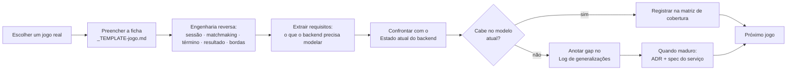

# Modelos de Jogo Multiplayer — taxonomia & engenharia reversa

**Status:** documento vivo · **Início:** 2026-07-06 · **Dono:** control plane (backend Go)

## Por que este documento existe

O backend (matchmaking, session, game-registry, fan-out) precisa dar suporte a **vários tipos de jogo multiplayer** — cooperativo, competitivo, por times, battle royale, turnos, etc. Hoje ele assume **um único arquétipo** (N jogadores independentes, cada um com placar, alguém vence por booleano — ver "Estado atual do backend"). O jogo-exemplo do data plane (Unity) acabou moldando os contratos, e queremos genericidade **com qualidade**, não por acidente.

A abordagem é **engenharia reversa de jogos reais**: para cada jogo que nos interessa, dissecamos como funcionam sessão, matchmaking, condição de término e resultado — e daí extraímos o que o backend precisa **modelar, mudar ou generalizar**. Este documento é o input de design; ADRs e specs são o output.

> **O que este documento NÃO é:** não é o design de *um* jogo (não há level design, arte, economia). É uma **taxonomia** + fichas de análise que existem para dirigir a modelagem do backend genérico.

> **Escopo (decidido 2026-07-06):** apenas jogos **tempo real com game server dedicado** (modelo Agones/Unity atual — sessão = 1 server vivo ↔ N players). Jogos **assíncronos** (jogadas ao longo de dias, sem server alocado) ficam **fora de escopo** por ora — exigiriam repensar sessão como estado durável sem server. O eixo "Sincronicidade" varia só entre *tempo real* e *turnos síncronos* (todos conectados).

## Como trabalhamos (o loop, entre sessões)

**Regras do loop:**
1. Um jogo por ficha, numerada: `01-<slug>.md`, `02-<slug>.md`, … (ordem de análise, não de prioridade).
2. Nunca inventamos mecânica: cada ficha cita **jogos reais** como referência e raciocina sobre o que é observável.
3. A ficha termina sempre com **"Impacto no backend"** — é o elo com o control plane.
4. Gaps recorrentes viram entrada no **Log de generalizações** (abaixo). Quando um gap amadurece, propomos **ADR** (decisão) + **spec** (implementação) — nunca gravamos ADR sem aprovação.
5. Cada jogo vira, eventualmente, uma **demo mínima** no data plane para validar o conceito (não o jogo completo).

## Eixos de classificação (o vocabulário comum)

Toda ficha classifica o jogo por estes eixos. São a "linguagem" que torna jogos diferentes comparáveis e revela o que o backend precisa parametrizar.

| Eixo | Valores possíveis (não exaustivo) | Por que importa pro backend |
|---|---|---|
| **Estrutura social** | solo-vs-mundo · co-op (todos juntos) · FFA competitivo · times (NvN) · múltiplos times/squads | Define se o resultado é por jogador, por time ou coletivo; se o matchmaking monta lados |
| **Condição de término** | eliminação · placar-alvo · tempo esgotado · objetivo cumprido · último de pé · sem fim (sandbox) | Quem/o quê fecha a sessão e dispara o `ReportResult` |
| **Modelo de resultado** | vitória binária · empate possível · colocação ordinal (1º..Nº) · placar contínuo · coletivo (co-op ganha/perde) · sem win-state | **O gap central** — hoje só existe `Won bool` + `Score` |
| **Granularidade do resultado** | por jogador · por time · por partida | Como o fan-out atribui XP/conquistas/ranking |
| **Persistência competitiva** | casual · ranked/MMR · temporadas | Se matchmaking usa skill e se há efeito pós-partida no ranking |
| **Tamanho & composição** | 1v1 · NvN simétrico · FFA de N · assimétrico (ex.: 4v1) | Parâmetros de formação de match |
| **Sincronicidade** | tempo real · por turnos síncrono · assíncrono (jogadas ao longo de dias) | Modelo de sessão: server dedicado vivo vs. estado durável sem server |
| **Ciclo de vida do jogador** | fixo até o fim · reconnect · entra/sai no meio (join-in-progress) · espectador | Robustez da sessão a desconexão/abandono |
| **Efeito do abandono** | derrota do faltante · substituição por bot · anula a partida · sem efeito | Como o resultado lida com quem saiu |

## Estado atual do backend (baseline)

O que os serviços modelam **hoje** — o ponto de partida a ser generalizado. (Refs: `session-service/specs/001,002`, `matchmaking-service/specs/001,003`, `game-registry/specs/001`.)

- **game-registry:** jogo = `id / slug / name` + capa + presença. **Não** descreve a *forma* do multiplayer (tipo, modo, times, término, regras de resultado).
- **matchmaking:** fila **FIFO** por `matchSize` fixo, escopada por `game_id`. Sem times, sem skill/MMR, sem modo/fila, sem party, sem região. `FindMatchRequest{ game_id }`.
- **session:** 1 game server ↔ N players. Ciclo: `CreateSession → (partida) → ReportResult → libera server`. Reconciliação de órfãs (spec 008). **Sem** conceito de times.
- **resultado (o gap):** `PlayerResult{ PlayerID; Score int64; Won bool }`. Fan-out → eventos `match_played` (todos) e `match_won` (`won=true`). **Sem** empate, abandono, colocação, resultado por time, ou partida sem vencedor.

### Arquétipo implícito de hoje

> "Uma partida competitiva de N jogadores **independentes**, todos rivais, cada um com um **placar**, terminando com **um ou mais vencedores** marcados por booleano."

Cobre bem: FFA competitivo simples. **Não** cobre: co-op, times, empate, colocação, ranked, assíncrono, abandono estruturado, jogo sem win-state.

## Matriz de cobertura (preenchida conforme analisamos jogos)

Cada jogo analisado entra aqui com um veredito rápido. `✅ cabe` · `⚠️ cabe com esforço` · `❌ exige generalização`.

> **Princípio (ficha 05): gênero ≠ arquétipo.** Arquétipo é a **forma** da sessão/matchmaking/resultado (o que o backend modela); gênero/tema (shooter, esporte, MOBA, luta…) e **câmera** (FPS/TPS) são **conteúdo do data plane**. Vários gêneros colapsam no mesmo arquétipo (ex.: shooter competitivo, MOBA 5v5, esporte, fighting 1v1 → todos `queue_arena` com `mode`/`scoring`/`teamSize` diferentes). Nem todo "tipo de jogo" novo vira arquétipo novo.

| # | Jogo | Estrutura | Resultado | Veredito | Ficha |
|---|---|---|---|---|---|
| 01 | Soulslike (DS1-3, Bloodborne, Elden Ring) | Assimétrica host-cêntrica (host + co-op + invasor) | Outcome por papel/evento | ❌ exige generalização | [01](./01-soulslike-invasion-coop.md) |
| 02 | Arena de sessão fechada (veículo atual — orbes) | FFA ou NvN, sessão simétrica | Vitória/derrota **+ empate**, por jogador/time | ⚠️ cabe com esforço (hoje hardcoded) | [02](./02-arena-placar.md) |
| 03 | Battle Royale (PUBG, Fortnite, Warzone…) | FFA/squads, eliminação progressiva | **Colocação ordinal** (1º..Nº) + respawn configurável | ❌ exige generalização | [03](./03-battle-royale.md) |
| 04 | Co-op PvE de missão (L4D, Deep Rock) | Co-op puro (time vs. ambiente) | **Coletivo** (`MISSION_SUCCESS/FAILURE` p/ todos) | ❌ exige generalização | [04](./04-coop-pve-mission.md) |
| 05 | Shooters FPS/TPS (CoD, CS, TLOU, MGS) | Times NvN (varia) | Por time + **stats por jogador** | ✅ **estende** `queue_arena` (não é arquétipo) | [05](./05-shooters-fps-tps.md) |

## Log de generalizações (gaps → decisões)

Fila de mudanças candidatas no backend, alimentada pelas fichas. Só viram ADR/spec após maturar e com aprovação.

| Gap | Origem (jogo/ficha) | Serviço(s) | Ideia de direção | Estado |
|---|---|---|---|---|
| Modelo de resultado além de `Won bool`/`Score` | baseline, fichas 01-04 | session, achievements, leaderboard | resultado como **outcome** rico: WIN/LOSS/DRAW (02), **colocação ordinal** (03), **coletivo por sessão** (04), **por evento/papel** (01) — por jogador, time **ou sessão** | 🔎 aberto |
| Jogo descreve sua **forma** de multiplayer (**perfil/arquétipo**) | baseline, ficha 01 | game-registry | jogo declara um **arquétipo de multiplayer** (`queue_arena`, `host_world_dropin`, …) + parâmetros; demais serviços leem e se pré-configuram | ✅ **ADR-0023** (Accepted) |
| Matchmaking com **times** e composição | baseline, fichas 02/03 | matchmaking | formar lados (NvN), squads e **lobby grande** (BR), não só N tickets FIFO | 🔎 aberto |
| Condição de vitória **declarada no perfil** (não hardcoded) | ficha 02 | game-registry, session | `first_to_score` / `highest_at_time` / `objective` / `elimination` no cadastro; hoje é `first-to-5` no código | 🔎 aberto |
| **Modo de partida** (preset) + **estrutura de rounds** no `queue_arena` | ficha 05 | game-registry, session | `mode` (TDM/FFA/Domination/S&D/CTF) = preset de {social, vitória, granularidade}; `matchStructure = single \| best_of_rounds(N)` | 🔎 aberto |
| **Stats estruturadas** no resultado (não só `score int64`) | ficha 05 | session, leaderboard, achievements | resultado carrega mapa de métricas por jogador (kills, assists, objetivos, stealth) → leaderboards ricos (K/D, MVP) | 🔎 aberto |
| **Colocação ordinal** como resultado (1º..Nº) | ficha 03 | session, leaderboard, achievements | outcome ordinal (BR) além de WIN/LOSS/DRAW | 🔎 aberto |
| **Eliminação progressiva** na sessão | ficha 03 | session | participante vira espectador/sai enquanto a sessão segue; colocação fixada na saída | 🔎 aberto |
| **Modo de respawn** como parâmetro de perfil | ficha 03 | game-registry, session | `one_life`/`teammate_revive`/`arena_1v1`/`reboot_timer`; muda quando a colocação é final | 🔎 aberto |
| **Resultado coletivo** (por sessão, não por jogador) | ficha 04 | session, achievements, leaderboard | `MISSION_SUCCESS/FAILURE` igual p/ todos; stats individuais só modulam recompensa | 🔎 aberto |
| **Parâmetros de missão/dificuldade** na sessão + **bot-fill** | ficha 04 | game-registry, matchmaking, session | host escolhe missão+dificuldade (matchmaking filtra, sessão carrega); slots de humano com bot-fill | 🔎 aberto |
| **Matchmaking por lobby/browser + join-in-progress** | fichas 01/04 | matchmaking, session | descobrir e **entrar numa sessão existente** (filtrada), não só formar partida nova | 🔎 aberto |
| Modo de matchmaking **sinal/injeção** (não só queue-form) | ficha 01 | matchmaking | descobrir host elegível por faixa/senha/pool/papel e **injetar** um participante numa sessão existente | 🔎 aberto |
| Sessão **host-cêntrica persistente** com **slots por papel** | ficha 01 | session | sessão nasce sem match (host abre mundo); join/leave no meio; capacidade dinâmica por papel (host/co-op/invasor) | 🔎 aberto |
| **Papel** do participante na sessão | ficha 01 | session | participante tem papel (host/aliado/adversário/neutro), não só "player" | 🔎 aberto |
| **Quando alocar o dedicated server** (Agones) | ficha 01 | session | original é P2P (mundo = grátis, sempre existe); nós usamos dedicated server → alocar **sob demanda** quando o mundo abre p/ multiplayer e liberar ao esvaziar (economia) | 🔎 aberto |
| **Topologia por jogo** (`dedicated` vs `p2p`) + control plane **agnóstico de transporte** | ficha 01 | game-registry, session | perfil declara a topologia; `SessionProvisioner` Port com 2 adapters (Agones / P2P listen-server+relay). Dedicated 1º; P2P = slot no modelo, implementação depois (provável repo Unity à parte) | ✅ campo do **ADR-0023**; implementação P2P = ADR futuro |

## Backlog de jogos a analisar

Preenchido pelo Vitor. Começamos por 1–2 jogos que ele tem em mente e expandimos.

- [x] **Soulslike** (DS1-3, Bloodborne, Elden Ring) — invasão & co-op no mundo do host → [ficha 01](./01-soulslike-invasion-coop.md)
- [x] **Arena de sessão fechada** — o veículo atual (orbes) generalizado → [ficha 02](./02-arena-placar.md)
- [x] **Battle Royale** (PUBG, Fortnite, Warzone…) — colocação + respawn configurável → [ficha 03](./03-battle-royale.md)
- [x] **Co-op PvE de missão** (L4D, Deep Rock) — resultado coletivo → [ficha 04](./04-coop-pve-mission.md)
- [x] **Shooters FPS/TPS** (CoD, CS, TLOU, MGS) — estende `queue_arena` (gênero ≠ arquétipo) → [ficha 05](./05-shooters-fps-tps.md)
- [ ] _(candidato com eixo ainda não coberto: **empate + turnos síncronos** — tabuleiro/carta)_

## Artefatos

- [`_TEMPLATE-jogo.md`](./_TEMPLATE-jogo.md) — ficha de engenharia reversa (copie por jogo)
- `NN-<slug>.md` — uma ficha por jogo analisado
