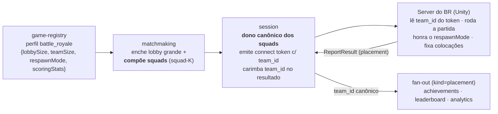

# Contrato control ↔ data plane — arquétipo `battle_royale`

> **Escopo:** o contrato entre o **control plane** (`go-multiplayer-control-plane`, Go) e o **data plane** (server do BR, Unity) para o arquétipo **`battle_royale`** do ADR-0023 — lobby grande, **squads** (solo/duo/quad), eliminação progressiva e **resultado por colocação ordinal** (1º..Nº) com sobrevivência/kills.
>
> Este doc é a **fonte de verdade do contrato**. O data plane (`unity-battle-royale-data-plane`, Unity) **não existe nem está planejado** ([REPO-TOPOLOGY.md](../REPO-TOPOLOGY.md)) — este documento é o que esse repo vai consumir quando for criado. O control plane já está pronto e testado isoladamente com server mockado (adapter `static` + cliente de teste simulando o server do BR).
>
> **Refs:** ADR-0023 (perfil de multiplayer), ADR-0010 (control/data plane), ADR-0011/0012 (Agones/Unity), ADR-0020 (fan-out). Specs: `game-registry/007` (perfil), `matchmaking/008` (lobby+squads), `session/015` (outcome `placement`), sinks `achievements/010` + `leaderboard/005` + `analytics/005`. Roadmap: [`battle_royale-roadmap.md`](./battle_royale-roadmap.md). Ficha: [`03-battle-royale.md`](./03-battle-royale.md).

## O arquétipo em uma frase

Um **lobby grande** de N jogadores (solo ou em **squads**) entra numa única sessão que **encolhe por eliminação progressiva**; vence o último de pé; o server reporta **as colocações de todos** no fim — um resultado **terminal ordinal** (não `win/loss/draw`, não por evento).

## Como isto difere dos outros arquétipos (fronteira do contrato)

| Eixo | `queue_arena` | `host_world_dropin` | **`battle_royale`** |
|---|---|---|---|
| Origem da sessão | match de fila (`CreateSession`) | host abre (`OpenWorld`) | **lobby grande** de fila (`CreateSession`) |
| Identidade | `match_id` | `session_id` | `match_id` |
| Composição | times simétricos (NvN) | slots por papel | **squads** (muitos times pequenos) ou solo/FFA |
| Ciclo do jogador | todos do início ao fim | join/leave no meio | **eliminação progressiva** → espectador (sessão segue) |
| Resultado | **1** `ReportResult(win_loss_draw)` | **N** `ReportParticipationEvent` | **1** `ReportResult(placement)` terminal |
| Claim no token | `team_id` | `role` | **`team_id`** (= squad) |
| Envelope de fan-out | `kind=win_loss_draw` | `kind=participation_event` | **`kind=placement`** (mesmo tópico) |

**Princípio de fronteira (ADR-0010):** o data plane roda o gameplay e **sabe a colocação de cada um** (a ordem de eliminação). O control plane é dono da **formação (squads)** e do **rótulo canônico do time**; o server **fixa a colocação na eliminação** (segundo o `respawnMode`) e a envia **junta no fim**. **Zona que encolhe, mapa, loot, spawns e o momento físico da eliminação = data plane** — o control plane não modela nada disso. O control plane recebe só as colocações **finais**.

## Como o perfil orienta os planos

O jogo declara `battle_royale` no game-registry; o control plane deriva a formação e o data plane herda o caminho pré-configurado:



- **`lobbySize`** (ex.: 30–150) e **`teamSize`** (1=solo, 2=duo, 4=quad) derivam a formação no matchmaking.
- **`respawnMode`** (`one_life`/`teammate_revive`/`arena_1v1`/`reboot_timer`) é **repassado** ao data plane; o control plane **não** implementa lógica de respawn (só armazena e entrega).
- **`scoringStats`** (ex.: `kills`) declara quais métricas viajam no `stats` do resultado.

## Handshake (sequência)

```mermaid
sequenceDiagram
  participant C as Clients (Unity)
  participant MM as matchmaking
  participant SS as session
  participant DS as Server do BR (Unity)

  C->>MM: FindMatch(game_id [, modo solo/squad]) [JWT]
  MM->>MM: lê perfil, enche o lobby até <b>lobbySize</b> e <b>compõe squads</b> (squad-K; solo = FFA)
  MM->>SS: CreateSession(match_id, game_id, <b>teams[]=squads</b>)
  SS->>SS: aloca server, registra composição, emite tokens
  SS-->>MM: server_address + grants{player_id, connect_token(<b>team_id=squad-K</b>)}
  MM-->>C: MATCHED{server_address, connect_token} (para todos do lobby)
  C->>DS: conecta (UDP/NGO) com connect_token
  DS->>DS: valida token offline (JWKS) e <b>lê team_id</b> → squad/spawn
  Note over DS: partida BR autoritativa · zona encolhe · eliminação progressiva<br/>colocação fixada na eliminação segundo o respawnMode
  DS->>SS: ReportResult(match_id, <b>placement</b>{entries de TODOS})
  SS->>SS: <b>carimba team_id</b> da composição, fan-out (kind=placement), fecha sessão, libera server
```

## Connect token (session → data plane)

JWT **EdDSA** (Ed25519), validado **offline** pelo server do BR via JWKS (`/.well-known/jwks.json` do session). Mesmos claims do `queue_arena` — o `team_id` carrega o **squad**:

| Claim | Descrição | Nota |
|---|---|---|
| `sub` | playerID | — |
| `match_id` | id do match (identidade da partida) | — |
| `server` | endereço do game server | — |
| `iat` / `exp` | emissão / expiração (TTL 5 min) | — |
| **`team_id`** | **squad do jogador** (ex.: `"squad-3"`); **ausente/vazio em solo/FFA** | reusa o claim do `queue_arena` (spec `session/010`) |

O server do BR lê o `team_id` no *connection approval* do NGO para agrupar o squad (spawn junto, HUD do time, friendly-fire off entre companheiros, revive/respawn por squad quando o `respawnMode` permite). Solo/FFA = `team_id` vazio (cada um é seu próprio "time").

## ReportResult (data plane → session)

O server do BR chama **uma vez, no fim** da partida (resultado terminal — decisão #1 do roadmap), com as colocações de **todos** os participantes. Reusa o `session.v1.Session/ReportResult` com o novo kind `placement` (spec `session/015`, BR2):

```
ReportResult(match_id, placement{
  entries: [ PlacementEntry{ player_id, team_id, placement (int32), survived_ms (int64), stats{...} } ]
})
```

- **`placement`**: colocação ordinal, `1 = vencedor`. **Squads compartilham a colocação do time.** Empates de colocação (co-eliminação) são **aceitos**; colocações **não** precisam ser contíguas (1..N sem buracos). O session valida só estruturalmente (`placement >= 1`, `survived_ms >= 0`) — o server é **autoritativo** sobre a corrida (o session não recomputa ranking).
- **`survived_ms`**: tempo de sobrevivência (ms) — intrínseco ao BR (vira board de highscore e stat de conquista).
- **`stats`**: `map<string,int64>` das métricas declaradas em `scoringStats` (ex.: `{"kills":6}`); pode ser vazio.
- **`team_id`**: o data plane **pode** ecoar (ex.: o do token), mas o session **o sobrescreve** com o `squad-K` canônico da formação. **Não é obrigatório** o data plane preenchê-lo corretamente.

Erros: `NotFound` (sem sessão para o `match_id`), `InvalidArgument` (`ErrInvalidOutcome`: `entries` vazio, `placement < 1` ou `survived_ms < 0`; `ErrUnsupportedOutcome`: nenhum campo do `oneof` setado). Em erro de rede, o server **refaz** o `ReportResult` (a publicação vem antes do fechamento, ADR-0020) — trate como **retriável**; `NotFound` após sucesso = sessão já encerrada (parar de reenviar).

## Modo de respawn (o data plane honra; o control plane só repassa)

O `respawnMode` do perfil decide **quando** a colocação de um jogador é fixada (provisória vs. final). É 100% gameplay — o control plane **não** medeia respawn nem recebe colocações provisórias (decisão #2 do roadmap). A colocação que chega no `ReportResult` é sempre a **final**.

| `respawnMode` | Como funciona (data plane) | Efeito em "quando a colocação é final" |
|---|---|---|
| `one_life` | sem volta (BR clássico) | eliminação = colocação final imediata |
| `teammate_revive` | aliado reergue quem foi derrubado (knocked) | derrubado ≠ eliminado; final só quando o squad inteiro cai |
| `arena_1v1` (Gulag) | quem morre disputa 1v1; vencedor volta | eliminação **provisória** até perder o 1v1 |
| `reboot_timer` | volta se o time pegar um item/estação em T min | eliminação provisória com janela |

> **Fronteira reforçada:** se algum modo exigisse o control plane **mediar** (ex.: realocar server para o "gulag"), viraria um ADR próprio. Hoje é 100% data plane.

## Envelope de fan-out (`kind=placement`)

O session publica o resultado no **mesmo** tópico `match-results`, discriminado por `kind` (retrocompatível; consumers que não entendem ignoram). O data plane **não** consome isto (é interno ao control plane), mas é a fonte de verdade do que os sinks veem:

```json
{
  "schemaVersion": 2,
  "kind": "placement",
  "matchId": "<match>",
  "gameId": "<jogo>",
  "entries": [
    { "playerId": "<jogador>", "teamId": "squad-3", "placement": 1, "survivedMs": 900000, "stats": { "kills": 6 } }
  ]
}
```

Sinks (control plane, já implementados na BR3):
- **achievements** (`010`): colocação → event types `battle_royale_played` (todos), `battle_royale_win` (1º), `battle_royale_top_n` (`placement <= 10`); `survivedMs` exposto como stat `survived_ms` para critérios por-métrica. Idempotente por `matchId`.
- **leaderboard** (`005`): boards `wins` (1º lugar), `top_n_finishes` (`<= 10`), highscore `survived_ms`, e `<stat>_total`/highscore por stat.
- **analytics** (`005`): distribuição de colocação por jogo (histograma **1º / top-10 / resto**, baldes exclusivos) + sobrevivência média.

> **Limiar Top-N = 10** é uma constante dos sinks (não vem do perfil), consistente entre achievements/leaderboard/analytics. Nos dois primeiros o `top_n` **inclui** o 1º lugar; no analytics os baldes do histograma são **exclusivos** (o 1º conta só em "winners") — proposital, porque o objetivo lá é a distribuição.

## Formação do lobby e squads (referência)

O matchmaking (`008`) enche um lobby até `lobbySize` e particiona em **squads** de `teamSize` (`squad-0`, `squad-1`, …; o último pode ficar menor — ragged). Solo (`teamSize=1`) vira **FFA** (sem `team_id`). Reusa a composição do `queue_arena` (`session/010` é o dono canônico do `team_id`), em escala. **Party real** (grupos pré-formados juntos), **skill/SBMM** e **região** ficam como follow-up.

## Mudanças necessárias no `unity-battle-royale-data-plane` (a construir)

O repo Unity ainda **não existe** ([REPO-TOPOLOGY.md](../REPO-TOPOLOGY.md)). Ao criá-lo, o contrato acima define o que ele precisa implementar. Trabalho cross-repo (não bloqueia o control plane — os serviços Go funcionam e são testados isoladamente com server mockado):

| # | Mudança | Origem | Prioridade |
|---|---|---|---|
| 1 | Gerar os stubs C# do proto `session.v1` (com o `oneof placement`: `PlacementResult`/`PlacementEntry`). | spec `session/015` | **Alta** |
| 2 | Ler o claim **`team_id`** (squad) do connect token no *connection approval* e agrupar o squad no gameplay (spawn junto, friendly-fire off, HUD do time). Solo = `team_id` vazio. | spec `session/010`/`015` | **Alta** |
| 3 | Rodar a **escala de sessão** (lobby grande num server) e a **eliminação progressiva** (jogador vira espectador; a sessão segue até sobrar 1). | ficha §3 | **Alta** |
| 4 | **Fixar a colocação na eliminação** segundo o `respawnMode` do perfil e reportar **as colocações de TODOS** num único `ReportResult(placement)` no fim. Idempotente/retriável (reenviar em erro; parar em `NotFound`). | spec `session/015` | **Alta** |
| 5 | Preencher `survived_ms` por jogador e `stats` conforme `scoringStats` (ex.: `kills`). | specs `game-registry/007` + `session/015` | Média |
| 6 | Implementar os `respawnMode` desejados (`one_life` mínimo; `arena_1v1`/`reboot_timer` como variações de gameplay). Sem envolver o control plane. | ficha §5 | Média |
| 7 | (Evolução) tracking de eliminação **ao vivo** (para o console mostrar "12/60 vivos") exigiria a sessão receber eventos incrementais — reabre a decisão #1; hoje o resultado é terminal. | roadmap (aberturas) | Baixa |

> **Nota de escala.** O `battle_royale` é o arquétipo que mais estressa a **capacidade de sessão** (1 server ↔ dezenas/centenas de jogadores) e a **latência** (N grande). Isso é dimensionamento de infra/gameplay do data plane; o contrato control↔data plane acima **não** muda com a escala — a formação, o token e o resultado são os mesmos de 30 ou de 150 jogadores.

## Resumo por modo (o que muda por campo)

| Aspecto | Solo (FFA) | Squads |
|---|---|---|
| Perfil (`teamSize`) | `1` | `2` (duo) / `4` (quad) / … |
| Composição (matchmaking) | N times de 1 (sem rótulo) | squads `squad-K` (último ragged) |
| `team_id` no connect token | ausente/vazio | `squad-K` |
| `placement` no resultado | por jogador | **compartilhado pelo squad** |
| `team_id` no ReportResult | vazio | carimbado pelo session (`squad-K`) |
| Fan-out | por jogador | por jogador **e** por squad (sinks derivam) |


## Modo + session manifest (ADR-0024, M1)

O jogo pode ter **N modos** (perfis nomeados, M0); a sessão nasce de um modo e **congela o snapshot** do perfil (mudanças no cadastro não afetam partidas em voo). O que o data plane precisa saber:

1. **Claim `mode_id` no connect token** (sempre presente; `"default"` quando o cliente não pediu modo). Lido no *connection approval* junto dos demais claims.
2. **Session manifest — `session.v1.Session/GetSessionConfig(ref_id)`**: no boot da sessão, o Dedicated Server chama o RPC (mesmo canal/auth do `ReportResult`; `ref_id` = `match_id` no queue-form ou `session_id` no host_world) e recebe:

```
GetSessionConfigResponse{
  session_id, match_id, game_id, mode_id,
  archetype,          // este arquétipo
  topology,           // "dedicated"
  params_json,        // params do modo, JSON cru — leia SÓ as chaves que conhece
  profile_hash        // hash do snapshot (logue para correlação com o backend)
}
```

**Princípio:** o server **não hardcoda regras que o perfil declara** — lê `params_json` e ignora chaves desconhecidas. Param novo no cadastro **não muda este contrato**.

3. **Validação de forma no `ReportResult`:** o session agora rejeita (`FailedPrecondition`) um outcome cujo *kind* não corresponda ao arquétipo do modo — reportar a forma errada é bug do server, não entra no fan-out.

> `lobbySize`/`teamSize`/`respawnMode`/`scoringStats` chegam prontos no `params_json` — o server do BR não precisa de fonte própria de configuração.
