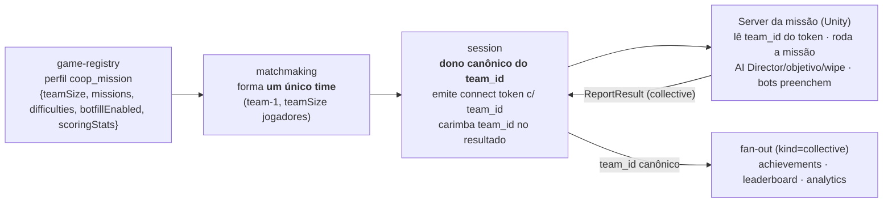
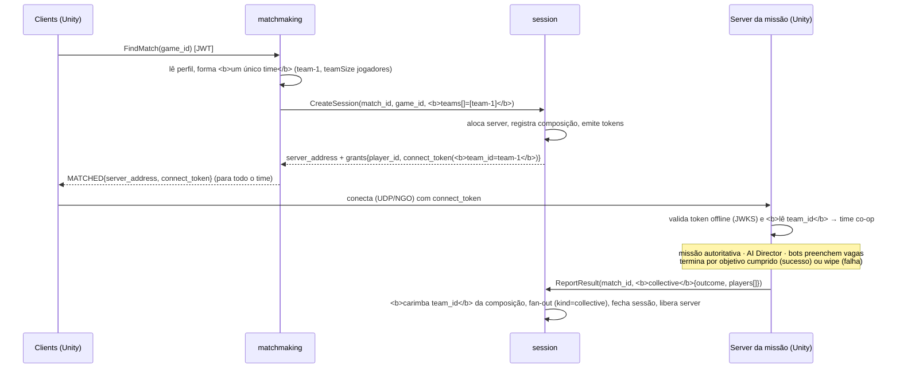

# Contrato control ↔ data plane — arquétipo `coop_mission`

> **Escopo:** o contrato entre o **control plane** (`go-multiplayer-control-plane`, Go) e o **data plane** (server da missão, Unity) para o arquétipo **`coop_mission`** do ADR-0023 — um time pequeno contra o **ambiente/IA**, término por **objetivo cumprido ou wipe**, e **resultado COLETIVO** (`MISSION_SUCCESS`/`MISSION_FAILURE` igual para todos), com stats individuais que modulam recompensa.
>
> Este doc é a **fonte de verdade do contrato**. O data plane (`unity-coop-mission-data-plane`, Unity) **não existe nem está planejado** ([REPO-TOPOLOGY.md](../REPO-TOPOLOGY.md)) — este documento é o que esse repo vai consumir quando for criado. O control plane já está pronto e testado isoladamente com server mockado (adapter `static` + cliente de teste simulando o server da missão).
>
> **Refs:** ADR-0023 (perfil de multiplayer), ADR-0010 (control/data plane), ADR-0011/0012 (Agones/Unity), ADR-0020 (fan-out). Specs: `game-registry/008` (perfil), `matchmaking/009` (time co-op), `session/016` (outcome `collective`), sinks `achievements/011` + `leaderboard/006` + `analytics/006`. Roadmap: [`coop_mission-roadmap.md`](./coop_mission-roadmap.md). Ficha: [`04-coop-pve-mission.md`](./04-coop-pve-mission.md).

## O arquétipo em uma frase

Um **time pequeno** (~4) entra numa sessão e enfrenta o **ambiente/IA**; ou **todos concluem** o objetivo (sucesso) ou dá **wipe** (falha); o server reporta **um único desfecho coletivo** no fim — igual para todos — com stats individuais que só modulam recompensa.

## Como isto difere dos outros arquétipos (fronteira do contrato)

| Eixo | `queue_arena` | `battle_royale` | **`coop_mission`** |
|---|---|---|---|
| Origem da sessão | match de fila (`CreateSession`) | lobby grande de fila | **match de fila** (`CreateSession`) |
| Identidade | `match_id` | `match_id` | `match_id` |
| Composição | times simétricos (NvN) | squads (muitos times) | **um único time** (`team-1`) |
| Adversário | outro(s) jogador(es) | outros jogadores | **o ambiente/IA** (sem PvP) |
| Resultado | **1** `ReportResult(win_loss_draw)` (por jogador) | **1** `ReportResult(placement)` (ordinal) | **1** `ReportResult(collective)` — **desfecho da SESSÃO** |
| Granularidade | por jogador/time | por jogador (colocação) | **por sessão** (todos ganham/perdem juntos) |
| Claim no token | `team_id` | `team_id` (squad) | **`team_id`** (= `team-1`) |
| Envelope de fan-out | `kind=win_loss_draw` | `kind=placement` | **`kind=collective`** (mesmo tópico) |

**Princípio de fronteira (ADR-0010):** o data plane roda o gameplay e **decide o desfecho** (objetivo cumprido vs. wipe). O control plane é dono da **formação (o time)** e do **rótulo canônico do time**; o server envia **um desfecho coletivo terminal** no fim. **IA/AI Director, hordas, incapacitação/revive, geração procedural e os bots = data plane** — o control plane não modela nada disso. Ele recebe só o **desfecho final da sessão** + stats por jogador.

> **O ponto estrutural novo:** diferente dos outros três kinds, o `outcome` do `coop_mission` **não é por jogador** — é um campo do resultado, no nível da **sessão**. Todos os participantes compartilham o mesmo `MISSION_SUCCESS`/`MISSION_FAILURE`.

## Como o perfil orienta os planos

O jogo declara `coop_mission` no game-registry; o control plane deriva a formação e o data plane herda os params de missão:



- **`teamSize`** (ex.: 4) deriva a formação no matchmaking (um único time de `teamSize`).
- **`missions`/`difficulties`** (catálogos declarados) e **`botfillEnabled`** são **repassados** ao data plane; o control plane **não** seleciona missão nem faz spawn de bot (só armazena e entrega).
- **`scoringStats`** (ex.: `kills`, `revives`) declara quais métricas por jogador viajam no `stats` do resultado.

## Handshake (sequência)



## Connect token (session → data plane)

JWT **EdDSA** (Ed25519), validado **offline** pelo server da missão via JWKS (`/.well-known/jwks.json` do session). Mesmos claims do `queue_arena` — o `team_id` carrega o **time co-op**:

| Claim | Descrição | Nota |
|---|---|---|
| `sub` | playerID | — |
| `match_id` | id do match (identidade da partida) | — |
| `server` | endereço do game server | — |
| `iat` / `exp` | emissão / expiração (TTL 5 min) | — |
| **`team_id`** | **time co-op** (ex.: `"team-1"`) | reusa o claim do `queue_arena` (spec `session/010`) |

O server da missão lê o `team_id` no *connection approval* do NGO para agrupar o time (spawn junto, HUD do time, friendly-fire off, revive por aliado). Como o co-op é **um único time**, todos os jogadores humanos compartilham o mesmo `team_id`.

## ReportResult (data plane → session)

O server da missão chama **uma vez, no fim** (resultado terminal — decisão #1 do roadmap), com o **desfecho coletivo da sessão** + uma entrada por participante. Reusa o `session.v1.Session/ReportResult` com o novo kind `collective` (spec `session/016`, C2):

```
ReportResult(match_id, collective{
  outcome: "MISSION_SUCCESS" | "MISSION_FAILURE",   // da SESSÃO (igual para todos)
  players: [ CollectivePlayer{ player_id, team_id, stats{...} } ]
})
```

- **`outcome`**: o desfecho da **sessão inteira** — `MISSION_SUCCESS` (objetivo cumprido) ou `MISSION_FAILURE` (wipe/objetivo perdido). **Não há desfecho por jogador**; todos recebem o mesmo. O session valida só o vocabulário.
- **`players[].stats`**: `map<string,int64>` das métricas declaradas em `scoringStats` (ex.: `{"kills":12,"revives":3}`); **modulam recompensa, não o desfecho**; pode ser vazio. Os valores **não** são validados pelo session (server autoritativo).
- **`players[].team_id`**: o data plane **pode** ecoar (ex.: o do token), mas o session **o sobrescreve** com o `team-1` canônico da formação. **Não é obrigatório** o data plane preenchê-lo corretamente.
- **Sem** `won`/`score`/`placement` por jogador — o desfecho é do time.

Erros: `NotFound` (sem sessão para o `match_id`), `InvalidArgument` (`ErrInvalidOutcome`: `players` vazio ou `outcome` fora de `{MISSION_SUCCESS, MISSION_FAILURE}`; `ErrUnsupportedOutcome`: nenhum campo do `oneof` setado). Em erro de rede, o server **refaz** o `ReportResult` (a publicação vem antes do fechamento, ADR-0020) — trate como **retriável**; `NotFound` após sucesso = sessão já encerrada (parar de reenviar).

## Missão, dificuldade e bot-fill (o data plane consome; o control plane só declara)

`missions`/`difficulties`/`botfillEnabled` do perfil são **params declarados** — igual ao `respawnMode` do `battle_royale`. O control plane os **armazena e repassa**; toda a lógica é do data plane:

| Param | Como o data plane usa | Fronteira |
|---|---|---|
| `missions[]` | catálogo de missões que o host pode escolher/rodar | seleção e conteúdo = data plane |
| `difficulties[]` | catálogo de dificuldades (Hazard Level etc.) | modula o gameplay, **não** o desfecho |
| `botfillEnabled` | se vagas humanas são preenchidas por bots | **bots são gameplay** — o control plane modela só slots de humano |

> **Bots e slots.** O control plane forma o time com os **humanos** disponíveis (MVP: espera o time cheio — bot-fill/lobby-timeout são Aberturas do roadmap). Os bots que preenchem vagas são 100% data plane e **não** aparecem no `players[]` do `ReportResult` (que carrega só humanos).

## Envelope de fan-out (`kind=collective`)

O session publica o resultado no **mesmo** tópico `match-results`, discriminado por `kind` (retrocompatível; consumers que não entendem ignoram). O data plane **não** consome isto (é interno ao control plane), mas é a fonte de verdade do que os sinks veem:

```json
{
  "schemaVersion": 2,
  "kind": "collective",
  "matchId": "<match>",
  "gameId": "<jogo>",
  "outcome": "MISSION_SUCCESS",
  "players": [
    { "playerId": "<jogador>", "teamId": "team-1", "stats": { "kills": 12, "revives": 3 } }
  ]
}
```

Sinks (control plane, já implementados na C3):
- **achievements** (`011`): desfecho → event types `coop_mission_played` (todos), `coop_mission_success` **ou** `coop_mission_failed` (conforme o desfecho da sessão — igual para todos); `stats` alimentam critérios por-métrica (kills/revives). Idempotente por `matchId`.
- **leaderboard** (`006`): board cumulativo `missions_completed` (+1 para todos em `MISSION_SUCCESS`) + `<stat>_total`/highscore por stat.
- **analytics** (`006`): distribuição de desfecho por jogo (`successes`/`failures`) + **taxa de sucesso** (`successRate`).

> **O desfecho é da sessão.** Nos sinks, `success`/`failed` e `missions_completed` valem **igual para todos** os jogadores da partida (não é por jogador) — é o que distingue este arquétipo dos outros três. Os `stats` seguem por jogador.

## Formação do time (referência)

O matchmaking (`009`) forma **um único time** de `teamSize` (`team-1`) — o caso degenerado do NvN do `queue_arena` (`StructureTeams` com `TeamCount=1`). O `session/010` é o dono canônico do `team_id`. **Join-in-progress** (entrar numa missão em andamento), **lobby/browser filtrado** (por missão+dificuldade) e **bot-fill** ficam como Aberturas do roadmap (partilham gap do `host_world_dropin`, cuja injeção já existe).

## Mudanças necessárias no `unity-coop-mission-data-plane` (a construir)

O repo Unity ainda **não existe** ([REPO-TOPOLOGY.md](../REPO-TOPOLOGY.md)). Ao criá-lo, o contrato acima define o que ele precisa implementar. Trabalho cross-repo (não bloqueia o control plane — os serviços Go funcionam e são testados isoladamente com server mockado):

| # | Mudança | Origem | Prioridade |
|---|---|---|---|
| 1 | Gerar os stubs C# do proto `session.v1` (com o `oneof collective`: `CollectiveResult`/`CollectivePlayer`). | spec `session/016` | **Alta** |
| 2 | Ler o claim **`team_id`** (= `team-1`) do connect token no *connection approval* e agrupar o time co-op no gameplay (spawn junto, friendly-fire off, revive por aliado). | spec `session/010`/`016` | **Alta** |
| 3 | Rodar a **missão autoritativa** (AI Director, hordas, objetivo, wipe) e detectar o **desfecho coletivo** (sucesso = objetivo cumprido; falha = time todo incapacitado). | ficha §3 | **Alta** |
| 4 | Reportar **um único `ReportResult(collective)`** no fim, com o `outcome` da sessão + `players[]` (só humanos) e `stats`. Idempotente/retriável (reenviar em erro; parar em `NotFound`). | spec `session/016` | **Alta** |
| 5 | Preencher `stats` por jogador conforme `scoringStats` (ex.: `kills`, `revives`, `ore_mined`). | specs `game-registry/008` + `session/016` | Média |
| 6 | Consumir `missions`/`difficulties`/`botfillEnabled` do perfil: rodar a missão+dificuldade escolhidas e **preencher vagas com bots** (bots são gameplay; não entram no `players[]`). | spec `game-registry/008` | Média |
| 7 | (Evolução) **join-in-progress** (entrar numa missão em andamento) exigiria injeção/descoberta no matchmaking — Abertura do roadmap (partilha o gap do `host_world_dropin`, cuja injeção já existe). | roadmap (aberturas) | Baixa |

> **Topologia.** L4D/Deep Rock são **P2P host-hospedado**; o perfil declara `topology` (`dedicated` default; `p2p` reservado, ADR-0023). O contrato acima vale para `dedicated`; a variante P2P (listen-server + relay) é um ADR/implementação futura e **não** muda os campos do resultado — só o `SessionProvisioner`.

## Resumo por campo (o que o data plane preenche)

| Campo do `ReportResult(collective)` | Quem decide | Obrigatório | Nota |
|---|---|---|---|
| `outcome` | data plane (missão) | **Sim** | `MISSION_SUCCESS`/`MISSION_FAILURE` — da sessão, igual para todos |
| `players[].player_id` | data plane | **Sim** | só humanos (bots não entram) |
| `players[].team_id` | — | Não | o session sobrescreve com `team-1` canônico |
| `players[].stats` | data plane | Não | métricas de `scoringStats`; modulam recompensa, não o desfecho |


## Modo + session manifest (ADR-0024, M1)

O jogo pode ter **N modos** (perfis nomeados, M0); a sessão nasce de um modo e **congela o snapshot** do perfil (mudanças no cadastro não afetam partidas em voo). O que o data plane precisa saber:

1. **Claim `mode_id` no connect token** (sempre presente; `"default"` quando o cliente não pediu modo). Lido no *connection approval* junto dos demais claims.
2. **Session manifest — `session.v1.Session/GetSessionConfig(ref_id)`**: no boot da sessão, o Dedicated Server chama o RPC (mesmo canal/auth do `ReportResult`; `ref_id` = `match_id` no queue-form ou `session_id` no host_world) e recebe:

```
GetSessionConfigResponse{
  session_id, match_id, game_id, mode_id,
  archetype,          // este arquétipo
  topology,           // "dedicated"
  params_json,        // params do modo, JSON cru — leia SÓ as chaves que conhece
  profile_hash        // hash do snapshot (logue para correlação com o backend)
}
```

**Princípio:** o server **não hardcoda regras que o perfil declara** — lê `params_json` e ignora chaves desconhecidas. Param novo no cadastro **não muda este contrato**.

3. **Validação de forma no `ReportResult`:** o session agora rejeita (`FailedPrecondition`) um outcome cujo *kind* não corresponda ao arquétipo do modo — reportar a forma errada é bug do server, não entra no fan-out.

> `missions`/`difficulties`/`botfillEnabled`/`scoringStats` chegam prontos no `params_json` — o catálogo declarado no cadastro orienta a seleção de missão sem chamada extra.
