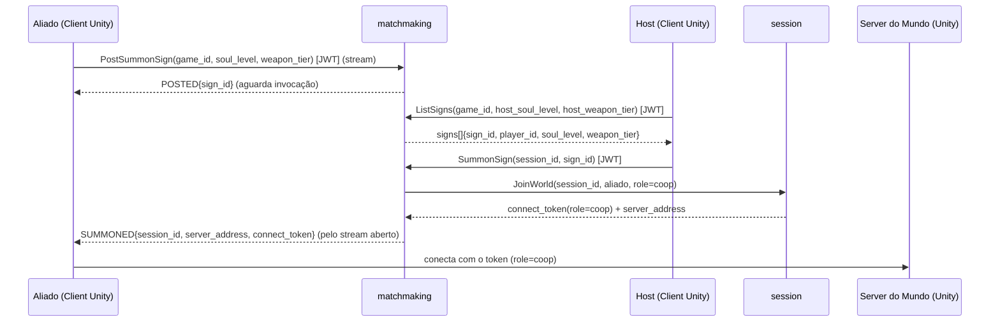
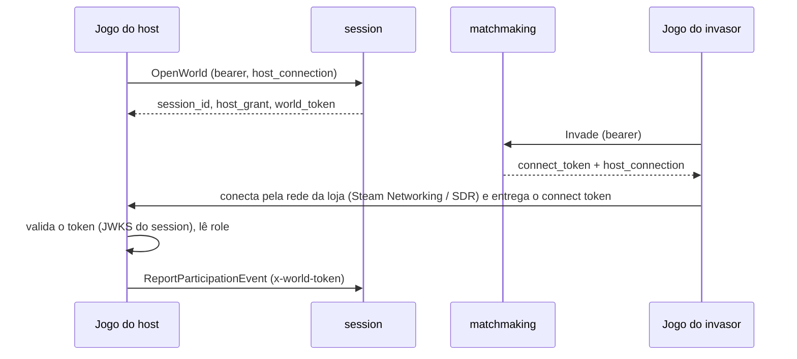
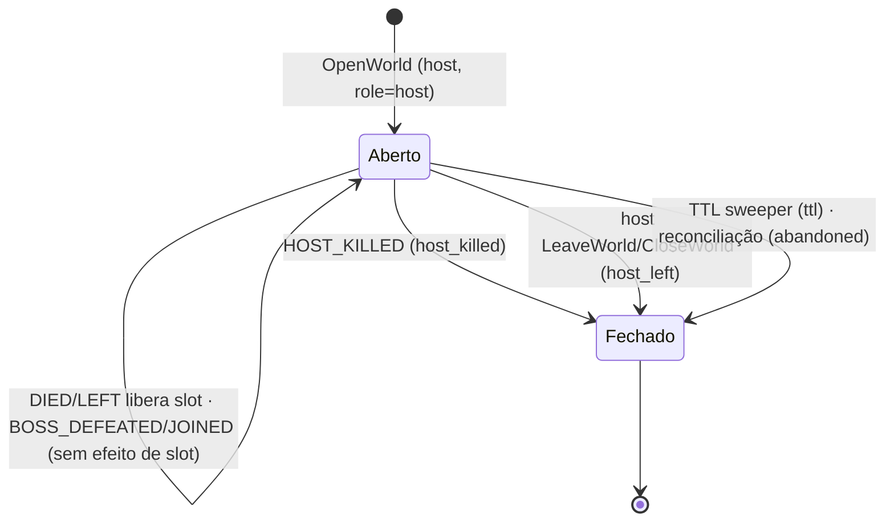

# Contrato control ↔ data plane — arquétipo `host_world_dropin`

> **Escopo:** o contrato entre o **control plane** (`go-multiplayer-control-plane`, Go) e o **data plane** (server do mundo, Unity) para o arquétipo **`host_world_dropin`** do ADR-0023 — o mundo persistente de um host onde phantoms **co-op** e **invasor** entram/saem no meio, com **papéis assimétricos** e **resultado por evento/participante** (não um placar terminal).
>
> Este doc é a **fonte de verdade do contrato** — o Unity referencia este arquivo por caminho relativo (`unity-host-world-dropin-data-plane/CLAUDE.md`) em vez de duplicar o conteúdo, propositalmente. O data plane (`unity-host-world-dropin-data-plane`) está **rodando de verdade** (2026-07-11): Fases 0–5 done, e2e k3d→Pi 5 + carga real (ver [`UNITY-INTEGRATION.md`](../UNITY-INTEGRATION.md) pro estado atualizado por arquétipo). O control plane está pronto e validado tanto isoladamente (adapter `static` + cliente de teste) quanto ponta a ponta com o server real.
>
> **Refs:** ADR-0023 (perfil de multiplayer), ADR-0010 (control/data plane), ADR-0011/0012 (Agones/Unity), ADR-0020 (fan-out). Specs: `session/011` (mundo host-cêntrico), `session/012` (diretório de invadíveis), `session/013` (eventos de participação), `matchmaking/006` (invasão), `matchmaking/007` (co-op por sinais), `achievements/009` + `analytics/004` (sinks). Roadmap: [`host_world_dropin-roadmap.md`](./host_world_dropin-roadmap.md). Follow-ups: [`host_world_dropin-follow-ups.md`](./host_world_dropin-follow-ups.md).

## O arquétipo em uma frase

Um **host** abre um **mundo persistente** (sessão sem match prévio); phantoms entram por **papel** (`coop`/`invader`) ocupando **slots por papel**; o server do mundo reporta **eventos por participante** ao longo da vida da sessão (não um `win/loss/draw` no fim).

## Como isto difere do `queue_arena` (fronteira do contrato)

| Eixo | `queue_arena` | `host_world_dropin` |
|---|---|---|
| Origem da sessão | um **match** formado por fila (`CreateSession`) | um **host** abre o mundo (`OpenWorld`), sem match |
| Identidade da sessão | `match_id` | `session_id` (o mundo) |
| Composição | times simétricos (`team_id`) | **slots por papel** (`role` = host/coop/invader), capacidade dinâmica |
| Entrada | todos juntos no início | **join/leave no meio** (`JoinWorld`/`LeaveWorld`) por papel |
| Resultado | **1** `ReportResult(win_loss_draw)` terminal | **N** `ReportParticipationEvent` por participante ao longo da vida |
| Claim no token | `team_id` | **`role`** |
| Envelope de fan-out | `kind=win_loss_draw` | `kind=participation_event` (mesmo tópico `match-results`) |

**Princípio de fronteira (ADR-0010):** o data plane roda o gameplay e **sabe o que aconteceu** (quem matou o host, quem ajudou no boss, quem saiu). O control plane é dono do **ciclo de vida do mundo e dos slots**; o server do mundo **reporta eventos** e o control plane **aplica o efeito no slot** (libera/encerra) e faz o fan-out. O server **não** decide "quem venceu" globalmente — não há vitória global; cada sink interpreta o desfecho por papel.

## Dois fluxos de entrada (o data plane recebe injeções; não forma partida)

Diferente do `queue_arena` (o matchmaking **cria** a sessão), aqui o matchmaking **descobre um mundo existente e injeta** um participante nele. Há dois fluxos assimétricos:

### A) Invasão — busca + injeção automática (o host não escolhe)

```mermaid
sequenceDiagram
  participant Host as Host (Client Unity)
  participant SS as session
  participant World as Server do Mundo (Unity)
  participant Inv as Invasor (Client Unity)
  participant MM as matchmaking

  Host->>SS: OpenWorld(game_id, soul_level, weapon_tier) [JWT do host → host = sub]
  SS->>SS: lê perfil, aloca server, deriva slots por papel
  SS-->>Host: session_id + server_address + host_grant(connect_token, role=host)
  Host->>World: conecta com o token (role=host)
  Inv->>MM: Invade(game_id, soul_level, weapon_tier) [JWT]
  MM->>SS: ListInvadableWorlds(game_id)
  SS-->>MM: worlds[]{session_id, host_soul_level, weapon_tier, free_invader_slots}
  MM->>MM: filtra por faixa assimétrica (Eligible)
  MM->>SS: JoinWorld(session_id, invasor, role=invader)
  SS-->>MM: connect_token(role=invader) + server_address
  MM-->>Inv: session_id + server_address + connect_token
  Inv->>World: conecta com o token (role=invader)
  Note over World: mundo autoritativo; phantom injetado no meio
```

### B) Co-op — quadro de sinais em dois passos (o host escolhe)



> **O que o server do mundo precisa saber destes fluxos:** nada sobre invasão/sinais/faixa — isso é control plane. O server só recebe **conexões novas** (via connect token com `role`) a qualquer momento e as trata como **join-in-progress**. A capacidade por papel já foi garantida pelo `JoinWorld` (o control plane recusa com `ErrRoleFull`); o server confia no token.

## Autenticação no session (spec `session/030`, ADR-0030 — contrato 1.2.0)

Toda chamada ao gRPC do session leva uma credencial na **metadata**:

| Quem chama | Metadata | RPCs |
|---|---|---|
| Cliente do jogo | `authorization: Bearer <JWT do identity>` | `OpenWorld` (o host é o `sub` do token — `host_player_id` pode ir vazio), `LeaveWorld` (a si mesmo; o host pode tirar outro), `CloseWorld` (só o host) |
| Dedicated Server | `x-game-server-key: <GAME_SERVER_KEY>` | `ReportResult`, `ReportParticipationEvent`, `GetSessionConfig`, `LeaveWorld`, `CloseWorld` |
| Jogo do host, mundo p2p (spec `session/031`) | `x-world-token: <world_token do OpenWorld>` | `ReportParticipationEvent`, `GetSessionConfig`, `LeaveWorld`, `CloseWorld` — só do próprio mundo |

A chave do Dedicated Server chega ao pod pela env `GAME_SERVER_KEY` (Secret `game-server-key` nas fleets de
`infra/agones/fleets/`; `dev-game-server-key` no compose). O session roda em **`warn`** enquanto o jogo não manda as
credenciais: a chamada sem credencial funciona como antes, mas aparece em `session_auth_rejections_total`. Quando o
jogo for atualizado, o operador vira `SESSION_AUTH_MODE=enforce` (aí a falta de credencial vira `Unauthenticated` e
a falta de permissão, `PermissionDenied`). O `SummonSign` só funciona para o host do mundo em qualquer modo.

**O que muda no jogo:** (1) o `SessionRpcClient` do cliente anexa o bearer que já tem do login e pode parar de
extrair o `sub` do JWT; (2) o server lê `GAME_SERVER_KEY` do ambiente e anexa `x-game-server-key` nos reports.

## Topologia p2p (spec `session/031`, ADR-0032 — contrato 1.4.0)

Com o modo em `topology: p2p`, **o jogo do host hospeda o mundo** (como nos Souls da FromSoftware) e não há
Dedicated Server:



| Campo | Dedicado | p2p |
|---|---|---|
| `OpenWorldRequest.host_connection` | ignorado | **obrigatório** (id de conexão do host; ex.: SteamID64) — sem ele, `InvalidArgument` |
| `OpenWorldResponse.server_address` | endereço do GameServer | vazio |
| `OpenWorldResponse.world_token` | vazio | credencial do host para reportar; vale só para este mundo e morre quando ele fecha |
| `JoinWorldResponse` / `InvadeResponse` / `SummonUpdate` `.host_connection` | vazio | o id de conexão do host |
| claim `server` do connect token | endereço do GameServer | o `host_connection` — o host confere que o token é para ele |

O jogo do host faz o papel que o Dedicated Server faz no dedicado: valida o connect token de quem entra, aplica os
papéis e reporta os eventos. **Confiança:** os eventos vêm do host — ele pode mentir, como nos Souls. Se o host cair
sem `CloseWorld`, o sweeper de TTL do session fecha o mundo. O netcode (NGO com transporte da Steam no modo host) é
decisão do repo do jogo.

## Heartbeat do mundo (spec `session/032` — contrato 1.5.0)

Quem hospeda o mundo (o Dedicated Server, ou o jogo do host em p2p) chama `Heartbeat(session_id)` logo depois de
abrir/assumir o mundo e a cada `interval_seconds` da resposta (hoje 30 s). Sem heartbeat o mundo fecha aos 30 min
de vida, jogando ou não; com heartbeat ele vive enquanto os avisos chegarem, e fecha como `abandoned` ~90 s depois
do último — é assim que um host que crashou some da lista de invasão. `NotFound` na resposta = o mundo já fechou:
pare de mandar.

## Connect token (session → data plane)

JWT **EdDSA** (Ed25519), validado **offline** pelo server do mundo via JWKS (`/.well-known/jwks.json` do session). Mesmos claims do `queue_arena`, com **`role`** no lugar de `team_id`:

| Claim | Descrição | Nota |
|---|---|---|
| `sub` | playerID | — |
| `match_id` | **o `session_id` do mundo** (o refID do token) | ⚠️ o claim se chama `match_id` por herança, mas **carrega o `session_id`** neste arquétipo |
| `server` | endereço do server do mundo | em p2p, o `host_connection` do host (spec `session/031`) |
| `iat` / `exp` | emissão / expiração (TTL 5 min) | — |
| **`role`** | **`"host"` \| `"coop"` \| `"invader"`** | **host_world_dropin** (spec `011`); `team_id` **ausente** aqui |

O server do mundo lê o **`role`** no *connection approval* do NGO (mesmo ponto onde valida o token) para decidir spawn, hostilidade (co-op sem friendly-fire; invasor PvP), HUD e regras por papel. O `match_id` do claim é o `session_id` que o server usa como identidade do mundo ao reportar eventos.

## ReportParticipationEvent (data plane → session)

O **server do mundo** é quem chama — ao longo da vida da sessão, um por evento. RPC unary novo (spec `013`):

```
session.v1.Session/ReportParticipationEvent(
  session_id, player_id, role, event, outcome, event_id, stats
) -> {}
```

- **`session_id`**: o mundo (o `match_id` do connect token do participante).
- **`player_id`** / **`role`**: quem e em que papel (o server lê o `role` do token de cada participante).
- **`event`** ∈ `{ JOINED, BOSS_DEFEATED, HOST_KILLED, DIED, LEFT }`.
- **`outcome`** ∈ `{ SUCCESS, FAIL, NEUTRAL }` — interpretado **pelo papel** no sink (não pelo session).
- **`stats`** (`map<string, int64>`, opcional — spec `026`): métricas do participante
  (kills, revives, ...), mesmo padrão de `ReportResult`. Ausente/vazio = ok
  (compat total); o session não valida conteúdo, é autoritativo o server.

Erros: `InvalidArgument` (event/outcome fora do vocabulário), `NotFound` (mundo inexistente/já encerrado — sinal para o server **parar** de reenviar aquele evento), `Internal` (falha transitória — p.ex. publish no fan-out ou devolução do GameServer; **reenviar** a mesma ocorrência).

### Identidade do boss no `BOSS_DEFEATED` (convenção, decisão D3 de 2026-09)

O evento não tem campo de "alvo". Para conquistas/analytics por boss, o server reporta o boss em `stats`, com uma
chave por boss e valor `1`: `stats: {"boss_boitata": 1}`. As event-rules enxergam isso como o fact
`stat.boss_boitata` (ex.: regra `event = BOSS_DEFEATED` + `stat.boss_boitata gte 1` → event type
`boitata_derrotado`), e o analytics guarda os `stats` brutos por jogador. Declare as chaves em `scoringStats` do modo
para o console não marcá-las como "drift". Um campo próprio (`subject_id`) só entra quando o analytics precisar de
uma dimensão "boss" — até lá, zero mudança de proto.

### Efeito de cada evento no mundo (o control plane aplica)

| `event` | Quem reporta (típico) | Efeito no mundo (session) |
|---|---|---|
| `JOINED` | o próprio phantom ao entrar | nenhum (o slot já foi ocupado no `JoinWorld`; é a confirmação) |
| `BOSS_DEFEATED` | co-op (ajudou) | nenhum (progresso; o phantom pode sair depois com `LEFT`) |
| `DIED` | phantom morto (invasor abatido / co-op morto) | **libera o slot** do `player_id` (no-op se já ausente) |
| `LEFT` | phantom que sai voluntariamente | **libera o slot** do `player_id` |
| `HOST_KILLED` | o invasor que matou o host | **encerra o mundo** (`CloseReason=host_killed`), libera o server, encerra a participação de todos |

**Ordem no control plane (desde 2026-08-19, fix `49e976d`):** o session **aplica o efeito primeiro** (libera o slot, encerra o mundo) e **depois publica** no fan-out — o gameplay nunca fica refém da infra de analytics. Se o publish falha, o efeito já valeu e o erro volta ao server, que **reenvia a mesma ocorrência (mesmo `event_id`)**; toda mutação é idempotente e os sinks deduplicam por `event_id`. Logo, o server deve tratar `ReportParticipationEvent` como **idempotente/retriável**: em erro, reenviar; ao receber `NotFound`, parar (o mundo já fechou).

**Reenvio do `HOST_KILLED` (spec `session-service/029`, 2026-09-26):** o `HOST_KILLED` fecha o mundo antes do publish; se o publish (ou a devolução do GameServer) falhar, o reenvio **da mesma ocorrência** (mesmo `event_id`; sem `event_id`, mesmo `player_id`) é aceito e só republica — antes recebia `NotFound` e o evento se perdia. Qualquer outro evento para o mundo já fechado continua recebendo `NotFound`. **Impacto no jogo: nenhum** — o comportamento esperado (reenviar em erro, parar em `NotFound`) é o mesmo; só deixa de perder o evento.

> **Semântica de papel:** o session **não** valida se o `role` combina com o `event` (ex.: "invasor não pode reportar BOSS_DEFEATED") — o server do mundo é **autoritativo**. Ver follow-up #12 se essa validação virar necessária.

## Envelope de fan-out (`kind=participation_event`)

O session publica cada evento no **mesmo** tópico `match-results` do `queue_arena`, discriminado por `kind` (decisão #3 do roadmap — retrocompatível; consumers que não entendem ignoram). O data plane **não** consome isto (é interno ao control plane), mas está aqui como fonte de verdade do que os sinks veem:

```json
{
  "schemaVersion": 2,
  "kind": "participation_event",
  "gameId": "<jogo>",
  "sessionId": "<mundo>",
  "playerId": "<participante>",
  "role": "host | coop | invader",
  "event": "JOINED | BOSS_DEFEATED | HOST_KILLED | DIED | LEFT",
  "outcome": "SUCCESS | FAIL | NEUTRAL",
  "modeId": "<modo>",
  "eventId": "<ocorrência, gerado pelo data plane>",
  "stats": {"kills": 2}
}
```

Sinks (control plane, já implementados): **achievements** reage por papel (`invader`+`HOST_KILLED`+`SUCCESS` → `invasion_won`; `coop`+`BOSS_DEFEATED`+`SUCCESS` → `coop_boss_helped`; `JOINED` → `world_joined`), idempotente por `eventId` (fallback `(sessionId, playerId, event)` para data plane sem `eventId`). **analytics** agrega `(gameId, modeId, role, event, outcome)` e guarda os `stats` brutos.

## Ciclo de vida do mundo e dos slots (referência)



- **Capacidade por papel** vem do perfil (`EnabledRoles`, `CoopSlots`, `InvaderSlots`). O host **não** ocupa slot (é o dono).
- **Host sai/morre encerra tudo:** `HOST_KILLED` (evento do server) ou `LeaveWorld(host)`/`CloseWorld` (voluntário) fecham o mundo; os phantoms voltam aos seus mundos.

## Implementação no `unity-host-world-dropin-data-plane` (estado em 2026-07-11)

O repo Unity implementou o contrato acima integralmente — todos os itens abaixo (originalmente um checklist "a construir", antes do repo existir) estão **feitos e verificados ao vivo**:

| # | Mudança | Origem | Estado |
|---|---|---|---|
| 1 | Gerar os stubs C# dos protos `session.v1` (com `ReportParticipationEvent`) e `matchmaking.v1` (Invade/PostSummonSign/ListSigns/SummonSign). | specs `011–013`, `006–007` | ✅ Feito |
| 2 | Ler o claim **`role`** do connect token no *connection approval* e aplicar no gameplay (spawn/hostilidade/HUD por papel: host, co-op sem friendly-fire, invasor PvP). | spec `011` | ✅ Feito |
| 3 | Aceitar **join-in-progress** a qualquer momento (phantoms entram no meio) e **leave** (phantom some, mundo segue). Sem reconnect do phantom. | ficha 01 §ciclo de vida | ✅ Feito |
| 4 | Reportar **eventos por participante** via `ReportParticipationEvent` (`JOINED` ao entrar; `BOSS_DEFEATED`/`HOST_KILLED`/`DIED`/`LEFT` conforme o gameplay), com `outcome` por papel. **Idempotente/retriável** (reenviar em erro; parar em `NotFound`). | spec `013` | ✅ Feito |
| 5 | Usar o `session_id` (claim `match_id` do token) como identidade do mundo ao reportar. | spec `013` | ✅ Feito |
| 6 | `eventId` único por evento para contagem fiel de ocorrências múltiplas na mesma sessão. | follow-up #4 | ✅ Feito |
| 7 | Preencher `stats` nos eventos (conquistas/leaderboard por stat). | follow-up #6 | ⚠️ **Corrigido 2026-07-13**: esta linha estava marcada "Feito", mas o campo `stats` **não existia** no proto/envelope até `session-service/026` (achado ao especificar `analytics-service/011`) — o control plane nem aceitava o campo, então não podia ter sido verificado ao vivo. Pendente: confirmar que o Dedicated Server já preenche `stats` na chamada (agora que o campo existe) ou implementar lá. |

Evoluções seguintes (senha, pools por região, reconexão do host) ficam no [`host_world_dropin-follow-ups.md`](./host_world_dropin-follow-ups.md) e na Fase 6+ do roadmap Unity — não são mudança de contrato, são refinamento sobre o que já está de pé.

> **Nota de topologia.** Este arquétipo tem afinidade com **P2P** (host como listen-server), mas o MVP usa **dedicated** (Agones/Unity) pela autoridade neutra (ADR-0008). O contrato acima vale para dedicated; a variante `p2p` é um investimento à parte (follow-up/aberturas do roadmap) — muda só a camada de provisionamento/connect da sessão, não os eventos nem os papéis.

## Resumo por papel (o que muda no gameplay)

| Papel | Como entra | Claim `role` | Hostilidade | Eventos típicos que reporta |
|---|---|---|---|---|
| `host` | `OpenWorld` (abre o mundo) | `host` | dono do mundo | — (é alvo; sua morte = `HOST_KILLED`) |
| `coop` | `SummonSign` (host invoca um sinal) | `coop` | aliado, **sem** friendly-fire | `JOINED`, `BOSS_DEFEATED`, `LEFT`, `DIED` |
| `invader` | `Invade` (injeção automática por faixa) | `invader` | PvP contra o host | `JOINED`, `HOST_KILLED` (SUCCESS), `DIED` (FAIL), `LEFT` |


## Modo + session manifest (ADR-0024, M1)

O jogo pode ter **N modos** (perfis nomeados, M0); a sessão nasce de um modo e **congela o snapshot** do perfil (mudanças no cadastro não afetam partidas em voo). O que o data plane precisa saber:

1. **Claim `mode_id` no connect token** (sempre presente; `"default"` quando o cliente não pediu modo). Lido no *connection approval* junto dos demais claims.
2. **Session manifest — `session.v1.Session/GetSessionConfig(ref_id)`**: no boot da sessão, o Dedicated Server chama o RPC (mesmo canal/auth do `ReportResult`; `ref_id` = `match_id` no queue-form ou `session_id` no host_world) e recebe:

```
GetSessionConfigResponse{
  session_id, match_id, game_id, mode_id,
  archetype,          // este arquétipo
  topology,           // "dedicated"
  params_json,        // params do modo, JSON cru — leia SÓ as chaves que conhece
  profile_hash        // hash do snapshot (logue para correlação com o backend)
}
```

**Princípio:** o server **não hardcoda regras que o perfil declara** — lê `params_json` e ignora chaves desconhecidas. Param novo no cadastro **não muda este contrato**.

3. **Validação de forma no `ReportResult`:** o session agora rejeita (`FailedPrecondition`) um outcome cujo *kind* não corresponda ao arquétipo do modo — reportar a forma errada é bug do server, não entra no fan-out.

> No host_world, o `mode_id` também flui no `OpenWorld`/entradas do matchmaking (`Invade`/sinais); o quadro de sinais é segmentado por modo (aliado do modo X não aparece para host do modo Y) e, desde a spec `matchmaking/012` (2026-09-26), a **invasão também**: o `Invade` só encontra mundos abertos no mesmo modo do invasor (vazio = `default`). **Impacto no jogo:** mandar no `Invade` o mesmo `mode_id` com que o host abriu o mundo.
