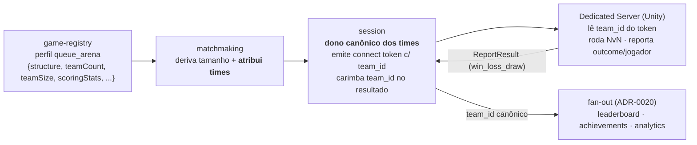
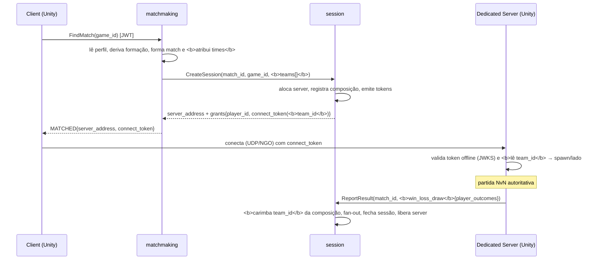

# Contrato control ↔ data plane — arquétipo `queue_arena`

> **Escopo:** o contrato entre o **control plane** (`go-multiplayer-control-plane`, Go) e o **data plane** (Dedicated Server Unity) para o arquétipo **`queue_arena`** do ADR-0023 (FFA **e** por times). É o primeiro arquétipo implementado ponta a ponta; o repo `go-game-dataplane` serve de **exemplo de referência** deste arquétipo (repos de data plane separados virão por tipo de jogo — cada arquétipo valida seu próprio data plane).
>
> Este doc é a **fonte de verdade do contrato**. Mudanças de design genérico (perfil → formação → resultado) que exigem trabalho no data plane são registradas aqui e referenciadas pelas specs dos serviços e pelo `go-game-dataplane`.
>
> **Refs:** ADR-0023 (perfil de multiplayer), ADR-0010 (control/data plane), ADR-0011/0012 (Agones/Unity), ADR-0020 (fan-out do resultado). Specs: `game-registry/006`, `matchmaking/004`+`005`, `session/009`+`010`.

## O arquétipo em uma frase

Sessão **simétrica** de N jogadores — **FFA** (todos rivais) ou **por times** (NvN) — que termina com um desfecho **win/loss/draw** por jogador, opcionalmente com **stats** (kills, assists, …) declaradas no perfil.

## Como o perfil orienta os planos

O jogo declara seu perfil no game-registry (`queue_arena`); o control plane deriva dele a formação e o data plane herda o caminho pré-configurado:



**Princípio de fronteira (ADR-0010):** o data plane roda o gameplay e **sabe quem ganhou**; o **rótulo canônico do time** é do control plane. Por isso o `team_id` **desce** ao data plane pelo connect token (para o gameplay) e **volta carimbado** pelo session no resultado (para o fan-out) — o data plane não precisa inventar nem preservar o rótulo.

## Handshake (sequência)



## Connect token (session → data plane)

JWT **EdDSA** (Ed25519), validado **offline** pelo Dedicated Server via JWKS (`/.well-known/jwks.json` do session). Claims:

| Claim | Descrição | Mudança |
|---|---|---|
| `sub` | playerID | — |
| `match_id` | id do match | — |
| `server` | endereço do game server | — |
| `iat` / `exp` | emissão / expiração (TTL 5 min) | — |
| **`team_id`** | **time do jogador na partida** (ex.: `"team-1"`); **ausente/vazio em FFA** | **NOVO (spec `session/010`)** |

O Dedicated Server lê o `team_id` no *connection approval* do NGO (mesmo ponto onde já valida o token) para decidir spawn, cor, aliados e placar por lado.

## ReportResult (data plane → session)

O `session.v1.Session/ReportResult` mudou na spec `009` (resultado polimórfico) — o formato antigo `PlayerResult{player_id, score, won}` **saiu**. O data plane reporta agora:

```
ReportResult(match_id, win_loss_draw{
  players: [ PlayerOutcome{ player_id, team_id, outcome, score, stats{...} } ]
})
```

- `outcome`: `"win" | "loss" | "draw"` (string, **não** mais `bool won`) — destrava empate e derrota explícita.
- `score`: `int64` (como antes).
- `stats`: `map<string,int64>` das métricas declaradas em `scoringStats` do perfil (ex.: `{"kills":12,"assists":3}`); pode ser vazio.
- `team_id`: o data plane **pode** preencher (ex.: ecoando o do token), mas o session **o sobrescreve** com o valor canônico registrado na formação. **Não é obrigatório** o data plane preenchê-lo corretamente.

## Mudanças necessárias no `go-game-dataplane` (queue_arena)

O repo hoje reporta o formato antigo e não conhece times. Trabalho cross-repo (não bloqueia o control plane — os serviços Go funcionam e são testados isoladamente):

| # | Mudança | Origem | Prioridade |
|---|---|---|---|
| 1 | Migrar `ReportResult`: `PlayerResult{won,score}` → `win_loss_draw`/`PlayerOutcome{outcome,score,stats}`. Regenerar o stub C# do proto do session. | spec `session/009` (dívida pré-existente) | **Alta** (contrato já quebrou) |
| 2 | Mapear o desfecho local para `outcome` string (`win`/`loss`/`draw`) em vez de `bool won`; empate agora é representável. | spec `session/009` | Alta |
| 3 | Preencher `stats` do `PlayerOutcome` conforme os `scoringStats` do perfil (se o jogo declarar métricas). | spec `game-registry/006` + `session/009` | Média |
| 4 | Ler o claim **`team_id`** do connect token no *connection approval* e usá-lo no gameplay NvN (spawn/lado/placar por time). | spec `session/010` | Alta (para validar NvN) |
| 5 | Suportar a formação `teams` no cliente/servidor (HUD por time, condição de vitória por time) — o exemplo atual é FFA (`first-to-5`, orbes). | ADR-0023 | Média |

> **Nota sobre "quebrar o data plane".** O foco atual é o aspecto multiplayer; mudanças grandes no `go-game-dataplane` são aceitáveis. A migração #1/#2 já é necessária pela spec `009`; #4/#5 habilitam o NvN de verdade. O `go-game-dataplane` fica como **exemplo canônico do queue_arena**; outros arquétipos ganham seus próprios repos de data plane.

## FFA vs. teams (resumo do que muda por campo)

| Aspecto | FFA | Teams (NvN) |
|---|---|---|
| Perfil (`structure`) | `ffa` (+`playerCount`) | `teams` (+`teamCount`,`teamSize`) |
| Tamanho do match | `playerCount` | `teamCount × teamSize` |
| Atribuição de times (matchmaking) | nenhuma | particiona os jogadores em lados |
| `team_id` no connect token | ausente/vazio | preenchido |
| `team_id` no ReportResult | vazio | carimbado pelo session |
| Granularidade do fan-out | por jogador | por jogador **e** por time (consumidores derivam) |
