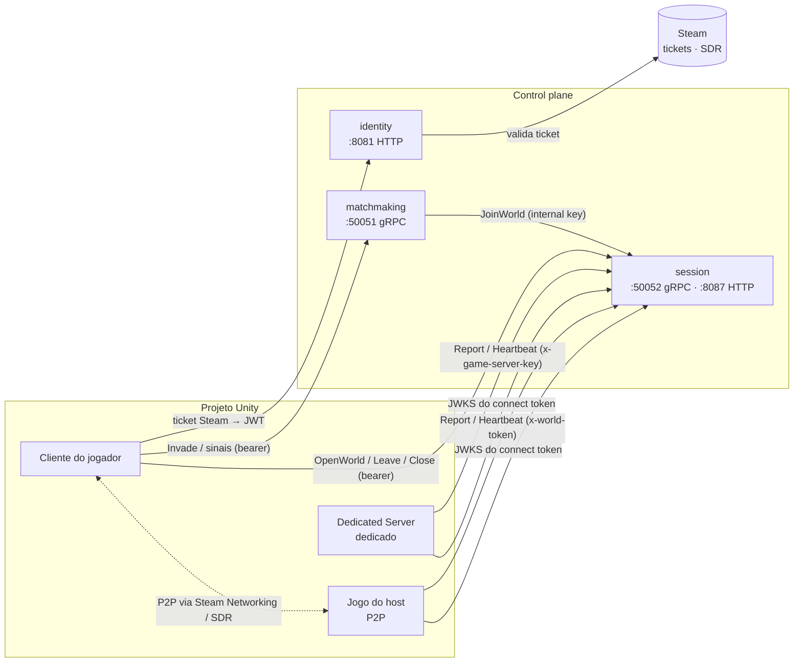
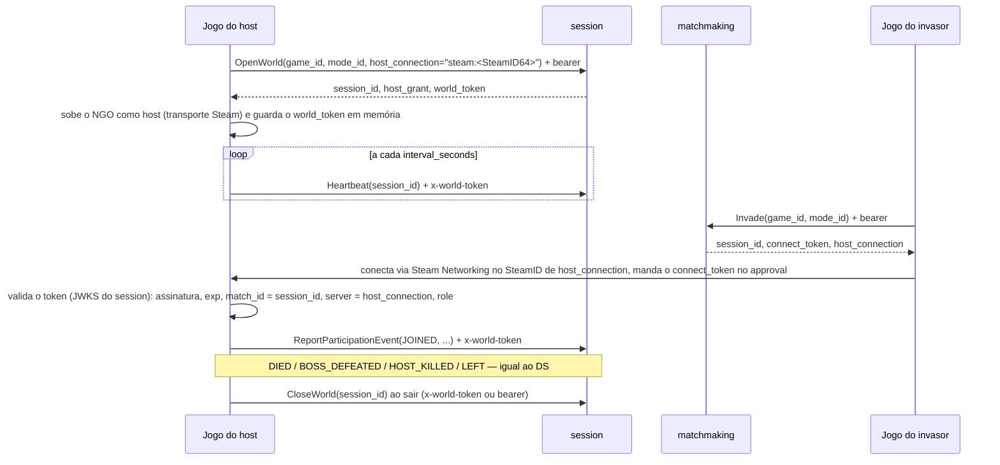

# Guia de integração — projeto Unity × control plane (contrato 1.0.0 → 1.5.0)

> Para quem vai mexer no projeto Unity (Folclore Souls / `unity-host-world-dropin-data-plane`) — gente ou agente.
> Resume **o que mudou no backend desde a integração de 2026-07** e **o que o jogo precisa fazer**, em ordem.
> Fonte da verdade do contrato: [`docs/contracts/CHANGELOG.md`](../contracts/CHANGELOG.md) e
> [`docs/game-models/host_world_dropin-dataplane-contract.md`](../game-models/host_world_dropin-dataplane-contract.md).
> No fim há um [prompt pronto](#prompt-para-o-agente-do-projeto-unity) para colar no agente do projeto Unity.

## 1. Em uma página

O jogo integrou o contrato **1.0.0** (julho/2026): o cliente abre mundo, o matchmaking injeta invasor/aliado, o
Dedicated Server (Agones) valida o connect token e reporta eventos. Desde então o backend ganhou cinco versões
**aditivas** — nada que já funciona quebra —, mas várias delas só rendem quando o jogo as usa:

| Versão | O que é | Quem mexe no jogo | Prioridade |
|---|---|---|---|
| 1.1.0 | invasão respeita o **modo**; convenção do **boss** em `stats` | cliente (Invade), DS (report) | média |
| 1.2.0 | **credenciais no gRPC do session** (bearer do jogador; chave do DS) | cliente e DS | **alta** — pré-requisito do `enforce` |
| 1.3.0 | **login Steam** (`POST /sessions/steam`) | cliente | **alta** — jogador real da Steam |
| 1.4.0 | **topologia P2P**: o jogo do host hospeda o mundo, sem Dedicated Server | cliente (host e phantom) | **alta** — corta o custo de servidor |
| 1.5.0 | **heartbeat do mundo** (sem ele o mundo fecha aos 30 min) | DS hoje; o host em P2P | **alta** — sessão de Souls dura horas |
| 2.0.0 (futuro) | o operador liga `SESSION_AUTH_MODE=enforce` | ninguém (é config) — só depois de 1.2.0 feito | — |

**Precisa de SDK?** Não para começar. O que o jogo precisa é uma camada fina em C# (um `ControlPlaneClient` dentro
do projeto) que concentre: login, metadata de credencial, heartbeat, fila de eventos com `event_id` e validação do
connect token. P2P não exige SDK próprio — reaproveita a mesma camada, só troca quem a usa (o jogo do host no lugar
do DS). Quando essa camada estabilizar no Folclore, ela vira o pacote UPM (seção 8).

## 2. Mapa de quem fala com quem



Portas do compose local: identity `8081`, matchmaking gRPC `50051`, session gRPC `50052` e HTTP `8087`
(`/.well-known/jwks.json` do connect token).

## 3. Passo a passo (na ordem recomendada)

### Passo 1 — Credenciais no gRPC do session (1.2.0)

| Quem | Metadata | Em quais chamadas |
|---|---|---|
| Cliente | `authorization: Bearer <JWT do identity>` | `OpenWorld`, `LeaveWorld`, `CloseWorld`, `Heartbeat` (se for o host) — e já nas do matchmaking |
| Dedicated Server | `x-game-server-key: <env GAME_SERVER_KEY>` | `ReportParticipationEvent`, `ReportResult`, `GetSessionConfig`, `LeaveWorld`, `CloseWorld`, `Heartbeat` |

- O `OpenWorld` com bearer **não precisa** de `host_player_id`: o host é o `sub` do token. Pode parar de extrair o
  `sub` do JWT no cliente.
- O DS lê `GAME_SERVER_KEY` do ambiente (Secret `game-server-key` nas fleets; `dev-game-server-key` no compose).
- Hoje o session roda em `warn`: sem credencial ainda funciona, mas aparece em `session_auth_rejections_total`.
  **Critério de pronto:** a métrica fica em zero numa sessão completa — aí o operador pode ligar `enforce`.

### Passo 2 — Login Steam (1.3.0)

1. No cliente: `SteamUser.GetAuthTicketForWebApi("control-plane")` (Steamworks.NET; o ticket chega no callback
   `GetTicketForWebApiResponse_t`) ou `SteamUser.GetAuthTicketForWebApiAsync("control-plane")` (Facepunch). A
   identidade `"control-plane"` tem de ser igual à `STEAM_TICKET_IDENTITY` do identity.
2. `POST /sessions/steam` com `{"ticket": "<bytes do ticket em hex>", "gameId": "<id do jogo>"}` → `{"token": "<JWT>"}`.
3. Erros: `401 invalid_ticket` (peça outro ticket), `403 banned`, `503 provider_unavailable` (tente depois),
   `404 provider_not_supported` (backend sem `STEAM_WEB_API_KEY`/`STEAM_APP_ID`).
4. O JWT dura **15 min e não há refresh**: quando uma chamada voltar `Unauthenticated`, pegue um ticket novo e refaça
   o login. Na primeira vez a conta é criada sozinha (handle `steam_<últimos dígitos>`).

### Passo 3 — Modo e boss (1.1.0)

- `Invade` e `OpenWorld` com o **mesmo `mode_id`** — a invasão só acha mundos do mesmo modo (vazio = `default`).
- `BOSS_DEFEATED` identifica o boss em `stats`: `{"boss_boitata": 1}`. Declare as chaves no `scoringStats` do modo
  no console.

### Passo 4 — Heartbeat (1.5.0)

Quem hospeda o mundo (o DS hoje; o jogo do host em P2P) chama `Heartbeat(session_id)` logo depois de abrir/assumir o
mundo e a cada `interval_seconds` da resposta (30 s hoje).

- Sem heartbeat: o mundo fecha **30 min depois de aberto**, jogando ou não (é o que acontece hoje).
- Com heartbeat: vive enquanto os avisos chegarem; fecha como `abandoned` ~90 s depois do último.
- `NotFound` = o mundo já fechou → pare o loop e trate como fim de sessão. Outros erros → siga tentando no próximo
  intervalo (perder dois seguidos ainda não fecha o mundo).

### Passo 5 — P2P (1.4.0)

Pré-requisito do lado do backend: no console, o modo do Folclore com **Topologia = P2P** (Configurações do jogo →
modos). O console passa a mostrar a hospedagem "P2P" e o sinal de vida de cada mundo em Rooms.



**O que o jogo do host faz** — é o papel do DS, rodando no cliente:

1. Abre o mundo com `host_connection = "steam:<SteamID64>"` (convenção do jogo; o backend não interpreta). Sem ele,
   `InvalidArgument`.
2. Guarda o `world_token` **só em memória** (nunca em disco, log ou analytics). Ele vale só para este mundo e morre
   quando o mundo fecha.
3. Sobe o Netcode for GameObjects como **host** com transporte da Steam (candidatos: o transporte
   SteamNetworkingSockets do *Multiplayer Community Contributions* sobre Steamworks.NET, ou o de Facepunch — a
   escolha é do projeto Unity).
4. No *connection approval*: valida o connect token **exatamente como o DS já faz**, com uma diferença — o claim
   `server` agora é o `host_connection` do próprio host (não um `ip:porta`).
5. Reporta os eventos (fila com `event_id`, reenvio em `Internal`, para em `NotFound`) com `x-world-token`.
6. Roda o loop de heartbeat (Passo 4).
7. Ao sair: `CloseWorld`. Se o jogo crashar, o heartbeat para e o mundo fecha sozinho em ~90 s.

**O que o jogo de quem entra faz:** chama `Invade`/`PostSummonSign` como hoje; se a resposta trouxer
`host_connection` (e `server_address` vazio), conecta pela Steam no SteamID dele em vez de `ip:porta`. O resto
(connect token no approval, papéis) é igual.

**Confiança:** em P2P os eventos vêm do host — ele pode mentir, como nos Souls. Aceito para o lançamento; conquistas
sensíveis podem exigir evento de mais de um participante (regra do console, não do jogo).

**Dedicado continua existindo:** o DS segue igual (mais o heartbeat). Dá para ter um modo P2P e outro dedicado no
mesmo jogo; o cliente decide o transporte pela resposta (`host_connection` ou `server_address`).

## 4. Esboço da camada C# (referência, não código pronto)

gRPC no Unity: `Grpc.Net.Client` + **YetAnotherHttpHandler** (Cysharp) — o `Grpc.Core` antigo está descontinuado.

```csharp
// Canal e credenciais — um lugar só para a metadata de cada tipo de chamador.
var channel = GrpcChannel.ForAddress(sessionUrl, new GrpcChannelOptions {
    HttpHandler = new YetAnotherHttpHandler { Http2Only = true }, DisposeHttpClient = true });
var session = new Session.SessionClient(channel);

Metadata Bearer(string jwt)          => new() { { "authorization", $"Bearer {jwt}" } };
Metadata WorldToken(string token)    => new() { { "x-world-token", token } };
Metadata GameServer(string key)      => new() { { "x-game-server-key", key } };

// Host P2P abre o mundo.
var opened = await session.OpenWorldAsync(new OpenWorldRequest {
    GameId = gameId, ModeId = modeId,
    HostConnection = $"steam:{SteamUser.GetSteamID().m_SteamID}",
}, Bearer(jwt));
var worldToken = opened.WorldToken; // só em memória

// Loop de heartbeat — com CancellationToken, sem corrotina solta.
async Task HeartbeatLoop(string sessionId, Metadata cred, CancellationToken ct) {
    var interval = TimeSpan.FromSeconds(30);
    while (!ct.IsCancellationRequested) {
        try {
            var r = await session.HeartbeatAsync(new HeartbeatRequest { SessionId = sessionId }, cred, cancellationToken: ct);
            interval = TimeSpan.FromSeconds(Math.Max(5, r.IntervalSeconds));
        } catch (RpcException e) when (e.StatusCode == StatusCode.NotFound) {
            OnWorldClosed(); return;                // o mundo fechou: pare
        } catch (RpcException) { /* rede: tenta no próximo intervalo */ }
        await Task.Delay(interval, ct);
    }
}
```

## 5. Como testar sem o jogo inteiro

- `docker compose -f infra/docker/docker-compose.yml up` e rode `scripts/demo-host-world.sh` (dedicado) e
  `TOPOLOGY=p2p scripts/demo-host-world.sh` (P2P). O script é a **especificação executável** das chamadas, na ordem,
  com as credenciais certas (grpcurl) — bom para comparar com o que o jogo manda.
- No console (Rooms): coluna **Hospedagem** (GameServer ou `P2P · steam:…`), badge de **sinal** (vivo / atrasado /
  sem sinal / sem heartbeat) e, no detalhe do mundo P2P, a conexão do host e o último heartbeat.
- Métricas do session: `session_auth_rejections_total` (deve zerar depois do Passo 1) e
  `session_world_heartbeats_total` (deve crescer depois do Passo 4).
- Login Steam sem publisher key: o identity aceita `STEAM_API_BASE_URL` apontando para um servidor falso (foi assim
  que o backend foi validado).

## 6. Checklist

- [ ] Cliente manda `authorization: Bearer` no session e no matchmaking; `OpenWorld` sem `host_player_id`.
- [ ] DS manda `x-game-server-key` (Secret `game-server-key` montado nas fleets).
- [ ] Login Steam: ticket com identidade `control-plane` → `POST /sessions/steam`; relogin em `Unauthenticated`.
- [ ] `mode_id` igual no `OpenWorld` e no `Invade`; boss em `stats` (`boss_<id>: 1`).
- [ ] Heartbeat no DS (dedicado).
- [ ] P2P: NGO host com transporte Steam; `OpenWorld` com `host_connection`; `world_token` em memória; approval
      checando `server = host_connection`; reports e heartbeat com `x-world-token`; `CloseWorld` ao sair.
- [ ] Phantom: conecta por `host_connection` quando vier; por `server_address` caso contrário.
- [ ] `session_auth_rejections_total = 0` numa sessão completa → avisar o operador para ligar `enforce` (2.0.0).

## 7. O que depende do dono (fora do código)

- Publisher key e app id do Steamworks (`STEAM_WEB_API_KEY`, `STEAM_APP_ID`) no deploy do identity.
- Virar o modo do Folclore para **P2P** no console quando o netcode estiver pronto.
- Ligar `SESSION_AUTH_MODE=enforce` quando o checklist do Passo 1 estiver verde.

## 8. Quando virar SDK

Quando a camada da seção 4 estiver estável no Folclore: extrair para um pacote UPM
(`com.<org>.controlplane`, `Runtime/`, `Samples~/`, asmdef), distribuído por git URL com tag e depois OpenUPM, com a
faixa de contrato suportada declarada (ex.: `>=1.5.0 <2.0.0`). Extrair do jogo real, não escrever no vácuo.

## Prompt para o agente do projeto Unity

Cole no agente do projeto Unity (ajuste os caminhos se o control plane estiver em outro lugar):

```text
Contexto: este projeto Unity integra com o control plane em Go (repo go-multiplayer-control-plane). A integração
atual segue o contrato 1.0.0 (julho/2026). O backend está no contrato 1.5.0, todo aditivo. Leia, nesta ordem:
1. docs/integration/UNITY-GUIA-INTEGRACAO.md (este guia — o plano)
2. docs/contracts/CHANGELOG.md (o que mudou, versão por versão)
3. docs/game-models/host_world_dropin-dataplane-contract.md (o contrato do arquétipo, incluindo P2P e heartbeat)
4. scripts/demo-host-world.sh (as chamadas reais, na ordem, com as credenciais)
Os .proto estão em services/session-service/proto/session/v1/session.proto e
services/matchmaking-service/proto/matchmaking/v1/matchmaking.proto — regenere os stubs C# a partir deles.

Tarefa: implemente o checklist da seção 6 do guia, na ordem dos passos 1 → 5, um passo por PR, sem quebrar o fluxo
dedicado que já funciona. Concentre login, metadata de credencial, heartbeat, fila de eventos e validação do connect
token numa camada só (ControlPlaneClient), usada pelo cliente, pelo DS e pelo host P2P. O world_token nunca vai
para disco nem para log. Antes do passo 5, proponha a escolha do transporte Steam para o NGO (com prós e contras) e
espere aprovação. Para cada passo, diga como validar contra o compose local e o que olhar no console (Rooms).
```
