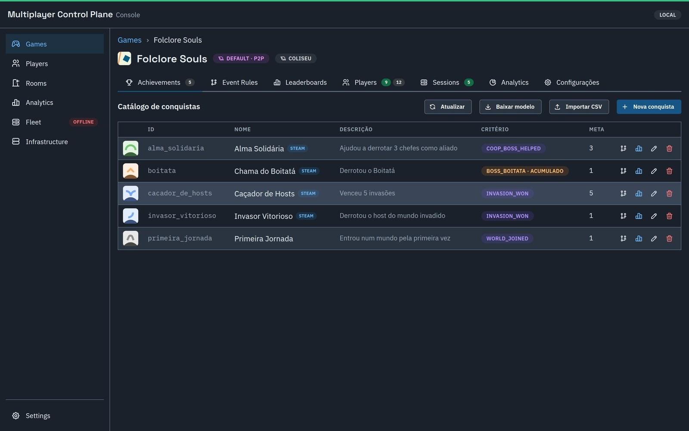

# achievements-service

≈ **GameKit Achievements**, mas com o motor de regras genérico e data-driven do
**ADR-0027**/**ADR-0028**: catálogo de conquistas (por jogo), **desbloqueio por
evento de gameplay** (idempotente) e **progresso parcial** (contadores/stats
até a meta). O vocabulário de eventos ("o que dispara uma conquista") não é
mais hardcoded por arquétipo — é dado, editável sem redeploy. Primeiro serviço
a validar o JWT do identity (via `shared/auth`).

▶ **Vídeo (~2 min):** [o motor de conquistas](../../docs/media/video-02-conquistas.mp4): critérios por evento e por métrica, regras globais e do jogo com comparadores, e o desbloqueio ao vivo pelo fan-out.

- **Protocolo:** REST · **Porta host:** 8082
- **Storage:** PostgreSQL (`achievements-postgres`, DB `achievements`)
- **Dependências:** identity (JWKS); consome o fan-out durável (SQS, ADR-0020) publicado pelo session-service
- **Multi-tenant por jogo** (ADR-0017): catálogo e regras escopados por `game_id`

## Modelo de regras: facts → event rules → event types → achievements

Cada arquétipo (`queue_arena`, `host_world_dropin`, `battle_royale`,
`coop_mission`, ADR-0023) produz um envelope de resultado com uma forma
diferente. Em vez de 4 funções Go hardcoded traduzindo cada forma num
vocabulário fixo de event types, o pipeline é:

1. **Facts** — o consumer normaliza o envelope recebido num mapa `Facts
   map[string]string` (`domain.ParticipationFacts`/`PlacementFacts`/
   `CollectiveFacts`/`WinLossDrawFacts` — só forma estrutural, sem regra de
   negócio). Duas dimensões cross-arquétipo somam-se ao mapa:
   - **`mode`** (`Facts.WithMode`) — o `modeId` do envelope (ADR-0024), destrava regras por modo (ex.: "vitória no ranked").
   - **`stat.<chave>`** (`Facts.WithStats`) — as métricas da partida/participação (ex.: `stat.deaths`, `stat.kills`) como facts numéricos. Suportado nos 4 arquétipos (a spec `018-participation-stats` fechou a lacuna que faltava em `host_world_dropin`).
2. **Event rules** — linhas da tabela `event_rules`: um `match` (subconjunto de
   condições contra os facts) que, se casar, contribui um ou mais
   `event_types`. Cada condição é `campo = valor` (igualdade, forma clássica)
   ou `{"op": "lt|lte|gt|gte|ne|in", "value": ...}` (comparadores, V2a do
   ADR-0028). `match = {}` sempre casa (ex.: "participou", incondicional).
   Regra **global** (`game_id IS NULL`) vale para todo jogo do arquétipo;
   override **por jogo** (`game_id` setado) soma event types próprios sem
   afetar os demais jogos. Um jogo também pode **suprimir** uma regra global
   só para si (V2b do ADR-0028, spec `017-suppress-event-rule`) — a linha
   global nunca é tocada, a supressão é uma relação própria
   (`event_rule_suppressions`).
3. **Event types** — o vocabulário de saída (`invasion_won`,
   `battle_royale_win`, `match_won`, ...), o mesmo que os achievements casam
   via `event_type`. Uma regra pode emitir vários event types.
4. **Achievements** — o catálogo casa por `event_type` (progresso por
   contagem de ocorrências) ou por `stat_key` (progresso por métrica,
   `cumulative` entre partidas ou `per_match`; ADR-0023 A1).

**Avaliador único** e puro: `domain.EvaluateRules(rules, gameID, facts)` casa
toda regra aplicável (arquétipo bate E regra é global ou do jogo) contra
`facts` e une os `event_types` das que baterem, sem duplicar.

### Exemplo concreto

Um achievement "Flawless Victory" (só desbloqueia numa vitória sem morrer)
não é expressável por um único event_type pronto — é a composição de um
resultado E uma métrica. Com o motor de regras:

- Envelope de participação chega com `outcome=SUCCESS` e stat `deaths=0`.
- Facts normalizados: `{"role":"host","event":"BOSS_DEFEATED","outcome":"SUCCESS","stat.deaths":"0", ...}`.
- Event rule (do jogo, ou global se fizer sentido pro arquétipo):
  `match = {"event":"BOSS_DEFEATED","outcome":"SUCCESS","stat.deaths":{"op":"lte","value":0}}` → `event_types = ["flawless_victory"]`.
- Achievement no catálogo: `event_type = "flawless_victory"`, `target = 1`.

Sem essa regra, "vitória" e "zero mortes" seriam dois sinais desencontrados —
nenhum event_type fixo no código captura a combinação sem mexer em Go.

## API

### Jogador (Bearer JWT)

| Método | Rota | Descrição |
|---|---|---|
| POST | `/events` | registra um evento (`type`) → desbloqueia/progride; retorna as recém-desbloqueadas |
| GET | `/achievements` | catálogo do jogo do jogador |
| GET | `/me/achievements` | conquistas do jogador (progresso + desbloqueadas) |

### Admin — catálogo (internal key, ADR-0018; sem JWT)

| Método | Rota | Descrição |
|---|---|---|
| POST | `/admin/games/{gameId}/achievements` | cria conquista no catálogo do jogo |
| PUT | `/admin/games/{gameId}/achievements/{id}` | edita name/description/critério/target |
| DELETE | `/admin/games/{gameId}/achievements/{id}` | remove conquista (+ progresso dos jogadores nela) |
| GET | `/admin/games/{gameId}/achievements` | lista catálogo |
| GET | `/admin/games/{gameId}/players/{playerID}/achievements` | conquistas de um jogador |
| POST | `/admin/games/{gameId}/players/{playerID}/events` | registra evento **em nome do jogador** (server-authoritative, sem JWT) |
| GET | `/admin/games/{gameId}/achievements/{id}/progress` | progresso de todos os jogadores numa conquista (painel) |

### Admin — event rules (migration 008/009/010; ADR-0027/ADR-0028)

| Método | Rota | Descrição |
|---|---|---|
| GET | `/admin/games/{gameId}/event-rules` | globais do arquétipo + overrides do jogo (`ListEffective`) |
| POST | `/admin/games/{gameId}/event-rules` | cria regra **do jogo** (globais são somente leitura por aqui) |
| PUT | `/admin/games/{gameId}/event-rules/{id}` | edita match/event_types de uma regra do jogo (arquétipo não é editável) |
| DELETE | `/admin/games/{gameId}/event-rules/{id}` | remove regra do jogo (globais protegidas — mesmo erro de "não existe") |
| POST | `/admin/games/{gameId}/event-rules/{id}/suppress` | desliga uma regra **global** só para este jogo (idempotente) |
| DELETE | `/admin/games/{gameId}/event-rules/{id}/suppress` | restaura a regra global suprimida |

### Consumer (SQS, sem HTTP)

Além do REST, o serviço roda um `internal/consumer` (long-poll na fila do
fan-out durável, ADR-0020) que traduz cada envelope (`kind`
`match`/`participation`/`placement`/`collective`) em facts → `EvaluateRules`
→ `ApplyMatchResult`/`ApplyParticipationEvent` (aplica event types e stats na
mesma transação, idempotente por `match_id`/`event_id`). Erro não deleta a
mensagem (retry → DLQ); duplicata é no-op idempotente e a mensagem é
deletada normalmente.

### Espelhamento na Steam (spec 019)

Conquista com `steamApiName` (o "API Name" do Steamworks) tem o desbloqueio espelhado na Steam do jogador por um
worker no consumer: a cada 15 s ele pega os desbloqueios pendentes do jogo configurado, lê o SteamID no identity
(`GET /admin/players/{id}/external-identities`) e chama `ISteamUserStats/SetUserStatsForGame`. Jogador sem conta
Steam vira `skipped`; falha reagenda (1 min, 2 min… até 1 h) e desiste após 10 tentativas (`failed`). Preencher o
`steamApiName` depois espelha quem já tinha desbloqueado. Estado em `player_achievements.steam_sync_*`.

| Env (consumer) | Uso |
|---|---|
| `STEAM_WEB_API_KEY`, `STEAM_APP_ID` | publisher key e app id (as mesmas do login Steam do identity) |
| `STEAM_GAME_ID` | id, no control plane, do jogo publicado na Steam (um app por deploy) |
| `IDENTITY_URL`, `INTERNAL_API_KEY` | leitura do SteamID |
| `STEAM_API_BASE_URL` | opcional (padrão `https://partner.steam-api.com`; aponte para uma Steam falsa em teste) |

Sem as cinco primeiras, o espelhamento fica desligado. Métrica: `achievements_steam_sync_total{result}`.
O jogo **não** deve chamar `SetAchievement` no cliente para essas conquistas (quem manda é o backend).

## Modelo de dados

**`achievements`** (catálogo, por jogo — `id` único por `game_id`)

| Coluna | Tipo | Notas |
|---|---|---|
| game_id, id | TEXT | PK composta (ADR-0017) |
| name / description | TEXT | exibíveis |
| event_type | TEXT | critério por evento (vazio se por stat) |
| stat_key | TEXT | critério por métrica (vazio se por evento; mutuamente exclusivo com event_type) |
| stat_mode | TEXT | `cumulative` (soma entre partidas) \| `per_match` (melhor stat de uma partida) — só com stat_key |
| target | INT | evento: nº de ocorrências; stat: threshold |

**`player_achievements`** (progresso/desbloqueio do jogador, por jogo)

| Coluna | Tipo | Notas |
|---|---|---|
| game_id, player_id, achievement_id | TEXT | PK composta |
| progress | INT | ocorrências/stat acumulado |
| unlocked_at | TIMESTAMPTZ (nullable) | `NULL` = em progresso |

**`event_rules`** (mapeamento facts → event types, ADR-0027 + V2a do ADR-0028)

| Coluna | Tipo | Notas |
|---|---|---|
| id | TEXT | PK |
| game_id | TEXT (nullable) | `NULL` = regra global do arquétipo; setado = override/adição do jogo |
| archetype | TEXT | `queue_arena` \| `host_world_dropin` \| `battle_royale` \| `coop_mission` |
| match | JSONB | subconjunto de condições contra os facts — valor string (igualdade) ou `{"op", "value"}` (comparadores) |
| event_types | TEXT[] | união de event types emitidos quando a regra bate |

**`event_rule_suppressions`** (V2b do ADR-0028, spec `017-suppress-event-rule`)

| Coluna | Tipo | Notas |
|---|---|---|
| game_id, rule_id | TEXT | PK composta; `rule_id` referencia uma regra **global** (`event_rules.id`) |

A linha global nunca é escrita para suprimir/restaurar — a supressão é
modelada como relação própria, preservando a regra compartilhada intacta
para os demais jogos.

**Idempotência** (tabelas auxiliares do consumer): `processed_matches`
(`match_id`, ADR-0020) e `processed_participations` (chave `event_id` —
migration 007; o data plane do host_world_dropin gera um `eventId` único por
ocorrência, spec `012-participation-event-id`/follow-up #4).

## Observabilidade

`/metrics` na porta 8082 (dashboard **Service Overview**, `$job=achievements-service`),
incluindo `fanout_consume_total{result="ok|dup|error"}` e
`fanout_consume_duration_seconds` (RED do consumer SQS, ADR-0020). Tracing no
Tempo (inclui spans de query do Postgres via otelpgx). Banco no dashboard
**PostgreSQL**.

## Testar / Specs

- Manual: [`api/achievements.http`](api/achievements.http)
- Specs: [`specs/`](specs/)
  - **Catálogo base:** `001-achievement-core`, `002-partial-progress`, `003-admin-read`, `004-game-scope`, `005-server-events`, `006-catalog-crud`, `008-stat-criteria`
  - **Arquétipos (outcome polimórfico, ADR-0023):** `007-outcome-events`, `009-participation-consumer` (host_world_dropin), `010-battle-royale-placement`, `011-coop-mission-collective`, `012-participation-event-id`, `018-participation-stats` (fecha a lacuna de stats no host_world_dropin)
  - **Motor de regras data-driven (ADR-0027/ADR-0028):** `013-mode-fact` (fact `mode`), `014-match-operators` (comparadores, V2a), `015-stats-as-facts` (facts `stat.*`), `016-update-event-rule`, `017-suppress-event-rule` (V2b)
