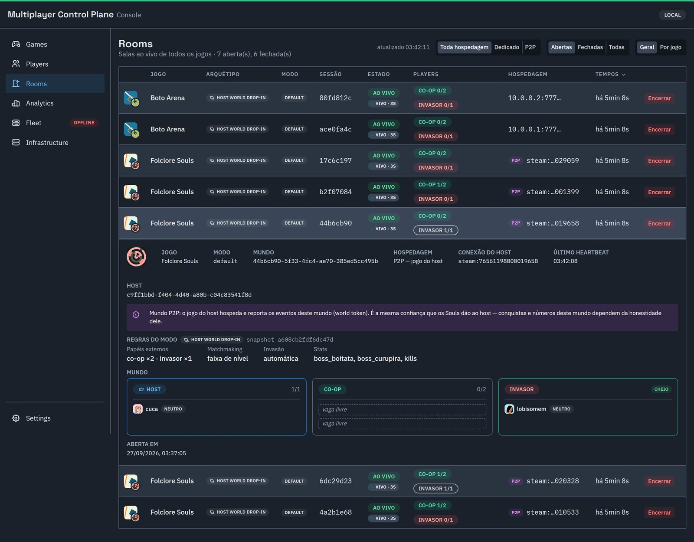

# admin-ui

Painel de operação do control plane — **games-first**: você entra pela lista de jogos e cada jogo abre num detalhe com sub-abas (achievements, event rules, leaderboards, players, sessions, analytics, configurações). Rooms/Players/Analytics/Fleet cross-game continuam como visões próprias na navegação, e Infrastructure guarda a topologia read-only original (ADR-0016). **Read-only**, sem auth no MVP.

- **Stack:** React 18 + TypeScript + Vite · Mantine UI (`@mantine/core`, `@mantine/charts`, `@mantine/hooks`, `@mantine/notifications`) · `@dicebear/core`+`@dicebear/styles` (capas/avatares procedurais determinísticos) · `@xyflow/react` (canvas do Event Rules e do Pipeline) · `react-router-dom`
- **Porta dev:** `5173` (Vite) · **Porta prod:** `8089` (nginx, via `docker compose -f infra/docker/docker-compose.yml up`)
- **Fala com o backend via proxy `/api` → admin-bff:** em dev o Vite proxya (`vite.config.ts`, alvo `http://localhost:8088`, sobrescrevível com `VITE_BFF_URL`); em prod o nginx (`nginx.conf`) proxya `/api/` → `admin-bff:8080` na rede do compose. Nunca fala direto com os serviços de domínio — sempre atrás do BFF.

<p align="center"></p>

▶ **Vídeos do console (~1 min cada):** [cadastrar um jogo](../../docs/media/video-01-cadastro.mp4) ·
[conquistas sem deploy](../../docs/media/video-02-conquistas.mp4) · [visão 360 do jogador](../../docs/media/video-03-jogador.mp4).
Como regravar: [`docs/media/README.md`](../../docs/media/README.md).

> App de apresentação — fora do hexagonal Go. Segue um **SDD adaptado** (spec = telas/UX), ver seção "Testar / Specs".

## Áreas do app

- **Games** (`/games`, rota raiz) — grid de jogos cadastrados (capa procedural + nome); ponto de entrada de tudo. "Registrar jogo" abre o wizard de criação.
- **Game detail** (`/games/:gameId`) — header com capa mini + badges de modo, e sub-abas por jogo:
  - **Achievements** — catálogo de achievements do jogo, com preview de regra.
  - **Event Rules** — canvas (`@xyflow/react`) do mapeamento evento → achievement/leaderboard (ADR-0027), edição visual de regras.
  - **Leaderboards** — rankings do jogo.
  - **Players** — jogadores com presença naquele jogo (`game_players`), badge de quem está online agora (interseção com sessões ativas).
  - **Sessions** — sessões ativas/recentes do jogo, com detalhe de partida/mundo por arquétipo.
  - **Analytics** — agregados de participação/resultado por modo (gráficos Mantine Charts).
  - **Configurações** — modos de multiplayer, slug, pipeline de progressão, fleet do jogo.
- **Rooms** (`/rooms`) — visão cross-game de sessões/salas ativas, agrupável e ordenável, com detalhe de partida por arquétipo (`SessionMatchDetail`).
- **Players** (`/players`) — base global de contas (identity), independente de jogo; abre no detalhe do jogador, que lista em quais jogos ele aparece.
- **Analytics** (`/analytics`) — overview cross-game alimentado pelo analytics-service (ADR-0021): agregados/ranking de jogos.
- **Fleet** (`/fleet`) — status dos game servers (Agones) por jogo — build/tag publicada, saúde, disponibilidade.
- **Infrastructure** (`/infrastructure`) — a antiga "Visão geral": topologia read-only dos serviços (React Flow) + saúde/RED ao vivo. Sobrevive como visão de plataforma, não é mais a tela inicial.

## Padrões reutilizáveis

- **`lib/useAsync.ts`** — hook padrão de fetch: carrega ao montar/mudar deps, expõe `{ data, error, loading, reload }`. É o jeito idiomático de buscar dado em qualquer página nova; evite `useEffect` + `useState` ad-hoc.
- **`useLocalStorage` (`@mantine/hooks`)** — persistência de preferências de UI (ex.: ordenação em Rooms). Não reinventar com `localStorage` direto.
- **`lib/archetypeMeta.ts` (`ARCHETYPE_META` / `archetypeMetaOf`)** — label + ícone por arquétipo (ADR-0023), compartilhado entre GameDetail, Configurações e Event Rules. `archetypeMetaOf` tolera arquétipo desconhecido/ausente (sessão legada).
- **`components/flow/`** — kit do canvas de fluxo (`FlowCanvas.tsx`, `nodes.tsx`, `pipelineNodes.tsx`, `flow.css`), base do Event Rules e do Pipeline em Configurações. Qualquer tela nova com grafo/canvas parte daqui, não de `@xyflow/react` puro.
- **`components/GameCover.tsx` / `PlayerAvatar.tsx` / `SessionAvatar.tsx`** — geração procedural determinística via DiceBear (capa de jogo, avatar de jogador, avatar de sessão); mesma seed → mesma imagem entre reloads.
- **`lib/format.ts`, `lib/status.ts`, `components/StatusBadge.tsx`, `components/StatCard.tsx`** — formatação (duração, close reason) e blocos visuais de status/métrica repetidos entre páginas.

Esses padrões são o que mais falta reaproveitar hoje: várias páginas ainda duplicam pequenas variações de fetch/hook antes de convergir para `useAsync`/`ARCHETYPE_META`/o kit de flow — ao tocar numa página, prefira migrar para o padrão existente em vez de copiar o que já está ali.

## Rodar localmente

```bash
cd services/admin-ui
npm install
npm run dev         # http://localhost:5173, proxy /api -> admin-bff:8088
npm run build        # tsc --noEmit + vite build -> dist/
```

Precisa do `admin-bff` no ar (`docker compose ... up admin-bff`, porta 8088 do host). Para apontar a outro host/porta: `VITE_BFF_URL=http://localhost:9999 npm run dev`.

Alternativa via Docker (sobe junto com a stack, sem instalar nada local):

```bash
docker compose -f infra/docker/docker-compose.yml up
# painel em http://localhost:8089
```

## Testar / Specs

Testes: `npm test` (Vitest) cobre os `lib/` puros — parsing do CSV de importação, montagem/formatação das condições das event-rules, slug — e roda no CI junto com o type-check (`tsc --noEmit`, parte do `npm run build`). Componentes React ainda não têm teste; há um `@playwright/test` nas devDependencies para verificação end-to-end pontual.

Specs individuais (SDD-lite, uma pasta por mudança de tela/UX) vivem em `specs/NNN-slug/` — histórico incremental de como cada área chegou ao estado atual. Exemplos recentes: `057-achievement-rule-preview` (preview de regra a partir do achievement), `058-canvas-first-event-rules` (Event Rules como canvas-first), `059-fleet-tab` (aba/nav Fleet), `060-rooms-grouped-sortable` (Rooms agrupável/ordenável). **Este README é a visão consolidada e atual do app; as specs são o registro incremental de como cada parte foi construída** — para entender "o que o app faz hoje", leia este arquivo; para entender "por que uma tela específica é como é", vá à spec correspondente.
