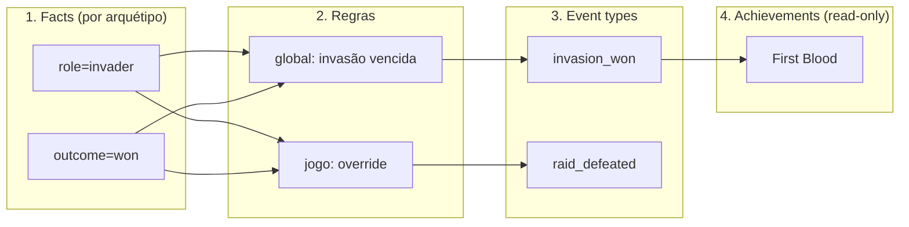

# Spec 043 — Editor visual de Event Rules (canvas low-code)

**Status:** Draft — aguardando aprovação
**Serviço:** admin-ui (fase 1 é UI-only; zero mudança de backend)
**Relaciona:** ADR-0027 (motor de regras data-driven), ADR-0028 (proposto — editor visual + roadmap do motor rico), spec `achievements-service` migration 008, `GameEventRules.tsx` (CRUD atual em tabela)

## Contexto

O ADR-0027 tornou o mapeamento evento→achievement-event-type data-driven (tabela
`event_rules`: `match` por subconjunto exato de facts + união de `eventTypes`).
A aba "Event Rules" atual é uma tabela + modal de pares chave/valor — funcional,
mas não mostra o **efeito combinado** das regras (várias regras casando o mesmo
evento, união dos event types, quais achievements escutam cada type). Esse
pipeline evento→regra→event type→achievement existe só na cabeça de quem leu o
ADR.

Direção do projeto (conversa 2026-07-09): o control plane já maturou (4
arquétipos completos) e a meta agora é deixá-lo **genérico o suficiente para
regras avançadas**. O editor visual é a porta de entrada dessa evolução — a
referência de UX é o exemplo *Call Center* do Foblex Flow (trigger → condição →
ação, paleta lateral, nós ricos com conteúdo editável). **Ferramenta:** React
Flow (`@xyflow/react`), já dependência do projeto — Foblex Flow é Angular e fica
só como referência de UX. A decisão de lib, o kit visual e o roadmap do motor
ficam registrados no ADR-0028.

## Nível de acabamento visual

O `TopologyGraph` atual (nós default do React Flow, retângulos de label) é o
contra-exemplo: simples demais. O editor usa **nós custom** (componentes React
estilizados com o tema escuro do console), no padrão do exemplo Call Center:

- Card com **header colorido por camada** (ícone + título + badge de escopo),
  corpo com o conteúdo da entidade (pares do match, lista de event types).
- **Handles/ports estilizados** (não os pontos default), edges com curvatura
  suave; edge **animada** quando a regra correspondente está selecionada
  (destaca o caminho fact → regra → event type → achievement).
- **MiniMap + Controls + Background** (dots) tematizados.
- **Paleta lateral** ("Nova regra", facts conhecidos do arquétipo) com
  drag-and-drop para o canvas.
- **Painel lateral de propriedades** ao selecionar um nó (substitui o modal) —
  padrão do exemplo *AI Low-Code Platform*.

O kit de nós/tema resultante (`components/flow/`) nasce reutilizável: o upgrade
do `TopologyGraph` para esse mesmo kit é follow-up natural (fora desta spec).

## Princípio de honestidade visual

O canvas representa **exatamente** a semântica do motor vigente: match por
subconjunto exato + união. A fase 1 não desenha branch/else/encadeamento/
operadores — o **roadmap** para essas capacidades (motor V2: comparadores,
supressão de global por jogo, prioridade) é o ADR-0028; quando o motor evoluir,
o canvas ganha os nós correspondentes em specs próprias.

## Modelo visual — grafo de 4 camadas (esq → dir)

- **Nó Fact** (`chave=valor`): derivado das regras existentes + vocabulário
  conhecido do arquétipo. Um nó por par distinto.
- **Nó Regra**: escopo global (read-only) ou jogo (deletável), distinção visual
  forte. Regra com match vazio aparece como "(sempre)" sem edges de fact.
- **Nó Event type**: um por type distinto; a **união** do motor fica visível
  como convergência de edges.
- **Nó Achievement** (read-only): achievements do jogo cujo `event_type` casa —
  fecha o pipeline didático.

Seleção de arquétipo (só os que o jogo tem, mesma fonte da aba atual) filtra o
grafo — um arquétipo por vez no canvas. A diferença entre arquétipos é **dado**
(facts diferentes), não UX diferente: um único modelo de editor serve os 4.

Layout automático por camada via lib de layout (dagre ou elkjs — decidir no
plan; posições não são persistidas, o dado é a regra, não o desenho).

## Requisitos (EARS)

- **R1.** QUANDO o admin abrir a sub-aba "Canvas" de Event Rules de um jogo, o
  sistema DEVE renderizar o grafo de 4 camadas do arquétipo selecionado, com
  layout automático por camada e nós custom tematizados (não os default).
- **R2.** QUANDO o admin selecionar um nó de regra, o sistema DEVE destacar
  (edges animadas) o caminho completo facts → regra → event types →
  achievements e abrir o painel lateral com os detalhes; para regra de jogo, o
  painel oferece remover (mesma confirmação da tabela).
- **R3.** QUANDO o admin criar uma regra pelo canvas (paleta "Nova regra" ou
  drag de um fact para a área de regras), o sistema DEVE abrir o painel de
  criação com sugestão dos facts/types já existentes no grafo e usar o endpoint
  existente (`POST /admin/games/{id}/event-rules`), recarregando o grafo.
- **R4.** ENQUANTO uma regra for global, o sistema NÃO DEVE oferecer edição nem
  remoção (paridade com a tabela; a distinção visual é obrigatória).
- **R5.** O sistema DEVE manter a visão em tabela existente (toggle
  Tabela/Canvas) — o canvas é uma view adicional, não substituição.
- **R6.** QUANDO o achievements-service estiver indisponível, o sistema DEVE
  degradar igual à aba atual (alert), sem quebrar a página do jogo.
- **R7.** Os componentes de nó/tema DEVEM viver em `components/flow/` como kit
  independente da página (preparado para reuso — TopologyGraph e futuras
  visões de fluxo), sem acoplamento a `GameEventRules`.

## Fora de escopo (fase 1)

- Qualquer mudança no motor/avaliador Go ou na tabela `event_rules` (motor V2 =
  ADR-0028, specs futuras no achievements-service).
- Edição de regra existente (o CRUD atual é create/delete; paridade).
- Persistir posições de nós.
- Upgrade do TopologyGraph para o kit novo (follow-up separado).

## Critérios de aceite

1. Grafo reflete fielmente `GET /admin/games/{id}/event-rules` + achievements do
   jogo — nenhum estado hardcoded no front.
2. Criar e remover regra pelo canvas produz o mesmo resultado que pela tabela.
3. Regra global visualmente distinta e imutável; seleção destaca o caminho
   completo com edges animadas.
4. Jogo com 2+ arquétipos alterna o grafo pelo seletor sem reload da página.
5. Visual claramente acima do TopologyGraph atual: nós custom, paleta, painel
   lateral, MiniMap tematizado.
6. `npm run build` (tsc + vite) verde; única dependência nova permitida é a lib
   de auto-layout (dagre ou elkjs).
