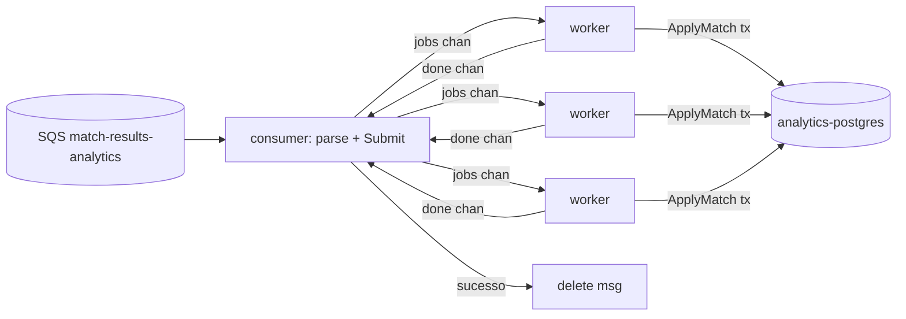

# Plan: 001-match-analytics

**Spec:** specs/001-match-analytics/spec.md
**Data:** 2026-07-04
**ADR:** 0021

## Abordagem técnica

Serviço novo (hexagonal, ADR-0002). O **worker pool é o core**: o consumidor SQS (driving adapter) desserializa e faz `Submit` num channel; **N workers** puxam e agregam via `repo.ApplyMatch` (tx idempotente por `matchId`, mesmo padrão da spec 006). O consumidor espera o resultado de cada mensagem (channel `done`) e **deleta só no sucesso** (at-least-once → DLQ em falha). Postgres arbitra a concorrência (row lock no UPSERT do rollup); a idempotência vem do `processed_matches`.

## Arquivos

- `migrations/001_create_analytics.sql` — `processed_matches(match_id pk, game_id)`, `game_rollup(game_id pk, matches_total, participations, wins, score_sum)`, `game_player_seen(game_id, player_id, pk composto)`, `game_daily(game_id, day, matches, pk (game_id,day))`.
- `internal/domain/analytics.go` — `MatchResult` (gameId, matchId, players[{id, won, score}]), `GameStat`, `Overview`, `GameAnalytics`, `DailyPoint`; Ports `MatchRepository` (ApplyMatch, Overview, GameAnalytics) + `Ingestor` (Submit).
- `internal/repository/postgres_analytics.go` — `ApplyMatch(ctx, m) (dup, err)` numa tx (dedup + UPSERT rollup/daily + player_seen); `Overview(ctx)`; `GameAnalytics(ctx, gameID, days)`. Querier interface (pool/tx) como na 006.
- `internal/service/pool.go` — **worker pool**: `jobs chan job{match, done chan error}`; `Start(ctx)` sobe N workers (`WaitGroup`); `Submit(ctx, match) <-chan error`; `Stop()` (close + wait). Métricas.
- `internal/service/reader.go` — `Overview`/`GameAnalytics` (delega ao repo; avgScore = score_sum/participations).
- `internal/consumer/consumer.go` — SQS long-poll; por batch: parse → `Submit` → coleta `done` → delete no sucesso. `internal/awsx/` (réplica da 006).
- `internal/transport/http_handler.go` — `GET /admin/analytics/overview`, `GET /admin/games/{gameId}/analytics`.
- `cmd/server/main.go` — wire: pool pgx (otelpgx), SQS client, `pool.Start`, `consumer.Run` (goroutine), HTTP (read API + /metrics + /healthz), graceful shutdown (para consumer → `pool.Stop`).
- `Dockerfile`.

## Decisões

- **Worker pool com `done` por mensagem**: o consumidor precisa do resultado para deletar (at-least-once). `Submit` devolve `<-chan error`; o consumidor fan-in dos `done` do batch.
- **Rollup pré-agregado** (C1 do ADR-0021): UPSERT incremental; jogadores únicos numa tabela `game_player_seen` (`count` no read; `count(distinct)` global no overview).
- **Idempotência transacional** por `matchId` (dedup + agregação na mesma tx) — reusa a lição da 006 (querier pool/tx).
- **`WORKERS`** via env (default 4); **`ANALYTICS_QUEUE_URL`** aponta a fila.
- Read por-jogo existe no serviço, mas o painel v1 só usa o overview (spec admin-bff/009).

## Ordem

1. migrations + domain. 2. repository (+ teste de integração: agregação + idempotência + únicos). 3. worker pool (+ teste `-race`: N submits concorrentes; Stop drena). 4. consumer + awsx. 5. transport read API (+ teste httptest). 6. main + Dockerfile. 7. infra (Terraform fila + compose + prometheus). 8. `go test -race` + build.

## Riscos

- **Backpressure**: `jobs` com buffer pequeno → `Submit` bloqueia sob carga (ok: aplica contrapressão no consumidor). `ctx` cancela o `Submit` no shutdown.
- **Contagem única**: `game_player_seen` cresce; ok no volume de dev (índice pela PK composta).
- **Shutdown ordenado**: parar o consumidor ANTES do `pool.Stop()` (senão Submit em pool fechado). Sequência explícita no main.
