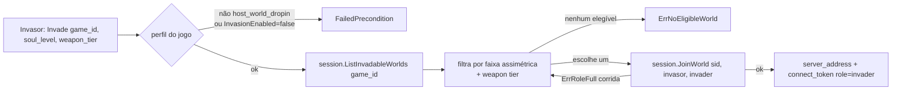

# Spec: 006-world-discovery-invade

**Serviço:** matchmaking-service
**Status:** Done (2026-07-07)
**Data:** 2026-07-07
**ADR:** 0023 (perfil de multiplayer por jogo) — **arquétipo `host_world_dropin`, fatia H1a** (lado matchmaking: descoberta + injeção)
**Roadmap:** `docs/game-models/host_world_dropin-roadmap.md` → H1a
**Depende de:** `session/012` (diretório de mundos + atributos do host) e `session/011` (`JoinWorld`).

## Contexto

Hoje o matchmaking tem **um modo**: queue-form FIFO. Tickets do mesmo jogo se acumulam, e quando juntam `Size` jogadores, forma um match novo e provisiona uma sessão (`CreateSession`). É o modelo do `queue_arena`.

O `host_world_dropin` (ficha 01) exige um **segundo modo, assimétrico**: o invasor **não forma partida** — ele **descobre um mundo aberto elegível e é injetado nele** (o host não escolhe). É a primeira vez que o matchmaking **entra numa sessão existente** em vez de criar uma. Esta é a novidade estrutural da H1a.

O fluxo:

Esta spec cobre o **lado matchmaking**: ler o perfil, listar mundos (via `session/012`), aplicar a **elegibilidade por faixa** (a matemática mora aqui, testável isolada), escolher um e **injetar** via `JoinWorld` (H0). O co-op por sinais é H1b.

## Comportamento

### Descobrir e injetar (invasão)

- WHEN o invasor chama `Invade(gameID, soulLevel, weaponTier)` para um jogo cujo perfil é `host_world_dropin` **com invasão habilitada** → THE SYSTEM SHALL listar os mundos invadíveis do jogo (`session.ListInvadableWorlds`), filtrar os **elegíveis** por faixa (e weapon tier, se o perfil exigir), **escolher um** e injetar o invasor (`session.JoinWorld` com papel `invader`), devolvendo o **endereço do server** e o **connect token** do invasor (claim `role=invader`).
- IF o perfil do jogo **não** é `host_world_dropin`, ou é mas com `InvasionEnabled=false` → THE SYSTEM SHALL rejeitar com `FailedPrecondition` (**ErrInvasionNotSupported**). Só esse arquétipo, com invasão ligada, aceita `Invade`.
- IF **nenhum** mundo é elegível (lista vazia, ou nenhum na faixa) → THE SYSTEM SHALL responder **ErrNoEligibleWorld** (`NotFound`) — o invasor tenta de novo mais tarde (não há fila de espera nesta fatia).
- IF o mundo escolhido **encheu** entre listar e injetar (`JoinWorld` → `ErrRoleFull`) → THE SYSTEM SHALL **tentar o próximo** mundo elegível; esgotados os candidatos → `ErrNoEligibleWorld`. A corrida listar→injetar não é erro: é re-tentável.
- IF o perfil não pode ser lido (rede, jogo inexistente) → THE SYSTEM SHALL propagar a indisponibilidade (`ErrProfileUnavailable` → o transport decide o code; provável `FailedPrecondition`/`Unavailable`).

### Elegibilidade por faixa (a política, no matchmaking)

- THE SYSTEM SHALL calcular a elegibilidade de um mundo a partir do **soul level do invasor** e do **soul level do host** do mundo, com uma **faixa assimétrica** (ficha 01, §4: o invasor entra numa banda em torno do nível do host; invasão "punge para cima"). A fórmula exata é uma **função de domínio pura, testável** (parâmetros no plan); o comportamento observável é: hosts fora da banda **não** são elegíveis.
- WHEN o perfil tem `WeaponTierEnabled=true` → THE SYSTEM SHALL exigir também compatibilidade de weapon tier (banda simples); `false` → ignora o weapon tier.
- WHEN o perfil tem `LevelRangeEnabled=false` → THE SYSTEM SHALL **não** filtrar por faixa (qualquer mundo aberto com vaga é elegível) — jogo que declara invasão sem range casa por vaga apenas.
- WHEN vários mundos são elegíveis → THE SYSTEM SHALL escolher **um** (critério simples nesta fatia — ex.: o primeiro/menos populado; decisão do plan). Sem MMR/skill (backlog).

### Isolamento do queue-form

- THE SYSTEM SHALL manter o `FindMatch` (queue-form, streaming) **inalterado**. `Invade` é uma operação **nova e independente**: não usa a fila, não forma match, não chama `CreateSession`.

## Contratos de Interface

### Protobuf (`matchmaking/v1/matchmaking.proto`)

- Novo RPC **unary** `Invade(InvadeRequest{ string game_id; int32 soul_level; int32 weapon_tier }) → InvadeResponse{ string session_id; string server_address; string connect_token }`. O `playerID` do invasor vem do **JWT** (interceptor, como no `FindMatch` — não é campo do request).
- `FindMatch`/`TicketUpdate` — **inalterados**.
- Regenerar com `buf`.

### Ports (domínio)

- **Novo** `WorldDirectory` (Port de saída, implementada pelo `sessionclient`): `ListInvadableWorlds(ctx, gameID) ([]InvadableWorld, error)` + tipo `InvadableWorld{ SessionID string; HostSoulLevel, WeaponTier, FreeInvaderSlots int }` (espelha `session/012`).
- **Novo** `WorldInjector` (Port de saída, `sessionclient`): `Inject(ctx, sessionID, playerID, role) (Injected, error)` com `Injected{ ServerAddress, ConnectToken string }`; mapeia `codes.ResourceExhausted`→`ErrRoleFull`, `NotFound`→`ErrWorldNotFound`. *(Pode ser um método a mais no adapter existente; nomes no plan.)*
- **`ProfileProvider`** ganha a leitura do **perfil host_world** (hoje o `Format` só entende `queue_arena`): expor `archetype` + `InvasionEnabled`/`LevelRangeEnabled`/`WeaponTierEnabled`. Decisão do plan: novo método (ex.: `InvasionPolicy(ctx, gameID)`) vs. estender o retorno. O `registryclient` já bate no mesmo endpoint `/multiplayer-profile`.
- **Novo** serviço de aplicação para a invasão (ex.: `Invader` ou método no serviço) — a matemática da faixa é função pura testável; o service orquestra profile→list→filter→inject.
- **`SessionProvisioner`** (queue-form) e o **`Matchmaker`** — inalterados.

### Erros de domínio (novos)

- `ErrInvasionNotSupported` → `FailedPrecondition` (arquétipo errado ou invasão desligada).
- `ErrNoEligibleWorld` → `NotFound` (nenhum mundo na faixa / todos cheios).
- Reusa `ErrProfileUnavailable`; `ErrRoleFull`/`ErrWorldNotFound` (do injetor) são internos ao retry.

## Modelo de Dados

Sem estado novo persistente. A invasão é **stateless** no matchmaking: uma chamada resolve na hora (lista→filtra→injeta) ou falha. Não há ticket, não há fila (diferente do `FindMatch`).

## Observabilidade

- Contadores `invasions_total{result="injected|no_world|not_supported"}` — o funil de invasão no dashboard (H3).
- Tracing: `Invade` no otelgrpc global; spans das chamadas ao session herdam via otelgrpc client.

## Fora de escopo

- **Co-op por sinais** (quadro de sinais, host escolhe) — H1b (`matchmaking/007`).
- **Senha (play-with-friends)** — follow-up (o `session/012` também adiou a senha).
- **Fila de espera de invasão** (esperar um mundo aparecer) — não; nesta fatia a ausência de alvo é resposta imediata (`ErrNoEligibleWorld`).
- **MMR/skill na escolha do mundo** — backlog; escolha simples aqui.
- **Resultado da invasão** (invasor matou host / morreu) → H2 (eventos de participação).
- **Data plane** que encarna o mundo e lê o `role` do token — cross-repo (`go-game-host-world-dropin-dataplane`, ⬜ planejado).

## Critérios de Aceite

- [ ] `Invade` num jogo `host_world_dropin` com invasão ligada e um mundo elegível → injeta e devolve server + connect token com claim `role=invader`.
- [ ] Jogo não-`host_world_dropin` ou `InvasionEnabled=false` → `ErrInvasionNotSupported` (`FailedPrecondition`).
- [ ] Nenhum mundo, ou nenhum na faixa → `ErrNoEligibleWorld` (`NotFound`).
- [ ] Mundo escolhido enche na corrida (`ErrRoleFull`) → tenta o próximo elegível; esgotados → `ErrNoEligibleWorld`.
- [ ] `LevelRangeEnabled=false` → casa por vaga sem filtrar faixa; `true` → hosts fora da banda excluídos (função de faixa testada isolada).
- [ ] `WeaponTierEnabled=true` → weapon tier incompatível exclui o mundo.
- [ ] `FindMatch` (queue-form) sem regressão; testes com `-race`, ≥80% em `service/`/`domain/`.
