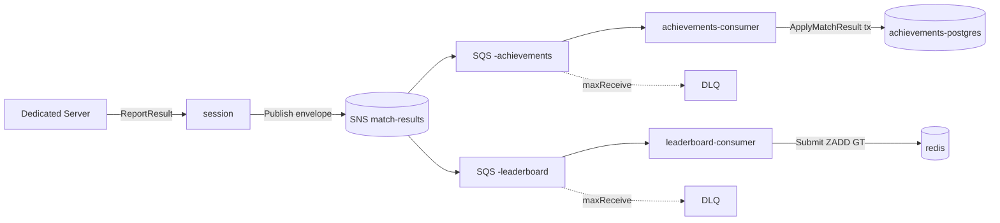

# Plan: 006-durable-fanout

**Spec:** specs/006-durable-fanout/spec.md
**Data:** 2026-07-04
**ADR:** 0020

## Abordagem técnica

Três frentes: **produtor** (session publica no SNS), **dois consumidores** (achievements e leaderboard leem SQS), **infra** (LocalStack + recursos). O contrato entre eles é o **envelope JSON** — não um tipo Go compartilhado; cada lado (des)serializa só os campos que usa (mensageria desacoplada). Endpoint AWS configurável (`AWS_ENDPOINT_URL`), igual ao MinIO/S3 do cloud-save.

## Produtor — session-service

- `internal/publisher/sns_publisher.go` (+ test) — `SNSPublisher` satisfaz `domain.ResultPublisher`. `Publish(ctx, gameID, results)` monta o envelope `{schemaVersion:1, matchId, gameId, results:[{playerId,won,score}]}` e chama `sns.Publish`. **Nota:** o `Publish` da Port não recebe `matchID` hoje — o service precisa passá-lo. Ajustar a assinatura `ResultPublisher.Publish(ctx, gameID, matchID, results)` **ou** o service serializa e injeta (decisão: estender a assinatura, é mais limpo).
- `internal/service/session_service.go` — `ReportResult`: passa `matchID` ao `Publish`; **se `Publish` falhar, retorna erro e NÃO encerra a sessão** (deixa o retry do Dedicated Server; TTL sweeper cobre a órfã). Sucesso → encerra/libera como hoje.
- `cmd/server/main.go` — `buildPublisher`: se `MATCH_RESULTS_TOPIC_ARN` setado → `SNSPublisher`; senão `LogPublisher` (fallback dev). Remove o ramo Composite/HTTP.
- **Remover:** `internal/publisher/{achievements_publisher,leaderboard_publisher,composite}.go` (+ testes) e as envs `ACHIEVEMENTS_URL`/`LEADERBOARD_URL`/`INTERNAL_API_KEY` do fan-out — a tradução migra para os consumidores.

## Consumidor — achievements-service (idempotência **necessária**)

`RecordEvent` **incrementa** progresso → não é idempotente; SQS é at-least-once → dedup por `matchID`.

- `cmd/consumer/main.go` — long-poll SQS (`WaitTimeSeconds=20`, `MaxNumberOfMessages=10`); por mensagem: desserializa envelope → `service.ApplyMatchResult` → sucesso: `DeleteMessage`; erro: **não deleta** (volta após visibility timeout; redrive → DLQ). Graceful shutdown com `context` + `sync.WaitGroup` (regra de goroutines). Sobe HTTP mínimo só `/metrics` + `/healthz` (scrape Prometheus).
- `migrations/004_processed_matches.sql` — `processed_matches(match_id text primary key, processed_at timestamptz default now())`.
- `internal/service/achievement_service.go` — novo `ApplyMatchResult(ctx, gameID, matchID, results)`: numa **única tx pgx** — `INSERT INTO processed_matches ON CONFLICT DO NOTHING`; se 0 linhas → dup, no-op; senão aplica `match_played` (todos) + `match_won` (`won`) por player **na mesma tx** e commita. Atomicidade marca+efeito → sem dobra em reentrega nem em crash.
- `internal/repository/...` — expor os métodos aceitando um querier/`pgx.Tx` (executor injetável) para participar da tx do `ApplyMatchResult`.

## Consumidor — leaderboard-service (idempotência **intrínseca**)

`store.Submit` usa `ZADD GT` (só sobe se maior) → **reprocessar a mesma partida é no-op**. **Não precisa dedup.**

- `cmd/consumer/main.go` — mesmo esqueleto SQS/shutdown/metrics do achievements; por mensagem: para cada `result` chama `service.Submit(gameID, playerID, score)`; sucesso → delete. Sem tabela/chave de dedup (registrar o porquê num comentário: highscore é idempotente).

## Infra

- `infra/docker/docker-compose.yml` — serviço `localstack` (`SERVICES=sns,sqs`), healthcheck; `session` ganha `MATCH_RESULTS_TOPIC_ARN` + `AWS_ENDPOINT_URL`; dois serviços novos `achievements-consumer` / `leaderboard-consumer` (mesma imagem do serviço, entrypoint no binário consumer; envs de fila + banco/redis). Prometheus scrape dos dois consumers; **decisão de infra abaixo**.
- Config AWS: helper que monta `aws.Config` com `BaseEndpoint`+region+static creds (padrão do `cloud-save/internal/storage/s3_store.go`).

## Decisões abertas (pedem seu OK na revisão)

1. **Onde vive o helper de config AWS + client SNS/SQS?**
   - (a) **Replicar por serviço** (`internal/awsx/`) — não toca `shared/`, alinhado ao que o cloud-save já fez inline. *Recomendado p/ MVP.*
   - (b) Promover para **`shared/awsx`** — DRY, mas **modifica `shared/` (regra: requer seu OK)**.
2. **Provisionamento dos recursos (SNS/SQS/DLQ):**
   - (a) **Terraform mínimo** em `infra/terraform/environments/local/messaging/` apontando LocalStack — **estreia o Terraform no projeto**, alinha ADR-0004/0020, mesmo `.tf` roda contra AWS depois. *Recomendado (é o que a spec/ADR dizem).*
   - (b) Script de init do LocalStack (`awslocal` em `ready.d/`) — mais leve, adia Terraform. Fallback se quiser não abrir a caixa do Terraform agora.
   - Testes **não** dependem disso: testcontainers-localstack cria os recursos via SDK no setup.

## Observabilidade (obrigatória)

- Produtor: `fanout_publish_total{result="ok|error"}`.
- Cada consumidor: `fanout_consume_total{result="ok|dup|error"}` + histograma de duração; `/metrics`+`/healthz`; job no Prometheus. Tracing OTel propagado via atributo no envelope (best-effort; se custar, fica p/ refinamento).
- DLQ depth (`ApproximateNumberOfMessages`) como métrica derivada — **nice-to-have**, pode ficar fora do MVP.

## Ordem

1. `SNSPublisher` + ajuste da Port/`ReportResult` + `main` (session) + testes (testcontainers-localstack).
2. Achievements: migration `processed_matches` + repo tx + `ApplyMatchResult` + `cmd/consumer` + testes de idempotência.
3. Leaderboard: `cmd/consumer` + testes (reentrega = no-op via GT).
4. Infra: LocalStack no compose + provisionamento (decisão 2) + os dois consumers no compose + scrape.
5. `go test ./... -race` + `go build ./...`; validar o loop no Docker (ReportResult → SNS → 2 filas → achievements/leaderboard refletem; matar um consumer → mensagem espera na fila e é processada ao voltar; forçar erro → DLQ).

## Riscos

- **at-least-once**: coberto por dedup (achievements) e GT (leaderboard); testes de reentrega obrigatórios.
- **Assinatura da Port**: estender `Publish` com `matchID` toca `domain` + os fakes de teste — mudança pequena, mas mapear todos os implementadores.
- **Envelope evolutivo**: `schemaVersion` já no envelope; consumidores ignoram campos desconhecidos.
- **Consumer sem lifecycle** = goroutine vazando: `context`+`WaitGroup` obrigatórios (regra do projeto).
- **Estreia do Terraform** (se decisão 2a): dimensionar mínimo, só o módulo messaging local.
