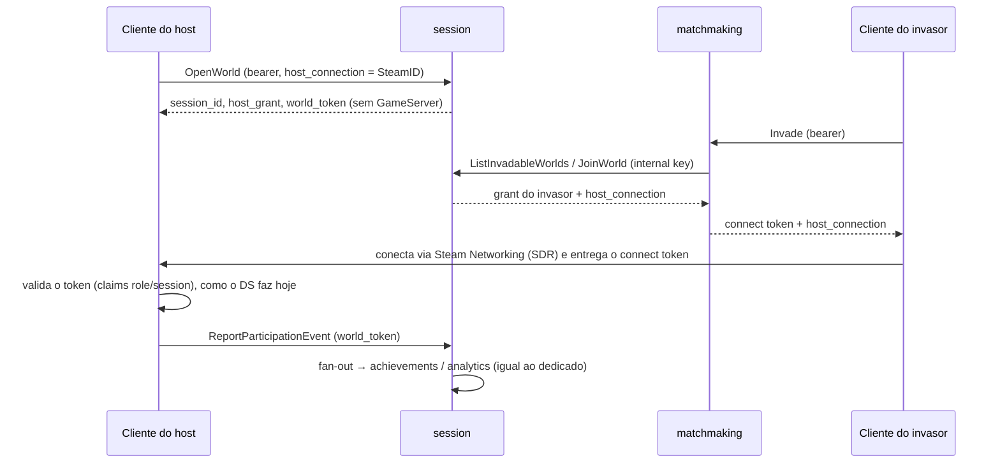

# Spec: 031-p2p-topology

**Serviço:** session-service (+ matchmaking-service, game-registry, admin-bff, admin-ui, proto `session.v1`)
**Status:** Done no backend (2026-09-27); o netcode do jogo segue no repo do jogo
**Data:** 2026-09-26
**ADR:** [0032](../../../../docs/adr/0032-p2p-host-world-topology.md) · rascunho B de `docs/review/ESTRATEGIA-PRODUTO-2026-09.md`

## Contexto

Hoje todo mundo do `host_world_dropin` aloca um GameServer (Agones/Unity DS). É o modelo mais robusto e o mais caro:
paga-se CPU por hora de mundo aberto, mesmo com o host jogando sozinho a maior parte do tempo. Os Souls da
FromSoftware fazem o contrário: o **cliente do host** roda a simulação e os servidores da From só fazem matchmaking,
sinais e mensagens. O perfil já reserva `topology: p2p` (ADR-0023), mas o registry e o session rejeitam o valor.

Esta spec liga `p2p` no arquétipo `host_world_dropin`. Os outros arquétipos continuam só `dedicated`.

## O que muda e o que não muda

Igual ao dedicado: diretório de mundos, slots por papel, faixa, senha, modo, connect token, eventos de participação,
fan-out, conquistas, analytics, telas do admin. Muda: **quem hospeda** (o cliente do host), **o endereço** (um
identificador de conexão no lugar de `ip:porta`) e **quem reporta** (o cliente do host, com uma credencial por mundo).

## Comportamento (EARS)

1. **Quando** o `OpenWorld` chegar para um modo cujo perfil tem `topology: p2p`, o session **deve** registrar o mundo
   sem chamar o allocator e guardar o `host_connection` recebido.
2. **Se** um mundo `p2p` for aberto sem `host_connection`, o session **deve** responder `InvalidArgument`.
3. **Quando** o mundo for `p2p`, o `OpenWorldResponse` **deve** trazer `server_address` vazio, `host_connection`
   ecoado e um `world_token` (credencial do host para reportar eventos daquele mundo, e só dele).
4. **Quando** o `JoinWorld` injetar alguém num mundo `p2p`, a resposta **deve** trazer `host_connection` no lugar de
   `server_address`; o matchmaking **deve** repassá-lo no `Invade`/`SummonSign`.
5. **Quando** chegar `ReportParticipationEvent`/`CloseWorld`/`LeaveWorld`/`GetSessionConfig` com metadata `x-world-token`, o session
   **deve** aceitá-lo só para o `session_id` do token (outro mundo → `PermissionDenied`).
6. **Se** o cliente do host cair sem chamar `CloseWorld`, o session **deve** fechar o mundo pelo TTL sweeper que já
   existe (`Sweep`); não há GameServer para liberar nem reconciliação de órfãs.
7. O game-registry **deve** aceitar `topology: p2p` só em `host_world_dropin`; nos outros arquétipos continua 422.
8. O admin **deve** mostrar a topologia: badge por modo nas Configurações de multiplayer e, em Salas, "P2P · host"
   no lugar do endereço do servidor. Frota (Agones) segue valendo só para os modos dedicados.

## Regras acrescentadas pela revisão de código (2026-09-27)

9. **Se** o host p2p reportar evento de um jogador que nunca esteve no mundo, o session **deve** recusar
   (`InvalidArgument`) — o host pode mentir sobre o próprio mundo, não forjar conquista para qualquer conta.
10. **Quando** o mundo fechar, o world token **deve** continuar valendo **só** para reenviar o evento que o fechou
    (spec 029: `HOST_KILLED` cujo publish falhou); qualquer outra chamada com ele é `Unauthenticated`. A janela é a
    mesma do histórico em memória.
11. Um host tem **no máximo um mundo p2p aberto**: abrir outro fecha o anterior (`host_left`). `host_connection`
    tem até 128 caracteres, sem espaço nem caractere de controle.

## Contrato (aditivo — contrato 1.4.0)

- `OpenWorldRequest.host_connection = 7` — identificador opaco de conexão do host (ex.: SteamID64 para Steam
  Networking Sockets). O backend não interpreta.
- `OpenWorldResponse.host_connection = 4`, `OpenWorldResponse.world_token = 5`.
- `JoinWorldResponse.host_connection = 3`.
- Metadata nova `x-world-token` (ADR-0030 ganha um quarto tipo de chamador: host p2p).
- Proto do matchmaking: `host_connection` na resposta de `Invade`/`SummonSign`.

## Confiança (decisão explícita)

Em `p2p` o host pode mentir nos reports (matar o boss sem ter matado, negar a morte do invasor). É a mesma confiança
que a From dá ao host. Mitigações baratas, fora desta spec: conquistas sensíveis só com evento de mais de um
participante; analytics marca a origem (`dedicated`/`p2p`) para o operador separar números.

## Critérios de aceite

- Unit: `OpenWorld` p2p não chama o allocator; sem `host_connection` → `InvalidArgument`; `world_token` de um mundo
  rejeitado em outro; `JoinWorld` devolve `host_connection`.
- Integração: registry aceita `p2p` em `host_world_dropin` e rejeita em `queue_arena`.
- `buf breaking` verde (só campos novos); `docs/contracts/CHANGELOG.md` 1.4.0.
- Demo: variante p2p do `scripts/demo-host-world.sh` fecha o ciclo sem Agones.

## Fora de escopo

- O netcode no jogo (NGO com transporte Steam no modo host) — decisão do repo do jogo.
- Migração de host, relay próprio, anti-cheat.
- `p2p` em `queue_arena`/`battle_royale`/`coop_mission`.
- **Heartbeat do mundo — feito na spec `032-world-heartbeat`:** o sweeper fecha por **idade** (`SESSION_TTL`, 30 min), não por inatividade —
  já era assim para mundos dedicados. Em p2p o TTL é o único detector de host caído, e ele também fecha mundos
  saudáveis com mais de 30 min. O certo é um heartbeat do host (RPC novo, contrato aditivo) e TTL por última
  atividade; fica para uma spec própria.
